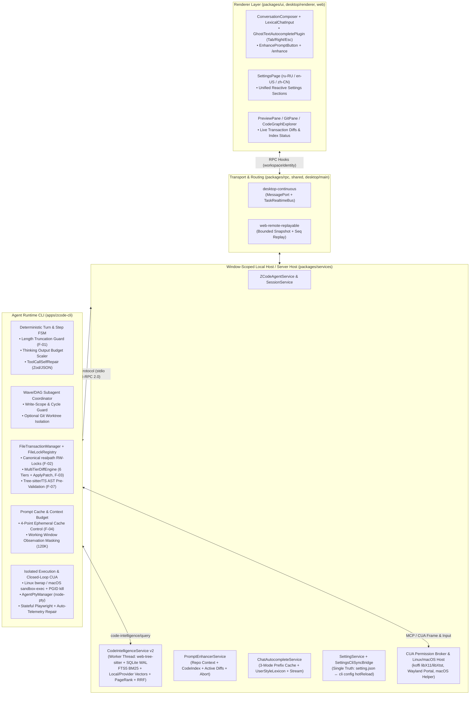
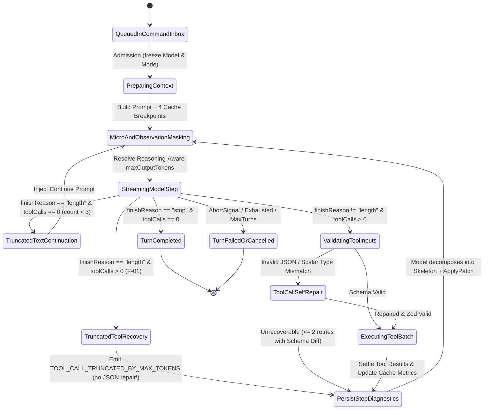
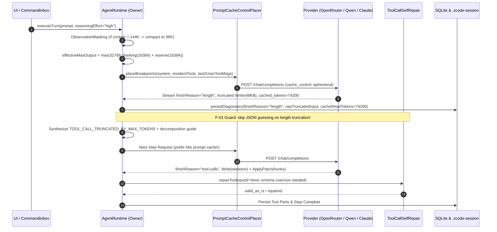
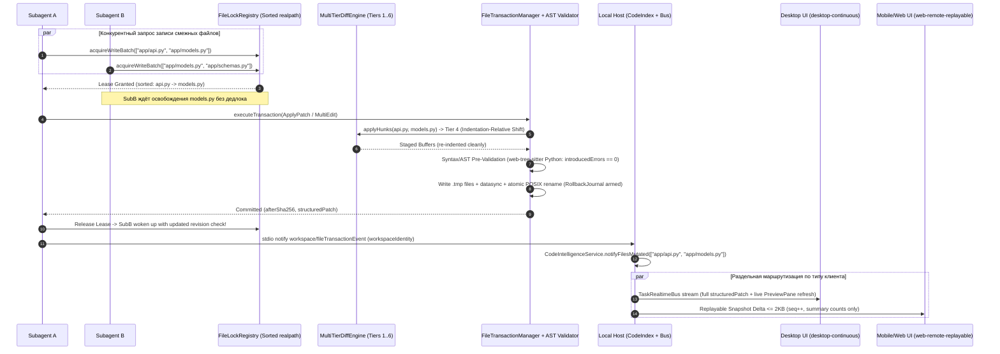
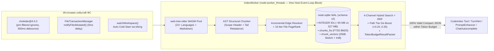
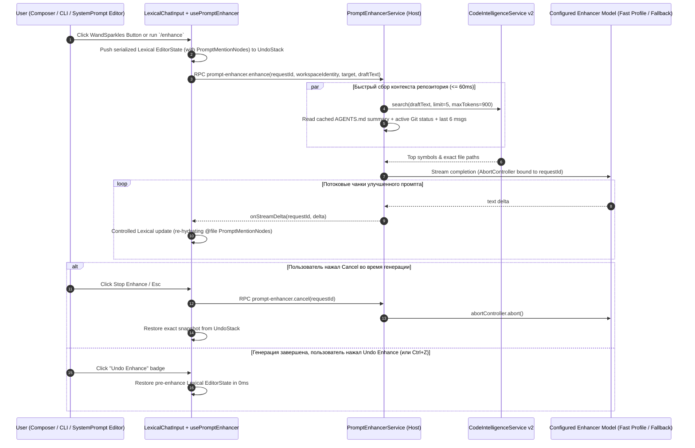
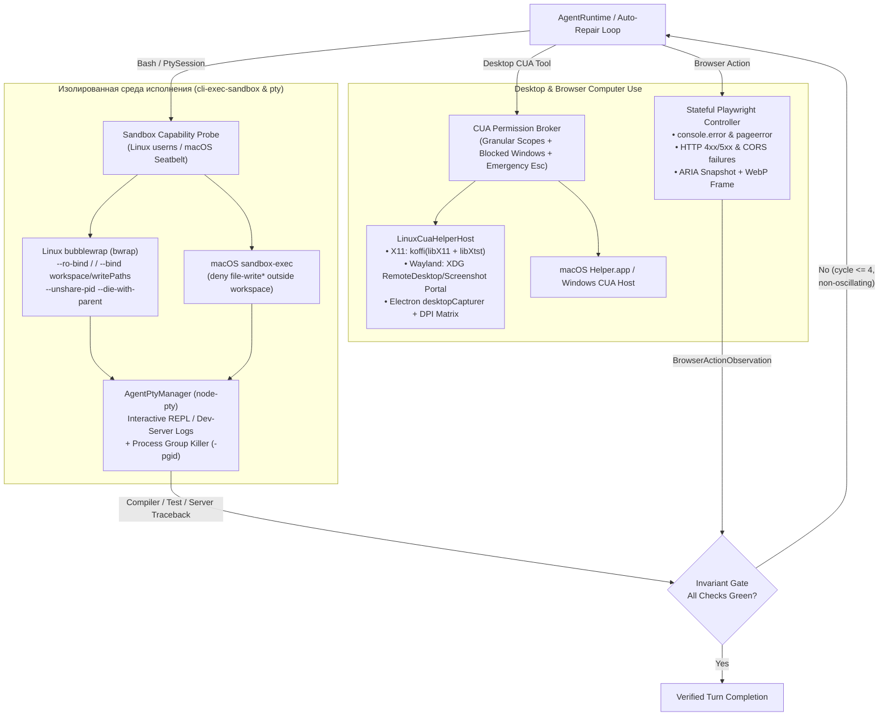
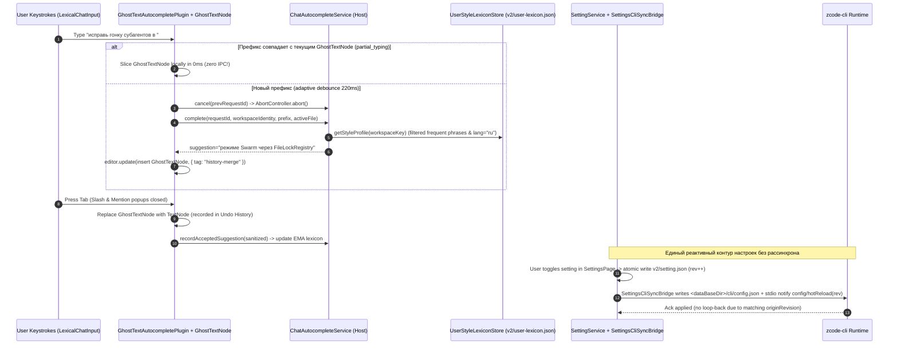
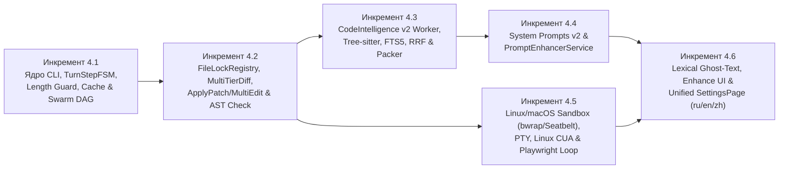

# Этап 3: Целевая архитектура Zcode, контракты взаимодействия модулей, спецификации, план пошаговой миграции и критерии приёмки

**Дата спецификации:** `2026-11-16`  
**Целевой монорепозиторий:** `<home>/Desktop/git/Zcode` (ветка `main`, среда `Node.js 24.14.0`, `pnpm 10.33.2`, `Electron 41.0.3`, лицензия `Apache-2.0`)  
**Входные артефакты:**
- [`docs/architecture/stage1-forensic-audit-and-baseline.md`](stage1-forensic-audit-and-baseline.md) — криминалистический аудит сессии `session_dee7732e677519c63e3dd10d5eeeaaff`, реестр корневых сбоев `F-01`–`F-07` и инструментальные baseline-метрики.
- [`docs/architecture/stage2-comparative-oss-research.md`](stage2-comparative-oss-research.md) — исходно-кодовый разбор `kilocode-legacy-main` и матрица отбора пермиссивных (`Apache-2.0` / `MIT` / `BSD`) OSS-алгоритмов.
- [`AGENTS.md`](../../AGENTS.md), [`DESIGN.md`](../../DESIGN.md), [`architecture-policy.yaml`](../../architecture-policy.yaml) — обязательные архитектурные, протокольные и UI-ограничения репозитория.

Настоящий документ является **прямым инженерным чертежом для Этапа 4 (Реализация инкрементов 4.1–4.6)**. Все контракты типов, Zod-схемы, реляционные таблицы SQLite, RPC-каналы, автоматы состояний и последовательность миграции зафиксированы однозначно и без заглушек.

---

## 0. Глобальные архитектурные инварианты и границы слоёв

Любой код, создаваемый или изменяемый на Этапе 4, обязан неукоснительно соблюдать 6 системных инвариантов Zcode:

1. **Политика управляемых модулей ([`architecture-policy.yaml`](../../architecture-policy.yaml:2100)):**
   - Глобальный гейт `pnpm architecture:check --changed` принудительно проверяет `managedOnly: true` (`newFilesEnforcedSince: "2026-09-10"`), `forbidCycles: true`, `forbidDeepImports: true`, `maxFileLines: 800`, `maxContractLines: 300`, `maxPublicMethods: 12`.
   - **Следствие для Этапа 4:** каждый новый функциональный контур создаётся не россыпью файлов в legacy-корне пакета, а изолированным **управляемым модулем (`managed: true`)** с собственными публичными точками входа `contract.ts` + `index.ts` и регистрируется в [`architecture-policy.yaml`](../../architecture-policy.yaml:1).
2. **Единственный владелец бизнес-состояния сессии и хода (`Single Source of Truth`):**
   - Единственным владельцем истории сообщений, состояния хода (`TurnMachineImpl`), очереди входящих команд во время выполнения (`CommandInbox`) и реестра дочерних задач (`runtimeTaskRegistry`) остаётся `AgentRuntime` в [`apps/zcode-cli/packages/core`](../../apps/zcode-cli/packages/core/src/runtime/agent-runtime.ts:349).
   - Electron `Main` ([`packages/desktop/src/main`](../../packages/desktop/src/main/task-realtime-bus/index.ts:1)) и внешний Relay маршрутизируют окна, процессы и шину `TaskRealtimeBus`, не сохраняя у себя состояние задач или очередей.
   - `Renderer` ([`packages/ui`](../../packages/ui/src/Root.tsx:1)) хранит исключительно неотправленный черновик композера (`composerDraftStore`), локальный эфемерный UI-стейт (например, текущий `GhostTextNode`) и оптимистичный pending-оверлей до подтверждения от `CommandInbox`.
3. **Строгие границы доступа UI и сервисов:**
   - Компоненты в `packages/ui` обращаются к бизнес-сервисам **только** через React-хуки в `packages/ui/src/hooks/` (`useServices()`, `usePlatform()`, `useSettings()`) и платформенный контракт [`IPlatformService`](../../packages/shared/src/platform.ts:1); прямые обращения к `window.zcode`, Node API или SQLite-репозиториям из UI запрещены.
   - Бизнес-сервисы в `packages/services` не импортируют внутренние детали реализации `apps/zcode-cli`, взаимодействуя с рантаймом исключительно через типизированный JSON-RPC 2.0 поверх `stdio` ([`packages/shared/src/zcode-protocol/index.ts`](../../packages/shared/src/zcode-protocol/index.ts:1)).
4. **Изоляция рабочих пространств (`Workspace Identity`):**
   - Ключ изоляции для всех кэшей, SQLite-индексов, файловых блокировок, подписок, очередей и автодополнения вычисляется единообразно:
     ```ts
     const workspaceKey = workspaceIdentity?.trim() || workspacePath;
     ```
   - Поле `workspacePath` используется **только** для реальных операций ФС, `cwd` дочерних процессов, Git и визуального отображения пути на целевом хосте. На удалённых/SSH/мобильных маршрутах `workspaceIdentity` и `remoteSessionId` пробрасываются сквозным образом.
5. **Разделение контуров доставки `desktop-continuous` и `web-remote-replayable`:**
   - **`desktop-continuous`:** высокочастотный потоковый канал `CLI stdio → Window-Scoped Local Host → Electron Main TaskRealtimeBus → Desktop Renderer` для живых дельт текста/рассуждений, прогресса индексации и мгновенных превью диффов транзакций.
   - **`web-remote-replayable`:** устойчивый к обрывам связи и переподключениям мобильный/веб-канал с идемпотентными порядковыми номерами (`seq`), коалесцированными сводками изменений и строгим соблюдением байтового бюджета снимков ([`docs/web-remote-control/snapshot-byte-budget.md`](../web-remote-control/snapshot-byte-budget.md:1)).
6. **Дизайн-система и наблюдаемость:**
   - Весь новый UI в `packages/ui` использует только типографическую шкалу `text-ui-*` (`text-ui-xs`, `text-ui-sm`, `text-ui-caption`, `text-ui-base`, `text-ui-lg`, `text-ui-xl`, `text-ui-settings-title`) и семантические цветовые токены из [`DESIGN.md`](../../DESIGN.md:14).
   - Логирование в UI выполняется через [`packages/ui/src/logger.ts`](../../packages/ui/src/logger.ts:1), в сервисах — через [`createServiceLogger(scope)`](../../packages/services/src/logger/serviceLogger.ts:1) без записи секретов, API-ключей и приватных URL.

### Общая топология целевой архитектуры Zcode (Этап 3 → Этап 4)



---

## 1. Блок 1 (Инкремент 4.1) — Оздоровление ядра Zcode, автомат сессий, самовосстановление вызовов инструментов, кэширование и многоагентная оркестрация

**Устраняемые корневые дефекты Этапа 1:** `F-01` (слепота к `finishReason === "length"` при обрыве аргументов инструментов и съедание квоты блоком `thinking`), `F-02` (частично: оркестрация субагентов и квоты владения путями), `F-04` (`cacheReadTokens = 0` и бесконтрольное разбухание контекста до `444K` токенов), `F-06` (потеря диагностических полей в SQLite и `.zcode-session`).

### 1.1. Затрагиваемые и создаваемые файлы монорепозитория

| Статус | Путь файла / Управляемый модуль | Назначение и архитектурная граница |
| --- | --- | --- |
| **NEW (managed)** | `apps/zcode-cli/packages/core/src/tool/self-repair/{contract.ts,index.ts,json-repair.ts,zod-coercion.ts,truncation-recovery.ts}` | Управляемый модуль `cli-tool-self-repair`: детерминированное восстановление аргументов tool call, приведение типов по JSON Schema/Zod и генерация self-healing ответов при усечении `maxOutputTokens`. |
| **NEW (managed)** | `apps/zcode-cli/packages/adapters/src/model/cache-control/{contract.ts,index.ts,breakpoint-placer.ts,provider-matrix.ts}` | Управляемый модуль `cli-model-cache-control`: расстановка стабильных точек `cache_control` для OpenRouter / `openai-compatible` / Anthropic / Gemini и нормализация метрик `cacheReadTokens` / `cacheWriteTokens`. |
| **MOD** | [`apps/zcode-cli/packages/core/src/runtime/methods/turn-output-token-continuation.ts`](../../apps/zcode-cli/packages/core/src/runtime/methods/turn-output-token-continuation.ts:27) | Расширение `classifyOutputTokenContinuation`: снятие слепого `if (input.toolCallCount > 0) return "none"` и перевод усечённых tool calls в детерминированную ветку `tool_call_truncated`. |
| **MOD** | [`apps/zcode-cli/packages/core/src/runtime/methods/turn-model-step.ts`](../../apps/zcode-cli/packages/core/src/runtime/methods/turn-model-step.ts:211) | Интеграция масштабирования выходного бюджета под `thinking`, перехват оборванных tool calls до `executeToolCallsForModelStep` и запись полной диагностики шага. |
| **MOD** | [`apps/zcode-cli/packages/core/src/runtime/methods/model-token-limits.ts`](../../apps/zcode-cli/packages/core/src/runtime/methods/model-token-limits.ts:17) | Формула `resolveReasoningAwareMaxOutputTokens` с гарантированным резервом под payload инструментов при активном `thinking` / `reasoningEffort`. |
| **MOD** | [`apps/zcode-cli/packages/core/src/tool/executor/call-runner.ts`](../../apps/zcode-cli/packages/core/src/tool/executor/call-runner.ts:235) | Встраивание `ToolCallSelfRepair` перед финальным отказом `validateInitialModelToolInput` с ограничением числа попыток и логированием `repairAttempts`. |
| **MOD** | [`apps/zcode-cli/packages/core/src/compact/microcompact.ts`](../../apps/zcode-cli/packages/core/src/compact/microcompact.ts:1) и `apps/zcode-cli/packages/core/src/runtime/methods/compact.ts` | Введение рабочего порога `softWorkingContextBudgetTokens = 120_000`, квантованного Observation Masking старых `Read`/`Bash`/`Grep` выводов и сохранения пар `reasoning + tool_use + tool_result`. |
| **MOD** | [`apps/zcode-cli/packages/core/src/runtime/methods/turn-swarm-execute.ts`](../../apps/zcode-cli/packages/core/src/runtime/methods/turn-swarm-execute.ts:52) и [`apps/zcode-cli/packages/core/src/runtime/methods/subagent/port.ts`](../../apps/zcode-cli/packages/core/src/runtime/methods/subagent/port.ts:550) | Волновой DAG-исполнитель субагентов с проверкой непересечения `writePaths` внутри волны, общим `FileLockRegistry`, бюджетами токенов/ходов и детектором циклов. |
| **MOD** | [`apps/zcode-cli/packages/contracts/src/interfaces/session-store.port.ts`](../../apps/zcode-cli/packages/contracts/src/interfaces/session-store.port.ts:1), `apps/zcode-cli/packages/adapters/src/storage/` и `packages/shared/src/zcode-protocol/index.ts` | Персистентность `finishReason`, `rawFinishReason`, `rawTruncatedInput`, `repairAttempts` и `stateTransitions` в SQLite `db.sqlite` и экспорте `.zcode-session`. |

### 1.2. Детерминированный конечный автомат хода (`TurnStepFSM`), масштабирование `maxOutputTokens` и `ToolCallSelfRepair`

#### А. Корень проблемы и новое поведение при `finishReason === "length"` (`F-01`)
В текущем коде [`turn-output-token-continuation.ts`](../../apps/zcode-cli/packages/core/src/runtime/methods/turn-output-token-continuation.ts:33) условие `if (input.toolCallCount > 0) return "none"` приводит к тому, что при достижении потолка `maxOutputTokens` посреди генерации JSON-аргументов `Write`/`Edit` оборванный вызов попадает в парсер, падает с `Unexpected end of JSON input`, и модель вслепую повторяет генерацию того же 50-килобайтного файла.

В целевой архитектуре классификатор расширяется до 4 детерминированных исходов:
- `"none"` — штатное завершение (`stop` / `tool-calls`);
- `"continue_text"` — усечение чисто текстового ответа без вызовов инструментов (`continuationCount < 3`);
- `"recover_truncated_tool_calls"` — `isOutputTokenLimitFinishReason(finishReason, rawFinishReason) && providerToolCallCount > 0`;
- `"exhausted"` — исчерпан лимит последовательных усечений (`MAX_TRUNCATED_STEP_RECOVERIES = 3`).

При исходе `"recover_truncated_tool_calls"`:
1. Завершённые без потерь read-only вызовы в начале пакета (если их JSON полностью закрыт и валиден по схеме) могут быть сохранены, а **любой оборванный или невалидный `tool_use` переводится в синтетический `ToolExecutionResult` с кодом `TOOL_CALL_TRUNCATED_BY_MAX_TOKENS`** без попытки выполнять мутацию на диске и без запуска `ToolCallSelfRepair` (категорически запрещено «додумывать» закрывающие кавычки у оборванного по длине кода файла!).
2. Модель получает точный структурированный `modelContent`:
   ```xml
   <tool_use_error code="TOOL_CALL_TRUNCATED_BY_MAX_TOKENS">
   Tool call "Write" (id: call_xxx) was truncated because the response hit maxOutputTokens=16384 (reasoningTokens=6120, outputTokens=16384, rawInputBytes=41892).
   REQUIRED RECOVERY ACTION:
   1. Do NOT retry writing the entire large file in a single Write call.
   2. First create a minimal valid module skeleton (<= 200 lines) with Write.
   3. Add remaining functions/sections incrementally using ApplyPatch or MultiEdit.
   </tool_use_error>
   ```

#### Б. Автоматическое масштабирование `maxOutputTokens` при активном `thinking` / `reasoningEffort`
В [`model-token-limits.ts`](../../apps/zcode-cli/packages/core/src/runtime/methods/model-token-limits.ts:17) вводится функция расчёта бюджета с учётом рассуждений:

```ts
export interface ReasoningAwareOutputBudgetInput {
  modelHardMaxOutputTokens: number | undefined; // Из каталога провайдера (напр. 32768 / 65536)
  configuredMaxOutputTokens: number | undefined;
  contextWindow: number | undefined;
  estimatedInputTokens: number;
  reasoningEffort: "none" | "minimal" | "low" | "medium" | "high" | "max" | undefined;
  explicitThinkingBudgetTokens?: number;
}

export interface ResolvedOutputBudget {
  effectiveMaxOutputTokens: number;
  thinkingBudgetTokens: number;
  minToolPayloadReserveTokens: number;
}
```

Правило расчёта:
- Базовый резерв под аргументы инструментов и видимый ответ: `minToolPayloadReserveTokens = 16_384` токенов.
- Бюджет `thinkingBudgetTokens` по уровням `reasoningEffort`: `none -> 0`, `minimal -> 2_048`, `low -> 4_096`, `medium -> 8_192`, `high -> 16_384`, `max -> 31_999`.
- `desiredOutputTokens = Math.max(configuredMaxOutputTokens ?? 32_768, thinkingBudgetTokens + minToolPayloadReserveTokens)`.
- Для кастомных OpenAI-совместимых / OpenRouter моделей (`qwen/qwen3*`, `deepseek/*`, `anthropic/claude-*`, `google/gemini-*`), где пользователь не задал иной жёсткий лимит, дефолтный потолок поднимается с устаревших `16_384` до `32_768` (или `modelHardMaxOutputTokens`, если модель декларирует меньше), а итоговое значение зажимается доступным остатком окна `contextWindow - estimatedInputTokens - 1_024`.

#### В. Контракт `ToolCallSelfRepair` (`apps/zcode-cli/packages/core/src/tool/self-repair/contract.ts`)
Вызывается в [`call-runner.ts`](../../apps/zcode-cli/packages/core/src/tool/executor/call-runner.ts:235) **только когда `finishReason !== "length"`**, но `prepareInitialToolExecutionInput` или `validateInitialModelToolInput` обнаружил синтаксический дефект JSON либо несоответствие типов Zod-схеме:

```ts
import { z } from "zod";
import type { JsonSchema } from "@zcode/contracts";

export const RepairStageSchema = z.enum([
  "strip_markdown_fences",
  "fix_trailing_commas",
  "escape_unescaped_control_chars",
  "unwrap_nested_arguments_key",
  "coerce_scalar_types_by_schema",
  "trim_parameter_keys",
  "alias_known_field_names",
]);

export type RepairStage = z.infer<typeof RepairStageSchema>;

export const ToolRepairAttemptRecordSchema = z.object({
  attemptIndex: z.number().int().nonnegative(),
  appliedStages: z.array(RepairStageSchema),
  repairedSuccessfully: z.boolean(),
  originalRawByteLength: z.number().int().nonnegative(),
  remainingValidationErrors: z.array(z.string()).max(10).optional(),
  durationMs: z.number().nonnegative(),
});

export type ToolRepairAttemptRecord = z.infer<typeof ToolRepairAttemptRecordSchema>;

export interface IToolCallSelfRepair {
  repairToolInput(params: {
    toolName: string;
    rawInput: unknown;
    inputJsonSchema: JsonSchema;
    runtimeZodSchema?: z.ZodTypeAny;
    finishReason?: string;
  }): {
    status: "valid_as_is" | "repaired" | "unrecoverable_schema_error" | "skipped_due_to_truncation";
    repairedInput: unknown;
    record?: ToolRepairAttemptRecord;
    diagnosticFeedbackForModel?: string;
  };
}
```

Защита от зацикливания: в `RegularTurnLoopState` хранится `consecutiveInvalidToolCallCount` по паре `(toolName, errorCategory)`. Если модель совершает более `2` неудачных вызовов подряд даже после возврата минимального примера схемы (`diagnosticFeedbackForModel`), шаг помечается предупреждением аномалии с запретом слепого повтора той же сигнатуры.

### 1.3. Отказоустойчивая персистентность диагностики в SQLite и `.zcode-session` (`F-06`)

В SQLite БД CLI (`~/.zcode/cli/db/db.sqlite`, миграция через `@zcode/sqlite-migrations`) и схему экспорта `.zcode-session` (`packages/shared/src/zcode-protocol/index.ts`) добавляется типизированный конверт диагностики шага и вызова инструмента:

```ts
export const PersistedStepDiagnosticsSchema = z.object({
  finishReason: z.enum(["stop", "length", "tool-calls", "content-filter", "error", "other", "unknown"]),
  rawFinishReason: z.string().max(128).optional(),
  effectiveMaxOutputTokens: z.number().int().positive().optional(),
  thinkingBudgetTokens: z.number().int().nonnegative().optional(),
  cacheHitRatio: z.number().min(0).max(1).optional(),
  stateTransitions: z.array(
    z.object({
      from: z.string(),
      to: z.string(),
      reason: z.string().optional(),
      atMs: z.number().int(),
    }),
  ),
});

export const PersistedToolFailureDiagnosticsSchema = z.object({
  failureKind: z.enum([
    "truncated_by_max_tokens",
    "invalid_json",
    "schema_validation_failed",
    "lock_timeout",
    "syntax_validation_failed",
    "execution_error",
  ]),
  rawTruncatedInputPreview: z.string().max(16_384).optional(),
  rawTruncatedInputTotalBytes: z.number().int().nonnegative().optional(),
  repairAttempts: z.array(ToolRepairAttemptRecordSchema).optional(),
});
```

### 1.4. Исправление `cacheReadTokens = 0` и умный бюджет автокомпакции контекста (`F-04`)

1. **`PromptCacheControlPlacer` (`apps/zcode-cli/packages/adapters/src/model/cache-control/`):**
   - Матрица провайдеров распознаёт:
     - нативные эндпоинты Anthropic (`@ai-sdk/anthropic`);
     - OpenRouter (`openrouter.ai/api/v1`) и кастомные `openai-compatible` шлюзы для семейств `anthropic/*`, `google/gemini-*`, `qwen/*` (Alibaba/DashScope), `deepseek/*`, `z-ai/glm-*`;
     - Gemini (`cachedContent` / implicit + block hints).
   - Размещает **ровно до 4 стабильных точек `cache_control: { type: "ephemeral" }`**:
     - **Breakpoint 1:** последний статический блок `system` промпта (не содержащий меняющихся таймстампов);
     - **Breakpoint 2:** последняя декларация в лексикографически стабильном списке resident-инструментов (`tools`);
     - **Breakpoint 3 & 4:** предпоследнее и последнее сообщение `role: "user" | "tool"` в отправляемом окне истории.
   - Для OpenRouter добавляет опцию маршрутизации `provider: { allow_fallbacks: true, require_parameters: false }` со sticky-предпочтением кэширующего апстрима в рамках сессии и унифицирует парсинг `usage.prompt_tokens_details.cached_tokens ?? usage.cache_read_input_tokens` в `result.usage.cacheReadTokens`.
2. **Умный двухпороговый бюджет контекста и квантованный Observation Masking:**
   - Вместо ожидания 80% от `contextWindow = 1_000_000` (800K токенов) вводятся:
     - **`workingContextSoftCapTokens = 120_000`** (настраиваемый в `SettingsPage`, по умолчанию `120K`);
     - **`maskingStepQuantumTokens = 24_000`** — маскирование запускается только при превышении `workingContextSoftCapTokens + maskingStepQuantumTokens`, сворачивая пачку старых выводов сразу до `96_000` токенов. Благодаря квантованию префикс сообщений остаётся **побайтово неизменным** на протяжении следующих 8–15 шагов, сохраняя **70–90% prompt cache hit rate**!
   - При маскировании выводы `Read`, `Bash`, `Grep`, `CodeIndex` старше `keepRecentTurns = 6` заменяются детерминированным маркером:
     `[Observation Masked: Read "backend/app/main.py" lines 1-240 (sha256: 9f2a1c..., unchanged). Re-call Read with offset/limit if exact lines are needed.]`
   - При полном `AutoCompact` строго сохраняется целостность связки `assistant(reasoning + tool_use) ↔ tool(tool_result)` для оставляемого хвоста истории (`preservePairedToolAndReasoningBlocks`), исключая HTTP 400 у reasoning-моделей.

### 1.5. Волновая/DAG оркестрация субагентов (`Swarm / Subagent Coordinator`)

В [`turn-swarm-execute.ts`](../../apps/zcode-cli/packages/core/src/runtime/methods/turn-swarm-execute.ts:52) и [`subagent/port.ts`](../../apps/zcode-cli/packages/core/src/runtime/methods/subagent/port.ts:550) вводится строгий контракт узла графа и возврата результата:

```ts
export const SwarmNodeContractSchema = z.object({
  nodeId: z.string().regex(/^[a-z0-9_-]{1,48}$/),
  title: z.string().min(1).max(200),
  agentType: z.string().min(1),
  dependsOn: z.array(z.string()).max(16).default([]),
  readPaths: z.array(z.string()).max(64).default([]),
  writePaths: z.array(z.string()).max(32), // Пустой массив [] = строго read-only узел
  isolationMode: z.enum(["shared-locked", "git-worktree"]).default("shared-locked"),
  budget: z.object({
    maxTurns: z.number().int().min(1).max(60).default(25),
    maxInputTokens: z.number().int().positive().default(400_000),
    maxWallTimeMs: z.number().int().positive().default(300_000),
  }),
  acceptanceChecks: z.array(z.string()).max(8).default([]),
});

export const SwarmNodeResultSchema = z.object({
  nodeId: z.string(),
  status: z.enum(["completed", "failed", "cancelled", "budget_exhausted"]),
  modifiedFiles: z.array(
    z.object({
      path: z.string(),
      operation: z.enum(["added", "modified", "deleted", "moved"]),
      postCommitSha256: z.string().optional(),
      syntaxValid: z.boolean(),
    }),
  ),
  summary: z.string().max(8_000),
  unresolvedRisks: z.array(z.string()).default([]),
  usage: z.object({
    turns: z.number().int(),
    inputTokens: z.number().int(),
    outputTokens: z.number().int(),
    cacheReadTokens: z.number().int(),
  }),
});
```

**Правила диспетчеризации волн (Wave Barrier + Anti-Race):**
1. Топологическая сортировка DAG (`Kahn's algorithm`) с мгновенным отклонением циклов при приёмке плана.
2. **Проверка конфликтов записи внутри одной волны:** если два независимых узла `A` и `B` попадают в одну параллельную волну и их `writePaths` пересекаются (например, оба включают `backend/app/main.py` или родительскую директорию `backend/app/`), планировщик автоматически либо добавляет ребро сериализации `A → B`, либо переводит их в `isolationMode: "git-worktree"` (`.zcode/worktrees/<swarmRunId>/<nodeId>` с пропиской в `.git/info/exclude`).
3. Число одновременно исполняемых субагентов волны жёстко ограничено `Math.min(policy.maxParallel, Math.max(1, os.availableParallelism() - 2))` в соответствии с правилами локальных ресурсов [`AGENTS.md`](../../AGENTS.md:83).
4. Все дочерние рантаймы одного workspace получают **единый экземпляр `FileLockRegistry`** через `deps` в [`subagent/port.ts`](../../apps/zcode-cli/packages/core/src/runtime/methods/subagent/port.ts:554).

### 1.6. Mermaid-диаграммы состояния и последовательности событий (Блок 1)





---

## 2. Блок 2 (Инкремент 4.2) — Транзакционное мультифайловое редактирование, многоуровневый Diff-движок, фоновые задачи и реактивная синхронизация

**Устраняемые корневые дефекты Этапа 1:** `F-02` (взаимное затирание файлов субагентами), `F-03` (11 сбоев `Edit` из-за пробелов/отступов и закомментированный `ApplyPatch`), `F-07` (запись синтаксически битых файлов на диск без AST-проверки).

### 2.1. Затрагиваемые и создаваемые файлы монорепозитория

| Статус | Путь файла / Управляемый модуль | Назначение и архитектурная граница |
| --- | --- | --- |
| **NEW (managed)** | `apps/zcode-cli/packages/core/src/tool/file-transaction/{contract.ts,index.ts,lock-registry.ts,transaction-manager.ts,syntax-validator.ts}` | Управляемый модуль `cli-file-transaction`: `FileLockRegistry` (RW-блокировки с канонической сортировкой `realpath`), `FileTransactionManager` (staging → AST/syntax pre-validation → atomic temp+rename commit → 100% rollback). |
| **NEW (managed)** | `apps/zcode-cli/packages/core/src/tool/diff-engine/{contract.ts,index.ts,multi-tier-engine.ts,reindent.ts,fuzzy-anchor.ts,conflict-resolver.ts}` | Управляемый модуль `cli-diff-engine`: 6-уровневый движок применения патчей `MultiTierDiffEngine` и генератор диагностических окон `BestMatchDiagnostic`. |
| **NEW** | `apps/zcode-cli/packages/contracts/src/tools/multi-edit.ts` и `apps/zcode-cli/packages/core/src/tool/handlers/multi-edit.ts` | Контракт и обработчик нативного пакетного инструмента мультифайловой транзакции `MultiEdit` (атомарное создание/обновление/удаление/перемещение набора файлов). |
| **MOD** | [`apps/zcode-cli/packages/core/src/tool/handlers/index.ts`](../../apps/zcode-cli/packages/core/src/tool/handlers/index.ts:91) | Включение `applyPatchToolEntry` и `multiEditToolEntry` в `builtInTools` для **всех** coding-моделей (снятие модельного ограничения). |
| **MOD** | [`apps/zcode-cli/packages/core/src/tool/handlers/apply-patch.ts`](../../apps/zcode-cli/packages/core/src/tool/handlers/apply-patch.ts:34), [`edit.ts`](../../apps/zcode-cli/packages/core/src/tool/handlers/edit.ts:1), [`write.ts`](../../apps/zcode-cli/packages/core/src/tool/handlers/write.ts:1) | Перевод всех трёх файловых инструментов на единый конвейер `FileLockRegistry` + `MultiTierDiffEngine` + `FileTransactionManager`. |
| **MOD** | [`packages/shared/src/zcode-protocol/index.ts`](../../packages/shared/src/zcode-protocol/index.ts:1), `packages/desktop/src/main/task-realtime-bus/`, `packages/ui/src/v4/conversation-projection-store/` | Протокольные события `fileTransaction/updated` и раздельные проекции активных диффов для `desktop-continuous` и `web-remote-replayable`. |

### 2.2. Архитектура `FileLockRegistry` и `FileTransactionManager`

#### А. Защита от гонок и дедлоков (`FileLockRegistry`)
1. Каждый путь перед постановкой в очередь блокировок канонизируется функцией `resolveCanonicalLockKey(workspaceIdentity, targetPath)`:
   - для существующих файлов берётся `await fs.realpath(targetPath)`;
   - для ещё не созданных файлов (`add` / `move` destination) берётся `path.join(await fs.realpath(existingAncestorDir), relativeRemainder)`;
   - префиксуется `workspaceKey = workspaceIdentity?.trim() || workspaceRootRealpath`.
2. **Инвариант отсутствия взаимных блокировок (Deadlock-Free Guarantee):** при захвате пакета блокировок (`acquireBatch(entries, signal)`) все ключи **строго сортируются лексикографически по UTF-16 code units (`keyA.localeCompare(keyB)` / `<`)** и захватываются последовательно в едином глобальном порядке! Если запрос блокировки на `k`-м файле отменяется по `AbortSignal` или `lockTimeoutMs` (`15_000 мс`), все `0..k-1` уже выданных грантов немедленно освобождаются в `finally`.
3. Режимы блокировки: множественные читатели (`shared-read` для `Read` и `CodeIndex`) либо единственный писатель (`exclusive-write` для `Write`, `Edit`, `ApplyPatch`, `MultiEdit`).

#### Б. Контракт `FileTransactionManager` (`apps/zcode-cli/packages/core/src/tool/file-transaction/contract.ts`)

```ts
export type FileMutationOp =
  | { kind: "create"; path: string; content: string; encoding?: "utf8"; lineEndings?: "LF" | "CRLF" }
  | { kind: "update"; path: string; expectedRevisionId?: string; computeNext: (current: string) => { content: string; appliedTier: DiffMatchTier } }
  | { kind: "move"; fromPath: string; toPath: string; expectedRevisionId?: string; computeNext?: (current: string) => { content: string; appliedTier: DiffMatchTier } }
  | { kind: "delete"; path: string; expectedRevisionId?: string };

export interface SyntaxValidationDiagnostic {
  path: string;
  language: string;
  valid: boolean;
  preExistingErrors: number;
  introducedErrors: number;
  firstError?: { line: number; column: number; message: string; snippet: string };
}

export interface FileTransactionCommitResult {
  transactionId: string;
  workspaceKey: string;
  status: "committed" | "rejected_conflict" | "rejected_syntax" | "rolled_back_on_error";
  files: Array<{
    path: string;
    moveFromPath?: string;
    operation: "create" | "update" | "move" | "delete";
    appliedTier?: DiffMatchTier;
    beforeSha256?: string;
    afterSha256?: string;
    syntaxDiagnostic?: SyntaxValidationDiagnostic;
  }>;
  errorDetails?: string;
}

export interface IFileTransactionManager {
  executeTransaction(params: {
    workspaceIdentity?: string;
    workspacePath: string;
    sessionId: string;
    turnId: string;
    agentId?: string;
    operations: readonly FileMutationOp[];
    strictSyntaxValidation?: boolean; // default: true
    abortSignal?: AbortSignal;
  }): Promise<FileTransactionCommitResult>;
}
```

#### В. Быстрая синтаксическая/AST превалидация (`F-07`) и 100% атомарный Rollback
1. **Фаза `Stage` (в памяти):** под удержанными `exclusive-write` блокировками считываются исходные байты, `mtimeMs` и `sha256`. Проверяется отсутствие параллельной внешней модификации относительно `readFileState` субагента/сессии; вычисляются целевые буферы в памяти.
2. **Фаза `Validate` (`< 25 мс` на файл, полностью до записи в целевые пути):**
   - `.json` → `JSON.parse`;
   - `.js/.jsx/.mjs/.cjs` → `meriyah.parseModule` / `parseScript`;
   - `.ts/.tsx/.mts/.cts` → `ts.createSourceFile` (`parseDiagnostics`);
   - `.py`, `.go`, `.rs`, `.c`, `.cpp`, `.java`, `.rb`, `.php`, `.sh`, `.toml`, `.yaml` → `web-tree-sitter` (`countSyntaxErrorNodes(nextTree) <= countSyntaxErrorNodes(prevTree)` — дельта-правило гарантирует, что агент не заблокируется на легаси-файле, где уже была ошибка, но **никогда не внесёт новую синтаксическую поломку**!).
   - Если `introducedErrors > 0` и `strictSyntaxValidation === true`, транзакция мгновенно завершается со статусом `"rejected_syntax"`, диск остаётся нетронутым, а модель получает точную строку, колонку и срез кода вокруг ошибки для исправления следующим вызовом.
3. **Фаза `Commit & Guaranteed Rollback`:**
   - Для каждого создаваемого/изменяемого файла буфер записывается во временный файл `.zcode-stage-${txId}-${idx}.tmp` **в той же целевой директории** (что гарантирует нахождение на той же файловой системе / mountpoint и атомарность системного вызова POSIX `rename(2)`) с вызовом `fileHandle.datasync()`.
   - Исходные буферы изменяемых и удаляемых файлов фиксируются в in-memory `RollbackJournal` (и при суммарном размере `> 8 МБ` дублируются во временный backup-файл в `cli/artifacts/<sessionId>/tx-journal/`).
   - Выполняется цикл атомарных `fs.rename(tmpPath, targetPath)` и `fs.unlink(deletedPath)`.
   - **При любой ошибке ФС (`ENOSPC`, `EACCES`, `EXDEV`, `AbortError`) на шаге `i`:** блок `catch` в обратном порядке `i-1 .. 0` восстанавливает все уже изменённые/удалённые файлы из `RollbackJournal`, удаляет созданные новые файлы и подчищает оставшиеся `.tmp`-файлы, гарантируя 100% транзакционную целостность рабочего дерева.

### 2.3. Шестиуровневый отказоустойчивый движок патчей (`MultiTierDiffEngine`) и снятие гейта с `ApplyPatch` (`F-03`)

Все ханки `Edit`, `ApplyPatch` и `MultiEdit` проходят через детерминированный каскад `MultiTierDiffEngine`:

| Уровень (`DiffMatchTier`) | Алгоритм сопоставления и трансформации замены | Защита от ложных срабатываний |
| --- | --- | --- |
| **Tier 1: `exact`** | Побайтовое вхождение `oldString` в исходный контент. Безопасная литеральная подстановка (`$` не интерпретируется как спецсимвол `String.replace`). | Проверка `occurrences === expectedReplacements` (по умолчанию `1`). |
| **Tier 2: `normalized_eol_quotes`** | Нормализация `CRLF ↔ LF`, типографских кавычек (`‘’“”` → `'"`), тире (`–—` → `-`), неразрывных пробелов `\u00A0` и видимых escape-последовательностей с сохранением исходного `originalEol` файла при записи. | Строгая единственность кандидата (`candidates.length === 1`). |
| **Tier 3: `line_trimmed_blank_tolerant`** | Построчное `trim()` + автоматическое снятие скопированных префиксов `Read` (`^\s*\d+\s*[│|→]\s?`) + эластичность к пропущенным/добавленным пустым строкам внутри блока. | Запрещено при `replaceAll: true` на коротких однострочных шаблонах (`< 12` символов). |
| **Tier 4: `indentation_relative_shift`** | Сопоставление после `removeCommonIndent(block) === removeCommonIndent(search)` + **обязательный относительный пересчёт отступов `reindentReplacementLines(newLines, matchedBaseIndent, searchBaseIndent)`** (сохраняет все внутренние сдвиги `if/for/def`, выравнивая базу блока под реальный отступ файла!). | Минимум `2` непустые строки; единственность совпадения. |
| **Tier 5: `block_anchor_levenshtein`** | Эластичный поиск верхнего и нижнего якорей (`±4` строки разницы длины окна) + Middle-Out поиск от ожидаемого `startLine + cumulativeDelta` с метрикой `fastest-levenshtein`: `similarity >= 0.85`. Применяет `reindentReplacementLines`. | Минимум `3` строки; разрыв со вторым лучшим кандидатом `margin >= 0.08` (иначе `ambiguous`). |
| **Tier 6: `non_overlapping_hunk_merge`** | При пакете из `K` ханков к одному файлу (`ApplyPatch` / `MultiEdit`): сортировка найденных диапазонов `[startLine, endLine)`, проверка `prev.endLine <= next.startLine`, применение с конца файла к началу. | При пересечении двух ханков возвращается точный конфликт диапазонов без порчи строк. |

При возврате `not_found` или `ambiguous` движок формирует компактный блок **`BestMatchDiagnostic`**: процент близости лучшего участка в файле и реальный срез `±15` строк с номерами строк, позволяя агенту немедленно скорректировать патч **без повторного вызова `Read` на весь файл**.

### 2.4. Неблокирующие фоновые задачи и реактивная синхронизация с UI (`desktop-continuous` vs `web-remote-replayable`)

1. **Иерархия жизненного цикла и отмены (`AbortController` Tree):**
   - `SessionAbortController` → `TurnAbortScope` → `{ ForegroundToolAbort, SubagentWaveAbortScope, BackgroundJobController(taskId) }`.
   - Фоновые команды `Bash(run_in_background=true)` и асинхронные субагенты `Agent(run_in_background=true)` регистрируются в `runtimeTaskRegistry` с привязкой к `workspaceKey`. Вызов `TaskStop(task_id)` или кнопка отмены в UI `ConversationBackgroundWorkTrigger` сигнализирует индивидуальный `AbortController`, убивает дерево процессов (`-pgid`) и освобождает удерживаемые этим агентом замки в `FileLockRegistry`.
   - По завершении фоновой задачи результат поступает в `CommandInbox` как системное событие `<task-notification>` без блокировки пользовательского ввода.
2. **Реактивная синхронизация ФС и активных диффов:**
   - В ZCode Protocol (`packages/shared/src/zcode-protocol/index.ts`) добавляется уведомление `workspace/fileTransactionEvent`:
     - В канале **`desktop-continuous`** Local Host публикует в `TaskRealtimeBus` полные структурированные ханки `structuredPatch` для мгновенного обновления `PreviewPane`, `GitPane` и `MessageChangeSummaryPanel`, а также напрямую передаёт список `changedRelPaths` в `CodeIntelligenceService.notifyFilesMutated()`, минуя задержку ОС-вотчера!
     - В канале **`web-remote-replayable`** (мобильный/удалённый Web) передаётся только облегчённая дельта `{ transactionId, seq, workspaceIdentity, files: [{ path, op, additions, deletions }] }` размером `<= 2 КБ` в пределах бюджета снимка; полный дифф конкретного файла подгружается по требованию при открытии карточки файла пользователем.

### 2.5. Mermaid-диаграмма мультифайловой транзакции и реактивной синхронизации (Блок 2)



---

## 3. Блок 3 (Инкремент 4.3) — Модернизация кодовой индексации (Tree-sitter AST, граф символов, гибридный поиск и реранжирование в рамках токен-бюджета)

**Устраняемые корневые дефекты Этапа 1:** `F-05` (`state = "unindexed"` по умолчанию, слепота ко всем языкам кроме JS/TS, `LIKE '%...%' LIMIT 1001` с `Recall@4 = 0.20`, раздутие SQLite до `527.40 МБ` на текстовых ключах, блокировка потока Local Host и повреждение JSON грубым `truncate` на 24 КБ).

### 3.1. Затрагиваемые и создаваемые файлы монорепозитория

Модуль `packages/services/src/code-intelligence` переводится в статус **`managed: true`** в [`architecture-policy.yaml`](../../architecture-policy.yaml:19) со строгим разделением публичного контракта и Worker-реализации:

| Статус | Путь файла | Назначение |
| --- | --- | --- |
| **MOD** | [`packages/services/src/code-intelligence/contract.ts`](../../packages/services/src/code-intelligence/contract.ts:1) и `index.ts` | Расширение `CodeIntelligenceService` (автоиндексация, инкрементальный хук `notifyFilesMutated`, токен-бюджетный поиск `maxTokens`, фильтрация ролей файлов, статистика языков и размера БД). |
| **NEW** | `packages/services/src/code-intelligence/worker/{index-worker.ts,worker-protocol.ts,sqlite-store.ts,schema-v2.sql.ts}` | Выделенный поток `node:worker_threads` с постоянным `DatabaseSync` (`node:sqlite` в режиме `WAL`), целочисленной схемой v2 и `FTS5`. **Event loop Local Host блокируется на `0 мс`!** |
| **NEW** | `packages/services/src/code-intelligence/ast/{tree-sitter-pool.ts,language-registry.ts,structural-chunker.ts,queries/*.ts,markdown-chunker.ts}` | Ленивый пул `web-tree-sitter` (22+ языка под `MIT`/`Apache-2.0`/`BSD`), S-expression запросы `@definition.*` / `@reference.*` / `@call.*` / `@import.*`, AST-чанкер с шапкой области видимости (`scope_header`) и ребалансировкой остатка. |
| **NEW** | `packages/services/src/code-intelligence/ranking/{hybrid-search.ts,local-sketch-vector.ts,symbol-pagerank.ts,rrf-reranker.ts,token-budget-packer.ts}` | 4-канальный гибридный поиск (`FTS5 BM25` + `Local 256d Int8 Sketch / Provider Embeddings` + `Exact Symbol/Path` + `Graph Centrality`), `Reciprocal Rank Fusion`, де-бустинг шума и синтаксически-целостный паковщик по токен-бюджету. |
| **MOD** | [`packages/services/src/code-intelligence/workspaceWatcher.ts`](../../packages/services/src/code-intelligence/workspaceWatcher.ts:1) | Переход с `fs.watch({ recursive: true })` на `chokidar@4.0.3` с пре-фильтрацией `ignored` до постановки `inotify` watch на Linux и коалесцированным дебаунсом `500 мс`, плюс быстрый обход через нативный `bfs` / `ripgrep --files`. |
| **MOD** | [`apps/zcode-cli/packages/core/src/tool/handlers/code-index.ts`](../../apps/zcode-cli/packages/core/src/tool/handlers/code-index.ts:38) и [`runtime-reminders.ts`](../../apps/zcode-cli/packages/core/src/runtime/helpers/runtime-reminders.ts:304) | Полный отказ от сырого `JSON.stringify(..., null, 2)` с `strategy: "truncate"` на 24 КБ; переход на компактный структурированный формат, упакованный строго в `maxTokens` без обрыва JSON и AST-блоков. |

### 3.2. Нормализованная реляционная схема SQLite v2 (`WAL` + `INTEGER` ID + `FTS5`)

Вместо хранения 378 802 дублирующихся длинных текстовых ключей `s:<path>:<line>:<kind>:<name>` (раздувавших БД без эмбеддингов до **527.40 МБ**) вводится нормализованная целочисленная схема `schema_version = 2` (прогноз размера на 11 725 файлов монорепозитория Zcode: **`60–85 МБ` — сокращение в 6–8 раз!**):

```sql
PRAGMA journal_mode = WAL;
PRAGMA synchronous = NORMAL;
PRAGMA temp_store = MEMORY;
PRAGMA foreign_keys = ON;
PRAGMA mmap_size = 268435456; -- 256 MB memory-mapped reads
PRAGMA cache_size = -32768;   -- 32 MB page cache

CREATE TABLE IF NOT EXISTS meta (
  key TEXT PRIMARY KEY,
  value TEXT NOT NULL
) WITHOUT ROWID;

-- path_tier: 0 = production code, 1 = docs/config, 2 = tests/specs, 3 = fixtures/skills/generated
CREATE TABLE IF NOT EXISTS files (
  file_id INTEGER PRIMARY KEY,
  rel_path TEXT NOT NULL UNIQUE,
  path_tokens TEXT NOT NULL,
  content_sha256 BLOB NOT NULL, -- 32 raw bytes вместо 64 hex-символов
  mtime_ms INTEGER NOT NULL,
  size_bytes INTEGER NOT NULL,
  lang_id INTEGER NOT NULL,
  path_tier INTEGER NOT NULL DEFAULT 0,
  pagerank REAL NOT NULL DEFAULT 1.0
);
CREATE INDEX IF NOT EXISTS idx_files_tier_pagerank ON files(path_tier, pagerank DESC);

-- kind: 1=class, 2=interface, 3=type, 4=function, 5=method, 6=variable/const, 7=enum, 8=module/namespace
CREATE TABLE IF NOT EXISTS symbols (
  symbol_id INTEGER PRIMARY KEY,
  file_id INTEGER NOT NULL REFERENCES files(file_id) ON DELETE CASCADE,
  parent_symbol_id INTEGER REFERENCES symbols(symbol_id) ON DELETE SET NULL,
  name TEXT NOT NULL,
  normalized_tokens TEXT NOT NULL,
  kind INTEGER NOT NULL,
  exported INTEGER NOT NULL DEFAULT 0,
  start_line INTEGER NOT NULL,
  end_line INTEGER NOT NULL,
  signature TEXT,
  centrality REAL NOT NULL DEFAULT 0.0
);
CREATE INDEX IF NOT EXISTS idx_symbols_name ON symbols(name);
CREATE INDEX IF NOT EXISTS idx_symbols_file ON symbols(file_id, start_line);

-- relation: 1=calls, 2=imports, 3=inherits/implements, 4=references_type
CREATE TABLE IF NOT EXISTS edges (
  src_symbol_id INTEGER NOT NULL REFERENCES symbols(symbol_id) ON DELETE CASCADE,
  dst_symbol_id INTEGER NOT NULL REFERENCES symbols(symbol_id) ON DELETE CASCADE,
  src_file_id INTEGER NOT NULL REFERENCES files(file_id) ON DELETE CASCADE,
  relation INTEGER NOT NULL,
  call_line INTEGER NOT NULL DEFAULT 0,
  PRIMARY KEY (src_symbol_id, dst_symbol_id, relation, call_line)
) WITHOUT ROWID;
CREATE INDEX IF NOT EXISTS idx_edges_dst ON edges(dst_symbol_id, relation);
CREATE INDEX IF NOT EXISTS idx_edges_src_file ON edges(src_file_id);

-- Промежуточная таблица импортов/вызовов для O(Δ_files) инкрементального резолва рёбер
CREATE TABLE IF NOT EXISTS unresolved_refs (
  src_file_id INTEGER NOT NULL REFERENCES files(file_id) ON DELETE CASCADE,
  src_symbol_id INTEGER NOT NULL REFERENCES symbols(symbol_id) ON DELETE CASCADE,
  target_specifier TEXT,
  target_name TEXT NOT NULL,
  relation INTEGER NOT NULL,
  line INTEGER NOT NULL
);
CREATE INDEX IF NOT EXISTS idx_unresolved_src_file ON unresolved_refs(src_file_id);
CREATE INDEX IF NOT EXISTS idx_unresolved_target_name ON unresolved_refs(target_name);

CREATE TABLE IF NOT EXISTS chunks (
  chunk_id INTEGER PRIMARY KEY,
  file_id INTEGER NOT NULL REFERENCES files(file_id) ON DELETE CASCADE,
  primary_symbol_id INTEGER REFERENCES symbols(symbol_id) ON DELETE SET NULL,
  start_line INTEGER NOT NULL,
  end_line INTEGER NOT NULL,
  token_count INTEGER NOT NULL,
  scope_header TEXT NOT NULL, -- напр. "packages/services/src/code-intelligence/service.ts | CodeIntelligenceService.search"
  content TEXT NOT NULL,
  chunk_sha256 BLOB NOT NULL
);
CREATE INDEX IF NOT EXISTS idx_chunks_file_lines ON chunks(file_id, start_line);

-- Внешне-контентная виртуальная таблица FTS5 (не дублирует хранение текста chunks!)
CREATE VIRTUAL TABLE IF NOT EXISTS chunks_fts USING fts5(
  path_tokens,
  symbol_tokens,
  content_tokens,
  tokenize = 'unicode61 tokenchars ''_-'''
);

-- Компактное хранилище векторов: 256-байтный локальный семантический скетч (всегда в наличии офлайн)
-- + опциональный скалярно-квантованный Int8 вектор внешнего провайдера эмбеддингов
CREATE TABLE IF NOT EXISTS chunk_vectors (
  chunk_id INTEGER PRIMARY KEY REFERENCES chunks(chunk_id) ON DELETE CASCADE,
  local_sketch_i8 BLOB NOT NULL,  -- 256 bytes Int8Array (L2-normalized feature hash of AST + subtokens + identifier bigrams)
  provider_vec_i8 BLOB,           -- D bytes Int8Array (напр. 768 или 1024 байт вместо 4096 байт Float32!)
  provider_vec_scale REAL
);
```

### 3.3. Автоматическая индексация, мультиязычный `web-tree-sitter` и граф символов

1. **Автоматический неблокирующий старт первичного индекса (`F-05`):**
   - При вызове `watchWorkspace({ workspacePath, workspaceIdentity })` во время открытия проекта в Desktop или старта сессии `zcode-cli` проверяется `autoIndexOnOpen` (по умолчанию `true`):
   - Сначала выполняется быстрый префлайт через предсобранный бинарник `bfs` / `rg --files` (`timeout: 2_500 мс`): если директория не является системным корнем (`/` / `$HOME` / `/tmp`) и содержит `1 <= discoveredSupportedFiles <= 50_000`, `IndexWorker` немедленно запускает фоновую индексацию батчами по `80` файлов с паузами `setImmediate` между транзакциями записей SQLite, публикуя живой прогресс `discoveredFiles / indexedFiles` в `CodeIndexPopover`.
   - Если обнаружена старая раздутая БД `schema_version < 2`, старый файл `.sqlite3` атомарно удаляется и перестраивается в компактном формате v2.
2. **Мультиязычный AST-разбор (`web-tree-sitter`) и структурно-семантический чанкинг:**
   - Поддерживаемые языки из коробки (строго пермиссивные `.wasm`-грамматики `MIT`/`Apache-2.0`/`BSD`): TypeScript, TSX, JavaScript, JSX, Python, Go, Rust, C, C++, C#, Java, Kotlin, Ruby, PHP, Swift, Bash/Sh, SQL, JSON, YAML, TOML, HTML, CSS, Vue, а также иерархический парсер Markdown по секциям заголовков.
   - **Алгоритм чанкинга:** обход AST сверху вниз по узлам объявлений (`class`, `interface`, `struct`, `impl`, `function`, `method`, `type_alias`, `enum`).
     - Узлы размером `60..1400` символов (`~15..380` токенов) сохраняются **целиком без разрезания посередине функции**.
     - Крупные классы/функции рекурсивно раскладываются по дочерним методам/блокам с сохранением `scope_header` родительского класса и сигнатуры.
     - Хвостовые остатки `< 200` символов приклеиваются к предыдущему синтаксическому блоку (ребалансировка хвоста).
     - Перед вставкой в `chunks_fts` идентификаторы проходят сплиттер `splitCodeIdentifiers`: `buildCodeIndexTurnHint` индексируется одновременно и как цельный токен `buildcodeindexturnhint`, и как подслова `build code index turn hint`!
3. **Инкрементальный граф символов и центральность (PageRank + Symbol Degree):**
   - При изменении `M` файлов (по событию `chokidar` или прямому сигналу `notifyFilesMutated` от `FileTransactionManager`) удаляются и пересчитываются `symbols`, `chunks`, `edges(WHERE src_file_id IN (...))` и `unresolved_refs` **только для этих `M` файлов** (`O(M)` вместо полного перестроения `378 802` рёбер!).
   - Воркер поддерживает глобальный `files.pagerank` (15 итераций `d = 0.85` по межфайловому графу импортов и вызовов) и `symbols.centrality = log1p(in_degree_prod * 2 + out_degree_prod)`, где входящие вызовы из тестовых файлов (`path_tier >= 2`) учитываются с пониженным весом `0.2`, чтобы популярные в тестах моки не обгоняли ядро архитектуры.

### 3.4. Гибридный поиск, многоступенчатое реранжирование (`RRF`) и паковщик по токен-бюджету

Каждый поисковый запрос `search({ query, limit, maxTokens, activeFiles, changedFiles })` проходит 4-ступенчатый конвейер в `IndexWorker` (целевая латентность `p50 < 25 мс`, `p95 < 60 мс`):

1. **Четыре параллельных канала кандидатов (`Top-150` из каждого):**
   - **`Channel A — FTS5 BM25`:** взвешенный запрос `bm25(chunks_fts, 4.0, 6.0, 1.0)` (вес `6.0` на имена символов, `4.0` на токены пути, `1.0` на тело кода). Сначала выполняется запрос с группировкой значимых термов (`NEAR` / `AND`), и если найдено `< limit * 2` результатов — расширяется до взвешенного ранжированного `OR` (в отличие от старого несортированного `LIKE ... LIMIT 1001`, `FTS5` мгновенно сортирует по `BM25` весь индекс!).
   - **`Channel B — Semantic Vector Similarity`:**
     - если настроен внешний провайдер эмбеддингов (`ollama` / `openai-compatible`) и `phase === "ready"`, вычисляется скалярное произведение по квантованным `provider_vec_i8`;
     - **всегда (в т.ч. на 100% офлайн при `embeddedChunks = 0`)** вычисляется близость по локальному 256-мерному `local_sketch_i8` (взвешенный feature-hashing символьных триграмм, нормализованных подслов идентификаторов и AST-тегов), который ловит морфологические вариации и перестановки терминов за `< 6 мс` на 30 000 чанков!
   - **`Channel C — Exact / Prefix Symbol & Path Index`:** мгновенный B-tree поиск по `symbols(name)` и `files(rel_path)` для точных запросов вида `createCodeIntelligenceService` или `workspaceWatcher.ts`.
   - **`Channel D — 1-Hop Symbol Graph Expansion`:** для топ-5 точных символов подтягиваются определения их прямых зависимостей/вызывающих (`edges`).
2. **Многоступенчатое реранжирование (`Weighted RRF + Context Multipliers`):**
   Базовый скор объединения:
   $$\text{RRF}(c) = \sum_{m \in \{A,B,C,D\}} \frac{w_m}{60 + \text{rank}_m(c)}$$
   где $w_{\text{exact}} = 1.35$, $w_{\text{fts5}} = 1.15$, $w_{\text{vec}} = 1.00$, $w_{\text{graph}} = 0.65$.
   Итоговый скор умножается на детерминированные структурные факторы:
   $$\text{FinalScore}(c) = \text{RRF}(c) \times \text{TierPenalty}(\text{path\_tier}, \text{queryIntent}) \times \left(1 + 0.20 \cdot \widetilde{\text{PageRank}}(f) + 0.15 \cdot \widetilde{\text{Centrality}}(s)\right) \times \text{ProximityBoost}(f)$$
   - **`TierPenalty` (Де-бустинг шумных директорий):** если в самом тексте запроса `query` нет явных маркеров поиска тестов/скиллов (`test`, `spec`, `e2e`, `fixture`, `mock`, `skill`, `doc`), то:
     - `path_tier = 0` (продакшн-исходники `packages/**/src`, `apps/**/src`): **`× 1.00`**;
     - `path_tier = 1` (`docs/`, `config/`): **`× 0.65`**;
     - `path_tier = 2` (`*.test.*`, `*.spec.*`, `__tests__/`, `test/`, `tests/`): **`× 0.35`**;
     - `path_tier = 3` (`.agents/skills/**`, `apps/dev-docs/src/data/**`, `**/fixtures/**`, `**/__snapshots__/**`): **`× 0.20`**!
   - **`ProximityBoost`:** если файл открыт в активной вкладке UI, находится в текущем Git diff хода или в одной директории с `activeFilePath` — применяется буст **`× 1.30`**.
3. **Синтаксически-целостный паковщик по токен-бюджету (`TokenBudgetResultPacker`):**
   - Соседние или пересекающиеся чанки одного файла сливаются в единый непрерывный диапазон строк (`mergeAdjacentFileSpans`, если зазор `<= 5` строк).
   - Паковщик последовательно набирает ранжированные элементы до достижения `maxTokenBudget` (по умолчанию `4_000` токенов / `~16 КБ` для явного вызова `CodeIndex` и `1_200` токенов для автоматического `buildCodeIndexTurnHint`).
   - Если очередной чанк не помещается целиком, он либо ужимается по AST-сигнатуре (`scope_header + signature + // ... body omitted, Read lines X-Y`), либо отбрасывается целиком с установкой `budgetTruncatedCount: N`, **на 100% гарантируя валидный JSON и отсутствие разрезанных посередине строк**.
   - Кроме того, `buildCodeIndexTurnHint` впрыскивает автоматическую подсказку в ход **только если `topResult.confidence >= 0.45`**, полностью прекращая засорение контекста нерелевантным шумом!

### 3.5. Mermaid-диаграмма архитектуры `CodeIntelligenceService v2` (Блок 3)



---

## 4. Блок 4 (Инкремент 4.4) — Системные промпты v2, когнитивные протоколы SOTA-уровня и нативная система `Enhance Prompt`

### 4.1. Затрагиваемые и создаваемые файлы монорепозитория

| Статус | Путь файла / Управляемый модуль | Назначение и архитектурная граница |
| --- | --- | --- |
| **NEW (managed)** | `packages/shared/src/prompt-enhancer/{contract.ts,index.ts}` | Управляемый модуль `shared-prompt-enhancer`: Zod-схемы запросов/ответов/событий потокового обогащения промптов и профилей улучшения. |
| **NEW (managed)** | `packages/services/src/prompt-enhancer/{contract.ts,index.ts,service.ts,context-collector.ts,meta-prompts.ts}` | Управляемый модуль `services-prompt-enhancer`: сервис `PromptEnhancerService` (RPC-дескриптор `IPromptEnhancerService`), сборщик контекста репозитория и отменяемый исполнитель (`AbortController`). |
| **MOD** | [`packages/shared/src/shared-channels-part1.ts`](../../packages/shared/src/shared-channels-part1.ts:168), [`packages/services/src/node/registration.ts`](../../packages/services/src/node/registration.ts:471), [`packages/client/src/remoteServiceAccess.ts`](../../packages/client/src/remoteServiceAccess.ts:123) | Регистрация RPC-канала `ServiceChannels.PromptEnhancer = "prompt-enhancer"` для Desktop Local Host, Remote SSH Server и Web Remote. |
| **MOD** | [`apps/zcode-cli/packages/core/src/context/builder.ts`](../../apps/zcode-cli/packages/core/src/context/builder.ts:1), [`sections/identity.ts`](../../apps/zcode-cli/packages/core/src/context/sections/identity.ts:1), [`dynamic-sections.ts`](../../apps/zcode-cli/packages/core/src/context/dynamic-sections.ts:1), [`config/prompts/registry.json`](../../config/prompts/registry.json:1) | Переработка системных промптов v2: жёсткое отделение неизменяемого кэшируемого ядра от динамических секций хода + внедрение 5 строгих когнитивных протоколов. |
| **NEW** | `apps/zcode-cli/packages/commands/` / встроенный slash-обработчик `/enhance` в CLI/TUI и `packages/ui/src/hooks/usePromptEnhancer.ts` | Нативная команда `/enhance` в CLI и React-хук для UI (обслуживающий как чат-композер, так и редакторы кастомных системных промптов). |

### 4.2. Архитектура Системных промптов v2 и 5 когнитивных протоколов SOTA-уровня

На Этапе 1 было установлено, что холодный старт системного промпта и резидентных схем в Zcode достигает `14 000 – 20 500` токенов, а примешивание изменяемых секций ломает префиксный кэш провайдера.

В архитектуре **System Prompts v2** вводятся два структурных правила:
1. **Двухзонная компоновка ради 100% стабильности `Breakpoint 1`:**
   - **Зона A (`Immutable Core System Prefix`, целевой объём `<= 5 500` токенов):** идентичность агента, 5 когнитивных протоколов, инварианты выбора инструментов (`CodeIndex` → точечный `Read(offset, limit)` → `ApplyPatch` / `MultiEdit`) и правила безопасности. **Не содержит ни текущей даты/времени, ни изменяемого `git status`, ни списков открытых вкладок.**
   - **Зона B (`Session/Turn Dynamic Context` в `<system-reminder>`):** снимок рабочей среды, `AGENTS.md`, активная ветка Git и высокодостоверные подсказки `CodeIndex`, обновляемые квантованно без инвалидации Зоны A.
2. **Пять обязательных когнитивных протоколов ядра (`Cognitive Protocols v2`):**
   - **Протокол 1 — Декомпозиция и архитектура до правок (`Architecture-First`):** перед любой нетривиальной мутацией агент обязан построить граф затрагиваемых модулей, определить единственного владельца состояния (`Single State Owner`), направление зависимостей (в соответствии с [`architecture-policy.yaml`](../../architecture-policy.yaml:1)) и порядок атомарных шагов.
   - **Протокол 2 — Анализ инвариантов, контрактов и краевых случаев (`Invariants & Edge-Case Matrix`):** явная проверка типов на границах модулей, пустых/граничных входов, отмены по `AbortSignal`, конкурентных гонок, обработки ошибок, идемпотентности и кроссплатформенных различий (`Linux` / `macOS` / `Windows`, `workspaceIdentity`).
   - **Протокол 3 — Проверка гипотез по первичному коду (`Evidence-Grounded Verification`):** строгий запрет на угадывание сигнатур функций, путей импорта, имён таблиц или ключей конфигов. Любая гипотеза проверяется вызовом `CodeIndex(search/context/impact)` и прицельным `Read(offset, limit)` первоисточника.
   - **Протокол 4 — Критическая самопроверка и статическая валидация (`Self-Critique & Gate Check`):** после внесения изменений агент обязан сверить дифф со всеми пунктами исходного запроса, убедиться в нуле синтаксических ошибок AST и выполнить релевантные таргетированные проверки (`typecheck`, `lint`, `architecture:check --changed`, unit/integration тест затронутого пакета).
   - **Протокол 5 — Абсолютный запрет на заглушки, усечения и монолитный перезапис (`Zero-Stub & Surgical Edit Mandate`):** категорически запрещены комментарии-заглушки (`// TODO`, `// ... existing code ...` внутри `Write`, `pass # implement later`, урезание существующей логики ради экономии символов). Создание файлов `> 250` строк выполняется строго через валидный каркас модуля (`Write`) с последующим наращиванием логики через `ApplyPatch` / `MultiEdit`.

### 4.3. Контракт и архитектура `PromptEnhancerService`

`PromptEnhancerService` проектируется как универсальный сервис Local/Remote Host, обогащающий **как пользовательские запросы в композере чата (`chat_user_prompt`), так и кастомные системные промпты агентов/субагентов/правил (`custom_system_prompt`)**:

```ts
// packages/shared/src/prompt-enhancer/contract.ts
import { z } from "zod";

export const PromptEnhanceTargetSchema = z.enum([
  "chat_user_prompt",
  "custom_system_prompt",
]);

export const PromptEnhanceStyleSchema = z.enum([
  "structured_engineering", // Чёткая цель, контекст файлов, ограничения, критерии приёмки
  "concise_direct",         // Лаконичная техническая формулировка без воды
  "deep_architectural",     // С декомпозицией инвариантов, краевых случаев и верификации
]);

export const EnhancePromptRequestSchema = z.object({
  requestId: z.string().min(8).max(64),
  workspacePath: z.string().min(1),
  workspaceIdentity: z.string().optional(),
  sessionId: z.string().optional(),
  target: PromptEnhanceTargetSchema,
  style: PromptEnhanceStyleSchema.default("structured_engineering"),
  draftText: z.string().min(2).max(32_000),
  preservedMentions: z.array(
    z.object({
      kind: z.enum(["file", "folder", "symbol", "skill", "session"]),
      value: z.string(),
      displayText: z.string(),
    }),
  ).default([]),
  activeFilePaths: z.array(z.string()).max(10).default([]),
  collaborationMode: z.string().optional(), // "default" | "plan" | "coordinator" и т.д.
});

export type EnhancePromptRequest = z.infer<typeof EnhancePromptRequestSchema>;

export const EnhancePromptResultSchema = z.object({
  requestId: z.string(),
  enhancedText: z.string(),
  usedContextSummary: z.object({
    indexedSymbolsMatched: z.array(z.string()),
    referencedFiles: z.array(z.string()),
    includedGitDiffSummary: boolean(),
    includedAgentsMdRules: boolean(),
    modelUsed: z.object({ providerId: z.string(), modelId: z.string() }),
    elapsedMs: z.number().nonnegative(),
  }),
});

export interface IPromptEnhancerService {
  enhance(request: EnhancePromptRequest): Promise<z.infer<typeof EnhancePromptResultSchema>>;
  cancel(params: { requestId: string }): Promise<void>;
  onStreamDelta(
    listener: (event: { requestId: string; delta: string; accumulated: string }) => void,
  ): () => void;
}
```

#### Конвейер сбора контекста `ContextCollector` (жёсткий тайм-бюджет `<= 60 мс`):
1. Параллельно с помощью `Promise.allSettled` и индивидуального таймаута `50 мс` запрашиваются:
   - `CodeIntelligenceService.search({ workspacePath, workspaceIdentity, query: draftText, limit: 5, maxTokens: 900 })` — находит реальные пути файлов и точные имена классов/функций репозитория, о которых пользователь написал неформально (например, *«почини баг с обрезкой индекса»* → находит `packages/services/src/code-intelligence/codeIntelligenceService.ts` и `apps/zcode-cli/packages/core/src/tool/handlers/code-index.ts`);
   - краткая сводка активных незакоммиченных изменений `GitService.getStatusSummary` (список изменённых файлов до `15` путей);
   - кэшированная выжимка заголовков и архитектурных запретов из корневого `AGENTS.md` (до `600` токенов);
   - последние `6` сообщений активной сессии `sessionId` (для разрешения местоимений *«этот компонент»*, *«предыдущая ошибка»*).
2. **Инвариант сохранности `@mentions` и языка:** мета-промпт `PromptEnhancerService` обязывает модель:
   - отвечать **строго на том же языке** (русский / английский / китайский), на котором написан исходный `draftText`;
   - сохранять все переданные маркеры `@file` / `$skill` без искажения путей;
   - никогда не отвечать на сам запрос, а возвращать исключительно улучшенный текст промпта.

### 4.4. Mermaid-диаграмма последовательности `Enhance Prompt` (Блок 4)



---

## 5. Блок 5 (Инкремент 4.5) — Отказоустойчивый режим Computer Use и автономная изолированная среда исполнения

### 5.1. Затрагиваемые и создаваемые файлы монорепозитория

| Статус | Путь файла / Управляемый модуль | Назначение и архитектурная граница |
| --- | --- | --- |
| **NEW (managed)** | `apps/zcode-cli/packages/adapters/src/exec/sandbox/{contract.ts,index.ts,capability-probe.ts,linux-bwrap.ts,macos-seatbelt.ts,process-group-killer.ts}` | Управляемый модуль `cli-exec-sandbox`: реальная ОС-песочница (`bubblewrap` на Linux, `sandbox-exec` Seatbelt на macOS) и гарантированное каскадное уничтожение дерева процессов по `-pgid`. |
| **NEW (managed)** | `apps/zcode-cli/packages/adapters/src/exec/pty/{contract.ts,index.ts,agent-pty-manager.ts,ansi-ring-buffer.ts}` и `apps/zcode-cli/packages/core/src/tool/handlers/pty-session.ts` | Управляемый модуль `cli-exec-pty`: интерактивный PTY-менеджер агента поверх `node-pty` (`PtyStart`, `PtyInteract`, `PtyTerminate`). |
| **NEW (managed)** | `packages/services/src/cua-linux-host/{contract.ts,index.ts,linux-cua-host.ts,x11-koffi-input.ts,wayland-portal-client.ts,linux-screen-capture.ts}` | Управляемый модуль `services-cua-linux-host`: нативный Desktop Computer Use на Linux (X11 FFI через `koffi` к `libX11.so.6` + `libXtst.so.6`, Wayland `RemoteDesktop`/`Screenshot` Portal, Electron `desktopCapturer`, DPI-нормализация). |
| **MOD** | [`packages/services/src/node/cua-helpers.ts`](../../packages/services/src/node/cua-helpers.ts:54) и [`packages/ui/src/settings/computerUseAvailability.ts`](../../packages/ui/src/settings/computerUseAvailability.ts:1) | Включение `platform === "linux"` в `shouldEnableDefaultCuaProductHelper`, `shouldUseCuaPermissionService` и матрице доступности UI `ComputerUseSection.tsx` с гранулярными политиками CUA Permission Broker. |
| **MOD** | [`apps/zcode-cli/packages/adapters/src/browser/`](../../apps/zcode-cli/packages/adapters/src/browser/index.ts:1) и [`apps/zcode-cli/packages/core/src/browser-client/facade/`](../../apps/zcode-cli/packages/core/src/browser-client/facade/index.ts:1) | Stateful Playwright-контроллер с предзагруженной сессией и автоматическим кольцевым сбором `console.error`, `pageerror`, `HTTP 4xx/5xx`, `requestfailed`, ARIA/DOM snapshot и WebP-скриншотов. |
| **NEW (managed)** | `apps/zcode-cli/packages/core/src/runtime/auto-repair-loop/{contract.ts,index.ts,verification-gate.ts,telemetry-aggregator.ts}` | Управляемый модуль `cli-auto-repair-loop`: детерминированный замкнутый цикл `Action → Telemetry Observation → Invariant Check → Iterative Auto-Repair`. |

### 5.2. Кроссплатформенная ОС-песочница (`SandboxExecutor`) и интерактивный PTY-менеджер

#### А. Реальная изоляция процессов на Linux (`bwrap`) и macOS (`sandbox-exec`)
Константа `BASH_SANDBOX_ENFORCEMENT = "not_implemented"` в [`bash.ts`](../../apps/zcode-cli/packages/core/src/tool/handlers/bash.ts:92) заменяется динамической политикой `SandboxMode = "off" | "workspace-write" | "strict-offline"` (по умолчанию `"workspace-write"`):

1. **Linux (`bubblewrap` / `/usr/bin/bwrap`):**
   - При старте рантайма `probeSandboxCapabilities()` выполняет однократный самотест `bwrap --ro-bind / / --dev /dev --proc /proc --unshare-pid --die-with-parent /bin/true` (`< 25 мс`), проверяя доступность непривилегированных user namespaces (`kernel.apparmor_restrict_unprivileged_userns`).
   - Аргументы обёртки в режиме `"workspace-write"`:
     - `--ro-bind / /` (вся корневая ФС только на чтение);
     - `--dev /dev --proc /proc --tmpfs /tmp`;
     - `--bind <workspaceRealpath> <workspaceRealpath>` (для субагента с узким `writePaths` — на запись монтируются **только** разрешённые поддиректории `writePaths`, а остальной `workspaceRealpath` остаётся `--ro-bind` — аппаратная защита ФС на уровне ядра Linux!);
     - защита критических путей поверх bind-монтирования: `--ro-bind-try <workspace>/.git/hooks <workspace>/.git/hooks`, `--ro-bind-try <workspace>/.zcode <workspace>/.zcode`, `--tmpfs $HOME/.ssh`, `--tmpfs $HOME/.gnupg`, `--tmpfs $HOME/.aws`;
     - разрешённые кэши пакетных менеджеров (`~/.cache/pnpm`, `~/.npm`, `~/.cache/pip`, `~/.cargo/registry`) монтируются опционально по флагу политики;
     - `--unshare-pid --die-with-parent` (ядро Linux гарантированно уничтожает все дочерние и фоновые процессы внутри контейнера в момент закрытия родительского дескриптора!);
     - в режиме `"strict-offline"` добавляется `--unshare-net` (полная сетевая изоляция кроме локального loopback `lo`).
2. **macOS (`/usr/bin/sandbox-exec` Seatbelt):**
   - Генерируется параметризованный профиль Seatbelt:
     ```scheme
     (version 1)
     (allow default)
     (deny file-write*)
     (allow file-write*
       (subpath (param "WORKSPACE_DIR"))
       (subpath (param "TMP_DIR"))
       (literal "/dev/null")
       (literal "/dev/tty"))
     (deny file-write*
       (subpath (param "GIT_HOOKS_DIR"))
       (subpath (param "SSH_DIR")))
     ```
   - При `"strict-offline"` добавляется `(deny network-outbound (remote ip))` с разрешением `(allow network* (local ip "localhost:*"))` для локальных dev-серверов и тестов.
3. **Строгое уничтожение группы процессов (`process-group-killer.ts`):**
   - Каждый дочерний процесс запускается как лидер группы (`detached: true` на POSIX → `pgid = child.pid`).
   - При таймауте или `AbortSignal` вызывается `process.kill(-pgid, "SIGTERM")`, через `1 500 мс` проверяется живость группы `process.kill(-pgid, 0)` и отправляется неотвратимый `process.kill(-pgid, "SIGKILL")`. На Windows используется существующий `windows-job-object.ts` (`JOB_OBJECT_LIMIT_KILL_ON_JOB_CLOSE`).

#### Б. Интерактивный PTY-менеджер для агента (`AgentPtyManager`)
Для работы с интерактивными CLI-визардами, REPL (`python`, `node`, `psql`, `gdb`), dev-серверами (`vite`, `uvicorn --reload`) и миграциями БД поверх уже установленного `node-pty` вводится инструмент `PtySession` с действиями:
- `start`: запускает PTY (`cols: 120, rows: 40`, внутри той же `SandboxExecutor` обёртки!), ждёт до `yieldMs` (`2 500 мс`) или стабилизации вывода (`400 мс` тишины при обнаружении приглашения ввода `[:?>#$]\s*$`), возвращает `{ ptyId, alive, exitCode, screenOutput, waitingForInput }`;
- `write`: отправляет строку/спецклавиши (`\r`, `\x03` для `Ctrl+C`, `\x04` для `Ctrl+D`, стрелки) и читает новую дельту кольцевого ANSI-очищенного буфера (`AnsiRingBuffer`, 128 КБ на сессию);
- `poll`: неблокирующее чтение новых логов работающего dev-сервера;
- `kill`: немедленное закрытие PTY и завершение `-pgid`.
На одну сессию агента разрешено не более `maxConcurrentPtySessions = 4`; при завершении сессии все открытые PTY гарантированно закрываются.

### 5.3. Нативный Linux Desktop Computer Use под контролем CUA Permission Broker

В [`packages/services/src/node/cua-helpers.ts`](../../packages/services/src/node/cua-helpers.ts:65) предикат расширяется на `platform === "darwin" || platform === "win32" || platform === "linux"` (при строгом сохранении ограничения `serviceAuthorityMode === "desktop-local" && !hasRemoteWorkspaceIdentity`, чтобы удалённый сервер никогда не управлял локальным экраном без ведома пользователя!).

Архитектура **`LinuxCuaHelperHost`** (`packages/services/src/cua-linux-host/`):
1. **Автоопределение графического протокола (`detectLinuxDisplayBackend`):**
   - читает `XDG_SESSION_TYPE`, `WAYLAND_DISPLAY`, `DISPLAY`;
   - различает `x11` (напр. Cinnamon/Muffin, XFCE, i3, KDE/GNOME Xorg), `wayland` (GNOME Mutter, KDE KWin, Sway/Hyprland) и `headless-xvfb` (Docker E2E).
2. **Захват экрана и нормализация координат (`linux-screen-capture.ts`):**
   - основной путь в Electron Desktop: `desktopCapturer.getSources({ types: ["screen"] })` + информация о мониторах и `scaleFactor` из Electron `screen.getAllDisplays()`;
   - fallback для чистого Wayland / CLI: D-Bus вызов `org.freedesktop.portal.Screenshot` или утилита `grim` / `gnome-screenshot`;
   - кадр сжимается через `jimp` / `webp` под целевую сетку модели с сохранением точной матрицы обратного преобразования `(modelX, modelY) → (logicalScreenX, logicalScreenY)` и подписывается штатным контрактом [`attestOfficialCuaFrameContent`](../../packages/zcode-cua/frame-contract.d.ts:1).
3. **Управление вводом мыши и клавиатуры:**
   - **X11 / XWayland (работает из коробки без установки `xdotool`):** прямой FFI-мост через уже установленный в Zcode `koffi@2.15.6` к системным библиотекам `libX11.so.6` (`XOpenDisplay`, `XFlush`, `XKeysymToKeycode`, `XQueryPointer`) и `libXtst.so.6` (`XTestFakeMotionEvent`, `XTestFakeButtonEvent`, `XTestFakeKeyEvent`). Поддерживает плавное перемещение, левый/правый/двойной клик, прокрутку колёсиком (`Button4`/`Button5`), модификаторы (`Ctrl`, `Alt`, `Shift`, `Super`) и Unicode-ввод текста через `XChangeKeyboardMapping` / буфер обмена.
   - **Чистый Wayland:** сессия `org.freedesktop.portal.RemoteDesktop` (`CreateSession` → `SelectDevices(KEYBOARD | POINTER)` → `Start` с системным диалогом согласия пользователя → `NotifyPointerMotionAbsolute` / `NotifyPointerButton` / `NotifyKeyboardKeysym`), с опциональным fallback на `ydotool` при наличии сокета.
4. **Гранулярные политики CUA Permission Broker и экстренный перехват (Human Takeover):**
   - Независимые флаги разрешений в брокере: `screenCapture: "allow" | "ask" | "deny"`, `mouseAndKeyboardInput: "allow" | "ask" | "deny"`, `blockedWindowClasses: string[]` (по умолчанию блокируется синтез кликов/ввода при фокусе на окнах `KeePassXC`, `1Password`, `Bitwarden`, `Polkit/pkexec`, `Gcr-prompter`).
   - Во время активной CUA-операции отображается индикаторная рамка/плашка и регистрируется глобальный хоткей экстренного останова (`CommandOrControl+Shift+Escape`), мгновенно обрывающий CUA-сессию и отпускающий все зажатые клавиши-модификаторы (`releaseAllModifiers()`).

### 5.4. Stateful Playwright-контроллер и замкнутый цикл самовосстановления (`Closed-Loop Auto-Repair`)

1. **Stateful Browser Context и пакетная телеметрия (`BrowserActionObservation`):**
   - Вместо обнуляемого JS-ядра с ручным `import(browserClientUrl)` на каждом шаге, в сессию браузерного плагина и адаптера [`apps/zcode-cli/packages/adapters/src/browser/`](../../apps/zcode-cli/packages/adapters/src/browser/session.ts:1) встраивается постоянный `BrowserTelemetryCollector`, подписанный на события активной вкладки Playwright / Electron `WebContentsView`:
     - `page.on("console")` — перехват `error` и `warning` с исходным URL и строкой;
     - `page.on("pageerror")` — полные стектрейсы необработанных исключений React/Vue/JS;
     - `page.on("requestfailed")` — сетевые обрывы, `ERR_CONNECTION_REFUSED`, ошибки `CORS`;
     - `page.on("response")` — фиксация всех ответов `status() >= 400` на типах ресурсов `fetch`, `xhr`, `document` (метод, URL, HTTP-статус, первые `512` байт тела ошибки API!).
   - После каждого действия (`goto`, `click`, `fill`, `press`, `evaluate`) контроллер ждёт микро-стабилизацию DOM/сети (`quietWindowMs = 350 мс`, потолок `2 500 мс`) и возвращает атомарный объект наблюдения:
     ```ts
     export interface BrowserActionObservation {
       url: string;
       title: string;
       ariaSnapshotCompact: string; // До 3 000 токенов
       newConsoleErrors: Array<{ type: "error" | "warn"; text: string; location?: string }>;
       newPageErrors: Array<{ message: string; stack?: string }>;
       newFailedRequests: Array<{ method: string; url: string; statusOrError: string; responseSnippet?: string }>;
       screenshotWebpBase64?: string; // quality=75, прикладывается при запросе или при обнаружении ошибок
       healthy: boolean; // true <=> 0 pageErrors && 0 consoleErrors && 0 HTTP 5xx/failed fetches
     }
     ```
2. **Детерминированный автомат автономного самовосстановления (`Closed-Loop Auto-Repair`):**
   - При выполнении задач разработки/исправления в `cli-auto-repair-loop` реализуется строгий цикл:
     `1. Apply Surgical Mutation (TxMgr) → 2. Static/Build Gate (Syntax AST + Typecheck/Lint/Unit Test) → 3. Runtime/Browser Gate (Dev Server PTY logs + Playwright BrowserActionObservation) → 4. Invariant Evaluation`.
   - Если на шаге 2 или 3 обнаружен дефект (например, `TS2345`, упавший Vitest-тест, `ReferenceError` в `pageerror` или `500 Internal Server Error` в `newFailedRequests` с трейсбеком Python в `PtySession.poll`), агрегатор собирает единый компактный отчёт корневой причины и переводит агент на итерацию точечного ремонта (`maxAutoRepairCycles = 4`). Если одна и та же сигнатура ошибки повторяется `2` цикла подряд без прогресса, срабатывает предохранитель осцилляции с переходом к пересмотру гипотезы через `CodeIndex`.

### 5.5. Mermaid-диаграмма изолированного исполнения, Linux CUA и замкнутого цикла самовосстановления (Блок 5)



---

## 6. Блок 6 (Инкремент 4.6) — Предиктивное Tab-автодополнение в чате (`ghost-text`), UI улучшения промптов и панель настроек Zcode

### 6.1. Затрагиваемые и создаваемые файлы монорепозитория

| Статус | Путь файла / Управляемый модуль | Назначение и архитектурная граница |
| --- | --- | --- |
| **NEW (managed)** | `packages/shared/src/chat-autocomplete/{contract.ts,index.ts}` | Управляемый модуль `shared-chat-autocomplete`: схемы запроса/ответа ghost-подсказок и профиля индивидуальной лексики пользователя. |
| **NEW (managed)** | `packages/services/src/chat-autocomplete/{contract.ts,index.ts,service.ts,prefix-ring-cache.ts,user-lexicon-store.ts}` | Управляемый модуль `services-chat-autocomplete`: `ChatAutocompleteService` (`ServiceChannels.ChatAutocomplete`), 3-режимный кэш префиксов, `AbortController` и персистентный локальный профиль словаря пользователя `~/.zcode/v2/user-lexicon.json`. |
| **NEW (managed)** | `packages/ui/src/lexical-ghost-autocomplete/{contract.ts,index.ts,GhostTextNode.ts,GhostTextAutocompletePlugin.tsx,useChatAutocomplete.ts}` | Управляемый модуль `ui-lexical-ghost-autocomplete`: кастомная inline-нода Lexical `GhostTextNode` и плагин автодополнения (`Tab`, `ArrowRight`, `Escape`, защита IME и приоритетов `/` и `@`). |
| **NEW (managed)** | `packages/ui/src/prompt-enhancer-ui/{contract.ts,index.ts,EnhancePromptButton.tsx,SystemPromptEnhanceAction.tsx}` | Управляемый модуль `ui-prompt-enhancer`: интерактивная кнопка `Enhance Prompt` (`WandSparkles`) с индикацией стриминга, отменой и возвратом `Undo` для чата (Electron + Web) и редакторов кастомных системных промптов. |
| **MOD** | [`packages/ui/src/LexicalChatInput.tsx`](../../packages/ui/src/LexicalChatInput.tsx:134), [`packages/ui/src/v4/conversation-composer/ComposerControlNodes.tsx`](../../packages/ui/src/v4/conversation-composer/ComposerControlNodes.tsx:143), [`packages/ui/src/SlashCommandPlugin.tsx`](../../packages/ui/src/SlashCommandPlugin.tsx:60) | Подключение `GhostTextNode`, `GhostTextAutocompletePlugin`, кнопки `EnhancePromptButton` и встроенной slash-команды `/enhance`. |
| **MOD** | [`packages/shared/src/validation.ts`](../../packages/shared/src/validation.ts:1) / `protocol.ts`, [`packages/services/src/setting/settingService.ts`](../../packages/services/src/setting/settingService.ts:1) и **NEW** `packages/services/src/setting/cliConfigSyncBridge.ts` | Расширение единой схемы `AppSettings` и реактивный мост синхронизации `setting.json ↔ zcode-cli` (`config/hotReload` + учёт `dataBaseDir` + защита от циклов обратной связи). |
| **MOD** | [`packages/ui/src/SettingsPage.tsx`](../../packages/ui/src/SettingsPage.tsx:29), [`packages/ui/src/settings-page/SettingsSectionContent.tsx`](../../packages/ui/src/settings-page/SettingsSectionContent.tsx:55), [`packages/ui/src/i18n/locales/ru-RU.json`](../../packages/ui/src/i18n/locales/ru-RU.json:1), [`en-US.ts`](../../packages/ui/src/i18n/locales/en-US.ts:1), [`zh-CN.ts`](../../packages/ui/src/i18n/locales/zh-CN.ts:1) | Новые и обновлённые секции настроек (`Autocomplete & Prompt Enhancer`, `Code Index v2`, `Sandbox & Computer Use`, `Agent Core & Caching`) с полной локализацией на русский, английский и китайский языки по правилам [`DESIGN.md`](../../DESIGN.md:14). |

### 6.2. Архитектура `ChatAutocompleteService`, профиля стиля пользователя и `GhostTextAutocompletePlugin.tsx`

#### А. Профиль индивидуального стиля и словаря пользователя (`UserStyleLexiconProfile`)
Для того чтобы Tab-автодополнение продолжало мысль именно в стиле конкретного инженера и с доменными терминами его проекта:
- `user-lexicon-store.ts` локально и асинхронно поддерживает компактный файл `<dataBaseDir>/v2/user-lexicon.json` (`<= 64 КБ`), обновляемый после отправки пользователем реальных сообщений в чат (и при принятии подсказки по `Tab`):
  - `preferredLanguageByWorkspace`: `Record<workspaceKey, "ru" | "en" | "zh">`;
  - `frequentDomainPhrases`: топ-150 устойчивых биграмм/триграмм и технических терминов пользователя с экспоненциальным затуханием (`EMA`);
  - `preferredImperativePatterns`: характерные зачины команд пользователя (например, *«проверь инварианты и исправь без заглушек»*, *«добавь юнит-тесты для»*, *«сделай рефакторинг модуля»*).
- **Фильтр приватности (`sanitizeForLexicon`):** перед записью в профиль автоматически вырезаются любые строки с высокой энтропией Шеннона (`> 4.2 bits/char`), API-ключи (`sk-*`, `ghp_*`, `Bearer ...`), пароли, email-адреса и длинные пути домашнего каталога.

#### Б. Контракт `ChatAutocompleteService` и малолатентный конвейер (`p50 < 180 мс`)

```ts
// packages/shared/src/chat-autocomplete/contract.ts
import { z } from "zod";

export const ChatAutocompleteRequestSchema = z.object({
  requestId: z.string(),
  workspacePath: z.string(),
  workspaceIdentity: z.string().optional(),
  sessionId: z.string().optional(),
  prefix: z.string().min(3).max(4_000),
  suffix: z.string().max(1_000).default(""),
  cursorAtEndOfLine: z.boolean(),
  activeFilePath: z.string().optional(),
  activeCursorLine: z.number().int().positive().optional(),
  openTabPaths: z.array(z.string()).max(8).default([]),
});

export const ChatAutocompleteResponseSchema = z.object({
  requestId: z.string(),
  suggestion: z.string(), // Чистый суффикс для вставки в GhostTextNode (после removePrefixOverlap)
  source: z.enum(["prefix_cache_exact", "prefix_cache_partial", "prefix_cache_backspace", "model_stream"]),
  latencyMs: z.number().nonnegative(),
});

export interface IChatAutocompleteService {
  complete(req: z.infer<typeof ChatAutocompleteRequestSchema>): Promise<z.infer<typeof ChatAutocompleteResponseSchema>>;
  cancel(params: { requestId: string }): Promise<void>;
  recordAcceptedSuggestion(params: { workspaceIdentity?: string; workspacePath: string; fullPrompt: string; acceptedSlice: string }): Promise<void>;
}
```

**Ключевые оптимизации задержки и UX:**
1. **Трёхрежимный кольцевой кэш префиксов (`PrefixRingCache`, 32 записи на `workspaceKey`):**
   - `exact`: мгновенный ответ за `0 мс`;
   - `partial_typing`: пока пользователь печатает символы, совпадающие с началом уже показанного `GhostTextNode`, плагин на стороне UI **синхронно на месте (`0 мс` без IPC!)** сдвигает `GhostTextNode` на напечатанный префикс — текст стоит как влитой без мигания!
   - `backward_deletion`: при `Backspace` удалённый хвост возвращается в `GhostTextNode` из кэша за `0 мс`.
2. **Адаптивный дебаунс и `AbortController`:** стартовый дебаунс `220 мс` (адаптируется по скользящей медиане латентности провайдера в диапазоне `[140 мс, 450 мс]`). Любое новое нажатие клавиши, не покрытое `partial_typing`, вызывает `cancel({ requestId: prevId })`, разрывая HTTP-стрим к LLM через `AbortController`.
3. **Запрос к быстрой модели:** `maxOutputTokens: 28`, `temperature: 0.1`, `reasoningEffort: "none"` (принудительное отключение `thinking`), `stop: ["\n\n", "\r\n"]`. В компактный промпт (`<= 700` токенов, стабильный системный префикс в кэше!) подаются: последние 3 реплики диалога, активный файл и строка курсора, изменённые файлы Git diff, топ-5 символов `CodeIndex` по последним словам префикса и `UserStyleLexiconProfile`. Функция `removePrefixOverlap` устраняет дублирование недописанного слова на BPE-границе.
4. **Интеграция `GhostTextNode` в [`LexicalChatInput.tsx`](../../packages/ui/src/LexicalChatInput.tsx:138):**
   - `GhostTextNode` наследует inline-узел Lexical с `excludeFromCopy() = true`, `exportJSON()`, рендерит `<span class="text-foreground-subtlest pointer-events-none select-none" data-testid="chat-ghost-text">` (наследуя `text-ui-*` родительского `ContentEditable` по [`DESIGN.md`](../../DESIGN.md:16)) и игнорируется при чтении чистого текста отправки, пока не принят пользователем.
   - Все мутации показа/скрытия `GhostTextNode` помечаются `editor.update(..., { tag: "history-merge", discrete: true })`, не засоряя стек `HistoryPlugin` (`Ctrl+Z`).
   - Клавиши:
     - `Tab` (`COMMAND_PRIORITY_LOW`): если есть `GhostTextNode` и закрыты всплывающие панели `SlashCommandPlugin` (`/`) и `MentionPlugin` (`@`), заменяет `GhostTextNode` на обычный `TextNode`, перемещает каретку в конец и фиксирует шаг `Undo`;
     - `ArrowRight` (когда каретка непосредственно перед `GhostTextNode` и нет выделения): принимает ровно одно следующее слово (`/^\s*\S+\s?/`), оставляя остаток фразы в `GhostTextNode`;
     - `Escape`: удаляет `GhostTextNode`, не затрагивая введённый пользователем текст;
     - во время `compositionstart`..`compositionend` (IME ввод китайского/японского/системного композа) и при вводе `/` или `@` токен-триггеров в начале слова показ `GhostTextNode` блокируется.

### 6.3. Интерактивный UI `Enhance Prompt` и `/enhance` в Electron и Web

1. **В тулбаре композера ([`ComposerControlNodes.tsx`](../../packages/ui/src/v4/conversation-composer/ComposerControlNodes.tsx:175)):**
   - Рядом с переключателем `Swarm` и селектором мышления размещается компактная кнопка `EnhancePromptButton` (`variant="ghost"`, `size="icon-sm"`, иконка `WandSparkles`, `data-testid="v4-composer-enhance-prompt"`, хоткей `Mod+Shift+E`, регистрируемый в `SHORTCUT_COMMANDS`).
   - Три визуальных состояния (строго на семантических токенах [`DESIGN.md`](../../DESIGN.md:73)):
     - `idle`: активна при `draftText.trim().length >= 3`; тултип с хоткеем;
     - `enhancing`: иконка плавно вращается, клик работает как `Cancel` (`AbortController`);
     - `undo_available` (в течение 30 секунд или до отправки сообщения): рядом появляется аккуратная пилюля возврата `Undo` (`text-ui-xs`), мгновенно откатывающая черновик вместе со всеми чипами `PromptMentionNode`.
   - Работает идентично в Desktop Electron (`desktop-continuous`) и в браузерном/мобильном Web-клиенте (`web-remote-replayable`), вызывая `IPromptEnhancerService` на целевом Host с передачей `workspaceIdentity`.
2. **Команда `/enhance` в [`SlashCommandPlugin.tsx`](../../packages/ui/src/SlashCommandPlugin.tsx:60):**
   - Добавляется в каталог `appSlashCommands`: ввод `/enhance <черновик запроса>` или вызов `/enhance` при наличии текста в поле запускает тот же контур `usePromptEnhancer({ target: "chat_user_prompt" })`.
3. **Улучшение кастомных системных промптов (`SystemPromptEnhanceAction.tsx`):**
   - Встраивается в заголовок текстовых полей системных инструкций профилей субагентов ([`SubagentsSection.tsx`](../../packages/ui/src/settings/SubagentsSection.tsx:1)) и пользовательских инструкций памяти/проекта с вызовом `target: "custom_system_prompt"`, структурируя роль, границы инструментов и критерии качества агента под стек текущего репозитория.

### 6.4. Единая реактивная схема настроек (`SettingsCliSyncBridge`) и проектирование `SettingsPage.tsx` (i18n `ru-RU` / `en-US` / `zh-CN`)

#### А. Устранение раскола `setting.json` ↔ CLI `config.json`
На Этапе 1 был выявлен раскол между `~/.zcode/v2/setting.json` (`ISettingService`) и `~/.zcode/cli/config.json`. В целевой архитектуре:
1. **`AppSettings` (`packages/shared`) объявляется единственным каноническим источником истины** для всех пользовательских настроек приложения и агентного ядра:
   ```ts
   export const agentCoreAndAiAssistSettingsSchema = z.object({
     agentCore: z.object({
       workingContextSoftCapTokens: z.number().int().min(48_000).max(500_000).default(120_000),
       reasoningReserveOutputTokens: z.number().int().min(8_192).max(65_536).default(16_384),
       enablePromptCaching: z.boolean().default(true),
       enableToolCallSelfRepair: z.boolean().default(true),
       strictSyntaxValidationOnEdit: z.boolean().default(true),
       swarmDefaultIsolation: z.enum(["shared-locked", "git-worktree"]).default("shared-locked"),
     }).default({}),
     codeIntelligence: z.object({
       autoIndexOnWorkspaceOpen: z.boolean().default(true),
       maxAutoIndexFiles: z.number().int().min(1_000).max(200_000).default(50_000),
       enableHybridLocalVectorSketch: z.boolean().default(true),
       penalizeTestsAndFixturesInSearch: z.boolean().default(true),
       searchResultTokenBudget: z.number().int().min(1_000).max(12_000).default(4_000),
     }).default({}),
     promptEnhancer: z.object({
       enabled: z.boolean().default(true),
       style: z.enum(["structured_engineering", "concise_direct", "deep_architectural"]).default("structured_engineering"),
       modelOverride: z.object({ providerId: z.string(), modelId: z.string() }).nullable().default(null),
       includeCodeIndexContext: z.boolean().default(true),
       includeConversationHistory: z.boolean().default(true),
     }).default({}),
     chatAutocomplete: z.object({
       enabled: z.boolean().default(true),
       debounceMs: z.number().int().min(100).max(1_000).default(220),
       modelOverride: z.object({ providerId: z.string(), modelId: z.string() }).nullable().default(null),
       enableUserStyleLexicon: z.boolean().default(true),
     }).default({}),
     executionSandbox: z.object({
       mode: z.enum(["off", "workspace-write", "strict-offline"]).default("workspace-write"),
       enableAgentInteractivePty: z.boolean().default(true),
       enableBrowserAutoTelemetryRepair: z.boolean().default(true),
       cuaInputPolicy: z.enum(["ask", "allow", "deny"]).default("ask"),
     }).default({}),
   });
   ```
2. **Реактивный мост `SettingsCliSyncBridge` (`packages/services/src/setting/cliConfigSyncBridge.ts`):**
   - Подписывается на `settingService.onDidChangeSettings`.
   - Каждое обновление сопровождается монотонным `settingsRevision: number` и `originActor: "host-ui" | "cli-file"`.
   - При изменении настроек в UI мост: (а) атомарно обновляет проекцию `<effectiveDataBaseDir>/cli/config.json` (учитывая кастомный `dataBaseDir` и выставляя `ZCODE_CLI_HOME_DIR` для порождаемых процессов CLI!), и (б) мгновенно рассылает живым процессам `zcode-cli` JSON-RPC уведомление `config/hotReload` без перезапуска активных сессий! Обратная защита по `settingsRevision` полностью исключает бесконечные циклы перезаписи (`loop prevention`).

#### Б. Проектирование секций в `SettingsPage.tsx` и трёъязычный словарь i18n (`ru-RU`, `en-US`, `zh-CN`)
Все элементы управления верстаются переиспользованием стандартных компонентов Zcode (`SettingsGroupCard`, `SettingsRow`, `Switch`, `Select`, `SettingsBadge`, `StatusDot`) из [`packages/ui/src/settings/SettingsPageParts.tsx`](../../packages/ui/src/settings/SettingsPageParts.tsx:1) со строгой типографикой `text-ui-base` (заголовки строк) и `text-ui-sm text-foreground-subtle` (подробные описания):

| Секция `SettingsPage` | Ключ i18n (`ru-RU.json` / `en-US.ts` / `zh-CN.ts`) | Контрол и тип | Русский (`ru-RU`) | English (`en-US`) | 简体中文 (`zh-CN`) |
| --- | --- | --- | --- | --- | --- |
| **General / AI Input Assist** | `settings.chatAutocomplete.enable` | `Switch` (`boolean`) | **Предиктивное автодополнение в чате (Ghost-Text)** — Предлагает продолжение фразы по `Tab` (или по одному слову через `→`) с учётом контекста задачи, открытых файлов, диффов и вашего стиля. | **Predictive Chat Autocomplete (Ghost-Text)** — Suggests inline completions accepted via `Tab` (or word-by-word via `→`) using task context, open files, diffs, and your phrasing style. | **聊天预测自动补全（幽灵文本）** — 结合当前任务、打开文件、变更差异与个人表达习惯，按 `Tab` 键采纳整句补全（或按 `→` 逐词采纳）。 |
| **General / AI Input Assist** | `settings.chatAutocomplete.userLexicon` | `Switch` (`boolean`) | **Адаптация к личному словарю** — Сохранять локальный профиль частых технических терминов и формулировок (секреты и ключи автоматически отфильтровываются). | **Personal Vocabulary Adaptation** — Maintain a local profile of frequent technical terms and phrasing patterns (secrets and tokens are automatically filtered out). | **个人技术词库自适应** — 在本地记录常用技术术语与指令句式（自动过滤密钥与敏感凭据）。 |
| **General / AI Input Assist** | `settings.chatAutocomplete.modelOverride` | `ModelSelect` | **Модель автодополнения** — Быстрая малолатентная модель для ghost-подсказок (по умолчанию: автовыбор быстрой модели провайдера). | **Autocomplete Model** — Low-latency model used for inline ghost suggestions (default: automatic fast provider model). | **自动补全模型** — 用于生成行内预测建议的低延迟模型（默认自动选择当前供应商的轻量模型）。 |
| **General / AI Input Assist** | `settings.promptEnhancer.enable` | `Switch` (`boolean`) | **Улучшение промптов (`Enhance Prompt` / `/enhance`)** — Обогащает запросы в чате и системные промпты точными путями файлов, символами из индекса кода и правилами `AGENTS.md`. | **Enhance Prompt (`/enhance`)** — Enriches chat prompts and custom system prompts with relevant file paths, code index symbols, and `AGENTS.md` conventions. | **提示词增强（`Enhance Prompt` / `/enhance`）** — 结合代码索引符号、文件路径与 `AGENTS.md` 规范，一键结构化优化聊天输入与自定义系统提示词。 |
| **General / AI Input Assist** | `settings.promptEnhancer.style` | `Select` (`3 режима`) | **Стиль обогащения промпта** — Инженерно-структурированный / Лаконичный / Глубокий архитектурный. | **Enhancement Style** — Structured Engineering / Concise Direct / Deep Architectural. | **提示词增强风格** — 工程结构化 / 精炼直达 / 深度架构分析。 |
| **Code Graph & Index** | `settings.codeIndex.autoIndexOnOpen` | `Switch` (`boolean`) | **Автоматическая фоновая индексация** — Неблокирующе строить и обновлять мультиязычный AST-индекс (`Tree-sitter` + `FTS5`) при открытии рабочей области. | **Automatic Background Indexing** — Build and incrementally update the multilingual AST & `FTS5` code index in a background worker when opening a workspace. | **打开工作区时自动后台索引** — 在独立工作线程中无阻塞构建并增量更新多语言 `Tree-sitter` AST 与 `FTS5` 代码索引。 |
| **Code Graph & Index** | `settings.codeIndex.penalizeTests` | `Switch` (`boolean`) | **Приоритет продакшн-кода над тестами и фикстурами** — Понижать ранг тестовых файлов, фикстур и документации, если запрос явно не ищет тесты. | **Prioritize Production Code Over Tests & Fixtures** — Down-rank test files, fixtures, and skill scripts unless the search query explicitly targets tests. | **优先展示生产代码（降权测试与夹具）** — 当查询未明确检索测试时，自动降低测试文件、夹具与示例脚本的排序权重。 |
| **Agent Core / Context** | `settings.agentCore.workingContextCap` | `Slider / Select` (`64K..256K`) | **Рабочий бюджет контекста до автосжатия** — Порог токенов (`120K` по умолчанию), при котором устаревшие выводы чтения файлов и команд маскируются для экономии токенов и сохранения кэша. | **Working Context Budget Before Masking** — Token threshold (`120K` default) above which stale file-read and command outputs are masked to preserve speed and prompt cache hits. | **工作上下文智能掩码阈值** — 超过该令牌阈值（默认 `120K`）时自动折叠早期大段文件读取与命令输出，降低消耗并保持提示词缓存命中。 |
| **Agent Core / Context** | `settings.agentCore.strictSyntaxValidation` | `Switch` (`boolean`) | **AST-проверка синтаксиса перед записью файлов** — Блокировать сохранение транзакции и возвращать агенту точную строку ошибки при нарушении синтаксиса кода. | **Pre-Commit AST Syntax Validation** — Reject file transactions that introduce syntax errors and return exact line/column diagnostics to the agent. | **写入前 AST 语法预校验** — 在落盘前拦截引入语法错误的修改事务，并向智能体返回精确的行列诊断信息。 |
| **Computer Use & Sandbox** | `settings.sandbox.mode` | `Select` (`off / workspace-write / strict-offline`) | **Изоляция команд терминала (OS Sandbox)** — Ограничивает запись дочерних процессов пределами рабочей области через `bubblewrap` (Linux) или `Seatbelt` (macOS). | **Command Execution OS Sandbox** — Restricts subprocess filesystem writes to the workspace using `bubblewrap` (Linux) or `Seatbelt` (macOS). | **终端命令系统级沙箱隔离** — 使用 Linux `bubblewrap` 或 macOS `Seatbelt` 将子进程写入范围严格限制在当前工作区内。 |
| **Computer Use & Sandbox** | `settings.computerUse.linuxBackendStatus` | `StatusDot + Badge` | **Статус среды Computer Use (Linux / macOS)** — Показывает активный драйвер экрана и ввода (`X11 XTest` / `Wayland Portal` / `macOS Helper`) и политику подтверждения действий. | **Computer Use Backend Status (Linux / macOS)** — Displays the active capture/input backend (`X11 XTest` / `Wayland Portal` / `macOS Helper`) and input approval policy. | **电脑控制运行后端状态（Linux / macOS）** — 显示当前屏幕捕获与输入驱动（`X11 XTest` / `Wayland Portal` / `macOS Helper`）及操作授权策略。 |

### 6.5. Mermaid-диаграмма `GhostTextAutocomplete` и синхронизации настроек (Блок 6)



---

## 7. План безопасной пошаговой миграции (Этап 4) и измеримая матрица критериев приёмки (`Acceptance Matrix`)

### 7.1. Порядок выполнения инкрементов 4.1–4.6 и гейты контроля качества

Реализация на Этапе 4 выполняется строго последовательными атомарными инкрементами по графу зависимостей (с учётом ограничения локальных ресурсов рабочей машины из [`AGENTS.md`](../../AGENTS.md:82) — без одновременного запуска нескольких полноядерных `pnpm typecheck` / `pnpm test`, длительные задачи через `nice -n 19`):



#### Пошаговый регламент миграции и обратной совместимости на каждом инкременте:
1. **Предварительный гейт перед началом работ:** `node scripts/check-workspace-freshness.mjs` и `pnpm architecture:check --changed` (фиксация чистой базовой линии; все несвязанные локальные правки разработчика сохраняются нетронутыми).
2. **Регистрация новых управляемых модулей в [`architecture-policy.yaml`](../../architecture-policy.yaml:1) до импорта из внешних пакетов:**
   - Инкремент 4.1: `cli-tool-self-repair`, `cli-model-cache-control` (миграция SQLite `db.sqlite` через аддитивные `ALTER TABLE / CREATE TABLE IF NOT EXISTS`, обратная совместимость со старыми `.zcode-session` через `.optional()` в Zod).
   - Инкремент 4.2: `cli-file-transaction`, `cli-diff-engine` (сохранение существующих сигнатур `Read`/`Write`/`Edit`/`ApplyPatch` для 100% совместимости со старыми траекториями и добавление `MultiEdit`).
   - Инкремент 4.3: перевод `code-intelligence` в `managed: true` (при обнаружении старого файла индекса `schema_version < 2` размером `527 МБ` — безопасное пересоздание БД v2 в фоне с автоматическим `VACUUM` / удалением старого файла без затрагивания пользовательских данных).
   - Инкремент 4.4: `shared-prompt-enhancer`, `services-prompt-enhancer` + синхронизация снимков промптов (`config/prompts/registry.json`).
   - Инкремент 4.5: `cli-exec-sandbox`, `cli-exec-pty`, `services-cua-linux-host`, `cli-auto-repair-loop` (при недоступности `bwrap` в экзотическом контейнере без привилегий — контролируемый fallback с честным статусом `degraded` в диагностике и `SettingsPage`, без падения CLI).
   - Инкремент 4.6: `shared-chat-autocomplete`, `services-chat-autocomplete`, `ui-lexical-ghost-autocomplete`, `ui-prompt-enhancer` + идемпотентная миграция `setting.json` с `.default({})` на всех новых секциях (старые `setting.json` читаются без единой ошибки).
3. **Обязательный проверочный конвейер в конце каждого инкремента 4.1–4.6:**
   - `pnpm architecture:check --changed` → **`0` нарушений слоёв, `0` циклов, `0` unmanaged-файлов, соблюдение `maxFileLines <= 800` и `maxContractLines <= 300`**;
   - `nice -n 19 pnpm typecheck` → **`0` ошибок TypeScript во всех пакетах монорепозитория**;
   - `pnpm lint` и `pnpm fmt:check` → **`0` ошибок линтера и форматирования**;
   - таргетированный прогон Vitest только по затронутым пакетам инкремента + проверка обоих контуров синхронизации (`desktop-continuous` и `web-remote-replayable`).

---

### 7.2. Измеримая матрица критериев приёмки (`Acceptance Matrix`: Baseline Этапа 1 → Target Этапа 4)

| ID | Подсистема / Метрика | Измеренный Baseline (Этап 1) | Целевой критерий приёмки (Target Этапа 4) | Метод инструментальной верификации на Этапе 4 |
| --- | --- | --- | --- | --- |
| **AM-01** | **Обработка усечения `maxOutputTokens` (`F-01`)** | Падает с `SyntaxError: Unexpected end of JSON input` на `16 384` токенах; модель слепо повторяет полный `Write` в цикле | **`0` ложных `invalid_json` при `finishReason === "length"`**; 100% возврат `TOOL_CALL_TRUNCATED_BY_MAX_TOKENS` с переходом агента на `Write(skeleton) + ApplyPatch`; авто-резерв `thinking + >= 16K` | Интеграционный тест в `apps/zcode-cli/packages/core/tests/` с эмуляцией стрима `finishReason="length"` на 48 КБ `Write` + активном `reasoningEffort="high"`. |
| **AM-02** | **Попадание в Prompt Cache и рабочий контекст (`F-04`)** | `cacheReadTokens = 0` за 108 шагов (`20.47M` входных токенов); пик окна **`444 198` токенов** | **Корректная разметка 4 точек `cache_control: ephemeral`** для Anthropic / OpenRouter (`Claude`, `Gemini`, `Qwen`, `DeepSeek`); **`cacheReadTokens > 0` (`>= 65%` hit rate на шагах 3+)**; удержание окна в пределах **`<= 145 000` токенов** за счёт квантованного Observation Masking | Wire-тесты трансформации запросов в `@zcode/adapters` + многошаговый интеграционный прогон на 30+ ходов с проверкой стабильности префикса и `cacheReadTokens`. |
| **AM-03** | **Стресс-тест мультифайловых транзакций и гонок Swarm (`F-02`, `F-07`)** | Взаимное затирание файлов субагентами; отсутствие rollback пакета; `0` проверок синтаксиса при записи | **`0` потерянных записей и `0` дедлоков** при одновременной работе 4 параллельных субагентов над смежными файлами; **100% атомарный rollback** всех файлов пакета при инжекции сбоя ФС или синтаксической ошибки AST (`< 25 мс`/файл) | Стресс-тест `file-transaction.stress.test.ts` (50 параллельных конкурирующих транзакций с инжекцией `ENOSPC`/битого Python/TS AST и проверкой побайтового восстановления исходных файлов). |
| **AM-04** | **Отказоустойчивость Diff-движка и `ApplyPatch` (`F-03`)** | `11` отказов `Edit` в эталонной сессии из-за сдвига отступов/пустых строк; `ApplyPatch` закомментирован | **`ApplyPatch` и `MultiEdit` активны для всех моделей**; **100% успешное применение** на корпусе из 20 реальных «шумных» патчей (сдвиг базового отступа Python/TS на ±4 пробела, лишние пустые строки, CRLF, префиксы номеров строк `Read`) с корректной ре-индентацией | Набор регрессионных тестов `multi-tier-diff-engine.test.ts` по реальным проблемным вызовам из сессии `session_dee7732e677519c63e3dd10d5eeeaaff`. |
| **AM-05** | **Качество гибридного поиска по Zcode (`Recall@4`, `Recall@12`, `MRR@12`)** | `Recall@4 = 0.20`, `Recall@12 = 0.50` (`0.30` после обрезки), `MRR@12 = 0.2394`, `partial = 80%` | **`Recall@4 >= 0.80`** (рост в **4×**), **`Recall@12 >= 0.90`**, **`MRR@12 >= 0.75`** (рост в **3×+**), **`partial = 0%`**, **100% валидный JSON** в пределах токен-бюджета без побайтового обрыва | Повторный инструментальный прогон тех же 10 контрольных запросов Этапа 1 (`Q1`–`Q10`) на полном индексе монорепозитория Zcode (`11 725+` файлов) + тесты для Python/Go/Rust проектов. |
| **AM-06** | **Размер SQLite индекса и латентность индексации/поиска (`F-05`)** | БД **`527.40 МБ`**; поиск блокирует Local Host до **`311.24 мс`**; автостарт отключён (`unindexed`); только JS/TS | Размер SQLite на полном Zcode **`<= 105 МБ`** (цель `65–85 МБ`, сжатие **в 5–8 раз**); блокировка Local Host Event Loop **`< 2 мс`** (вынесено в Worker); латентность поиска **`p50 <= 25 мс`, `p95 <= 60 мс`**; инкрементальный апдейт 1 файла **`<= 35 мс`**; автостарт для 22+ языков | Инструментальный бенчмарк с замером размера `.sqlite3` на диске, `perf_hooks.monitorEventLoopDelay`, памяти Worker Thread после GC и автоиндексации Python+TS проекта `<home>/Desktop/test-zcode/new`. |
| **AM-07** | **Латентность и UX Tab-автодополнения (`Ghost-Text`) и `Enhance Prompt`** | Обе подсистемы отсутствуют (`0` вхождений) | Локальное достраивание из `PrefixRingCache` (`partial_typing` / `backspace`): **`<= 2 мс`**; полный цикл сетевой генерации быстрой моделью: **`p50 <= 250 мс`, `p95 <= 500 мс`**; мгновенная отмена по `AbortController` (`< 10 мс`); `0` поломок IME, чипов `@file`, попапов `/` и истории `Ctrl+Z` | Юнит- и компонентные тесты `GhostTextAutocompletePlugin` + `EnhancePromptButton` (Desktop и Web режимы) с проверкой `Tab`, `ArrowRight`, `Escape`, `Undo` и фильтрации секретов в лексиконе. |
| **AM-08** | **ОС-песочница, агентный PTY, Linux CUA и замкнутый цикл Playwright** | `BASH_SANDBOX_ENFORCEMENT = "not_implemented"`; Linux CUA отключён; браузер не собирает `pageerror`/`4xx-5xx` | На Linux `bwrap` блокирует запись вне `workspacePath` (`EACCES`/`EROFS`) и убивает 100% дочерних процессов (`--die-with-parent` + `-pgid`); Linux CUA захватывает экран и синтезирует ввод через `koffi(libX11/libXtst)` под контролем брокера; Playwright возвращает `pageerror` + `HTTP 4xx/5xx` в одном шаге | Интеграционные тесты песочницы на рабочей Linux-машине (`Linux 6.14`), тест интерактивного `PtySession`, проверка `LinuxCuaHelperHost` readiness probe и тест замкнутого самовосстановления ошибки фронтенда/API. |
| **AM-09** | **Полнота диагностики `.zcode-session` (`F-06`), единство настроек и архитектурный гейт** | Потеря `finishReason` и оборванного входа в `.zcode-session`; рассинхрон `setting.json` и `cli/config.json` | 100% сохранение `finishReason`, `rawTruncatedInputPreview` и `repairAttempts` в SQLite и `.zcode-session`; мгновенный `config/hotReload` без рестарта CLI; **100% переводы `ru-RU`, `en-US`, `zh-CN`**; `pnpm architecture:check --changed`, `pnpm typecheck`, `pnpm lint` → **`exit code 0`** | Автоматизированная проверка сериализации/гидратации `.zcode-session`, тест `SettingsCliSyncBridge` на защиту от циклов, проверка ключей локализации и финальный прогон всех репозиторных гейтов. |
