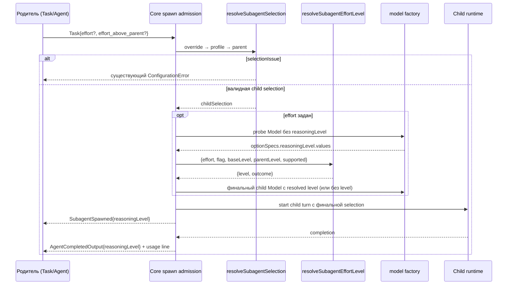

# Относительный класс effort для сабагентов

Статус: реализовано 2026-11-14 для сабагентов; root-auto реализован отдельным spec (`2026-11-14-root-auto-reasoning-effort.md`).

Связанные документы:

- [Subagent 模型与 Reasoning Effort 覆盖](../subagents-built-in-model-overrides.md) — этот spec заменяет
  правило «不增加 Agent tool 调用级 model/effort override» только в части effort.
- [Каталог кейсов](../conversation-session-case-catalog.md) — случай I20; его пункт
  «provider-visible `Agent` schema 不新增 model/effort» заменяется разделом «Конфликт правил».
- [Root-auto reasoning effort](./2026-11-14-root-auto-reasoning-effort.md) — отдельный владелец
  автоматического уровня у корневого агента.

## Scope

Спецификация описывает optional-поля `effort` и `effort_above_parent` в `Task`/`Agent` input
и чистый resolver, который превращает относительный класс в конкретный уровень целевой модели
в момент спавна. Действует для локальных, удалённых, CLI- и desktop-сессий одинаково, потому что
резолв живёт в core runtime, а не в UI.

Не входит в scope: выбор модели (model string и profile override), пользовательские настройки
уровня в Settings, `SendMessage`-resume, root-auto классификатор (отдельный spec), фоновые
уведомления завершения background-child.

## Зачем

Сейчас уровень ребёнка — это уровень из profile override либо уровень родителя
(`resolveSubagentSelection`: `overrideSelection → profileSelection → parentSelection`,
`apps/zcode-cli/packages/core/src/runtime/helpers/subagent-selection.ts:14-58`). Вызывающий агент
не может сказать «эта ветка механическая» или «эта ветка объективно сложнее моей»:

- роутеры `start`/`orchestrator` идут на модели пользователя и не управляют сложностью ветки;
- каждая ветка наследует уровень родителя, поэтому дешёвая механическая работа выполняется
  на высоком уровне, а действительно сложная не может подняться выше родителя;
- добавление absolute `reasoningLevel` в tool input продуктово запрещено: модель не должна
  переопределять настройку пользователя.

Новое правило разрешает только **относительный класс** и удерживает жёсткий guard: без явного
`effort_above_parent: true` ребёнок не может оказаться выше родителя.

## Продуктовые правила

### RF-1. Поля tool input

В `AgentInputObjectSchema` и `TaskInputSchema` (общий контракт,
`apps/zcode-cli/packages/contracts/src/tools/agent.ts:166-227`) добавляются два optional-поля:

```ts
effort?: string;              // "lower" | "same" | "higher"; см. RF-7 про неизвестные значения
effort_above_parent?: boolean; // default false
```

Те же два поля добавляются в `AgentTaskGraphNodeSchema` и `zcode-spawn-envelope`-узлы графа:
orchestrator спавнит worker-ов через `task_graph`, и без node-поля правило выбора класса было бы
неприменимо к основному пути. Каждый узел резолвится независимо, родителем считается агент,
вызвавший `Task` с графом.

Absolute `reasoningLevel`/`thoughtLevel`/`model` в tool input **не добавляются**. Поле `level`
(`:205-209`) остаётся глубиной спавна и к effort не относится.

### RF-2. Порядок выбора не меняется

Сначала работает существующий `resolveSubagentSelection`:

```text
SubagentRunOptions.modelOverride.selection  (Core Server / settings override)
        → profile.modelSelection             (profile, включая built-in settings override)
        → parentSelection                     (текущая session selection родителя)
        → ConfigurationError при selectionIssue
```

Класс применяется **после** этого резолва к уже валидной child selection. Resolver не создаёт
новых `ConfigurationError`, не делает fallback на другую модель и не переписывает модель.

### RF-3. Resolver: единственная точка правды

Имя зафиксировано: `resolveSubagentEffortLevel` (core, чистый модуль рядом с
`runtime/helpers/subagent-selection.ts`).

```ts
export type SubagentEffortClass = "lower" | "same" | "higher";

export interface ResolveSubagentEffortLevelInput {
  effort?: string;                 // как пришло из истории/tool input, без предварительного сужения
  effortAboveParent?: boolean;     // default false
  baseLevel?: string;              // уровень из resolved child selection
  parentLevel?: string;            // эффективный уровень родителя в этом turn
  supportedLevels: readonly string[]; // optionSpecs.reasoningLevel.values, от низкого к высокому
}

export type SubagentEffortOutcome =
  | "applied"
  | "clamped"
  | "elevation-denied"
  | "no-supported-levels"
  | "no-anchor"
  | "unknown-class";

export interface ResolveSubagentEffortLevelResult {
  level?: string;
  outcome: SubagentEffortOutcome;
  /** base level не найден в supported и заменён ближайшей поддерживаемой опорой. */
  baseClamped?: true;
}

export function resolveSubagentEffortLevel(
  input: ResolveSubagentEffortLevelInput,
): ResolveSubagentEffortLevelResult;
```

Алгоритм (порядок шагов обязателен):

1. `supportedLevels` пуст или отсутствует → `{ outcome: "no-supported-levels" }`, `level: undefined`.
   Ребёнок исполняется без level, ошибки нет. Если в унаследованной selection level был, он
   в child selection не переносится.
2. `effort` не входит в `"lower" | "same" | "higher"` → `{ outcome: "unknown-class", level: baseLevel }`.
   Selection не меняется, вызывающий пишет `logger.warn`, ретрая модели нет.
3. Опорный индекс (`anchorIndex`), от низкого к высокому:
   1. `baseLevel` есть в `supportedLevels` → его индекс;
   2. иначе `parentLevel` есть в `supportedLevels` → его индекс, `baseClamped: true`;
   3. иначе индекс `0` (низшая поддерживаемая ступень), `baseClamped: true`.
4. Если и `baseLevel`, и `parentLevel` отсутствуют → `{ outcome: "no-anchor" }`, `level: undefined`.
5. `delta`: `lower = -1`, `same = 0`, `higher = +1`;
   `targetIndex = min(max(anchorIndex + delta, 0), supportedLevels.length - 1)`.
6. Elevation guard:
   - если `parentLevel` присутствует в `supportedLevels` и `targetIndex > parentIndex`
     и `effortAboveParent !== true` → `targetIndex = parentIndex`, `outcome: "clamped"`;
   - иначе если `parentLevel` отсутствует в `supportedLevels` (или его нет) и `delta > 0`
     и `effortAboveParent !== true` → `targetIndex = anchorIndex`, `outcome: "elevation-denied"`;
   - иначе `outcome: "applied"`.
7. Результат: `supportedLevels[targetIndex]`.

`baseLevel` берётся из уже разрешённой child selection. Если level пришёл из явного profile
override, он к этому моменту уже провалидирован `resolveSubagentSelection`/`resolveEffectiveModelSelection`
(`packages/provider/src/effective-model-selection.ts:17-77`), поэтому «невалидный base» на практике
означает унаследованный от родителя уровень, которого нет в шкале целевой модели.

### RF-4. Инвариант «не выше родителя»

При наличии класса и отсутствии `effort_above_parent: true` итоговый индекс не превышает индекс
родителя, когда уровень родителя сравним (присутствует в `supportedLevels` целевой модели).
Единственные исключения: `no-supported-levels`, `no-anchor`, `unknown-class` и несравнимая шкала
родителя (`elevation-denied` не поднимает ребёнка, а фиксирует опору).

### RF-5. Явный profile override выше родителя: точный итог

Profile override — это осознанная настройка пользователя, но класс — это указание вызывающего
агента на конкретный спавн. Контракт:

| Ситуация | Итог |
| --- | --- |
| `effort` отсутствует | уровень профиля сохраняется как есть (resolver не вызывается) |
| `effort: "same"` | `clamped` до уровня родителя, если профиль выше родителя |
| `effort: "lower"` | `targetIndex = anchorIndex - 1`; если всё ещё выше родителя — `clamped` до родителя |
| `effort: "higher"` | `clamped` до уровня родителя без флага; с `effort_above_parent: true` — `anchorIndex + 1` (или top) |
| любой класс + `effort_above_parent: true` | guard не применяется, профиль сохраняет своё преимущество |

То есть: настройка профиля без класса никогда не понижается, а любой переданный класс без флага
подчиняется инварианту «не выше родителя».

### RF-6. No-op без ошибок и без ретраев

- Модель без `reasoningLevel` → шаг 1, ребёнок без level.
- Неизвестное значение `effort` (история, галлюцинация, будущая версия) → шаг 2, warning, без
  ошибки tool call. Поэтому provider-visible schema объявляет `effort` как `z.string()`, а не
  `z.enum`: ошибка схемы заставила бы модель повторять вызов.
- Отсутствие опоры (`no-anchor`) → level не добавляется.
- Новые `ConfigurationError` для классов/уровней не вводятся. Ошибки неполной или невалидной
  selection остаются прежними и возникают до resolver.

### RF-7. Ребёнок видит свой фактический уровень

Строка модели в child system prompt
(`apps/zcode-cli/packages/core/src/subagent/system-prompt.ts:21-40`, строка модели на `:25-27`)
дополняется суффиксом только при наличии level:

```text
You are powered by the model named <providerId>/<modelId> (reasoning effort: <level>).
```

Без level строка остаётся текущей. `env-info.ts`/root-контекст не меняется.

### RF-8. Родитель видит фактический уровень

- `AgentCompletedOutput.reasoningLevel?: string` и соответствующее optional-поле в
  `AgentCompletedOutputSchema` (`apps/zcode-cli/packages/contracts/src/tools/agent.ts:366-383`,
  `:407-431`).
- `<usage>` в tool result для модели (`apps/zcode-cli/packages/core/src/tool/handlers/agent.ts:282-308`)
  получает optional-строку `reasoning_effort: <level>` после `duration_ms` и до
  `host_acceptance`/`work_result`. Без level строка не печатается.
- `SubagentSpawned` payload (`apps/zcode-cli/packages/core/src/subagent/runner-run.ts:232-251`)
  получает `reasoningLevel?: string` — effective child level этого спавна.
- `SubagentRow.reasoningLevel?: string` в `packages/shared/src/zcode-protocol-v4/rows.ts:268-284`;
  проекция `onSubagentSpawned` (`apps/zcode-cli/packages/bootstrap/src/zcode-protocol-v4/product-projection-subagents.ts:242-307`)
  читает поле через `stringPayload` и переносит в row (append и update-ветки). Строка сабагента
  в UI (`packages/ui/src/v4/conversation-row-view/SimpleRowViews.tsx`,
  `packages/ui/src/v4/conversation-status-panel/SubagentStatusSection.tsx`) показывает уровень рядом
  с типом, используя существующее отображение thought-level; неизвестное значение печатается как есть.
- Child `ModelSelected` **не зеркалится** в родительский topic: это перезаписало бы `config` родителя.
  Родитель узнаёт уровень только из результата и `SubagentSpawned`.

### RF-9. Инструкции профилей

В `apps/zcode-cli/packages/core/src/subagent/built-in-profiles.ts` добавляется общий контракт
`SUBAGENT_EFFORT_SELECTION_CONTRACT` и включается в `start` (`:241-276`) и `orchestrator`
(`:277-314`), а также в `WORKER_PARALLEL_DELEGATION_CONTRACT` (`:85-88`) для worker-ролей, которые
могут делегировать:

> При спавне выбирай относительный класс effort по сложности подзадачи: `lower` — простая
> механическая работа, `same` — обычная задача, `higher` — объективно сложная задача.
> `higher` используй только с явным обоснованием в описании ветки; `effort_above_parent: true`
> добавляй только если это осознанно разрешено конвертом. Отсутствие поля означает наследование
> уровня родителя; абсолютный уровень не указывай.

### RF-10. Resume и SendMessage

- Класс применяется только в момент нового спавна `Task`/`Agent`.
- `SendMessage`-resume не переиспользует класс и не пересчитывает уровень: авторитетом остаётся
  текущий profile/selection ребёнка (`port.ts:625-633`: «本轮 profile 选出的模型仍是执行权威»).
- Исторические tool calls не исполняются повторно; replay/resume не фиксирует старый абсолютный
  level. Persisted `AgentInput` с `effort` — обычный текст истории, миграции нет.

### RF-11. Логирование

Core логирует `subagent.effort.resolved` на `debug` (level, outcome, baseClamped, agentType) и
`subagent.effort.unknown_class` на `warn`. Уровни и идентификаторы моделей — не секреты; prompt
и аргументы не логируются.

## Владелец состояния и порядок событий

Единственный владелец резолва — core spawn admission в
`apps/zcode-cli/packages/core/src/runtime/methods/subagent/port.ts`. `SubagentsService` и Settings
владеют только профильными override; UI — производная проекция событий, второго owner нет.



Probe-Model — только конструирование handle (без provider request), нужное потому, что уровни
поддерживаются в `model.optionSpecs.reasoningLevel.values`, а `RuntimeModelFactory` не отдаёт
capability без Model (`apps/zcode-cli/packages/core/src/runtime/types.ts:464`). Probe создаётся
с selection без `reasoningLevel`, чтобы унаследованный невалидный уровень не бросил ошибку до
резолва; `validatePartialOptions` допускает отсутствие level
(`apps/zcode-cli/packages/adapters/src/model/model.ts:137-157`).

## Матрица clamp

Supported: `low, medium, high`; `parent` — эффективный уровень родителя в этом turn.

| parent | effort | flag | anchor = parent | итог | outcome |
| --- | --- | --- | --- | --- | --- |
| high | lower | false | high | medium | applied |
| high | same | false | high | high | applied |
| high | higher | false | high | high (top) | applied |
| medium | lower | false | medium | low | applied |
| medium | same | false | medium | medium | applied |
| medium | higher | false | medium | medium | clamped |
| medium | higher | true | medium | high | applied |
| low | lower | false | low | low | applied |
| low | same | false | low | low | applied |
| low | higher | false | low | low | clamped |
| low | higher | true | low | medium | applied |
| — | same | false | base=profile | базовый уровень | applied |
| — | lower | false | base=profile | base-1 | applied |
| — | higher | false | base=profile | базовый уровень | elevation-denied |
| — | higher | true | base=profile | base+1 (или top) | applied |
| off (нет в supported) | higher | false | floor=low | low | elevation-denied |
| off (нет в supported) | same | false | floor=low | low | applied, baseClamped |
| medium | любой | — | supported пуст | без level | no-supported-levels |
| medium | `max` (неизвестный класс) | — | medium | medium | unknown-class |
| medium + profile high | same | false | high | medium | clamped |
| medium + profile high | lower | false | high | medium | applied |
| low + profile high | lower | false | high | low | clamped |
| medium + profile high | higher | true | high | high (top) | applied |

`applied` при верхнем/нижнем index clamp (например `higher` на последней ступени) остаётся
`applied`: guard не срабатывал.

## Сценарии приёмки

| ID | Сценарий | Ожидание |
| --- | --- | --- |
| SA-01 | parent high, supported low/medium/high, `effort: lower` | child medium; `SubagentSpawned.reasoningLevel=medium`; usage line `reasoning_effort: medium` |
| SA-02 | parent high, `effort: same` | child high, без изменения selection |
| SA-03 | parent high, `effort: higher` | child high (top), outcome applied |
| SA-04 | parent medium, `effort: higher` без флага | child medium, outcome clamped; provider-visible level не выше родителя |
| SA-05 | parent medium, `effort: higher`, `effort_above_parent: true` | child high |
| SA-06 | parent low, `effort: higher` без флага; с флагом | low (clamped); medium с флагом |
| SA-07 | parent level отсутствует у целевой модели (например `off`), `effort: higher` | low, outcome elevation-denied, без ошибки |
| SA-08 | модель без `reasoningLevel.values` | child без level, без ошибки, resolver outcome no-supported-levels |
| SA-09 | исторический/неизвестный `effort: "max"` | вызов не падает, selection не меняется, warning, повторного model request нет |
| SA-10 | profile high, parent medium, `effort: same`; и тот же кейс без `effort` | medium (clamped) только при классе; без класса остаётся high |
| SA-11 | profile high, parent medium, `effort: lower` | medium (clamped), не ниже родителя |
| SA-12 | child system prompt при наличии level | строка модели содержит `(reasoning effort: <level>)`; без level — не содержит |
| SA-13 | `AgentCompletedOutput` и `<usage>` | optional `reasoningLevel`/`reasoning_effort` присутствуют только при level |
| SA-14 | UI-проекция `SubagentSpawned` | `SubagentRow.reasoningLevel` появляется в append и update, переживает hydration; родительский `config` не меняется |
| SA-15 | resume через `SendMessage` | уровень ребёнка не пересчитывается, текущий profile остаётся авторитетом; класс из старого вызова не применяется |
| SA-16 | provider-visible `Agent`/`Task` schema | содержит `effort` и `effort_above_parent`, не содержит `model`/`reasoningLevel`/`thoughtLevel`; `level` остаётся глубиной |
| SA-17 | task_graph с разными `effort` на узлах | каждый узел получает свой уровень, родителем считается вызвавший граф агент |
| SA-18 | `effort: lower` при parent level ниже или равном нижней ступени | child остаётся на нижней ступени, outcome applied |

## Конфликт правил

`docs/subagents-built-in-model-overrides.md:69-75` (не目标) запрещал «`Agent` tool 调用级的 model
或 reasoning effort 覆盖», а case I20 (`docs/conversation-session-case-catalog.md:1089`) требовал,
чтобы provider-visible `Agent` schema не добавляла effort. Настоящий spec заменяет именно это
правило:

- model и absolute effort в tool input по-прежнему запрещены;
- разрешён только относительный класс с elevation guard, который не может поднять ребёнка выше
  родителя без явного флага;
- Settings/profile selection остаётся единственным источником модели и базового уровня.

## Что за рамками

- Автоматический выбор класса моделью без явного поля (никакого эвристического `effort` по тексту).
- Изменение `SendMessage` semantics и пересчёт уровня при resume.
- Зеркалирование child `ModelSelected` в родительский topic.
- Фоновые completion-уведомления (`runtime-task/notification.ts`) — уровень туда не добавляется.
- Новые provider-visible поля абсолютного уровня, model string или per-node model override.
- Изменение существующих ошибок неполной/невалидной selection.

## Проверки

Обязательные обновления существующих тестов и новые кейсы:

- `apps/zcode-cli/packages/core/tests/subagent-effective-selection.test.ts` — матрица clamp,
  unknown-class, no-supported-levels, явный profile выше родителя.
- `apps/zcode-cli/packages/core/tests/spawn-budget.test.ts` — спавн с классом не обходит admission
  и не создаёт второй владелец слотов (`:63-68`).
- `apps/zcode-cli/packages/core/tests/context-builder.test.ts:1350-1392` — суффикс level в child
  system prompt.
- `apps/zcode-cli/packages/core/tests/subagent-prompt-assembly.test.ts:251-261` — сегменты
  system prompt не меняются, кроме строки модели.
- `apps/zcode-cli/packages/core/tests/tool-contracts.test.ts` — provider-visible schema и
  `<usage>`/`AgentCompletedOutput.reasoningLevel`.
- `apps/zcode-cli/packages/bootstrap/tests/product-projection.test.ts` и
  `transcript-hydration.test.ts:2928-3046` — `SubagentRow.reasoningLevel` в append/update/hydration.
- `packages/ui/test/v4ConversationRowViewTimelineMarker.test.ts` — уровень в строке маркера
  не участвует (регресс не должен появиться); row-тест сабагента — новый level suffix.
- `pnpm typecheck` и `pnpm lint` для затронутых пакетов; полный `pnpm test` — только по запросу.

Проверки, которые не доказывают поведение: unit-тест resolver не подтверждает реальный provider
request; для сквозной проверки нужен child request с `reasoning_effort` в теле (raw capture).
