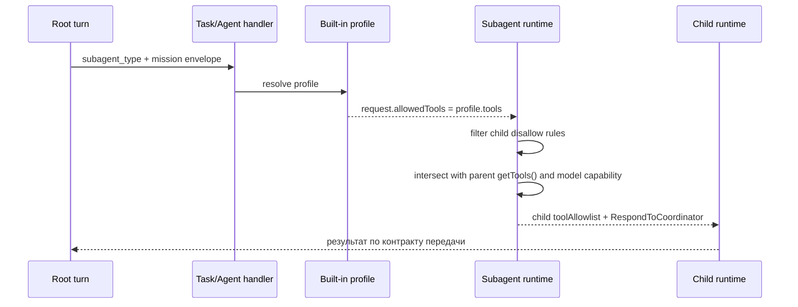

# Agent capability gate для встроенных профилей

## Назначение и владельцы

Встроенные профили ZCode делятся на три класса по реальной способности, а не по описанию в промпте:

- **read-only маршрутизатор** (`start`, `orchestrator`) — только читает и делегирует;
- **инспекция** (`researcher`, `reviewer`, `security-reviewer`, `evaluator`) — читает и воспроизводит проверки командой, но не меняет файлы;
- **исполнитель** (`implementer`, `test-engineer`, `self-improver`, `knowledge-curator`, `subagent-factory`) — полный рабочий набор, включая запись и команды.

Декларируемый список инструментов принадлежит профилю: `apps/zcode-cli/packages/core/src/subagent/profile.ts`. Фактическую способность child-сессии определяет runtime: `resolveSubagentToolAllowlist` в `apps/zcode-cli/packages/core/src/runtime/methods/subagent.ts` пересекает `request.allowedTools` с реально доступными инструментами родителя (`this.getTools()`), применяет child-запреты (`EnterPlanMode`/`ExitPlanMode` и `disallowedTools`) и добавляет управляющий канал `RespondToCoordinator`. Поэтому список профиля — это верхняя граница, а не единственная защита; профиль не может расширить способность родителя.

## Матрица ролей

| Класс                   | Профили                                                                                  | Инструменты                                                                                                                                                     |
| ----------------------- | ---------------------------------------------------------------------------------------- | --------------------------------------------------------------------------------------------------------------------------------------------------------------- |
| Read-only маршрутизатор | `start`, `orchestrator`                                                                  | `Read`, `Glob`, `Grep`, `Task`, `Skill`                                                                                                                         |
| Инспекция               | `researcher`, `reviewer`, `security-reviewer`, `evaluator`                               | `Read`, `Glob`, `Grep`, `Bash`, `WebFetch`, `WebSearch`, `Task`, `Skill`, `TodoRead`, `TodoWrite`, `AskUserQuestion`, `TaskOutput`, `TaskStop`                  |
| Исполнитель             | `implementer`, `test-engineer`, `self-improver`, `knowledge-curator`, `subagent-factory` | `Read`, `Glob`, `Grep`, `Write`, `Edit`, `Bash`, `WebFetch`, `WebSearch`, `Task`, `Skill`, `TodoRead`, `TodoWrite`, `AskUserQuestion`, `TaskOutput`, `TaskStop` |

`start` и `orchestrator` не получают `Bash`, `Write`, `Edit`, `WebFetch` и `WebSearch`: маршрутизатор не исполняет команды, не правит файлы и не подменяет делегирование собственной реализацией. Read-only триаж выполняется чтением (`Read`/`Glob`/`Grep`). Если `Task` недоступен или хост отклонил вызов, профиль фиксирует blocker и возвращает его вызывающему.

Инспекционные профили получают `Bash` для воспроизведения, но не получают `Write`/`Edit`: проверка не должна переписывать проверяемый код. Исполнительские профили сохраняют полный набор, и их промпты не ослабляются.

## Инварианты

1. `start`/`orchestrator` никогда не реализуют задачу сами; любая задача, требующая команд, тестов, правок или сбора доказательств, делегируется.
2. `implementer`, `test-engineer`, `self-improver`, `knowledge-curator`, `subagent-factory` сохраняют `Write`/`Edit`/`Bash`.
3. Итоговая способность child = пересечение `profile.tools` с фактической allowlist родителя и child-запретами. Профиль не расширяет родителя.
4. Промпт не обещает инструмент, которого нет в объявленном наборе. `START_TOOLING_AND_NESTING_CONTRACT` перечисляет точный набор `start`.
5. `RespondToCoordinator` добавляется runtime как управляющий канал и не входит в профильную матрицу.
6. Root-only инструменты из `ROOT_ONLY_TOOL_NAMES` не попадают в профили, пока child runtime их не регистрирует.
7. `EnterPlanMode` и `ExitPlanMode` принудительно запрещены всем child-сессиям.

## Поток способности

## Root-сессия

Отдельного per-root allowlist нет. `toolAllowlist` в `AgentRuntimeConfig` задаёт поверхность всей сессии (`apps/zcode-cli/packages/core/src/runtime/types.ts`), попадает туда из опций сессии (`apps/zcode-cli/packages/bootstrap/src/app/runtime-config.ts`) и применяется при регистрации инструментов. Turn-уровень умеет только вычитать инструменты через `toolDisallowlist` (`apps/zcode-cli/packages/core/src/runtime/methods/turn-loop-state.ts`, `apps/zcode-cli/packages/contracts/src/interfaces/session.port.ts`); позитивного per-turn/per-root списка в контракте нет. Root-сессия не является `AgentProfile`, поэтому профильная матрица на неё не распространяется.

Решение: глобальный `toolAllowlist` не меняется. Сужение root-сессии сломало бы обычное кодирование (Write/Edit/Bash) и потребовало бы нового контракта на turn.ts/session.port, что выходит за границы этой задачи. Prompt-политика root-сессии остаётся прежней.

## Приёмочные сценарии

1. Матрица ролей: `start`/`orchestrator` имеют ровно `Read, Glob, Grep, Task, Skill`; инспекционные роли имеют `Bash`, но не `Write`/`Edit`; исполнительские роли имеют `Write`/`Edit`/`Bash`.
2. Runtime enforcement: при родителе, который отдаёт `Write`/`Edit`/`Bash`, итоговый allowlist `start`/`orchestrator` их не содержит, а `Read`/`Glob`/`Grep`/`Task`/`Skill` содержит.
3. Runtime enforcement: инспекционные роли получают `Bash` и не получают `Write`/`Edit`.
4. Runtime enforcement: исполнительские роли получают `Write`/`Edit`/`Bash`.
5. Runtime enforcement: если родитель не имеет инструмента, профиль не получает его даже при наличии в `profile.tools`.
6. Prompt honesty: промпт `start` перечисляет реальный набор и явно сообщает, что `Bash`/`Write`/`Edit` недоступны; промпты инспекционных ролей сообщают «Bash доступен, Write/Edit недоступны».
7. Ни один профиль не рекламирует root-only инструменты и инструменты без child-обработчика.

Проверки: `tests/subagent-profile.test.ts` (матрица и промпты) и `tests/runtime-tool-allowlist.test.ts` (runtime enforcement через `resolveSubagentToolAllowlist`).
