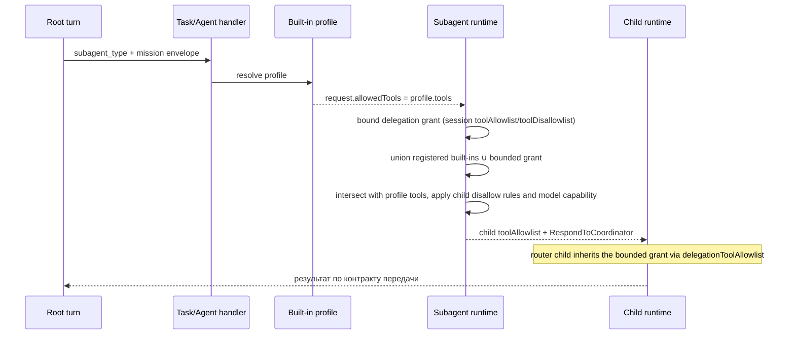

# Agent capability gate для встроенных профилей

## Назначение и владельцы

Встроенные профили ZCode делятся на пять классов по реальной способности, а не по описанию в промпте:

- **read-only маршрутизатор** (`start`, `orchestrator`) — только делегирует;
- **leaf-исследование** (`researcher`) — читает и воспроизводит проверки командой, не меняет файлы и не делегирует;
- **инспекция** (`evaluator`) — читает, воспроизводит проверки командой и может делегировать bounded researcher-ветки, но не меняет файлы;
- **review-only** (`reviewer`, `security-reviewer`) — читает и воспроизводит проверки командой, но не меняет файлы; `Task` разрешён только для bounded researcher-подагентов, `Agent` не выдан, recursive review и writer-роли запрещены caller-policy;
- **исполнитель** (`implementer`, `coder`, `frontend-coder`, `backend-coder`, `infra-coder`, `test-engineer`, `self-improver`, `knowledge-curator`, `subagent-factory`) — полный рабочий набор, включая запись и команды.

Специализированные исполнители делят одну и ту же способность, но разные границы роли: `coder` — production-код в назначенной области, спецификации и regression tests; `frontend-coder` — UI/renderer/design system, `DESIGN.md`, темы, i18n и desktop/mobile; `backend-coder` — services/runtime/protocol/data, границы архитектуры, конкурентность и идемпотентность; `infra-coder` — build/release/CI/scripts/electron, упаковка и кросс-платформенность. Границы заданы prompt-контрактом и назначенной областью, а не разным набором инструментов.

Декларируемый список инструментов принадлежит профилю: `apps/zcode-cli/packages/core/src/subagent/profile.ts`. Фактическую способность child-сессии определяет runtime: `resolveSubagentToolAllowlist` в `apps/zcode-cli/packages/core/src/runtime/methods/subagent.ts` пересекает `request.allowedTools` с эффективной поверхностью родителя, применяет child-запреты (`EnterPlanMode`/`ExitPlanMode` и `disallowedTools`) и добавляет управляющий канал `RespondToCoordinator`.

Эффективная поверхность родителя — это **объединение** фактически зарегистрированных built-in инструментов (`this.getTools()`, включая `CreateWorkflow` и alias `Agent`) и delegation-набора, ограниченного политикой выдавшей его сессии. Замена зарегистрированных инструментов голым worker-списком теряла динамические workflow-инструменты и alias; отсутствие границы на delegation-наборе позволяло restricted root выдавать `Write`/`Edit`/`Bash`. Поэтому список профиля — это верхняя граница, а не единственная защита; профиль не может расширить способность родителя.

## Матрица ролей

| Класс                   | Профили                                                                                                                                             | Инструменты                                                                                                                                                     |
| ----------------------- | --------------------------------------------------------------------------------------------------------------------------------------------------- | --------------------------------------------------------------------------------------------------------------------------------------------------------------- |
| Read-only маршрутизатор | `start`, `orchestrator`                                                                                                                             | `Task`                                                                                                                                                          |
| Leaf-исследование       | `researcher`                                                                                                                                        | `Read`, `Glob`, `Grep`, `Bash`, `WebFetch`, `WebSearch`, `Skill`, `TodoRead`, `TodoWrite`, `AskUserQuestion`, `TaskOutput`, `TaskStop`                          |
| Инспекция               | `evaluator`                                                                                                                                         | `Read`, `Glob`, `Grep`, `Bash`, `WebFetch`, `WebSearch`, `Task`, `Skill`, `TodoRead`, `TodoWrite`, `AskUserQuestion`, `TaskOutput`, `TaskStop`                  |
| Review-only             | `reviewer`, `security-reviewer`                                                                                                                     | `Read`, `Glob`, `Grep`, `Bash`, `WebFetch`, `WebSearch`, `Task`, `Skill`, `TodoRead`, `TodoWrite`, `AskUserQuestion`, `TaskOutput`, `TaskStop`                  |
| Исполнитель             | `implementer`, `coder`, `frontend-coder`, `backend-coder`, `infra-coder`, `test-engineer`, `self-improver`, `knowledge-curator`, `subagent-factory` | `Read`, `Glob`, `Grep`, `Write`, `Edit`, `Bash`, `WebFetch`, `WebSearch`, `Task`, `Skill`, `TodoRead`, `TodoWrite`, `AskUserQuestion`, `TaskOutput`, `TaskStop` |

`start` и `orchestrator` не получают `Read`, `Glob`, `Grep`, `Skill`, `Bash`, `Write`, `Edit`, `WebFetch` и `WebSearch`: маршрутизатор не читает репозиторий, не исполняет команды, не правит файлы и не подменяет делегирование собственной реализацией. Если `Task` недоступен или хост отклонил вызов, профиль фиксирует blocker и возвращает его вызывающему.

Инспекционные профили получают `Bash` для воспроизведения, но не получают `Write`/`Edit`: проверка не должна переписывать проверяемый код. `researcher` — leaf: `Task` отсутствует в его surface, caller-policy не показывает ему делегацию, и промпт запрещает создавать подвопросы. `evaluator` сохраняет `Task` для bounded researcher-веток. Исполнительские профили сохраняют полный набор, и их промпты не ослабляются.

Review-only профили получают `Task` только для bounded researcher-подагентов; `Agent` не выдан. Caller-policy разрешает reviewer/security-reviewer запускать только `researcher`, поэтому recursive review и writer-роли остаются запрещены. Это профильный тир, а не runtime-губернатор: контракт держится списком инструментов профиля, caller-policy и промптом.

## Инварианты

1. `start`/`orchestrator` никогда не реализуют задачу сами; любая задача, требующая команд, тестов, правок или сбора доказательств, делегируется.
2. `implementer`, `coder`, `frontend-coder`, `backend-coder`, `infra-coder`, `test-engineer`, `self-improver`, `knowledge-curator`, `subagent-factory` сохраняют `Write`/`Edit`/`Bash`.
3. Итоговая способность child = пересечение `profile.tools` с эффективной поверхностью родителя (зарегистрированные built-in инструменты ∪ delegation-набор) и child-запретами. Профиль не расширяет родителя.
4. Промпт не обещает инструмент, которого нет в объявленном наборе. `START_TOOLING_AND_NESTING_CONTRACT` перечисляет точный набор `start`.
5. `RespondToCoordinator` добавляется runtime как управляющий канал и не входит в профильную матрицу.
6. Root-only инструменты из `ROOT_ONLY_TOOL_NAMES` не попадают в профили, пока child runtime их не регистрирует.
7. `EnterPlanMode` и `ExitPlanMode` принудительно запрещены всем child-сессиям.
8. Встроенная роль владеет своим именем: custom-профиль с тем же именем (без учёта регистра) не заменяет её prompt, tools или skills. `normalizeAgentProfiles` сохраняет built-in и добавляет custom-профиль только под уникальным именем.
9. `subagent-factory` создаёт файл только при устойчивом направлении, которого нет в каталоге; существующая роль или навык важнее нового профиля.
10. Router-грант: `start`/`orchestrator` могут делегировать worker-набор, не имея `Write`/`Edit`/`Bash` сами. Грант ограничен политикой выдавшей его сессии: `toolAllowlist` (`*` = allow-all, `Agent`/`Task` считаются одной способностью) и `toolDisallowlist` через те же `buildSubagentChildDisallowRules`/`filterSubagentChildToolNames`. `WebSearch` дополнительно фильтруется по Active Model child.
11. Грант наследуют только router-дети; worker- и read-only-дети его не получают и пересекаются со своим фактическим tool surface.
12. Каталог агентов, показываемый модели, использует тот же ограниченный delegation-набор (видимые инструменты ∪ `resolveRuntimeDelegationToolNames`). Каталог не рекламирует инструмент, который spawn срежет, и не скрывает worker-набор у router-ребёнка.
13. `reviewer`/`security-reviewer` получают `Task` только для `researcher`-подагентов; `Agent` не выдан. `evaluator` сохраняет `Task` и также может запускать только `researcher`. `researcher` — leaf: `Task` отсутствует, caller-policy возвращает ему пустой каталог делегации. Recursive review и writer-роли запрещены caller-policy.
14. Review-промпты начинаются с выданного diff, ограничивают findings числом 10 и возвращают partial/blocked только при объективной невозможности продолжить. Число параллельных review-веток определяется независимыми вопросами и фактическими свободными слотами; фиксированного числа нет.
15. Research bounded: `orchestrator` планирует одного researcher на независимый вопрос (максимум 3 на run), не дублирует вопрос и не отправляет researcher подтверждать settled facts. `researcher` не делегирует.

## Router delegation grant

Владелец границы — `filterDelegationToolNames` в `apps/zcode-cli/packages/core/src/subagent/tool-policy.ts`. Она применяет `isToolAllowedByParentAllowlist` (с `*` как allow-all и эквивалентностью `Agent`/`Task`) и затем `filterSubagentChildToolNames` с session `toolDisallowlist`.

- Root/session-рантайм получает worker-набор по умолчанию в конструкторе `AgentRuntime` (`taskType !== "subagent_child"`).
- `resolveRuntimeDelegationToolNames` (`runtime/methods/subagent.ts`) ограничивает этот набор политикой сессии. Для `subagent_child` allowlist — производная поверхность профиля, а `delegationToolAllowlist` уже ограничен тем, кто выдал грант; повторная граница там срезала бы worker-набор у read-only router.
- При spawn router-ребёнка (`start`/`orchestrator`) `subagent.ts` передаёт ему **уже ограниченный** грант; worker- и read-only-дети получают `undefined`.
- `collectRuntimeAgentListing` (`runtime/helpers/agent-listing.ts`) добавляет к видимым инструментам тот же ограниченный набор, поэтому каталог и spawn используют одну границу.

## Review-wave contract (prompt-level)

Владельцы — системные промпты `reviewer`/`security-reviewer` в `profile.ts` и `bundled-skills/skills/reviewer/SKILL.md`. Отдельного runtime-губернатора конкурентности для ревью нет, поэтому исполнимая сегодня граница — только промпт и план вызывающего.

- **Diff-first.** Первичный вход — точный commit, diff или набор путей от вызывающего. Сначала читается diff; затем ревью идёт по выданному diff и непосредственно требуемым call sites (вызовы изменённых символов, владеющая спецификация, ближайшие тесты).
- **Без повторного обхода.** Если пути выданы, reviewer не запускает широкий Explore-подобный обход репозитория. Отчёт содержит просмотренные файлы, фактически запущенные команды/тесты и использованный чеклист.
- **Findings cap.** Не более 10 подтверждённых findings, каждый с severity, `file:line`, impact и reproduction/evidence. Неподтверждённые подозрения идут в `gaps`, а не в findings.
- **Partial/blocked.** `partial` или `blocked` возвращается только при объективной невозможности продолжить (нет доступа, исчерпан контекст, пользователь остановил работу): что просмотрено, что нет и что осталось. Частичный просмотр нельзя выдавать за полный. Собственный тайм-бюджет или искусственный deadline не вводится.
- **Параллелизм.** Review-волна планируется по числу независимых вопросов в пределах фактических свободных слотов. Это planner/prompt-политика, а не runtime-лимит: `resolveSwarmParallelism` управляет общим fan-out, отдельного счётчика review-конкурентности нет.
- **Security scoping.** `security-reviewer` запускается только на security-sensitive diff: аутентификация/авторизация, секреты и ключи, границы доверия, сетевой ввод и парсинг, разрешения и sandbox. Обычный code review без этих поверхностей не должен его запрашивать.

## Границы custom-профилей и фабрики

`subagent-factory` — единственный встроенный профиль, который создаёт новые роли. Формат: `.zcode/agents/<kebab-name>.md` с YAML frontmatter (`name`, `description`, `tools`, `skills`; опционально `disallowedTools` и `mcpServers`) и телом — системными правилами роли.

- Имя в kebab-case не совпадает с built-in ролью или зарезервированными `general`, `general-purpose`, `Explore`.
- `tools` — только имена из `WORKER_SUBAGENT_TOOL_NAMES`; root-only инструменты не добавляются.
- `skills` — только реально доступные имена из текущего Skill-каталога.
- Запрещены секреты, токены, персональные данные и внутренние адреса; запрещены generic-роль «делаю всё» и профиль под разовую задачу, один файл или одну правку.
- Фабрика не изменяет встроенные профили и не подменяет их имена. Если поручение не разрешает запись, она возвращает готовый Markdown и blocker.
- После Write фабрика возвращает путь, имя, tools, skills, правила роли и пометку, что профиль станет доступен в следующем turn. В окружении без Host-загрузчика каталог перечитывается после перезапуска.

Custom-профиль с уникальным именем остаётся обычной пользовательской ролью: он не входит в canonical Swarm snapshot, но доступен обычным `Agent`/`Task` вызовам, если вызывающий разрешает custom-профили.

## Поток способности

## Root-сессия

Отдельного per-root allowlist нет. `toolAllowlist` в `AgentRuntimeConfig` задаёт поверхность всей сессии (`apps/zcode-cli/packages/core/src/runtime/types.ts`), попадает туда из опций сессии (`apps/zcode-cli/packages/bootstrap/src/app/runtime-config.ts`) и применяется при регистрации инструментов. Turn-уровень умеет только вычитать инструменты через `toolDisallowlist` (`apps/zcode-cli/packages/core/src/runtime/methods/turn-loop-state.ts`, `apps/zcode-cli/packages/contracts/src/interfaces/session.port.ts`); позитивного per-turn/per-root списка в контракте нет. Root-сессия не является `AgentProfile`, поэтому профильная матрица на неё не распространяется.

Решение: глобальный `toolAllowlist` не меняется. Сужение root-сессии сломало бы обычное кодирование (Write/Edit/Bash) и потребовало бы нового контракта на turn.ts/session.port, что выходит за границы этой задачи. Prompt-политика root-сессии остаётся прежней.

## Приёмочные сценарии

1. Матрица ролей: `start`/`orchestrator` имеют ровно `Task`; `researcher` имеет `Bash`, но не `Task`/`Write`/`Edit`; `evaluator` имеет `Bash` и `Task`, но не `Write`/`Edit`; `reviewer`/`security-reviewer` имеют `Bash`/`Read`/`Grep`/`Glob` и `Task` только для `researcher`, но не имеют `Agent`/`Write`/`Edit`; исполнительские роли имеют `Write`/`Edit`/`Bash`.
2. Runtime enforcement: при родителе, который отдаёт `Write`/`Edit`/`Bash`, итоговый allowlist `start`/`orchestrator` содержит только `Task` и не содержит `Read`/`Glob`/`Grep`/`Skill`/`Write`/`Edit`/`Bash`.
3. Runtime enforcement: `researcher` получает `Bash` и не получает `Task`/`Write`/`Edit`; `evaluator` получает `Bash` и `Task`, но не `Write`/`Edit`.
4. Runtime enforcement: исполнительские роли получают `Write`/`Edit`/`Bash`.
5. Runtime enforcement: если родитель не имеет инструмента, профиль не получает его даже при наличии в `profile.tools`.
6. Prompt honesty: промпт `start` перечисляет реальный набор и явно сообщает, что `Read`/`Glob`/`Grep`/`Skill`/`Bash`/`Write`/`Edit` недоступны; промпты `researcher`/`evaluator` сообщают «Bash доступен, Write/Edit недоступны», а промпт `researcher` явно запрещает делегирование и повторное открытие settled facts.
7. Ни один профиль не рекламирует root-only инструменты и инструменты без child-обработчика.
8. Roster содержит ровно 15 канонических ролей в стабильном порядке; `getSwarmAgentProfiles` возвращает их независимо от custom-каталога.
9. Custom-профиль `start`/`implementer` не меняет built-in tools и systemPrompt; custom-профиль с уникальным именем добавляется в каталог и виден в model prompt.
10. `subagent-factory` описывает формат `.zcode/agents/<kebab-name>.md`, worker-only tools, доступные skills, запрет секретов/generic/разовых задач и пометку про следующий turn. `start` называет специализированных владельцев, `orchestrator` запускает все полезные независимые ветки в фактических пределах параллельности, не задаёт искусственных per-branch deadline и вызывает фабрику для отсутствующего устойчивого направления.
11. Review-промпты `reviewer`/`security-reviewer` содержат diff-first вход, запрет широкого повторного обхода при выданных путях, лимит 10 findings с форматом severity/`file:line`/impact/reproduction и честный partial/blocked только при объективной блокировке.
12. `security-reviewer` ограничен security-sensitive поверхностями (auth, secrets, trust boundaries, network/input parsing, permissions); обычный review его не запрашивает. Число параллельных review-веток определяется независимыми вопросами и свободными слотами, без отдельного runtime-губернатора.

Проверки: `tests/subagent-profile.test.ts` (матрица, промпты, roster и приоритет built-in) и `tests/runtime-tool-allowlist.test.ts` (runtime enforcement через `resolveSubagentToolAllowlist`).
