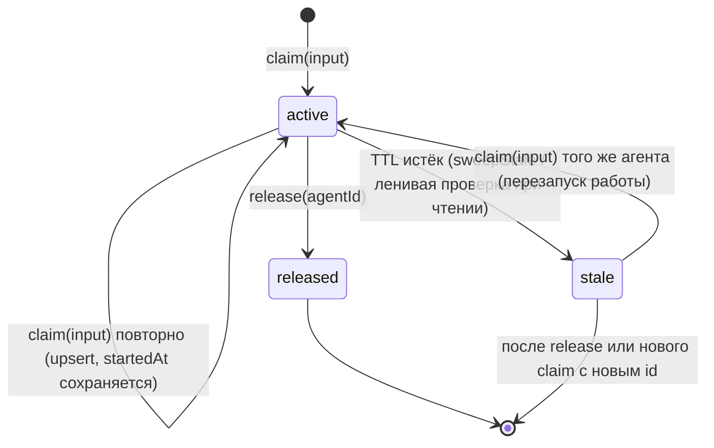
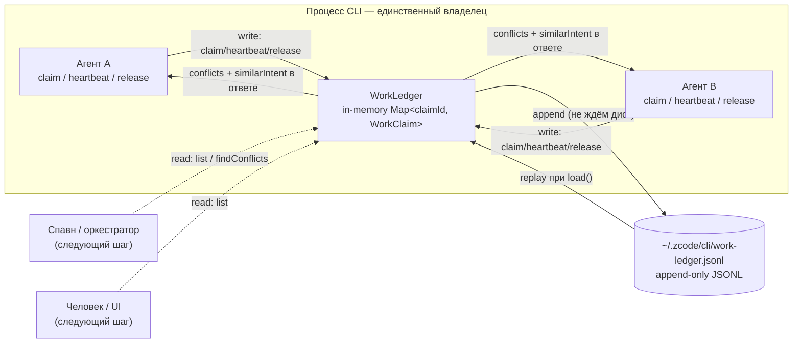

# Реестр работ агентов (Agent Work Ledger)

> Статус: реализовано ядро. Интеграция в спавн субагентов — отдельный следующий шаг
> (в этом изменении её нет, протокол не меняется).
> Код: `apps/zcode-cli/packages/core/src/runtime-task/work-ledger.ts`.
> Тесты: `apps/zcode-cli/packages/core/tests/work-ledger.test.ts`.

## 1. Проблема

В одном workspace одновременно работают несколько агентов (координатор и его субагенты).
Сегодня это реально случалось: 96 спавнов за сессию, часть агентов делала одну и ту же работу
и правила одни и те же файлы. Итог — конфликтующие правки, двойные затраты, потерянные изменения.

Существующие механизмы решают другие задачи:

- `owner/lease` (Host) отвечает за маршрутизацию ввода и владение сессией;
- `CommandInbox` (CLI/runtime) сериализует admission уже принятых busy/running запросов.

Ни один из них не отвечает на вопрос «какой агент что делает прямо сейчас и какие файлы держит».
Реестр работ (work ledger) закрывает именно этот пробел: до начала записи агент объявляет
намерение и набор путей, а реестр отвечает предупреждениями о конфликте и дубле.

## 2. Границы

В скоупе:

- in-memory реестр активных работ в процессе CLI — единственный владелец состояния;
- append-only журнал для переживания рестарта;
- API: `claim`, `heartbeat`, `release`, `list`, `findConflicts`, `findSimilarIntent`, `sweepStale`;
- нормализация и сравнение путей, TTL, дедупликация намерений.

Вне скоупа (следующие шаги, требуют отдельного согласования):

- вызовы реестра из спавна субагентов и подмешивание предупреждений в промпт;
- принудительная блокировка записи инструментов (реестр только предупреждает);
- изменения протокола `packages/shared/src/zcode-protocol/`, UI и remote-каналов;
- очередь работ, планировщик, распределение задач между агентами.

Реестр не заменяет `owner/lease` и `CommandInbox` и не хранит бизнес-состояние задач:
это индекс намерений и занятых путей, а не источник истины о сессии.

## 3. Модель данных

```ts
interface WorkClaim {
  id: string; // uuid claim'а
  workspaceIdentity: string; // ключ workspace: workspaceIdentity?.trim() || workspacePath
  workspacePath: string; // база для нормализации путей и отображения
  agentId: string;
  parentAgentId: string | null;
  profile: string | null;
  intent: string; // короткая строка «что делаю»
  paths: string[]; // нормализованные пути (relative к workspacePath, если внутри него)
  startedAt: number; // epoch ms
  heartbeatAt: number; // epoch ms
  status: "active" | "released" | "stale";
}
```

`workspacePath` добавлен к исходной модели как обязательное поле: без него нельзя ни
нормализовать пути, ни показать, где именно идёт работа. `workspaceIdentity` хранит
**разрешённый ключ** (`identity?.trim() || path`), а не сырое значение.

### 3.1 Ключ workspace

Единственное правило репозитория:

```ts
const workspaceKey = workspaceIdentity?.trim() || workspacePath;
```

Ключ используется для группировки, поиска конфликтов, дедупликации и персистентности.
Пути сравниваются только внутри одного ключа: агенты в разных workspace не конфликтуют,
даже если у них совпадают относительные пути.

### 3.2 Журнал (append-only)

Файл `~/.zcode/cli/work-ledger.jsonl`, по одному JSON-событию на строку:

```ts
type WorkLedgerEvent =
  | { v: 1; type: "claim"; at: number; claim: WorkClaim } // upsert полного снимка
  | { v: 1; type: "heartbeat"; at: number; claimId: string }
  | { v: 1; type: "release"; at: number; claimId: string; status: "released" | "stale" };
```

Журнал — не второй владелец состояния, а лог восстановления: истина в памяти процесса,
журнал только реплеится при старте. События применяются в порядке файла, последнее
событие по `claimId` побеждает.

## 4. Жизненный цикл



- `claim` создаёт или обновляет claim агента в данном workspace; повторный `claim` того же
  агента не плодит записи, а обновляет `intent`, `paths`, `heartbeatAt`.
- `heartbeat` продлевает все активные claim'ы агента.
- `release` переводит активные claim'ы агента в `released` (терминальное состояние).
- TTL — 10 минут с последнего heartbeat (`WORK_LEDGER_TTL_MS`). Просроченный claim
  считается `stale` **лениво**, при любом чтении, даже если `sweepStale` никто не вызвал:
  протухшая работа не может блокировать других навсегда.
- `sweepStale(now)` материализует просроченные claim'ы в `stale` и пишет события в журнал;
  ленивая проверка при чтении статус меняет, но Journal не трогает (это производное состояние).

## 5. Правила конфликта

Конфликт — это два **активных** claim'а в одном workspace, у которых пересекаются пути,
и это разные агенты. `released` и `stale` в конфликтах не участвуют.

### 5.1 Нормализация путей

1. `\` → `/`, trim.
2. Относительный путь разрешается от `workspacePath`; абсолютный нормализуется как есть.
3. `posix.normalize` убирает `.`, `..` и двойные слэши; хвостовой `/` отбрасывается.
4. Путь внутри workspace хранится относительно него (`src/a.ts`); корень — `"."`;
   путь вне workspace хранится абсолютным.
5. Сравнение регистронезависимо на macOS/Windows и регистрозависимо на Linux
   (переопределяется опцией `caseSensitivePaths`). Ложное предупреждение дешевле
   пропущенного конфликта.

### 5.2 Пересечение

Два нормализованных пути пересекаются, если:

- они равны (точное совпадение файла), или
- один является префиксом-каталогом другого: `src/a` ⊃ `src/a/b.ts`, или
- один из них — корень workspace `"."` (claim «весь workspace» пересекается со всем).

Префикс проверяется по границе сегмента: `src/ab` и `src/a/b.ts` не пересекаются.

### 5.3 Что возвращается

`WorkConflict` — по одному на конфликтующий путь кандидата:

```ts
interface WorkConflict {
  path: string; // путь кандидата
  kind: "same-file" | "directory-overlap";
  holders: Array<{
    claimId: string;
    agentId: string;
    parentAgentId: string | null;
    profile: string | null;
    intent: string;
    path: string; // путь держателя, который пересекается
    startedAt: number;
    heartbeatAt: number;
  }>;
}
```

Родитель и ребёнок не имеют приоритета: конфликт виден обоим, каждый получает
держателя другой стороны. Это осознанно — правило «родитель главнее» скрыло бы
реальную гонку записи.

Реестр **не блокирует**: `claim` всегда записывается и всегда возвращает
`{ claim, conflicts, similarIntent }`. Блокировка чтения не делается никогда;
решение «писать или согласовать» принимает вызывающая сторона (в будущем — спавн).
Ответ на конфликт — список занятых путей и кто их держит, а не отказ.

## 6. Дедупликация намерений

`findSimilarIntent` отвечает на вопрос «этим уже занимается кто-то другой?».

Нормализация `intent`: `trim` → `toLowerCase` → схлопывание пробелов в один.

Похожесть:

- `identical` — нормализованные строки равны;
- `overlapping` — пересечение значимых слов ≥ 2 (`MIN_SHARED_INTENT_TOKENS`);
  слова короче 2 символов, числа-шум и служебные слова (`и`, `в`, `на`, `the`, `and`, …)
  отбрасываются.

Если в запрос переданы `paths`, дополнительно требуется пересечение путей: одинаковые
слова про разные файлы — это не дубль. Если `paths` не переданы, фильтр по путям не
применяется (режим «кто вообще делает похожее»).

Результат — `WorkIntentWarning { claim, kind, sharedTokens, message }`, где `message`
готов к показу: «Этим уже занимается агент X: <intent>». Предупреждение не блокирует
`claim`; оно возвращается вместе с ним.

## 7. Владелец состояния и журнал



- Один владелец: экземпляр `WorkLedger` в процессе CLI. Других путей записи в состояние нет;
  журнал только дописывается.
- Запись в журнал не блокирует вызывающего: события складываются в последовательную
  цепочку промисов (`appendFile`), порядок сохраняется. Ошибка записи не отменяет claim —
  она фиксируется в `lastWriteError`, состояние в памяти остаётся истиной.
- `flush()` дожидается очереди записи (нужен тестам и корректному завершению процесса).
- `load()` реплеит журнал; битые строки и строки чужой версии пропускаются и считаются
  в `lastLoadError`/`skippedLines`, а не роняют CLI.
- Кросспроцессная согласованность не гарантируется: два процесса CLI с одним journal-путём
  могут перезаписать представление друг друга. Это граница текущего шага; единственный
  поддерживаемый сценарий — один CLI-процесс на пользователя.
- Ротация/компакция журнала не входит в этот шаг; формат append-only оставляет её
  возможной без миграции (перезапись снимков при старте).

## 8. API

```ts
new WorkLedger(options?: {
  journalPath?: string | null;   // default: ~/.zcode/cli/work-ledger.jsonl; null — только память
  ttlMs?: number;                // default: 10 минут
  now?: () => number;            // инъекция часов
  caseSensitivePaths?: boolean;  // default: platform !== "linux"
}): WorkLedger

await ledger.load(): Promise<void>;
ledger.claim(input): WorkClaimResult;
ledger.heartbeat(agentId, now?): WorkClaim[];
ledger.release(agentId, now?): WorkClaim[];
ledger.list(filter?): WorkClaim[];
ledger.findConflicts(input): WorkConflict[];
ledger.findSimilarIntent(input): WorkIntentWarning[];
ledger.sweepStale(now?): WorkClaim[];
ledger.flush(): Promise<void>;
```

- `claim` — `{ agentId, workspacePath, workspaceIdentity?, parentAgentId?, profile?, intent, paths? }`.
  Возвращает `{ claim, conflicts, similarIntent, reused }`.
- `findConflicts` — `{ paths, workspacePath, workspaceIdentity?, agentId? }`: `agentId`
  исключает собственные claim'ы (проверка «что будет, если я возьму эти файлы»).
- `findSimilarIntent` — `{ intent, workspacePath, workspaceIdentity?, paths?, agentId? }`.
- `list` — фильтры `workspaceIdentity`/`workspacePath`, `agentId`, `parentAgentId`,
  `status`, `paths` (пересечение). Сортировка по `startedAt`, затем `id`.
- Все публичные методы возвращают замороженные снимки: внешний код не может
  изменить состояние реестра в обход API.

## 9. Приёмочные сценарии

Тесты: `apps/zcode-cli/packages/core/tests/work-ledger.test.ts`.

- **(a) Один файл, два агента.** A берёт `src/runtime.ts`, B берёт тот же файл →
  `claim` B возвращает конфликт `same-file` с держателем A (agentId, intent).
- **(b) Разные файлы.** A берёт `src/a.ts`, B берёт `src/b.ts` → конфликтов нет,
  оба claim'а активны.
- **(c) Родитель и ребёнок.** Родитель берёт `src/runtime-task`, ребёнок —
  `src/runtime-task/work-ledger.ts` → конфликт `directory-overlap` виден обоим:
  ребёнку — с держателем-родителем, `findConflicts` родителя — с держателем-ребёнком.
- **(d) TTL.** Claim без heartbeat старше 10 минут → `sweepStale` переводит в `stale`;
  новый агент на тот же путь конфликтов не получает; `list({ status: "active" })`
  его не показывает.
- **(e) Похожее намерение.** Два агента с пересекающимися путями и похожим intent
  («реестр работ агентов» / «реестр работ агентов: API») → `findSimilarIntent`
  возвращает предупреждение с agentId и message; `claim` второго возвращает его же.
- **(f) Рестарт.** Claim'ы записаны, `flush()`, новый экземпляр `load()` →
  активные claim'ы восстановлены, `released` остаётся `released`, heartbeat продлён.

Дополнительно: нормализация путей (`./a/../a/x.ts`, `\`, абсолютный путь внутри workspace)
и отсутствие конфликта у путей с общим текстовым префиксом (`src/ab` vs `src/a/b.ts`).

## 10. Совместимость

- Новых зависимостей нет, протокол не меняется, UI не затрагивается.
- Новый файл — path-level exception `unmanaged-new-file` в `architecture-policy.yaml`
  (как у `first-token-watchdog.ts`): `apps/zcode-cli` остаётся `managed: false`,
  отдельного модуля у `runtime-task` нет.
- Следующий шаг интеграции: спавн вызывает `claim` до старта субагента, добавляет
  `conflicts`/`similarIntent` в его контекст как предупреждение, а `release` — на
  терминальном событии; heartbeat — по таймеру рантайма.
