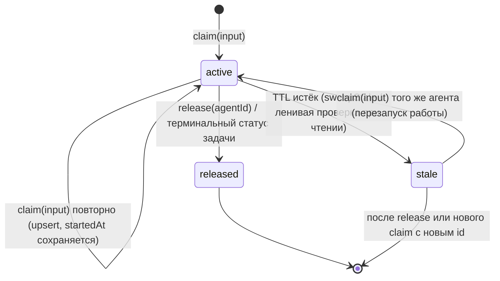
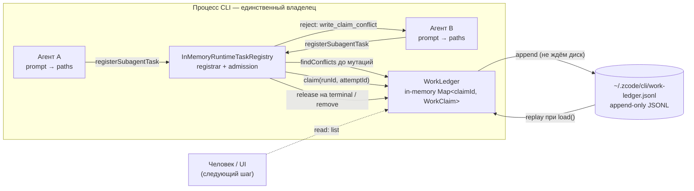

# Реестр работ агентов (Agent Work Ledger)

> Статус: реализованы ядро, интеграция в спавн субагентов и жёсткий registrar-gate.
> Протокол не меняется.
> Код: `apps/zcode-cli/packages/core/src/runtime-task/work-ledger.ts`,
> `apps/zcode-cli/packages/core/src/runtime-task/work-ledger-wire.ts`,
> `apps/zcode-cli/packages/core/src/runtime-task/registry.ts`,
> `apps/zcode-cli/packages/core/src/subagent/runner.ts`.
> Тесты: `apps/zcode-cli/packages/core/tests/work-ledger.test.ts`,
> `apps/zcode-cli/packages/core/tests/work-ledger-wire.test.ts`,
> `apps/zcode-cli/packages/core/tests/registrar-gate.test.ts`,
> `apps/zcode-cli/packages/core/tests/work-result.test.ts`.

## 1. Проблема

В одном workspace одновременно работают несколько агентов (координатор и его субагенты).
Сегодня это реально случалось: 96 спавнов за сессию, часть агентов делала одну и ту же работу
и правила одни и те же файлы. Итог — конфликтующие правки, двойные затраты, потерянные изменения.

Существующие механизмы решают другие задачи:

- `owner/lease` (Host) отвечает за маршрутизацию ввода и владение сессией;
- `CommandInbox` (CLI/runtime) сериализует admission уже принятых busy/running запросов.

Ни один из них не отвечает на вопрос «какой агент что делает прямо сейчас и какие файлы держит».
Реестр работ (work ledger) закрывает именно этот пробел: до начала записи агент объявляет
намерение и набор путей, а registrar блокирует спавн при пересечении с живым claim'ом.

## 2. Границы

В скоупе:

- in-memory реестр активных работ в процессе CLI — единственный владелец состояния;
- append-only журнал для переживания рестарта;
- API: `claim`, `heartbeat`, `release`, `list`, `findConflicts`, `findSimilarIntent`, `sweepStale`;
- нормализация и сравнение путей, TTL, дедупликация намерений;
- registrar-gate в `runtime-task/registry.ts`: конфликт путей блокирует admission **до**
  создания задачи и расхода spawn-бюджета;
- periodic sweep протухших claim'ов внутри registry;
- `workResult` в контракте завершённого субагента и агрегация WorkResult для DAG.

Вне скоупа (следующие шаги, требуют отдельного согласования):

- принудительная блокировка записи инструментов (реестр блокирует только spawn, не Write/Edit);
- изменения протокола `packages/shared/src/zcode-protocol/`, UI и remote-каналов;
- очередь работ, планировщик, распределение задач между агентами.

Реестр не заменяет `owner/lease` и `CommandInbox` и не хранит бизнес-состояние задач:
это индекс намерений и занятых путей, а не источник истины о сессии.

**Registry — registrar, а не LLM.** `InMemoryRuntimeTaskRegistry` детерминированно применяет
правила admission: извлекает пути регулярными выражениями, сравнивает их с активными claim'ами,
создаёт claim и только потом меняет состояние задачи. Он не спрашивает модель, не «предлагает»
и не использует семантику намерения для блокировки. Модель не может обойти gate текстом:
любой билет в спавн проходит один и тот же код.

## 3. Модель данных

```ts
interface WorkClaim {
  id: string; // uuid claim'а
  workspaceIdentity: string; // ключ workspace: workspaceIdentity?.trim() || workspacePath
  workspacePath: string; // база для нормализации путей и отображения
  agentId: string;
  parentAgentId: string | null;
  profile: string | null;
  intent: string; // короткая строка «что делаю»
  paths: string[]; // нормализованные пути (relative к workspacePath, если внутри него)
  startedAt: number; // epoch ms
  heartbeatAt: number; // epoch ms
  status: "active" | "released" | "stale";
  runId?: string; // root run, в котором создан claim (admission-контекст)
  attemptId?: string; // попытка задачи, выдавшая claim
}
```

`workspacePath` добавлен к исходной модели как обязательное поле: без него нельзя ни
нормализовать пути, ни показать, где именно идёт работа. `workspaceIdentity` хранит
**разрешённый ключ** (`identity?.trim() || path`), а не сырое значение.

`runId`/`attemptId` — additive-поля. Они не участвуют в конфликтах, но связывают claim
с root run и попыткой задачи: по ним аудит журнала и terminal catalog отличает повторный
admission (repair) от старого claim'а. Старые записи журнала без этих полей читаются.

### 3.1 Ключ workspace

Единственное правило репозитория:

```ts
const workspaceKey = workspaceIdentity?.trim() || workspacePath;
```

Ключ используется для группировки, поиска конфликтов, дедупликации и персистентности.
Пути сравниваются только внутри одного ключа: агенты в разных workspace не конфликтуют,
даже если у них совпадают относительные пути.

### 3.2 Журнал (append-only)

Файл `~/.zcode/cli/work-ledger.jsonl`, по одному JSON-событию на строку:

```ts
type WorkLedgerEvent =
  | { v: 1; type: "claim"; at: number; claim: WorkClaim } // upsert полного снимка
  | { v: 1; type: "heartbeat"; at: number; claimId: string }
  | { v: 1; type: "release"; at: number; claimId: string; status: "released" | "stale" };
```

Снимок `claim` включает `runId`/`attemptId`, если они известны. Журнал — не второй владелец
состояния, а лог восстановления: истина в памяти процесса, журнал только реплеится при старте.
События применяются в порядке файла, последнее событие по `claimId` побеждает.

## 4. Жизненный цикл



- `claim` создаёт или обновляет claim агента в данном workspace; повторный `claim` того же
  агента не плодит записи, а обновляет `intent`, `paths`, `heartbeatAt`, `runId`, `attemptId`.
- `heartbeat` продлевает все активные claim'ы агента.
- `release` переводит активные claim'ы агента в `released` (терминальное состояние).
- TTL — 10 минут с последнего heartbeat (`WORK_LEDGER_TTL_MS`). Просроченный claim
  считается `stale` **лениво**, при любом чтении, даже если `sweepStale` никто не вызвал:
  протухшая работа не может блокировать других навсегда.
- `sweepStale(now)` материализует просроченные claim'ы в `stale` и пишет события в журнал;
  ленивая проверка при чтении статус меняет, но Journal не трогает (это производное состояние).
- Registry с подключённым ledger'ом запускает **periodic sweep** (`WORK_LEDGER_TTL_MS / 2`)
  через `setInterval(...).unref?.()`. Перед `sweepStale` вызывается
  `heartbeatActiveWorkClaims`: claim'ы всех `local_agent` задач в статусе `running`
  продлеваются, поэтому живая задача не протухает из-за отсутствия child-событий;
  `stale` становятся только claim'ы без живой задачи. Ошибки sweep'а ловятся и не роняют
  процесс. Таймер снимается `dispose()`: root `AgentRuntime`, создавший registry, вызывает
  его в `beginShutdown`, а переданный извне (общий для дочерних runtime) registry
  закрывает его владелец. Ленивая проверка остаётся основным механизмом корректности:
  periodic sweep лишь материализует `stale` в журнале и освобождает память.

## 5. Правила конфликта

Конфликт — это два **активных** claim'а в одном workspace, у которых пересекаются пути,
и это разные агенты. `released` и `stale` в конфликтах не участвуют.

### 5.1 Нормализация путей

1. `\` → `/`, trim.
2. Относительный путь разрешается от `workspacePath`; абсолютный нормализуется как есть.
3. `posix.normalize` убирает `.`, `..` и двойные слэши; хвостовой `/` отбрасывается.
4. Путь внутри workspace хранится относительно него (`src/a.ts`); корень — `"."`;
   путь вне workspace хранится абсолютным.
5. Сравнение регистронезависимо на macOS/Windows и регистрозависимо на Linux
   (переопределяется опцией `caseSensitivePaths`). Ложное предупреждение дешевле
   пропущенного конфликта.

### 5.2 Пересечение

Два нормализованных пути пересекаются, если:

- они равны (точное совпадение файла), или
- один является префиксом-каталогом другого: `src/a` ⊃ `src/a/b.ts`, или
- один из них — корень workspace `"."` (claim «весь workspace» пересекается со всем).

Префикс проверяется по границе сегмента: `src/ab` и `src/a/b.ts` не пересекаются.

### 5.3 Что возвращается

`WorkConflict` — по одному на конфликтующий путь кандидата:

```ts
interface WorkConflict {
  path: string; // путь кандидата
  kind: "same-file" | "directory-overlap";
  holders: Array<{
    claimId: string;
    agentId: string;
    parentAgentId: string | null;
    profile: string | null;
    intent: string;
    path: string; // путь держателя, который пересекается
    startedAt: number;
    heartbeatAt: number;
  }>;
}
```

Родитель и ребёнок не имеют приоритета: конфликт виден обоим, каждый получает
держателя другой стороны. Это осознанно — правило «родитель главнее» скрыло бы
реальную гонку записи.

`claim` по-прежнему не блокирует сам по себе и возвращает `{ claim, conflicts, similarIntent }`:
ядро остаётся честным индексом, а решение о блокировке принимает registrar (следующий раздел).
`findConflicts` — чистое чтение, поэтому его можно вызывать до любых мутаций.

## 6. Registrar hard gate

`registerSubagentTask` — единственная точка admission для subagent-задач. До любых мутаций
состояния (расход spawn-бюджета, `setTaskSnapshot`, запись в индексы) он выполняет:

1. `text = task.prompt || task.description`.
2. `paths = extractTaskPaths(text)` (консервативный экстрактор явных путей).
   Backtick-спан сначала проверяется целиком: пробелы разрешены внутри сегментов
   (`/tmp/zcode workspace/repo/src/a.ts`), поэтому workspace с пробелом не оставляет
   частичный claim на родительский каталог. Команда (`pnpm test src/a.test.ts`)
   распадается на токены, и путём становится только её аргумент. Каталог из двух
   сегментов без расширения принимается только для известных исходных каталогов
   (`src/runtime-task`), а `text/html` — нет.
3. Если передан `workLedger` и известен `workspacePath` и `paths.length > 0`:
   `conflicts = ledger.findConflicts({ workspacePath, paths, agentId: task.agentId })`.
4. Непустые `conflicts` → `{ accepted: false, reason: "write_claim_conflict" }`.
   Задача не создаётся, budget не тратится, claim не появляется.
5. Ошибка ledger'а на чтении или записи → `{ accepted: false, reason: "work_claim_unavailable" }`.
   Это fail-closed: при включённом ledger'е нельзя гарантировать отсутствие конфликта.
6. Без ledger'а или без workspacePath gate выключен (обратная совместимость).
7. Только после всех admission-gates создаётся claim с `runId = rootRunId` и
   `attemptId = stamped.attemptId`. Если claim бросает, spawn отклоняется
   (`work_claim_unavailable`), а частичный claim не остаётся.
8. `agentId` в `findConflicts` исключает собственные claim'ы: repair/повторный admission
   того же агента не конфликтует сам с собой.

При отказе узел DAG падает, его потомки получают `blocked`, агрегированный `workResult`
становится `partial`/`failed`. Отказ admission не оставляет ни задачи, ни claim'а.

`declareWorkClaim` больше не пишет `console.warn` и не игнорирует конфликты: конфликт
блокирует spawn до claim'а. Release остаётся в `setTaskSnapshot` (единый funnel) и `remove`.

### 6.1 Остаток бюджета и фактический maxParallel

`InMemoryRuntimeTaskRegistry` — владелец остатка spawn-бюджета. Наружу добавлены
read-only методы:

```ts
getRemainingSpawnBudget(rootRunId: string, sessionId: SessionId): number | undefined;
getActiveSubagentWorkItemCount(rootSessionId: SessionId): number;
```

`getRemainingSpawnBudget` возвращает `remainingSpawnsBySession.get(sessionId) ?? spawnBudget`
и `undefined`, если root-run состояния нет (legacy-путь). `resolveSpawnGrant` при отсутствии
явных `internalSpawnGrant`/`spawnBudget` берёт остаток из registry по
`runOptions.internalSwarmRootRunId` (или `getRootRunIdForSession`) и **не** откатывается к
`options.spawnBudget`, если registry уже знает остаток. Старый fallback остаётся только для
вызовов без root-run состояния.

Фактический параллелизм DAG — чистая функция:

```
actual = max(1, min(nodeCount, requested, remainingSpawns, activeCap - activeCount))
```

- `remainingSpawns = 0` или нет свободных worker slots → routing gate выбирает
  `integrate_inline` с причиной про бюджет; DAG-порт всё равно может попытаться запустить
  один узел, чтобы admission вернул видимую причину (`spawn_budget_exhausted`).
- `runTaskDag` порта пересчитывает `maxParallel` по registry remaining и active cap, а не
  берёт сырой `request.maxParallel`.
- Конверт ребёнка (`<zcode-spawn-envelope>`) печатает фактический `max_parallel` из
  `ExploreSubagentRuntimeRequest.maxParallel`; хардкода `8` нет. `buildSpawnEnvelope` —
  чистая функция, экспортируется для тестов.

Routing gate (`resolveSwarmParallelism`) живёт в `profile.ts` и не меняется. Расширение
`remainingSpawns/activeCount/activeCap` реализовано обёрткой в `runner.ts`, которую вызывает
`turn.ts`: она подставляет минимальный бюджет/лимит и при нулевой ёмкости возвращает
`integrate_inline`.

## 7. Дедупликация намерений

`findSimilarIntent` отвечает на вопрос «этим уже занимается кто-то другой?».

Нормализация `intent`: `trim` → `toLowerCase` → схлопывание пробелов в один.

Похожесть:

- `identical` — нормализованные строки равны;
- `overlapping` — пересечение значимых слов ≥ 2 (`MIN_SHARED_INTENT_TOKENS`);
  слова короче 2 символов, числа-шум и служебные слова (`и`, `в`, `на`, `the`, `and`, …)
  отбрасываются.

Если в запрос переданы `paths`, дополнительно требуется пересечение путей: одинаковые
слова про разные файлы — это не дубль. Если `paths` не переданы, фильтр по путям не
применяется (режим «кто вообще делает похожее»).

Результат — `WorkIntentWarning { claim, kind, sharedTokens, message }`, где `message`
готов к показу: «Этим уже занимается агент X: <intent>». Предупреждение не блокирует
`claim`; оно возвращается вместе с ним и попадает в конверт ребёнка. Блокирует только
пересечение путей (registrar hard gate).

## 8. WorkResult завершённого агента

`AgentCompletedOutput` получает additive-поле `workResult?: WorkResult`:

```ts
interface WorkResult {
  status: "completed" | "partial" | "failed" | "blocked";
  summary: string;
  files: string[];
  evidence: string[];
  tests: Array<{ command: string; status: "passed" | "failed" | "not_run"; summary?: string }>;
  unresolved: string[];
  confidence?: number; // 0..1
  claims: Array<{ path: string; runId?: string; attemptId?: string }>;
  metrics?: { durationMs?: number; toolUses?: number; tokens?: number };
}
```

Источники:

1. Финальный текст worker'а может содержать блок
   `<zcode-work-result>JSON</zcode-work-result>`. Блок парсится и валидируется строгой
   схемой (обязательны `status`, `summary`; остальные поля имеют детерминированные
   default'ы). Валидный блок — источник `status/summary/files/evidence/tests/unresolved`.
2. Невалидный JSON или несоответствие схеме → блок игнорируется, применяется fallback:
   `summary` из текста, `files` — из `Write/Edit/MultiEdit` tool events, `tests` — из Bash
   команд с признаками тестового прогона, `evidence` — из tool result/error событий,
   `metrics` — из usage/toolUseCount/duration. Текстовый content не меняется.
3. `claims` заполняются из ledger по `agentId`/`workspacePath`; в них попадают `runId`
   и `attemptId`, если они есть у claim'а.

`AgentOutput.status` остаётся `"completed"` по контракту даже при `workResult.status`
`partial/failed`; фактический статус показывает `workResult` и текст сводки
(в `formatAgentOutputForModel` добавляется `work_result: ...`).

Агрегация DAG:

- `completed` — только если все узлы `completed` и их `workResult.status = completed`;
- `failed` — если есть узел `failed` (включая rejected Host acceptance или
  `workResult.status = failed`);
- `partial` — blocked/cancelled/unknown узлы или частичный `workResult` без failed.

Сводка DAG строится из агрегированного `WorkResult`: status, summary, files, tests,
evidence, unresolved. Ошибки admission (`spawn_budget_exhausted`, `write_claim_conflict`)
видны в статусе узла и в причине сводки.

## 9. Repair / retry

- Автоматического retry failed/неидемпотентных узлов нет: DAG вызывает `runNode` один раз.
- Repair — это новая admission с новым `attemptId` (`randomUUID` на каждый допуск).
  Повторный admission того же `agentId` не конфликтует с собственным claim'ом, но
  обязан пройти все остальные gates (owner, lineage, budget, active limit).
- После fail/timeout/cancel/killed/stopped/lost задача переходит в terminal, а claim
  освобождается в `setTaskSnapshot`; `remove` активной задачи освобождает его напрямую.
  Поэтому новая попытка на тот же путь проходит без stale-конфликта.

## 10. Владелец состояния и журнал



- Один владелец: экземпляр `WorkLedger` в процессе CLI. Других путей записи в состояние нет;
  журнал только дописывается.
- Запись в журнал не блокирует вызывающего: события складываются в последовательную
  цепочку промисов (`appendFile`), порядок сохраняется. Ошибка записи не отменяет claim —
  она фиксируется в `lastWriteError`, состояние в памяти остаётся истиной.
- `flush()` дожидается очереди записи (нужен тестам и корректному завершению процесса).
- `load()` реплеит журнал; битые строки и строки чужой версии пропускаются и считаются
  в `lastLoadError`/`skippedLines`, а не роняют CLI.
- Кросспроцессная согласованность не гарантируется: два процесса CLI с одним journal-путём
  могут перезаписать представление друг друга. Это граница текущего шага; единственный
  поддерживаемый сценарий — один CLI-процесс на пользователя.
- Ротация/компакция журнала не входит в этот шаг; формат append-only оставляет её
  возможной без миграции (перезапись снимков при старте).

## 11. API

```ts
new WorkLedger(options?: {
  journalPath?: string | null;   // default: ~/.zcode/cli/work-ledger.jsonl; null — только память
  ttlMs?: number;                // default: 10 минут
  now?: () => number;            // инъекция часов
  caseSensitivePaths?: boolean;  // default: platform !== "linux"
}): WorkLedger

await ledger.load(): Promise<void>;
ledger.claim(input): WorkClaimResult;
ledger.heartbeat(agentId, now?): WorkClaim[];
ledger.release(agentId, now?): WorkClaim[];
ledger.list(filter?): WorkClaim[];
ledger.findConflicts(input): WorkConflict[];
ledger.findSimilarIntent(input): WorkIntentWarning[];
ledger.sweepStale(now?): WorkClaim[];
ledger.flush(): Promise<void>;
```

- `claim` — `{ agentId, workspacePath, workspaceIdentity?, parentAgentId?, profile?, intent,
paths?, runId?, attemptId?, now? }`. Возвращает `{ claim, conflicts, similarIntent, reused }`.
- `findConflicts` — `{ paths, workspacePath, workspaceIdentity?, agentId? }`: `agentId`
  исключает собственные claim'ы (проверка «что будет, если я возьму эти файлы»).
- `findSimilarIntent` — `{ intent, workspacePath, workspaceIdentity?, paths?, agentId? }`.
- `list` — фильтры `workspaceIdentity`/`workspacePath`, `agentId`, `parentAgentId`,
  `status`, `paths` (пересечение). Сортировка по `startedAt`, затем `id`.
- Все публичные методы возвращают замороженные снимки: внешний код не может
  изменить состояние реестра в обход API.
- Registry дополнительно экспортирует `getRemainingSpawnBudget`,
  `getActiveSubagentWorkItemCount` и `dispose()`; последние два/три — optional в
  `RuntimeTaskRegistry` для совместимости реализаций.

## 12. Приёмочные сценарии

Тесты: `apps/zcode-cli/packages/core/tests/work-ledger.test.ts`,
`tests/work-ledger-wire.test.ts`, `tests/registrar-gate.test.ts`,
`tests/work-result.test.ts`, `tests/spawn-budget.test.ts`.

Ядро:

- **(a) Один файл, два агента.** A берёт `src/runtime.ts`, B берёт тот же файл →
  `claim` B возвращает конфликт `same-file` с держателем A (agentId, intent).
- **(b) Разные файлы.** A берёт `src/a.ts`, B берёт `src/b.ts` → конфликтов нет,
  оба claim'а активны.
- **(c) Родитель и ребёнок.** Родитель берёт `src/runtime-task`, ребёнок —
  `src/runtime-task/work-ledger.ts` → конфликт `directory-overlap` виден обоим.
- **(d) TTL.** Claim без heartbeat старше 10 минут → `sweepStale` переводит в `stale`;
  новый агент на тот же путь конфликтов не получает.
- **(e) Похожее намерение.** Два агента с пересекающимися путями и похожим intent →
  `findSimilarIntent` возвращает предупреждение.
- **(f) Рестарт.** Claim'ы записаны, `flush()`, новый экземпляр `load()` →
  активные claim'ы восстановлены, `runId`/`attemptId` сохранены; старые строки без
  этих полей читаются.

Registrar:

- same-file и directory-overlap конфликт блокируют `registerSubagentTask`
  (`write_claim_conflict`), задача и claim не создаются, budget не тратится;
- без ledger'а тот же спавн проходит (backward compat);
- ошибка ledger'а на gate/claim → `work_claim_unavailable`, задача не создаётся;
- fail/cancel/timeout(killed/stopped/lost) освобождают путь; новый claim после release
  проходит;
- протухший claim не блокирует новый admission;
- backtick-путь с пробелом извлекается целиком: absolute и relative ссылки на один
  файл конфликтуют, два разных absolute-файла — нет;
- directory scope `src/runtime-task` пересекается с `src/runtime-task/work-ledger.ts`;
- claim `running`-задачи переживает TTL и periodic sweep; claim без живой задачи — нет;
- каждый повторный admission получает новый `attemptId`;
- `runId`/`attemptId` есть в claim, журнале и terminal catalog.

Бюджет и параллелизм:

- remaining=2 при 5 узлах → фактический `maxParallel = 2`;
- конверт содержит `max_parallel="2"`, а не `8`;
- remaining=0 → `spawn_budget_exhausted` виден в admission, DAG-сводке и `workResult`.

WorkResult:

- валидный блок парсится; невалидный JSON/схема → fallback;
- fallback собирает summary/files/tests/evidence/metrics из текста и tool events;
- агрегация completed/partial/failed;
- сводка DAG содержит status/files/tests/unresolved;
- failed-узел не ретраится автоматически (`runNode` вызван один раз).

## 13. Совместимость

- Новых зависимостей нет, протокол не меняется, UI не затрагивается.
- Новые файлы — path-level exceptions `unmanaged-new-file` в `architecture-policy.yaml`
  (как у `first-token-watchdog.ts`): `apps/zcode-cli` остаётся `managed: false`,
  отдельного модуля у `runtime-task` нет.
- Интеграция (spawn path):
  - `InMemoryRuntimeTaskRegistry` получает `workLedger` только извне; `AgentRuntime`
    передаёт его в registry, bootstrap создаёт один процессный экземпляр
    (`getProcessWorkLedger`, ленивый реплей журнала). Без ledger'а wiring выключен.
  - `registerSubagentTask` сначала вызывает `findConflicts`, затем создаёт claim с
    `runId`/`attemptId`, пишет снапшот задачи и только после успешной записи списывает
    spawn-бюджет; сбой `setTaskSnapshot` откатывает claim и не съедает бюджет.
  - В конверт ребёнка (`runtime/methods/subagent.ts`, конец `agentPrompt`) добавляется
    блок «Сейчас в работе у других агентов» (≤15 строк) и строка о похожем намерении.
  - `setTaskSnapshot` — единый funnel: переход в терминальное состояние
    (completed/failed/cancelled/killed/stopped/lost) вызывает `release`; удаление активной
    задачи тоже освобождает claim. `heartbeat` идёт с шагов ребёнка (child event sink),
    не чаще раза в минуту.
  - `SubagentSpawned` payload и terminal catalog record получают additive `runId`
    (и `attemptId` уже есть в catalog) для аудита; старые записи читаются без них.
  - Любая ошибка ledger'а на gate/claim отклоняет spawn (`work_claim_unavailable`);
    ошибки release/heartbeat ловятся и логируются.
