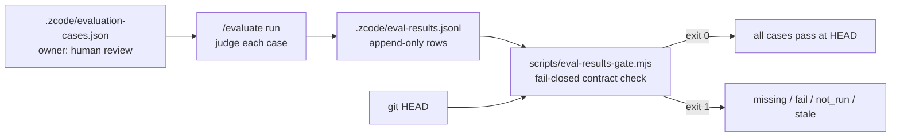

# Evaluation gate

## Product rules

- The shared evaluation suite has exactly one owner: `.zcode/evaluation-cases.json` at the workspace root. Test files, one-off commands, and ad-hoc criteria are not the suite.
- The catalog is version `1` and holds at most 50 cases. A case is an object with exactly `id`, `criterion`, and optional `evidence`. `id` matches `^[A-Z][A-Z0-9-]{1,40}$`; `criterion` and `evidence` are single-line texts of 1-240 characters; ids are unique.
- `/evaluate` judges every catalog case in the current run and reports exactly one of three outcomes: `pass`, `fail`, or `not_run`.
- `pass` requires evidence observed in this run. Missing, stale, or indirect evidence remains `not_run`; `not_run` is never a pass and cannot close the gate.
- The evaluator appends one JSON object per line to `.zcode/eval-results.jsonl`. Required fields are `case_id`, `revision`, `result`, and `evidence`. `revision` is the full `git rev-parse HEAD` of the evaluated checkout. Unknown fields are rejected, so no percentage, rate, average, or score can enter the record.
- Results are an append-only history. The gate uses the last row per case whose `revision` equals HEAD. A case with only rows for another revision counts as missing.
- `node scripts/eval-results-gate.mjs` (also `pnpm eval:gate`) is fail-closed and exits `0` only when every catalog case has a `pass` row at HEAD with non-empty evidence. Each of the following exits `1`: missing or invalid catalog, missing results file, invalid JSON line, unknown case id, unknown field, invalid result value, conflicting duplicate results for one case at HEAD, missing case row, stale-only revision, `not_run`, `fail`, `pass` without evidence, or an unreadable git HEAD.
- The gate does not run models, authenticate evidence, or judge quality. It verifies the recorded contract; independent review of the evidence stays manual. It never prints percentages or scores.
- The gate is not part of `verify:pre-push`. Results come from a model-driven `/evaluate` run, not from unit tests, so wiring the gate into every push would block commits on an activity that has not happened yet.

## Data formats

`.zcode/evaluation-cases.json`:

```json
{
  "version": 1,
  "cases": [
    {
      "id": "E-START-GW",
      "criterion": "A non-trivial /start request is dispatched with exactly one Task(start) call.",
      "evidence": "task metadata and transcript"
    }
  ]
}
```

`.zcode/eval-results.jsonl`, one object per line:

```json
{
  "case_id": "E-START-GW",
  "revision": "<40-hex HEAD>",
  "result": "pass",
  "evidence": "task metadata: one start task, id 42"
}
```

## State ownership and order



## Acceptance scenarios

| ID     | Given                                                       | When                 | Then                                                                                   |
| ------ | ----------------------------------------------------------- | -------------------- | -------------------------------------------------------------------------------------- |
| EVG-01 | The catalog lists its cases                                 | Run `/evaluate`      | Every case is reported once as pass, fail, or not run, with direct evidence            |
| EVG-02 | A case has no observed evidence                             | Run `/evaluate`      | The case is recorded as `not_run`, never as `pass`                                     |
| EVG-03 | Every catalog case has a `pass` row at the current HEAD     | Run `pnpm eval:gate` | The gate prints a pass summary and exits `0`                                           |
| EVG-04 | A catalog case has no result row                            | Run the gate         | The gate names the missing case and exits `1`                                          |
| EVG-05 | One result row is `not_run`                                 | Run the gate         | The gate rejects `not_run` as not pass and exits `1`                                   |
| EVG-06 | Every result row was recorded at an earlier HEAD            | Run the gate         | The gate reports stale revisions and exits `1`                                         |
| EVG-07 | The results file contains a malformed line                  | Run the gate         | The gate reports the line number, exits `1`, and does not evaluate later lines blindly |
| EVG-08 | The catalog contains a metric name such as `E-TOKEN-BUDGET` | Run `/evaluate`      | The catalog stays valid; only credential-shaped text is rejected as a secret           |
| EVG-09 | A `pass` row has empty evidence                             | Run the gate         | The gate rejects the pass and exits `1`                                                |
| EVG-10 | The results file is missing                                 | Run the gate         | The gate exits `1` and tells the operator to run `/evaluate` at HEAD                   |
