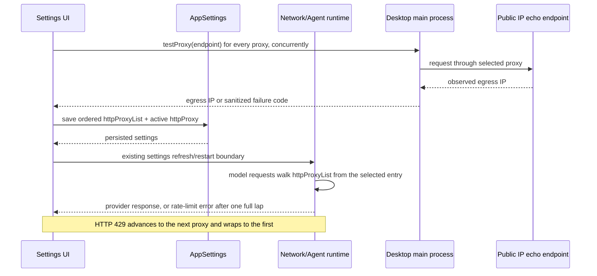

# Network proxy list settings

## Product rules

- The Network settings page stores an ordered, newline-separated list of proxy endpoints in `AppSettings.httpProxyList`; the list is edited in a dedicated dialog opened by a proxy-list button.
- Supported input forms are `ip:port:login:pass` (normalized to a SOCKS5 URL), `socks://...` (SOCKS5 alias), `socks5://...`, `http://...`, and `https://...`. Credentials are retained locally and never included in status messages or logs.
- `AppSettings.httpProxy` remains the selected route for the renderer, Host API, MCP, and command tools. A non-empty `httpProxyList` is also the ordered ring for model-provider requests.
- The user selects the active entry explicitly. Saving a list preserves direct routing when direct is currently selected. If a non-direct active entry is removed, saving selects the first remaining entry; saving an empty list clears the active proxy and restores the existing direct-route behavior.
- When the list is non-empty, model-provider requests start at the selected `httpProxy` if that value is in the list, otherwise at the first entry. They do not stay on a direct connection just because direct is the selected renderer route.
- Existing installations with only `httpProxy` hydrate the editor as a one-entry list, preserving the active route. Saving migrates that value to `httpProxyList`.
- Selecting a different entry updates only `httpProxy`; list order and contents remain unchanged. Runtime route changes follow the existing restart/recreation boundary.
- A model-provider HTTP 429 before any response is returned to the caller retries that same request through the next list entry. The entry after the last is the first. One request tries each entry at most once, then the rate-limit error is surfaced. The next request starts at the entry after the last one tried. The model and provider do not change. Connection failures raised while establishing the proxy tunnel, before the request is sent (`ECONNREFUSED`, `ECONNRESET`, `EHOSTUNREACH`, `ENETUNREACH`, `ETIMEDOUT`, `EAI_AGAIN`, `ENOTFOUND`, undici `UND_ERR_CONNECT_TIMEOUT` / `UND_ERR_SOCKET`, CONNECT/SOCKS handshake failures, including errors nested in `cause`), mark that entry dead and the same request continues with the next entry. When every entry is dead the request is sent directly without a proxy; a direct-connection failure surfaces as the model error, never as a proxy error. A dead entry is not selected for 60 seconds through an in-memory `host:port` health cache that resets whenever the configured list changes. Any HTTP status other than 429 is returned as-is and does not rotate. An empty list keeps the single selected proxy or direct route, and a 429 is not retried. OpenCode rotates only when its current upstream is SOCKS: the loopback bridge retargets to the next SOCKS entry, existing tunnels are closed, and the local session request is retried before stream output. An HTTP OpenCode upstream stays on the selected proxy. MCP and command tools never receive the proxy list.
- Proxy URLs and credentials remain in local settings and are not written to logs or diagnostics. UI route labels redact username/password and show only scheme and host/port.
- The dialog has one multiline editor with one endpoint per line, so users can paste a whole proxy list. A derived entry list provides Use, Remove, and transient test status for each non-empty line. Testing is a single action beside Use direct that checks every entry concurrently; editing/removing a line never changes the active route until explicitly selected or saved under the rules above.
- One Test all proxies action sends independent checks through every non-empty proxy concurrently. It does not change the active route and reports each returned egress IP or a red failure state. Test status is transient UI state and is not persisted.
- The connectivity check tries multiple public IP-echo endpoints sequentially per proxy, so one unavailable echo service does not mark an otherwise working proxy as failed.

## State ownership and order

## Acceptance scenarios

| ID     | Given                                                                       | When                     | Then                                                                                                  |
| ------ | --------------------------------------------------------------------------- | ------------------------ | ----------------------------------------------------------------------------------------------------- |
| NPS-01 | Settings has legacy `httpProxy` and no list                                 | Open Network settings    | The editor shows the legacy active URL as one line and keeps it active                                |
| NPS-02 | The user enters several URLs, one per line while direct routing is selected | Save the list            | Blank lines and surrounding whitespace are removed; list is saved and direct routing remains selected |
| NPS-03 | A saved list has an active entry                                            | Select another entry     | Only `httpProxy` changes; the selected URL becomes the runtime's active route                         |
| NPS-04 | The active entry is removed from the list                                   | Save the list            | The first remaining URL becomes active, or direct routing is restored when the list is empty          |
| NPS-05 | The saved list has two or more proxies and a model request returns HTTP 429 | Before any output        | The same request tries the next proxy, wraps from the last to the first, and stops after one lap. The model and provider stay the same |
| NPS-06 | The user opens proxy settings                                               | Click Add/manage proxies | One multiline editor accepts one proxy per line; each non-empty entry has Use and Remove actions      |
| NPS-07 | A proxy is entered using any supported format                               | Save the list            | Endpoints are normalized and saved in order; credentials are preserved only in local settings         |
| NPS-08 | The list has configured proxies                                             | Click Test all proxies   | Every proxy is checked concurrently; each success shows a green status and outbound IP                |
| NPS-09 | A proxy is unreachable or invalid                                           | Click Test all proxies   | That proxy shows red while other checks finish; the active route is unchanged                         |
| NPS-10 | A proxy includes credentials                                                 | View current route       | UI shows its scheme and host/port without username or password                                       |
| NPS-11 | The first list entry refuses the tunnel and the second one is healthy        | Send a model request     | The request succeeds through the second entry; no model error is raised                              |
| NPS-12 | Every list entry refuses the tunnel                                          | Send a model request     | The request is sent directly and succeeds; the dead entries are reported as warnings                  |
| NPS-13 | Every list entry refuses the tunnel and the direct connection fails          | Send a model request     | The surfaced error is the direct network error, not a proxy error, and contains no credentials        |
| NPS-14 | An entry was marked dead less than 60 seconds ago                            | Send another model request | That entry is skipped without a connection attempt; it becomes selectable again after the window    |
