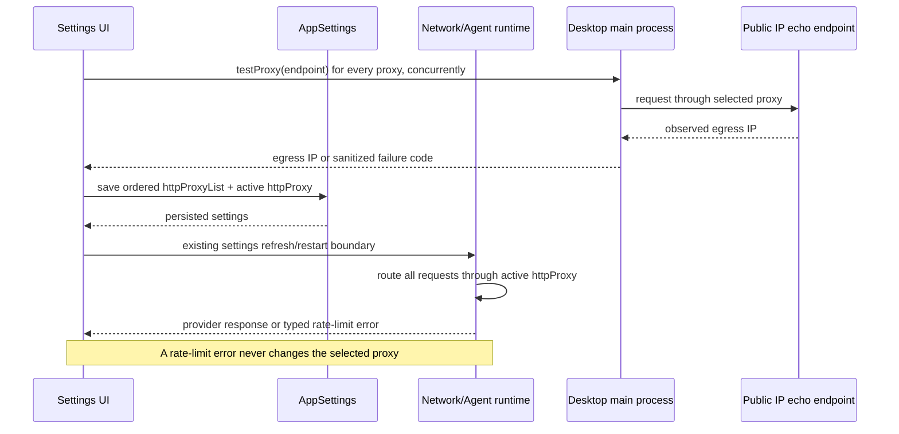

# Network proxy list settings

## Product rules

- The Network settings page stores an ordered, newline-separated list of proxy endpoints in `AppSettings.httpProxyList`; the list is edited in a dedicated dialog opened by a proxy-list button.
- Supported input forms are `ip:port:login:pass` (normalized to a SOCKS5 URL), `socks://...` (SOCKS5 alias), `socks5://...`, `http://...`, and `https://...`. Credentials are retained locally and never included in status messages or logs.
- `AppSettings.httpProxy` remains the single active proxy consumed by renderer, Host, CLI tools, and OpenCode. The list is not itself a routing or retry policy.
- The user selects the active entry explicitly. Saving a list preserves direct routing when direct is currently selected. If a non-direct active entry is removed, saving selects the first remaining entry; saving an empty list clears the active proxy and restores the existing direct-route behavior.
- Existing installations with only `httpProxy` hydrate the editor as a one-entry list, preserving the active route. Saving migrates that value to `httpProxyList`.
- Selecting a different entry updates only `httpProxy`; list order and contents remain unchanged. Runtime route changes follow the existing restart/recreation boundary.
- Provider rate-limit responses (including HTTP 429) never rotate proxies, retry the request through another proxy, or switch model/provider. The error is surfaced and the user may manually change the active route.
- Proxy URLs and credentials remain in local settings and are not written to logs or diagnostics.
- The dialog has one multiline editor with one endpoint per line, so users can paste a whole proxy list. A derived entry list provides Use, Remove, and transient test status for each non-empty line. Testing is a single action beside Use direct that checks every entry concurrently; editing/removing a line never changes the active route until explicitly selected or saved under the rules above.
- One Test all proxies action sends independent checks through every non-empty proxy concurrently. It does not change the active route and reports each returned egress IP or a red failure state. Test status is transient UI state and is not persisted.
- The connectivity check tries multiple public IP-echo endpoints sequentially per proxy, so one unavailable echo service does not mark an otherwise working proxy as failed.

## State ownership and order

## Acceptance scenarios

| ID     | Given                                                                       | When                     | Then                                                                                                  |
| ------ | --------------------------------------------------------------------------- | ------------------------ | ----------------------------------------------------------------------------------------------------- |
| NPS-01 | Settings has legacy `httpProxy` and no list                                 | Open Network settings    | The editor shows the legacy active URL as one line and keeps it active                                |
| NPS-02 | The user enters several URLs, one per line while direct routing is selected | Save the list            | Blank lines and surrounding whitespace are removed; list is saved and direct routing remains selected |
| NPS-03 | A saved list has an active entry                                            | Select another entry     | Only `httpProxy` changes; the selected URL becomes the runtime's active route                         |
| NPS-04 | The active entry is removed from the list                                   | Save the list            | The first remaining URL becomes active, or direct routing is restored when the list is empty          |
| NPS-05 | A model request returns a provider rate-limit error                         | The turn fails           | The same route is not retried and no proxy/model/provider is selected automatically                   |
| NPS-06 | The user opens proxy settings                                               | Click Add/manage proxies | One multiline editor accepts one proxy per line; each non-empty entry has Use and Remove actions      |
| NPS-07 | A proxy is entered using any supported format                               | Save the list            | Endpoints are normalized and saved in order; credentials are preserved only in local settings         |
| NPS-08 | The list has configured proxies                                             | Click Test all proxies   | Every proxy is checked concurrently; each success shows a green status and outbound IP                |
| NPS-09 | A proxy is unreachable or invalid                                           | Click Test all proxies   | That proxy shows red while other checks finish; the active route is unchanged                         |
