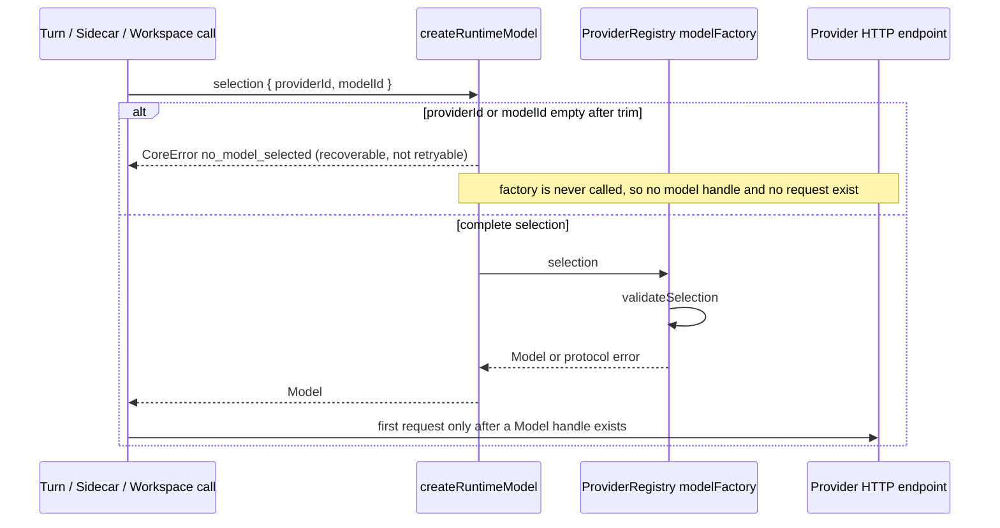

# Reject turns without a valid model selection

## Product rules

- A turn may only be executed when its model selection names a real model: both `providerId` and `modelId` must be non-empty after trimming whitespace.
- A selection object that exists but carries `modelId: null`, `modelId: ""`, or `providerId: ""` is the same product condition as a missing selection: no model was chosen. It is not a provider failure and not a retryable model error.
- Such a turn ends immediately with the core error `no_model_selected` before the runtime builds a model handle. No provider request, no network call, and no retry may be produced.
- The error is recoverable (the user can pick a model) but not retryable, because retrying the same empty selection cannot succeed.
- Selection resolution rules are unchanged: this guard never rewrites, defaults, or repairs a selection. It only refuses incomplete ones at the execution entry.
- The provider registry remains the single authority for "provider/model exists" and option validity. The guard only rejects selections that cannot even be looked up.

## State ownership and order

## Interface

- `CoreErrorType.NoModelSelected = "no_model_selected"` (contracts). The generated `code` is `NO_MODEL_SELECTED`.
- `createRuntimeModel` is the single guard point; every execution path (turn model, compact, title sidecar, workspace generate, steering, project memory) already funnels through it.
- Localized text exists in the agent CLI copy (`cli.errors.noModelSelected`) and in the shared UI bundle (`zcode.error.NO_MODEL_SELECTED`).

## Acceptance scenarios

- `{ providerId: "glm", modelId: null }` through `createRuntimeModel` throws `no_model_selected` and the model factory (and therefore any network mock) is never invoked.
- `{ providerId: "glm", modelId: "" }` and `{ providerId: "  ", modelId: "glm-4" }` behave the same way.
- A selection with a non-empty `providerId` and `modelId` still reaches the factory unchanged and produces a working model handle.
- The UI banner renders the localized `no_model_selected` text instead of a raw runtime message.
