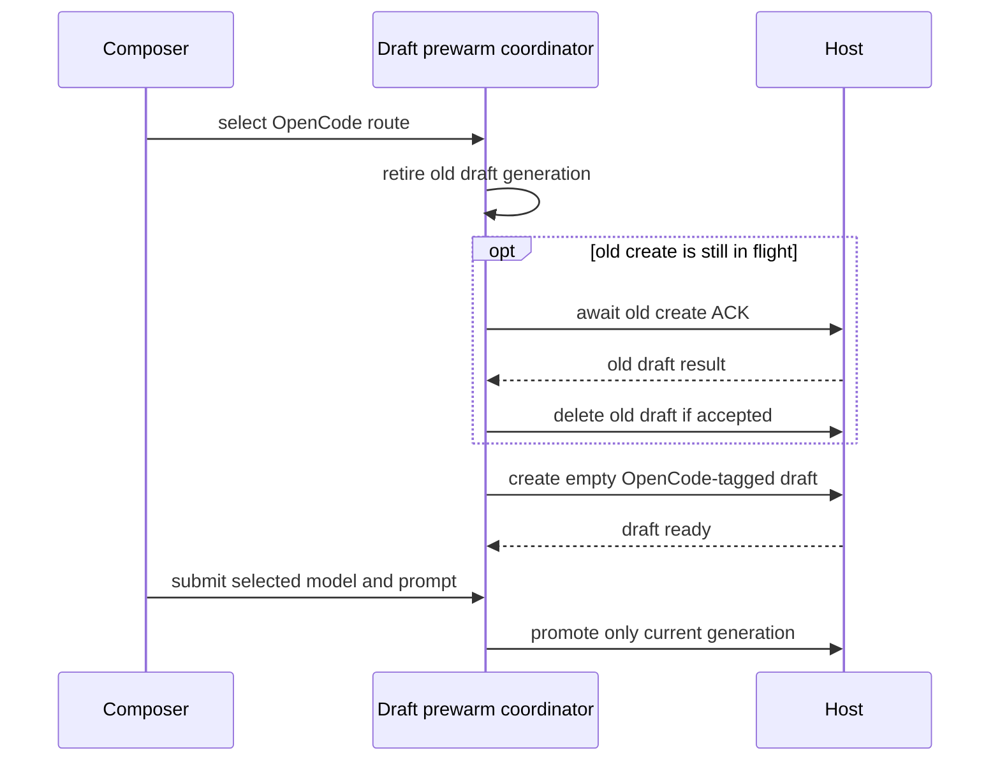

# OpenCode ACP delegated runtime

## Feature summary

| Field        | Decision                                                                                                                                                                                                                                      |
| ------------ | --------------------------------------------------------------------------------------------------------------------------------------------------------------------------------------------------------------------------------------------- |
| Capability   | Select OpenCode CLI and a CLI-reported model in the regular conversation Composer, then run the message through the process-owning Host's OpenCode ACP bridge; API-backed providers remain in Provider Registry.                              |
| Change layer | Composer option source and draft/commit route, conversation protocol/admission/projection, Host ACP process lifecycle, cancellation and transcript persistence.                                                                               |
| Owner        | Composer owns the pending local provider/model choice; CLI conversation runtime owns admission and ZCode transcript facts; the process-owning Host owns ACP child/transport; OpenCode owns credentials, tools, agent loop and provider usage. |
| Out of scope | API-key bypass, rate-limit circumvention, reading/copying OpenCode credentials, separate workspace/session Composer UX, unrelated MCP or swarm work.                                                                                          |

## Current product decision: OpenCode CLI is selectable in Composer

This decision supersedes the earlier separate-panel-only decision and its statements that CLI models cannot appear in Composer. The user's latest request is the product authority for this interaction.

- In the normal Composer model picker, OpenCode CLI is one provider choice alongside configured API providers. After choosing it, the same picker shows models reported by the installed local OpenCode CLI. The user then sends a normal chat message; there is no separate OpenCode workspace picker, session-start screen, or transcript panel in this flow.
- OpenCode CLI alone is enough to keep the Composer model picker visible. An empty API registry or an empty coding-plan catalog must not replace it with a settings shortcut once CLI models are available.
- OpenCode CLI and OpenCode API remain distinct access modes. The CLI uses the process-owning Host's installed `opencode` and OpenCode's existing sign-in; it never asks for an API key or reads/copies the CLI credential store. API-backed OpenCode providers remain ordinary Provider Registry entries and continue to use their own API credentials.
- The active Composer selection is a distinct execution route (`opencode-acp`) plus the selected OpenCode model ID. Do not forge a Provider Registry entry or pass this route through ZCode's normal `ModelSelection`/model execution credentials. The existing v4 route schema already separates these concepts.
- OpenCode still owns its agent loop, tools, permissions, and upstream usage/rate limits. Its selected model and activity are presented in the ordinary ZCode conversation; the active workspace path is taken from the current Composer/Host binding, without another folder field. Do not create an independent OpenCode session UI for each turn.
- The provider row is simply named **OpenCode** and identifies **CLI** access in its badge/help text. Model selection is visible in the chat picker itself. Do not add a second ACP-only provider entry, an API key form for CLI, or model-management options that belong to the CLI.
- In Model Providers, OpenCode CLI has one enable/disable control. Enabling it automatically checks the installed CLI; if missing, the same row presents **Install** and one click installs/configures the supported executable for the current OS, then verifies it before enabling the provider. Remove manual CLI path selection, workspace folder selection, explicit session start/close, and the separate prompt/transcript UI from this provider flow. The existing provider API-key entries remain separate.
- Enabling is reflected immediately while the setting is being saved. If persistence fails, the switch returns to its prior value and the panel shows a localized error so the user can retry; the failure must not be silently reduced to a log entry.
- The enable flag is persisted in the local Host application settings and survives leaving/re-entering Model Providers or recreating the settings service. Composer reads that same local Host setting. When enabled, Composer reports model-catalog loading and exposes an in-place retry if the Host cannot read a non-empty CLI catalog; a transient `opencode models` failure must not silently strand the user in Model Providers. Selecting a listed model still sets the typed `opencode-acp` route for the draft.
- The model list comes from the active Host's bounded, read-only `opencode models` catalog. Its authentication state remains unknown until a real prompt gives typed auth-required evidence. A model-list refresh must not send a prompt, create a durable OpenCode session, or query credentials. Missing CLI and required sign-in are actionable inline states, not hidden failures or fake model options.
- Sending a CLI-routed message must use the existing conversation command/admission and Host-owned ACP bridge, preserve the selected model route through persistence/recovery, display content/tool/permission events in the ZCode conversation, and cancel the same OpenCode run when the user stops it. Unsupported submissions must be rejected before acceptance with a visible reason; they must never fall back to a different provider/model.
- A deferred Composer draft is only a conversation/admission container, not model execution. Only a draft explicitly tagged for the `opencode-acp` route may be created through the Host's read-only ZCode control client without ZCode provider readiness or account-provider synchronization. The marker is valid only for an empty deferred draft (no first input and no ZCode model selection), never authorizes model execution, and is not persisted as session policy. Ordinary drafts and all immediate/API-backed session creation retain the provider-readiness gate. OpenCode ACP admission remains the only execution path for that tagged draft.
- A `sendText` command with the schema-validated `executionRoute.kind === "opencode-acp"` also uses the Host's read-only control client and skips ZCode provider readiness/account-provider synchronization. This only allows the command to reach CLI admission and Host-owned ACP; it does not authorize ZCode model execution. All other command routes retain the normal provider-readiness gate.
- When ACP requests a permission, show its bounded title/input summary and exact advertised options inline on that run in the ordinary conversation. The pending request is ephemeral Host/Renderer state and is never written to the run journal or SQLite. A response must carry the exact ZCode session, command/run, ACP session, request, and selected ACP option IDs; only an advertised option explicitly clicked by the user is sent. Run cancellation, Host loss, or interruption clears the pending interaction; never auto-approve or infer ZCode permission policy for OpenCode.
- The feature is not complete while the CLI route returns `fault.command.opencodeAgentExecutionUnavailable`, while selected catalog models are reference-only, or while the normal Composer cannot produce an executable `opencode-acp` command.
- Keep `@zcode/services` and `opencode-acp-runtime/index.ts` browser-safe: export only descriptors and wire types. Node process factories remain in `services/node.ts`; renderer code uses typed service contracts.
- ACP event subscriptions remain parameterized RPC events and keep the `onDynamic...` names. The process-owning Host remains the sole ACP process owner; CLI model discovery and prompts are scoped to the active Host/workspace binding.
- Keep old OpenCode Go API configurations and credentials intact for compatibility. They are not aliases for the local CLI provider, and this change must not migrate or delete saved provider data.
- Never attempt to remove, evade, or automatically work around provider rate limits. The user will decide how to handle limits.

### Conversation ownership and event order

```text
Composer draft (provider=OpenCode, model ID)
  -> active Host read-only `listModels` (no auth inspection, no ACP session)
  -> Composer sendText with executionRoute=opencode-acp + chosen model ID
  -> Host uses read-only control client for the typed ACP command (no ZCode provider/API-key gate)
  -> CLI CommandInbox validates delivery/capabilities
  -> if this is the first send from a deferred draft, CLI runtime persists the session row first
     (this creates no model turn and sends no prompt)
  -> CLI atomically records user input + run in the ACP admission transaction
  -> process-owning Host starts one ACP session in the active workspace and sets its selected model
  -> Host sends prompt; ACP content/tool/permission/terminal updates carry run ID + monotonic sequence
  -> CLI validates run identity/sequence and projects events into this ZCode conversation
  -> existing Stop action cancels that same run; stale run events/stop cannot affect a newer turn
```

The Composer draft/selection is UI-owned until submission. CLI admission and the conversation timeline remain authoritative after acceptance; the Host owns the ACP process and OpenCode session; OpenCode owns its provider credentials and agent/tool loop. The selected CLI model is never persisted as a fabricated Provider Registry credential. A process restart marks an in-flight ACP run interrupted and must not silently replay a prompt.

Changing the Composer route while its deferred draft is being created is a generation change owned by the existing draft prewarm coordinator. The coordinator retires the old generation, waits for its non-cancellable create command to settle, cleans up an accepted old draft, and then creates a draft tagged for the latest route. It must never submit an OpenCode selection using a draft that was created through the ordinary ZCode provider path. Leaving OpenCode before submission follows the same transition in reverse; only the latest route may be promoted.



Current implementation evidence (2026-10-23): the strict `opencode-acp` Composer route, CLI admission/outbox, Host dispatch, Host-to-CLI event receiver, bounded external-agent row, cancellation identity, and inline permission flow are present. The isolated Composer reproduction admitted the Host RPC command but returned `fault.command.executionFailed` before any session/input/run rows were written. Source order and the session foreign-key contract identified the second defect: ACP admission wrote its run outbox before the deferred Composer draft had a durable session row. The admission now persists that session skeleton before the atomic input+run transaction; a focused regression test covers this ordering and verifies that failure to persist the session leaves no outbox row. A later live Dev send exposed a third defect: the CLI receiver detached `getOpenCodeAgentRun` from its SQLite store, so the `started` event threw while reading `this.db` and closed the CLI transport. The receiver now calls the method through its store; a receiver-sensitive test failed before this fix and passes after it. The isolated profile has no OpenCode credentials, so this does not prove a real model response. A second desktop smoke could not be completed because the relaunched Electron process did not expose a renderer or Host in the locked local desktop environment.

### CLI sign-in diagnostics

- `opencode models` only discovers provider/model identifiers. Its result remains `authentication: "not-checked"`; neither a successful command nor ACP's advertised `authMethods` proves that any provider is signed in. OpenCode advertises its login method even when login may already exist.
- The ACP Host may classify only the protocol's typed `RequestError.authRequired` response as the fixed local diagnostic `opencode.auth-required`. Peer text, error data, and credential state are never forwarded or persisted. Every other ACP peer error keeps the fixed operation fallback.
- When that exact signal is returned, the settings panel tells the user to sign in with OpenCode's own `opencode auth login` command and retry. ZCode does not invoke a login flow, read OpenCode's credential store, or copy credentials.
- Session creation failure still tears down the ACP child and retains no session. Prompt-time authorization failure keeps the active session and reports the same safe sign-in diagnostic so the user can authenticate in OpenCode and retry deliberately.

| Case        | Action                                                               | Expected result                                                                                                                             |
| ----------- | -------------------------------------------------------------------- | ------------------------------------------------------------------------------------------------------------------------------------------- |
| OCAD-AUTH-1 | Refresh `opencode models` while sign-in state is unknown.            | Models may be shown as reference-only; authentication remains `not-checked`.                                                                |
| OCAD-AUTH-2 | ACP returns the typed `authRequired` error for `session/new`.        | Runtime returns only `opencode.auth-required`, closes the failed child, and stores no session; UI shows the OpenCode CLI login instruction. |
| OCAD-AUTH-3 | ACP returns the typed `authRequired` error during a prompt.          | Runtime returns only `opencode.auth-required`; it does not expose peer text or tear down the established session.                           |
| OCAD-AUTH-4 | ACP returns any other peer error containing diagnostic-looking text. | Runtime returns the operation's fixed fallback and exposes no peer text.                                                                    |

| Case      | Setup and action                                                                            | Expected result                                                                                                                                   |
| --------- | ------------------------------------------------------------------------------------------- | ------------------------------------------------------------------------------------------------------------------------------------------------- |
| OCAD-UX-1 | Open Composer with a usable local OpenCode CLI and no API key configured for it.            | OpenCode appears as a provider choice, its CLI models appear in the chat model list, and no API key or workspace/session setup is required.       |
| OCAD-UX-2 | Select an OpenCode CLI model and send an ordinary text message from the active workspace.   | The existing conversation command dispatches that exact model through Host-owned ACP; content and terminal state appear in ZCode chat.            |
| OCAD-UX-3 | Stop an active OpenCode-routed message.                                                     | The matching ACP prompt is cancelled; a stale stop cannot cancel a later run.                                                                     |
| OCAD-UX-4 | CLI is missing, catalog is unavailable, or OpenCode requires sign-in.                       | Composer shows an actionable inline state; it never silently selects an API provider or another model.                                            |
| OCAD-UX-5 | OpenCode API provider and legacy OpenCode Go are also configured.                           | API choices remain credential-backed Registry entries; the CLI entry remains separate and saved legacy configurations remain unchanged.           |
| OCAD-UX-6 | CLI model catalog refreshes while Host/workspace or user selection changes.                 | Late catalog results cannot replace the current Host's options or another selected provider/model.                                                |
| OCAD-UX-7 | Existing profile contains OpenCode API/Go custom providers and credentials.                 | Composer preserves API/Go entries and does not inspect secret values, rewrite, merge, or delete provider records.                                 |
| OCAD-UX-8 | OpenCode ACP is selected with no ZCode API provider configured; send a normal chat message. | Host forwards the typed command through the read-only control client, CLI admission reaches ACP, and no ZCode provider readiness error is raised. |

<details>
<summary>OpenCode CLI Composer and provider-settings implementation contract</summary>

The current implementation contract is below. The local-provider-adapter exploration immediately following this note is historical research only; do not implement that adapter. Provider settings only enable/check/install the local CLI. Ordinary Composer owns provider and model choice; there is no separate workspace/session UI.

## Architecture decision: OpenCode CLI is a Composer provider with delegated-agent semantics

The visible product is one provider choice in the ordinary Composer model picker. Internally, it uses the strict `opencode-acp` execution route because OpenCode owns the model request, agent loop, tools, permissions and upstream credentials. It must not be faked as a ZCode API `ModelSelection` or passed through ZCode's provider credentials. OpenCode API and OpenCode Go remain normal API-key-backed providers and preserve their saved configuration.

Settings only own CLI enablement and automatic discovery/install. The Composer catalog is read from the active process-owning Host and does not create a session or inspect auth. Missing CLI offers Install in provider settings; a verified install enables the provider. Authentication remains OpenCode-owned and may require `opencode auth login` in the CLI. Usage limits are upstream-owned and are never circumvented.

The ACP route intentionally creates an OpenCode ACP session per accepted chat request. It uses the active Composer workspace binding and does not expose a separate folder picker, manual start/close controls, prompt panel or second transcript. Ordered output and terminal status must be presented in the existing conversation as a clearly identified OpenCode run projection. This is not an ordinary ZCode model turn and must not claim ZCode tools or permissions governed OpenCode execution.

The adjacent Cline source and OpenCode source support these boundaries: `opencode models` is suitable for bounded, read-only model discovery, while ACP `session.prompt` runs OpenCode's agent loop. Do not copy Cline's community provider adapter or its process-global signal-listener workaround without a separate design, since that adapter delegates tools and owns OpenCode sessions rather than making a model-only request.

## Composer route: OpenCode CLI delegated agent

### Product contract

- Composer exposes **OpenCode CLI** as a provider in the existing provider/model picker. Its internal route remains distinct from normal `ModelSelection`; it must never be registered as a ZCode `Model` adapter or send ZCode credentials. The picker identifies CLI access and the selected OpenCode model.
- Composer may select a model ID from the owning Host's `opencode models` discovery result, plus an explicit **OpenCode default** choice. This catalog is only a requested value, not proof that the model is available or authenticated. After ACP `session/new`, the Host must find an ACP `configOptions` entry for model selection whose advertised value exactly matches the requested model ID, apply it through `session/set_config_option`, and wait for the complete updated option set before sending the prompt. If no matching ACP option exists or it is rejected, fail with a typed diagnostic; never silently choose another model. The first Composer slice does not expose a separate ACP mode selector; OpenCode's session default mode applies. A later mode selector must source values from a Host-owned ACP preflight contract, not guess config IDs from `opencode models`.
- Normal OpenCode API and OpenCode Go templates remain ordinary API-key `ModelSelection` entries and continue to use the existing ZCode model/tool loop. CLI auth is owned by the installed OpenCode CLI on the process-owning Host; ZCode neither reads its credential files nor asks for/copies an API key. No route falls back between CLI and API identities.
- A delegated run is one Composer request admitted by the existing CLI/runtime `CommandInbox`. ZCode may render the request, ordered ACP updates, and final result in the task UI, but OpenCode owns the actual session transcript, model/provider auth and rate limits, tool execution, and tool permission policy. The rendered output is a view of that run, not proof that ZCode tools or ZCode's permission policy governed it.
- The route is a strict discriminator inside the existing `sendText` payload/canonical input intent: `executionRoute: { kind: "zcode" }` (the compatibility default for existing clients) or `executionRoute: { kind: "opencode-acp", model: { kind: "default" } | { kind: "catalog", modelId } }`. `modelId` is an opaque OpenCode catalog ID, never a ZCode provider/model identity; the explicit `default` variant means no model option should be set. The OpenCode branch must omit/reject `modelSelection` and `modelExecution`. Keep `sendText` envelope, `commandId`, task `sessionId`, `CommandInbox` idempotency/FIFO admission and durable input-intent admission as the one accepted-input path. After atomic durable admission, CLI dispatches the route via the typed Host bridge below; it does not enter normal ZCode model construction or `sendText` turn execution.
- First iteration is text-only and idle-only: reject `requestedDelivery` other than absent/`startNow`, any held-queue disposition, queue/guide/steer, nonempty attachments, `modelExecution`/Highspeed, slash commands (including goal/compact), browser ambient context, shared context refs, conversation quotes/selections, plugin/UI context, code comments, web/PPTX element context, and any other Composer payload not explicitly in the ACP text mapping. Strict shape/content validation belongs in the shared command schema and runs before `CommandInbox` admission. Host-capability and busy-state validation runs after the in-memory inbox accepts the command but before durable input admission; failure settles a typed rejected ACK and writes no input intent or run envelope. Never silently drop or stringify unsupported data. Existing ZCode `mode` and `planEnabled` are not sent to OpenCode.
- Route gating is capability-based: enable it only when the active target workspace exposes the process-owning Host bridge. Local workspaces use their window-scoped Local Host; Source Server workspaces use that Source Server Host through authenticated RPC. Missing bridge, detached/stale Source Server attachment, legacy desktop-attached SSH/WSL/Docker, Web or phone attachment fails closed with a localized unsupported/unavailable state and cannot fall back to Desktop Local Host.

### Owners and protocol

| Concern                             | Single owner / contract                                                                                                                                                                                                                                                                                                                                                                                                                                                                                                                                                                                                                                                          |
| ----------------------------------- | -------------------------------------------------------------------------------------------------------------------------------------------------------------------------------------------------------------------------------------------------------------------------------------------------------------------------------------------------------------------------------------------------------------------------------------------------------------------------------------------------------------------------------------------------------------------------------------------------------------------------------------------------------------------------------- | --- | ----------------------------------------------------------------------------------------------------------------------------------------------------------------------------------------------------------------------------------------------------------- |
| Route/model draft                   | Composer route draft owner, scoped by `workspaceIdentity?.trim()                                                                                                                                                                                                                                                                                                                                                                                                                                                                                                                                                                                                                 |     | workspacePath`plus draft/session scope. Persist the non-secret route kind and explicit OpenCode default/catalog choice with the existing nonblank text draft only; clear them with that draft. This is distinct from`ModelSelection` and Provider Registry. |
| Admission and canonical user input  | Existing CLI `CommandInbox` remains the sole admission/idempotency/FIFO owner. Strict route/payload validation runs before the inbox; capability and busy validation runs before the durable ledger. `admitInputCommand` atomically persists the canonical `sendText` intent and initial `openCodeAgentRun` outbox envelope for delegated input before execution dispatch. The accepted intent is the only source of the user prompt.                                                                                                                                                                                                                                            |
| External run identity and lifecycle | `runId` is deterministic and equal to the accepted `commandId`, so retry/recovery never invents a second run identity. The same durable transaction stores the intent and initial outbox envelope. CLI owns dispatch/reconciliation transitions; Renderer owns only the draft and pending projection.                                                                                                                                                                                                                                                                                                                                                                            |
| CLI ↔ process-owning Host bridge    | Use the existing bidirectional CLI stdio JSON-RPC connection and active client handler in `packages/services/src/zcode-agent/zcodeAgentService.ts`; add a versioned strict `interaction/requestOpenCodeAgentRun` request plus ordered Host→CLI run-event method on that same live connection. This is a process-owned reverse RPC, not a Renderer service call. The receiver derives workspace/connection/attachment generation from its authenticated active CLI client scope; those facts are not trusted caller fields. The Host derives `workspacePath` from its own validated workspace registry. No renderer-supplied `cwd`, executable path, or credentials are accepted. |
| Process and workspace               | The process-owning Host owns the `opencode acp` child, ACP connection/session and session cleanup. Local routes use Local Host; Source Server routes use authenticated Source Server RPC and server-local CLI/auth. Both validate workspace identity and active attachment before creating the session.                                                                                                                                                                                                                                                                                                                                                                          |
| ACP loop and auth                   | OpenCode ACP child owns provider credentials, model request, agent/tool loop, tool policy and its own durable session. ZCode does not construct a parallel Model or execute ZCode tools for this run.                                                                                                                                                                                                                                                                                                                                                                                                                                                                            |
| Durable task projection             | Existing CLI/task transcript owner persists a small `openCodeAgentRun` record, not synthetic `assistantText`, reasoning, or ZCode tool-call rows. The admitted user input remains canonical in the existing input intent. ACP partial updates are live-only; persist terminal status, selected ACP option identity, bounded final text/result if present, and typed diagnostic/interruption code. Never persist secrets, raw ACP payloads, full tool input, stderr, or auth state.                                                                                                                                                                                               |

### Typed control RPC and event contract

The bridge is a strict, versioned control contract over the existing bidirectional CLI stdio JSON-RPC connection, not a Renderer service call. Add `interaction/requestOpenCodeAgentRun` for CLI→Host operations and a matching Host→CLI event notification, both with versioned strict schemas in `packages/shared/src/zcode-protocol/index.ts`. CLI sends `startRun`, `getRunStatus`, `cancelRun`, and `respondToPermission`; Host returns a typed ACK/status and emits ordered run events as reverse RPC notifications on the same active client connection. Each request carries only `{ zcodeSessionId, commandId, runId }` plus the operation payload. The receiver derives the workspace identity, active connection, and attachment generation from its authenticated client scope; caller-supplied attachment/generation values are forbidden. Cancel and permission responses additionally carry the exact `opencodeSessionId` returned by `startRun`; permission response also requires `requestId` and an option ID issued by that request. CLI verifies the durable accepted input intent/outbox before dispatch; Host validates the request against the active client scope and its idempotency map before acting. `startRun` carries only already admitted text and optional requested OpenCode catalog model ID. The Host resolves `cwd` from its validated workspace record; it does not trust a path from the Renderer or CLI payload. The active client connection is the source-server/local-host boundary: a Source Server's own CLI and ACP runtime pair stays on that server and uses its server-local auth; it is never routed through Desktop Local Host.

The bridge schema carries a protocol version and bounded request deadlines. `runId` is the idempotency key at both ends. `startRun` returns promptly once the Host has created the ACP session, validated/applied the requested model option, and accepted the prompt request; it does not wait for the model response or terminal event. The CLI then settles the original `CommandInbox` command as accepted, releasing that session's FIFO so a separately admitted `stop` can cancel by exact command/run ID. All later content, permission and terminal events update the run projection asynchronously outside the inbox command handler. If `startRun` times out or the stdio response is lost, CLI calls `getRunStatus` on the same active connection; it must not retry by creating another ACP session. Host stores its in-memory `runId -> ACP sessionId` mapping for the owning process lifetime and returns the same session status for duplicate `startRun`. If the Host has restarted and cannot prove the prior ACP session, it reports `interrupted`; it does not start a replacement session automatically. A disconnected/replaced client invalidates the bridge generation and all outstanding callbacks.

CLI is the owner of admission, deterministic `runId`, canonical input intent, durable run-envelope transitions and projection. The Host is the source of ACP lifecycle/content/tool/permission facts and emits normalized events; CLI validates/fences them against the currently active RPC client and persists only the permitted small projection. Renderer subscribes to CLI's task projection/stream and cannot mutate Host run state directly. Each event is typed, monotonic per `runId`, and fenced by `{ zcodeSessionId, commandId, runId, opencodeSessionId, connectionGeneration, sequence }`; `connectionGeneration` is injected/validated from the receiving connection rather than accepted from an untrusted payload:

| Event                 | Typed data                                                                       | Durable projection                                                                                   |
| --------------------- | -------------------------------------------------------------------------------- | ---------------------------------------------------------------------------------------------------- |
| `accepted`            | command ID, deterministic run ID, execution route                                | Initial outbox envelope status `pending`; command admission is authoritative for accepted user input |
| `started`             | ACP session ID, applied ACP model option ID/value (or explicit default)          | Status `running`; no auth claims                                                                     |
| `content`             | ACP text chunk, tagged as external OpenCode output                               | In-memory stream only; never `assistantText` row                                                     |
| `tool`                | ACP tool call ID, bounded title and status                                       | In-memory external-run card only; never ZCode tool-call event                                        |
| `permissionRequested` | request ID, bounded/escaped title and input summary, exact ACP option IDs/labels | Ephemeral pending interaction on this run's conversation row; never SQLite/journal                   |
| `permissionResolved`  | request ID and selected option ID or `cancelled`                                 | Pending interaction removed                                                                          |
| `completed`           | ACP stop reason and bounded final result, if supplied                            | Terminal `completed` envelope and bounded result                                                     |
| `cancelled`           | typed cancellation reason                                                        | Terminal `cancelled` envelope                                                                        |
| `failed`              | stable diagnostic code only                                                      | Terminal `failed` envelope                                                                           |
| `interrupted`         | stable Host-loss/process-loss code                                               | Terminal `interrupted` envelope                                                                      |

Only the current active CLI↔Host RPC connection may publish events. The CLI rejects events with stale sequence, command/run identity, workspace identity, or connection generation. Source Server reconnection creates a new connection generation; old run events and cancellation/permission replies cannot be rebound to it. A detach/process loss settles any persisted nonterminal envelope as `interrupted`; there is no automatic retry or session resume.

### Event order

```text
Composer submit -> `sendText` route discriminator -> schema/payload validation -> CLI `CommandInbox`
  -> pre-durable capability/busy validation -> atomic input-intent + outbox admission (runId = commandId)
  -> CLI typed control RPC `startRun` -> owning Host validates active connection/workspace scope
  -> Host derives cwd -> ACP initialize/session/new -> validate/apply ACP options -> prompt
  -> ordered typed ACP events -> CLI durable projection / live task card
  -> `stop` with expected commandId/runId -> CLI verifies active run -> Host `cancelRun`
  -> terminal event + durable envelope update -> close ACP session
Host disposal/detach -> cancel pending permissions -> bounded ACP/process cleanup
  -> current durable `running` envelope becomes `interrupted`; stale generation events are dropped
```

An ACP delegated run is an external active-work kind owned by the V4 task control projection, not a Core `AgentRuntime` turn. While such a run is pending/running, the task advertises busy/canStop consistently and rejects a second delegated or ordinary `sendText` before durable admission; queue/guide admission is not supported in this slice. `stop` has a strict target union: existing Core `expectedForegroundExecutionId` or delegated `{ expectedCommandId, expectedRunId }`. The CLI validates the current external active-work owner before routing cancellation. Core stop never cancels ACP implicitly, and ACP stop never aborts a Core turn. Terminal completion/cancellation clears the external busy owner exactly once and triggers the same task-control projection update as other foreground work.

The Host must not infer a workspace from an earlier session. Exact execution `cwd` comes from the owning Host's currently validated workspace registration for the admitted `workspaceIdentity` (and `remoteSessionId` where applicable); workspace path remains an execution/display value, never the identity key. The renderer's selected workspace path is not an authority. No local Host fallback is allowed when Source Server routing fails. A detached/replaced Source Server attachment invalidates pending run and permission callbacks rather than retargeting them.

### Cancellation and permission ordering

- Before admission, cancelling only clears the Composer draft. After durable `CommandInbox` admission, the stop command must carry the expected `commandId` and `runId`; CLI verifies they still identify the foreground delegated run, then sends the typed Host `cancelRun` request with the same workspace and Host-generation fence. A delayed stop cannot cancel a newer command or sibling task.
- The Host sends at most one effective ACP `session/cancel` for that active session. Pending ACP permission requests are answered with the protocol's `cancelled` response before/while cancellation is sent; stale events after cancellation are ignored by run/session fencing. A cancelled or completed session is not reused for another Composer submission.
- Every ACP permission request is surfaced with bounded, escaped tool/input details and only the exact options offered by ACP. No option is preselected; no ZCode YOLO/auto-approve setting is forwarded as implicit consent. Only an explicit user choice returns the corresponding advertised option ID. Close, Host loss, or run cancellation resolves outstanding requests as cancelled. OpenCode remains the policy owner for persistent permission choices.
- Process disposal remains bounded and idempotent under the existing ACP runtime contract. A cancel/permission response that hangs cannot prevent process-tree cleanup or leave the run marked active indefinitely; the run ends as cancelled or interrupted with a typed reason. Host owns the `runId -> ACP sessionId` map and deletes it after terminal projection and session close; Host shutdown also closes all remaining runs/sessions.

### Source of truth, cleanup and retention

- `ConversationInputIntent` is the sole durable source of the admitted user text and route discriminator. The `openCodeAgentRun` record is only a bounded execution/result projection keyed by `commandId`/`runId`; it is not a second prompt store or a copy of the OpenCode transcript.
- Retain only route kind, the non-secret requested OpenCode catalog model ID/default choice, run/status timestamps, terminal diagnostic code, and bounded final output. Never persist ACP session credentials, auth state, raw ACP updates/permission bodies/tool inputs, child environment, executable path, or stderr. Partial content/tool updates remain renderer/Host-memory stream state and may be lost on restart.
- On normal completion/cancel/failure, close that ACP session where supported and remove Host's in-memory mapping; keep the terminal projection under the owning ZCode task's existing transcript/task-retention and deletion rules. Do not create a second independent retention database or keep unbounded run histories. On restart, any persisted `pending`/`dispatching`/`running` envelope without a terminal event is atomically projected to `interrupted`; no replay/retry occurs.
- The durable store must add a strict versioned `openCodeAgentRun` outbox/projection record and commit it atomically with the canonical admitted input intent. Its storage schema/migration, task identity, bounded retention/page limits, snapshot hydration, and recovery transition are specified in [opencode-acp-delegated-run-storage.md](./opencode-acp-delegated-run-storage.md); implement that protocol/storage migration as a prerequisite before enabling Composer UI. The input ledger plus outbox transaction is authoritative for admission; ACP events are facts projected afterward. Do not choose a second ad hoc database.

### Session durability boundary

ACP `loadSession`/resume is not part of the current runtime contract. Therefore delegated Composer runs are **not resumable** across owning Host/process loss or application restart. The ZCode task may retain its request and received output as a read-only record, but must mark an interrupted in-flight run as interrupted, disable “continue this OpenCode session,” and require a new delegated run (new ACP session) for further work. Do not replay prompts, fabricate an OpenCode transcript, or imply that a saved session ID is sufficient to resume. OpenCode's own durable session record remains OpenCode-owned and does not grant ZCode resume capability.

### CLI outbox and event-consumer completion gate

The stored outbox is not executable until the following full path is connected. Keep the Composer route fail-closed until every step is implemented and tested:

1. `CommandInbox` performs capability/busy validation before durable admission. The CLI then commits the canonical `session_input` and `openCodeAgentRun` row in the same transaction; only that commit permits an accepted ACK.
2. The same CLI command owner claims `pending -> dispatching` by compare-and-set, then sends `startRun` over the authenticated active CLI↔Host JSON-RPC client. A lost response is reconciled with `getRunStatus` on that connection and existing `runId`; it never repeats `session/new` or replays the prompt.
3. The Host emits the already specified versioned run notification through the exact active client. Each run numbers events from `1` and serializes sends in sequence order; a failed send does not reuse a sequence. The CLI notification consumer validates schema, workspace/client generation, task/command/run/ACP-session identity, and next sequence before persistence or projection. A stale/duplicate notification is a no-op; a gap or identity mismatch cannot advance durable state.
4. The CLI persists the lifecycle CAS and the bounded terminal summary before publishing the same external-run row to V4. Partial text, tool progress and permission requests are live-only. They never become ordinary ZCode assistant/tool events. Terminal state is immutable and clears the active external-work owner once.
5. `stop` resolves the exact active delegated run and forwards cancellation to that Host/session. Host loss, process restart or connection replacement marks unresolved state `interrupted`; no run is resumed or recreated. Pending permissions are cancelled during cleanup.

The task snapshot must hydrate the dedicated `externalAgentRun` row from the journal, including terminal state after restart. The row is linked to the canonical admitted `userInput`; it clearly marks output and tools as OpenCode-owned. The normal task busy/stop projection must include a delegated run without setting a ZCode `AgentRuntime` turn active. This keeps the Composer `CommandInbox` as the sole admission owner while the Host owns ACP process/session state and the journal remains the sole durable run projection.

Completed delegated runs may be included in a public conversation share. The public allow-list retains only the OpenCode provider marker, optional selected model ID, bounded prompt/output/tool summary, terminal status, and timestamps; it regenerates run/command identities and never includes live permission requests or internal diagnostic codes. Active delegated runs cannot be shared.

Required evidence before opening the guard: a protocol/server test that sends a Composer command through `CommandInbox`, observes atomic admission, Host `startRun`, ordered events, terminal persistence and snapshot hydration; duplicate command/start replay creates one ACP session; cancellation reaches the same run and cascades during setup; stale generation/sequence is rejected; restart yields interrupted without prompt replay; a UI/E2E case verifies the external row and stop behavior without synthesizing assistant/tool rows.

### Acceptance cases and evidence

| Case    | Scenario                                                                                                                   | Required result / evidence                                                                                                                                                                                                                                                                                                   |
| ------- | -------------------------------------------------------------------------------------------------------------------------- | ---------------------------------------------------------------------------------------------------------------------------------------------------------------------------------------------------------------------------------------------------------------------------------------------------------------------------- |
| OCAD-01 | Select OpenCode CLI in Composer next to a normal OpenCode API model.                                                       | Distinct execution route is visible and typed; CLI selection never enters Provider Registry; API route still follows normal ZCode model/tool loop and requires its API key.                                                                                                                                                  |
| OCAD-02 | Submit delegated run with an ACP model option.                                                                             | `CommandInbox` admits one run; owning Host creates one ACP session; selected value is validated/applied before prompt; no AI SDK/model adapter request or ZCode tool loop runs.                                                                                                                                              |
| OCAD-03 | Requested model is missing/rejected by ACP config options.                                                                 | Run fails closed with typed diagnostic; no fallback model/provider or prompt is sent.                                                                                                                                                                                                                                        |
| OCAD-04 | CLI exists but auth is absent, invalid, or rate-limited.                                                                   | ACP/model error is surfaced as bounded actionable status; authentication remains unknown unless upstream returns explicit evidence; no auth-file inspection, key prompt, API fallback, or rate-limit bypass occurs.                                                                                                          |
| OCAD-05 | Local workspace and Source Server workspace each submit a run.                                                             | Each request is handled only by its owning Host; Source Server uses authenticated RPC and server-local CLI/auth; outages never fall back to Desktop Local Host.                                                                                                                                                              |
| OCAD-06 | Legacy remote workspace or phone attachment submits a delegated run.                                                       | UI reports unsupported route before process launch; no remote path is executed locally.                                                                                                                                                                                                                                      |
| OCAD-07 | ACP asks for permission, then user chooses an advertised option in the ordinary conversation.                              | The external-run row shows bounded request details and only ACP-advertised options; a click returns that exact option ID after run/session/request identity validation. Pending UI is ephemeral and clears on resolution, cancellation, interruption, or Host loss; no auto-approval and no permission payload is journaled. |
| OCAD-08 | Cancel during prompt while a stale update arrives.                                                                         | Exactly one active run is cancelled on its owning Host; stale update cannot change settled UI/task state; sibling run is unaffected.                                                                                                                                                                                         |
| OCAD-09 | Host/process exits during a run, then user reopens the task.                                                               | Task is visibly interrupted and read-only for that ACP session; continuation requires a new run/session; no `loadSession`/resume claim or replay occurs.                                                                                                                                                                     |
| OCAD-10 | OpenCode CLI is missing or `initialize` fails on macOS, Windows, or Linux.                                                 | Installer/diagnostic behavior remains the explicit ACP contract; no Composer prompt/session is admitted as successful. Platform smoke evidence is recorded separately for each OS.                                                                                                                                           |
| OCAD-11 | CLI/API routes are used repeatedly with identical visible model IDs.                                                       | Persisted route identity keeps CLI and API credentials/semantics separate; no silent migration or cross-route fallback occurs.                                                                                                                                                                                               |
| OCAD-12 | Submit delegated route with queue/guide/steer, attachments, model execution, slash command, or any unsupported context.    | Typed validation rejects before durable admission; input remains in Composer; no attachment/context is dropped, stringified, or sent through standard ZCode model execution.                                                                                                                                                 |
| OCAD-13 | Submit valid text-only `sendText` delegated route, then retry same command ID after transport loss.                        | `CommandInbox` deduplicates; one durable input intent/run envelope and at most one Host ACP session/prompt exist. The new typed route survives canonical intent projection.                                                                                                                                                  |
| OCAD-14 | Submit from a local workspace and from a Source Server workspace.                                                          | Local uses Local Host; Source Server uses authenticated Source Server control RPC. Host derives `cwd` from its own current workspace registry; no Renderer path or credentials cross the bridge and no local fallback occurs.                                                                                                |
| OCAD-15 | Stop arrives after a newer delegated run starts, or the active CLI↔Host connection is replaced while events are in flight. | `commandId`/`runId`/`connectionGeneration` fencing rejects stale stop/events/permission replies; newer run is untouched and old nonterminal envelope becomes `interrupted`.                                                                                                                                                  |
| OCAD-16 | ACP emits content, tool and permission updates, then completes.                                                            | UI receives ordered typed external-run events; the inline permission card is ephemeral and explicit; persistence stores only the bounded run envelope/final result. No ACP content is emitted as ZCode `assistantText`, and no OpenCode tool is emitted as a ZCode tool event.                                               |
| OCAD-17 | App/Host restarts with an `accepted` or `running` external-run envelope.                                                   | Recovery marks it `interrupted` once, retains the task record read-only, drops partial live stream, and never retries or claims ACP resume. Terminal rows follow existing task retention/deletion.                                                                                                                           |
| OCAD-18 | Send the first OpenCode message from an empty deferred Composer draft.                                                     | CLI runtime persists the session row before the atomic ACP input/run admission (the run/input transaction remains atomic); admission succeeds without ZCode provider readiness, and no ZCode model turn is created. A failed session persistence creates no ACP outbox row.                                                  |
| OCAD-19 | Host receives the `started` event and reads the same run before/after the SQLite host-event transaction.                   | Store methods retain their receiver; the event is persisted and projected without closing the CLI protocol transport.                                                                                                                                                                                                        |

Fake ACP/Host tests can prove typed routing, atomic durable admission/idempotency, strict unsupported-payload rejection before ledger writes, ordered events, external busy/stop ownership, cancellation, option validation, redaction and restart-state projection. They do not prove real CLI authentication or successful provider/model execution. Independent acceptance evidence requires: shared schema/command contract tests; CommandInbox/input-intent/outbox-run-projection tests; Host reverse-RPC contract tests; packaged desktop E2E for Composer submit, model choice, unsupported payload gates, permissions, cancellation and interruption; a live model request using the user's installed CLI on each supported OS; and a Source Server run showing that the server Host, not Desktop Local Host, owns the child. A real model request is the only evidence here that CLI auth/model access works; `--version`, `opencode models`, and ACP `initialize` alone are insufficient.

</details>

## Behavior

1. The ordinary conversation model picker contains one **OpenCode · CLI** provider group populated from the active process-owning Host's read-only OpenCode CLI catalog. Selecting a model there and sending a normal chat message dispatches the current workspace turn through the Host-owned ACP bridge. OpenCode API and OpenCode Go remain separate API-key-backed providers.
2. The Composer stores a tagged execution route independently from the ZCode `ModelSelection`. Choosing OpenCode must not write a fabricated provider, model, API credential, mode, or plan into the ZCode Provider Registry/session config. Switching back to a ZCode provider restores the regular model selection.
3. Host diagnostics use the already initialized owning Host environment (`runtimeProcessEnvPatch` plus that Host's existing login-shell/bootstrap PATH policy), then search deterministic install locations, including the official `~/.opencode/bin` path and the user's `~/.linuxbrew/bin` path even when a GUI Host has a narrow PATH. The shared `/home/linuxbrew/.linuxbrew/bin` location remains a separate Linuxbrew candidate. They run only the resolved executable's `--version` with a short timeout and bounded output, return the detected path, and report `available`, `missing`, `unavailable`, or `timed-out`. The user can select an explicit executable path if the Host cannot discover it. `available` proves CLI discoverability/version only; it does not prove ACP compatibility, authentication, model availability, or prompt readiness.
4. If the CLI is missing, the panel offers an explicit install action only where native platform tooling is available. macOS/Linux download the fixed official V2 install script over HTTPS with bounded size and time, run it through the resolved `bash` with `--no-modify-path` in a disposable `HOME`, verify the staged binary with `--version`, and exclusive-copy it into the user's `~/.opencode/bin`; this avoids system npm permissions, does not overwrite an existing install or edit shell profiles, and re-probes immediately before install. Windows resolves `winget.exe` directly from PATH or the Windows app-execution-alias directory and runs the official WinGet package ID `Anomaly.OpenCode` with `--exact`, `--source winget`, agreement flags, and `--no-upgrade`; it must re-probe immediately before install, refuse if any OpenCode CLI appeared, bound duration/output, and verify the executable through PATH or the WinGet portable Links directory. The official OpenCode v2.0.28 changelog documents this package; native Windows smoke evidence remains a separate acceptance item. The legacy `SST.opencode` package is a separate community V1 package; ZCode never asks WinGet to upgrade, remove, or migrate it. If WinGet, `bash`, or `curl` is unavailable, show official instructions instead of a failing install action. ACP on Windows runs only as a directly resolved `.exe`/`.com` with `shell:false`. A detected but ACP-incompatible CLI is not silently or automatically upgraded. The panel links to official V2 installation instructions; it does not invoke `opencode upgrade --major` because cross-major in-place upgrade behavior is not verified across installation methods and operating systems.
5. Choosing an OpenCode CLI model does not start a session. On send, the Host starts an ACP child with fixed `acp` arguments, initializes it, creates a session using the current workspace path owned by that Host, applies the selected catalog model, and dispatches the prompt. The child communicates only over stdio JSON-RPC without a shell and without inheriting unrelated application secrets. Model catalog refresh remains read-only and must not create a session or send a prompt.
6. Model discovery returns bounded `provider/model` IDs from `opencode models`; authentication remains `not-checked`. Missing CLI, unavailable catalog, and typed ACP auth errors show actionable Composer state. CLI catalog results do not imply sign-in, and the UI never substitutes another provider/model.
7. Prompt, update, cancel, close-session, and process-dispose calls stay on the same ACP connection. Validated content, tool activity, permission requests, and terminal outcomes are projected into the ordinary ZCode conversation. OpenCode owns its tool loop, permission policy, credentials, and upstream usage/rate limits; ZCode cancellation targets the exact admitted run.
8. The active workspace binding supplies the path to the process-owning Host. The Composer has no separate OpenCode workspace folder, manual session-start flow, or transcript panel. Source Server workspaces use their owning server Host; a remote path is never treated as a local `cwd`.
9. Host disposal closes owned ACP sessions where supported, requests graceful child termination, waits for process exit, and performs bounded force cleanup on timeout. ACP cancel/close requests are bounded and cannot postpone process-tree termination indefinitely. Repeated dispose is idempotent. A child exit or broken stdio fails pending operations and prevents reuse of the stale connection; startup failure must enter bounded process-tree cleanup without first awaiting `ChildProcess.close`, because descendants may keep inherited stdio open.
10. A runtime is not available to session creation until ACP initialize has settled successfully. Concurrent starts share one initialization promise or fail with a typed busy result; `session/new` cannot overtake initialize and a failed initialize is never reused.
11. ACP startup captures at most 4 KiB of child stderr in memory only. It may classify a small allowlist of loopback-listener failures, spawn failures, and early process exits into stable diagnostic codes; raw stderr, environment values, and ACP error text are never exposed to UI, logs, or persisted state. ACP errors that resemble internal `opencode.*` diagnostic IDs are accepted only from an exact local allowlist. Every emitted diagnostic has a localized UI message. A successful `--version` check means only that the executable starts; it does not establish ACP readiness.

## Ownership and event order

```text
Composer draft stores tagged route + CLI model ID independently of ZCode ModelSelection
  -> read-only catalog from current process-owning Host
  -> sendText(executionRoute=opencode-acp) -> CommandInbox validates typed idle/text-only admission
  -> deferred draft only: CLI runtime persists durable session identity before FK-bound outbox write
  -> atomic input + ACP run outbox admission
  -> Host reverse RPC -> ACP initialize -> session/new -> apply selected model -> prompt
  -> sequenced Host events -> CLI validates run identity and persists conversation projection
  -> normal conversation timeline; Stop -> cancel exact admitted run -> terminal projection
Host disposal/restart -> interrupt in-flight run; never replay an uncertain prompt
```

The Composer owns the next-submission route until admission; `CommandInbox` and the CLI conversation runtime own accepted input, idempotency, cancellation identity, and durable transcript facts. The process-owning Host owns ACP child/session lifecycle and ordered events. OpenCode owns its authentication, upstream rate limits, agent/tool loop, and tool execution. The route must not be written into ZCode's provider/model execution config. Workspace paths come only from the current owning Host binding.

## Security and compatibility boundaries

- No shell interpolation, auth-store reads, API-key copying, model requests, or installation are part of diagnostics. The explicit-start ACP compatibility check sends `initialize` to the Host-owned `opencode acp` child, then disposes it without `session/new`; it does not create durable OpenCode work.
- ACP's request-permission callback never silently approves an OpenCode action. It presents the request in the active conversation and responds only with an option advertised by ACP and explicitly selected by the user. Cancelling a prompt first answers pending requests with ACP `cancelled`, then sends `session/cancel`. ZCode guarded/YOLO policy is not claimed to govern OpenCode's internal tool loop; OpenCode owns its permission policy.
- OpenCode ACP can execute tools in the workspace under the OpenCode process's own configuration. The conversation must identify the OpenCode CLI execution route and must not represent its output as a ZCode-native model/tool turn.
- CLI compatibility is checked by the ACP `initialize` exchange itself. Installed OpenCode versions outside the supported protocol contract must produce a clear compatibility error; no source-checkout version assumption is allowed. Model/auth readiness is not inferred from this check.
- OpenCode install commands are platform-specific process execution. macOS/Linux and Windows support must be proven independently; documentation fallback is acceptable when a safe adapter cannot be verified. Existing binaries are never automatically upgraded. Cross-major V1-to-V2 upgrades remain manual because the V2 CLI is distributed under different packages/install methods and the official V1 updater has a reported Windows npm failure.

## Local compatibility evidence

- Installed OpenCode CLI 1.19.3 accepts `opencode acp --help`. A real ACP `initialize` completed after the smoke process was granted loopback access and given isolated XDG data/config directories plus a temporary workspace. No `session/new`, prompt, model, or auth request was sent. Earlier runs that could not bind the local ACP listener failed in the restricted sandbox; that was an environment failure, not evidence that this CLI lacks ACP support.
- `opencode serve --help` is not used as an ACP capability probe: `serve` is a separate HTTP server command, while ACP starts with `opencode acp`. An unrelated `serve --stdio` result therefore cannot establish ACP compatibility.
- The adjacent OpenCode source checkout has `packages/cli/package.json` version 2.0.32 and `git describe --tags --always` value `v2.1.0-dev.3-13-g8e777aa`; it is not the installed binary. Its `packages/cli/src/commands/handlers/acp.ts` calls `Standalone.start()` before `ACP.connect()`, and `packages/cli/src/services/standalone.ts` spawns `selfCommand()` with `serve --stdio --port 0` and requires a JSON readiness line. `packages/cli/src/commands/commands.ts` declares `serve.stdio`. These source facts explain the failure path but are not runtime evidence for CLI 1.19.3.
- The official [V2 installation docs](https://opencode.ai/v2/docs) list distinct installation methods and say Windows package managers are unsupported; official issue [#54469](https://github.com/anomalyco/opencode/issues/54469) records `opencode upgrade --major` failing with npm on Windows 11, with maintainers recommending manual V2 installation. ZCode therefore offers a manual V2 instructions link instead of an in-place cross-major update action.
- Fake ACP tests verify the ZCode client path, including compatibility rejection, permission selection, and cancellation. The local smoke verifies ACP initialize only; live model authentication, model response, full desktop interaction, and Windows process startup remain unverified.

## Accepted cases

| Case    | Setup / action                                                                                                             | Required evidence                                                                                                                                                                                                                                                                                                                                                                                                                                                                |
| ------- | -------------------------------------------------------------------------------------------------------------------------- | -------------------------------------------------------------------------------------------------------------------------------------------------------------------------------------------------------------------------------------------------------------------------------------------------------------------------------------------------------------------------------------------------------------------------------------------------------------------------------- |
| ACPR-01 | Fake CLI answers `--version`; call diagnostics.                                                                            | Version is bounded and reported; no ACP child/session is created.                                                                                                                                                                                                                                                                                                                                                                                                                |
| ACPR-02 | Fake ACP child completes initialize and session/new.                                                                       | One child per Host runtime; session ID and returned model config options pass through without ZCode registry mapping.                                                                                                                                                                                                                                                                                                                                                            |
| ACPR-03 | Fake ACP child streams update and completes prompt.                                                                        | Caller receives ordered session updates and final stop reason for the same session.                                                                                                                                                                                                                                                                                                                                                                                              |
| ACPR-04 | Prompt is active; caller cancels.                                                                                          | One ACP cancel is sent for that session; prompt settles cancelled; another session remains independent.                                                                                                                                                                                                                                                                                                                                                                          |
| ACPR-05 | Child exits or writes malformed ACP data with a pending request.                                                           | Pending operation rejects with a bounded diagnostic; stale runtime cannot start another request on the dead connection. Startup failure maps only allowlisted stderr patterns to stable diagnostic codes; raw stderr is never surfaced.                                                                                                                                                                                                                                          |
| ACPR-06 | Dispose during active work and call dispose again.                                                                         | Sessions are closed/cancelled where supported, child cleanup is awaited, second dispose is harmless, and no child remains.                                                                                                                                                                                                                                                                                                                                                       |
| ACPR-07 | Attempt to request a catalog without explicit session creation.                                                            | No hidden session is created; diagnostics remain version-only.                                                                                                                                                                                                                                                                                                                                                                                                                   |
| ACPR-08 | ACP agent requests a client permission.                                                                                    | The IDE shows the advertised tool details and exact ACP options; no implicit approval occurs. A user's selection returns that option ID, while cancelling the run responds `cancelled` and drains pending requests.                                                                                                                                                                                                                                                              |
| ACPR-09 | Open the panel or run diagnostics with an installed CLI.                                                                   | No ACP child or durable session starts until the explicit start action.                                                                                                                                                                                                                                                                                                                                                                                                          |
| ACPR-10 | Start a session with live selectable `model`/`mode` config options.                                                        | The panel renders those choices; changing one sends `session/set_config_option` and refreshes the complete options from ACP before prompt is enabled.                                                                                                                                                                                                                                                                                                                            |
| ACPR-11 | Start a session without a selectable model option.                                                                         | The panel explains OpenCode default is in effect; no synthetic model is added; the user explicitly confirms before first prompt.                                                                                                                                                                                                                                                                                                                                                 |
| ACPR-12 | Open settings on a remote workspace.                                                                                       | For a Source Server workspace, diagnostics/install/session calls use that server's Host and its workspace path; no local fallback occurs. Legacy desktop-attached SSH/WSL/Docker and phone attachments report unavailable and never pass their remote path to the Desktop Local Host process.                                                                                                                                                                                    |
| ACPR-13 | CLI is missing and user invokes Install on macOS/Linux.                                                                    | Confirmation is required; a second probe must still report missing; fixed npm install runs and verifies the binary, or reports actionable platform instructions. An existing CLI is never overwritten.                                                                                                                                                                                                                                                                           |
| ACPR-14 | Send/cancel a prompt in the panel.                                                                                         | Text and updates remain in OpenCode-owned panel state; cancel reaches the same ACP session; ordinary ZCode composer/session is unchanged.                                                                                                                                                                                                                                                                                                                                        |
| ACPR-15 | Windows PATH contains only `opencode.cmd`/`opencode.bat`, or contains a native `.exe`.                                     | Resolver tests prove the shim is never selected and a native executable is selected according to PATH/PATHEXT; Windows process launch still requires Windows smoke evidence.                                                                                                                                                                                                                                                                                                     |
| ACPR-16 | Host PATH is incomplete but OpenCode exists in an npm/Homebrew/Mise/Volta directory, or the user selects an explicit path. | Deterministic candidates are searched without shell expansion; diagnostics show the actual resolved path; explicit invalid/non-absolute paths fail closed; `--version` uses the exact selected executable.                                                                                                                                                                                                                                                                       |
| ACPR-17 | Windows is missing OpenCode and WinGet is available; user explicitly confirms Install.                                     | Fake WinGet records the exact `Anomaly.OpenCode` package argv with `--no-upgrade`; no shell, user-controlled command/ID, V1 package ID, or upgrade command is used; post-install detection resolves the native executable from WinGet Links and verifies `--version`. The UI does not present this as a vendor-supported install path.                                                                                                                                           |
| ACPR-18 | Windows has a native CLI already detected, or only a `.cmd`/`.bat` shim.                                                   | A detected CLI returns `already-installed` without invoking WinGet; a shim stays unsupported and cannot trigger installation or shell execution. The legacy `SST.opencode` identifier is never passed to WinGet.                                                                                                                                                                                                                                                                 |
| ACPR-19 | ACP requests permission during a prompt, with one or more concurrent requests.                                             | The session-scoped IDE panel displays tool title/kind, bounded input summary, and exact labels for ACP-advertised options (`allow_once`, `allow_always`, `reject_once`, `reject_always`). The kind is protocol metadata only; the scope of persistent choices belongs to OpenCode and is not inferred by ZCode. Selecting an option responds with its ACP option ID; cancel/close/dispose resolves pending requests as `cancelled`; stale/forged option IDs cannot grant access. |
| ACPR-20 | Explicitly start with a CLI whose `opencode acp` fails ACP `initialize`.                                                   | The Host returns a typed compatibility diagnostic, disposes the child, and creates no ACP session; it does not run an unrelated `serve --stdio` check, invoke an installer/updater, or read auth files. A later retry starts a fresh process.                                                                                                                                                                                                                                    |
| ACPR-21 | ACP child or package-install lifecycle script starts with secret-bearing ZCode process variables.                          | Child env contains required PATH/home/temp/platform runtime values and omits unrelated token/API/GitHub markers; diagnostics never include env values.                                                                                                                                                                                                                                                                                                                           |
| ACPR-22 | Fake ACP child never resolves `session/cancel` or `session/close`.                                                         | Caller returns within the documented bound and the owned process tree is terminated; dispose/close remain idempotent and no child stays alive.                                                                                                                                                                                                                                                                                                                                   |
| ACPR-23 | Two callers start sessions concurrently while initialize is pending or failing.                                            | No `session/new` is sent before initialize succeeds; runtime initialization is single-flight, and failed/aborted initialization is discarded before a later retry.                                                                                                                                                                                                                                                                                                               |
| ACPR-24 | Packaged process-owning Host starts a CLI that exits during ACP initialization after a loopback-listener error.            | The panel shows an actionable loopback diagnostic; no session is created; stderr secrets/control text are absent from the error, logs, and persisted state. A Source Server workspace attempts startup only on its owning server Host; a legacy desktop-attached remote workspace does not attempt to start the local CLI.                                                                                                                                                       |
| ACPR-25 | Select an API-key provider, then select the dedicated OpenCode CLI item in Agent integrations.                             | The API-key provider form shows `API key` with no ACP panel; the separate CLI settings panel shows `Host CLI · no API key`, and ACP model options do not alter Provider Registry state.                                                                                                                                                                                                                                                                                          |
| ACPR-26 | Cancel the delegated run while ACP `session/new` or `session/set_config_option` is still pending.                          | The Host records cancellation before the first prompt, closes any session created afterward, never dispatches the prompt, and settles the same run as cancelled.                                                                                                                                                                                                                                                                                                                 |
| ACPR-27 | Dispose the owning Host while ACP `session/new` or the post-dispatch `accepted` acknowledgement is pending.                | Before prompt dispatch, the continuation never sends a prompt and closes any late session. After prompt dispatch, teardown cancels and closes the same session. `disposeAllAndWait()` settles only after startup acknowledgement and ACP cleanup finish.                                                                                                                                                                                                                         |

## Remaining validation

- Permission requests are accepted in the separate OpenCode panel and returned only when the user explicitly selects an ACP-advertised option. OpenCode owns execution and permission policy; this is not the ZCode tool-permission broker.
- Add desktop E2E for explicit start, local workspace ownership, real option selection and transcript/cancel behavior once the UI slice is stable. A deterministic E2E candidate for packaged startup diagnostics remains pending; service tests do not prove the user's test build or loopback policy.
- A real local OpenCode 1.19.3 process completed ACP `initialize` in an isolated XDG data/config environment; no durable session and no model request were made. This proves that protocol handshake only. It does not verify the user's OpenCode authentication, model availability, complete IDE UI path, the user's packaged test build, Source Server RPC ownership, or native Windows process behavior. The reported test-build failure is not attributed to loopback without a direct reproduction.
- Windows WinGet installation uses the official v2 package identifier `Anomaly.OpenCode` from the v2.0.28 changelog. Native WinGet execution and Windows ACP process startup still require Windows smoke evidence. WinGet owns package hash verification and installation layout; ZCode does not download or extract release archives itself.

## Verification plan

- Unit/contract tests use a temporary fake ACP child. The separately recorded local handshake is a manual smoke and is not substituted for unit or desktop E2E coverage.
- Run the focused service tests, `pnpm architecture:check --changed`, `pnpm typecheck`, and `pnpm lint`.
- A later end-to-end ACP smoke test requires explicit authorization because it can create a durable OpenCode session and reach configured model providers. `--version` is not such a test and proves no auth/model readiness.
