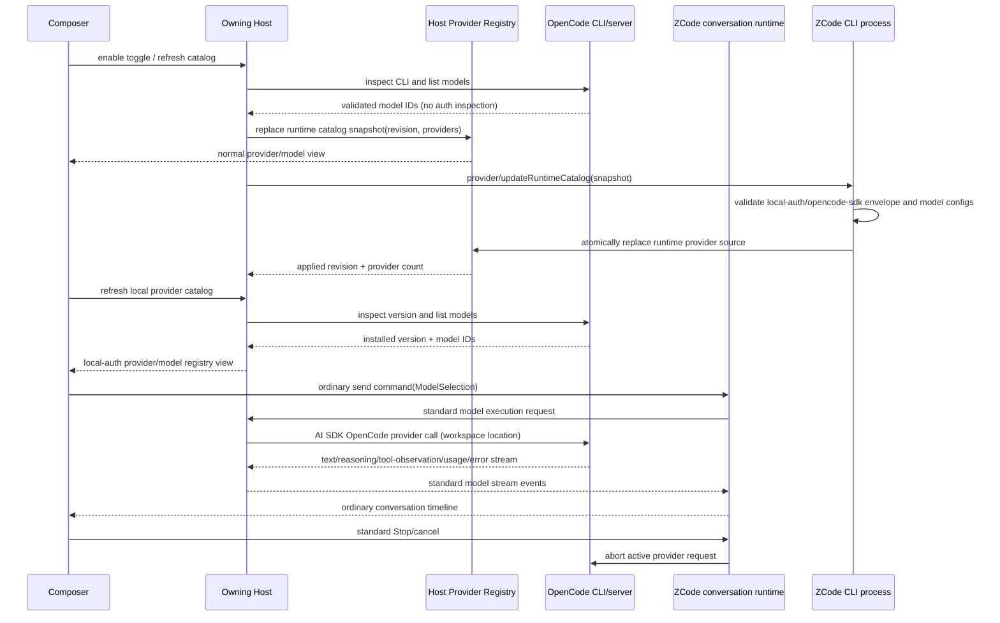

# OpenCode CLI model provider

## Product contract

OpenCode CLI is a first-class local-auth model provider, following the interaction used by Cline:

1. The user enables **OpenCode CLI** in Model Providers. ZCode detects the executable; if it is absent, the same provider row offers Install and verifies the installation.
2. The user chooses **OpenCode CLI** in the ordinary conversation model picker and chooses a model reported by the local OpenCode installation.
3. The ordinary conversation send path runs the selected model through the OpenCode AI SDK provider. There is no ACP-only Composer route, separate workspace picker, session-start form, or separate transcript panel.

OpenCode CLI is distinct from OpenCode Go and other API providers. The CLI uses credentials managed by OpenCode on the Host that owns the workspace. ZCode must not request, read, copy, or persist those credentials. API-backed provider entries and their existing credentials remain unchanged.

## Runtime and ownership

| Concern                                                                                 | Owner                                                             |
| --------------------------------------------------------------------------------------- | ----------------------------------------------------------------- |
| Enable/disable and install UI                                                           | Model Providers settings                                          |
| CLI discovery and model catalog                                                         | Process-owning local Host; existing bounded CLI resolver/catalog  |
| User's selected provider/model                                                          | Ordinary Composer `ModelSelection` and standard draft persistence |
| Model execution                                                                         | ZCode's ordinary AI SDK model adapter in the owning CLI/runtime   |
| OpenCode authentication, upstream provider access, OpenCode-side tools and usage limits | OpenCode installation and its own server                          |
| ZCode conversation admission, message order, cancellation, and displayed transcript     | Existing conversation runtime and protocol                        |

The model integration uses `ai-sdk-provider-opencode-sdk` v3, which targets AI SDK 6 and OpenCode 1.x. Do not upgrade the whole AI SDK to copy Cline's current dependency line. Resolve and pin the compatible v3 release. Provider construction/import must be lazy and process-scoped; remove only signal handlers newly registered by the library, never existing host handlers. Dispose provider-owned resources with the owning runtime.

The local provider is created as an ordinary provider-registry entry with the stable provider ID `opencode`, display name `OpenCode CLI`, and a typed local-auth access mode. It must not use a fabricated URL, fake API key, or a public API provider ID. The model list uses the normal provider/model selection UI and validation. OpenCode's `opencode models --verbose` output is the source for model names, context/output limits, and input/output capabilities; only those validated fields cross the Host boundary. Model IDs preserve the CLI's exact `providerID/modelID` namespace so the SDK receives the same ID it reported; the protocol accepts a bounded safe namespace/model grammar and must not require the namespace to equal `opencode`. If a model lacks required metadata, omit that model instead of failing the entire catalog or inventing capabilities. Do not expose reasoning variants until the ordinary model-selection contract can pass them to the OpenCode SDK.

The OpenCode SDK executes its own server-side agent/tools and ignores custom tool definitions sent by the AI SDK caller. The provider capability therefore advertises tool-call support so the standard adapter accepts the request; this does not make ZCode tool implementations available to OpenCode. OpenCode owns its tool permissions and must show tool activity in the ZCode timeline through the normal model result stream. Never execute an OpenCode tool event a second time through ZCode's local tool runner. Features that require ZCode-owned tools or controls must be disabled for this provider with a visible reason; they must not silently fall through to another provider.

Every Composer send continues to use the standard `ModelSelection`, CommandInbox admission, ZCode run lifecycle, cancellation, and transcript. OpenCode model calls must receive the active workspace directory through the provider's supported location option. No persistent OpenCode session ID or transcript is copied into ZCode session storage unless the provider contract explicitly requires it and a migration/spec is added first.

The owning CLI runtime must create the OpenCode SDK provider and inject it into the ordinary model adapter before that adapter can receive a selection. Catalog visibility alone is not readiness: a visible `opencode/*` model without an initialized provider is a broken state. The app owns disposal of the adapter and provider when its runtime closes or startup fails.

Never evade provider rate limits or automatically switch models/providers after a limit. Surface the typed provider error and let the user decide.

## Change boundary

- Change layers: `option-source`, `validation`, `commit-effect`, `persistence`, and `recovery`.
- Primary path: provider settings -> local Host discovery/install -> ordinary provider registry view -> Composer `ModelSelection` -> standard AI SDK runtime -> conversation projection.
- Retire the `opencode-acp` Composer execution route and its draft/prewarm/admission exceptions when the standard provider path is proven. Remove its ACP-specific transcript, permission, and SQLite run state if no other product surface owns it. Keep only shared CLI install/discovery code that remains used.
- Do not modify OpenCode Go/API provider credentials or other model surfaces (automation, Subagents, workflows) unless they explicitly select the same provider through existing registry semantics.
- Desktop and local Host are the supported CLI scope. Remote Hosts may use OpenCode only when their own local installation and registry explicitly advertise it; do not proxy local credentials to another Host or mobile client.

## Event sequence

Desktop Main merges the user's login-shell `PATH` into its own `PATH` before the first Host spawn: shell entries first, then any directories already present. Finder and Dock only provide launchd's `PATH`, so a terminal-installed `opencode` would otherwise be invisible. Windows skips the merge. `ZCODE_SKIP_LOGIN_SHELL_PATH=1` leaves `PATH` unchanged. An absolute `ZCODE_E2E_OPENCODE_CLI_PATH` is prepended and the login-shell merge is skipped, so the E2E fixture stays ahead of a developer install. The Host then passes that `PATH` to the Host process and the owning CLI.

The Host owns the authoritative OpenCode catalog because it owns the local CLI and its filesystem. On
worker attachment, the Host sends the current full snapshot before the worker can execute a model;
toggle changes and catalog refreshes send a new full snapshot through a per-client serialized queue.
The protocol carries only the provider identity/display metadata, the detected absolute CLI executable
path, a strict `local-auth` + `opencode-sdk` config, model IDs and validated model configs, and a
revision. It must reject API keys, URLs, headers, and unknown config fields. The worker prepends the
validated executable directory to its own `PATH` while the provider is enabled and restores its prior
`PATH` when disabled or disposed; this is required because the OpenCode SDK spawns the bare command
name. The worker validates the entire envelope before replacing
its runtime provider source. Registry refresh publishes that source and the existing config/account
sources in one generation; an invalid or stale delivery leaves the last complete snapshot intact.
An empty provider list is the authoritative disabled/unavailable state. The ACK is sent only after
the worker Registry has applied the revision, not merely received the bytes.

## Accepted cases and evidence

| Case   | Setup and action                                                    | Required result                                                                              | Evidence                                          |
| ------ | ------------------------------------------------------------------- | -------------------------------------------------------------------------------------------- | ------------------------------------------------- |
| OCP-01 | OpenCode missing; enable provider                                   | Same row offers Install; successful installation is detected and provider becomes selectable | resolver/install unit + Desktop settings E2E      |
| OCP-02 | CLI installed and reports models; open Composer picker              | One OpenCode CLI provider with its catalog models appears in normal provider/model selection | provider registry + Composer tests                |
| OCP-03 | Select an OpenCode model and send in an existing ZCode conversation | Standard model selection/admission runs; response appears in the same ZCode conversation     | AI SDK adapter integration + Desktop E2E          |
| OCP-04 | Cancel an in-flight OpenCode response with Stop                     | The same ZCode run is cancelled. A provider chunk that arrives after Stop is not written to the transcript | `opencode-cancel` runtime test; adapter abort test |
| OCP-05 | OpenCode CLI lacks its own provider sign-in                         | Typed sign-in error is shown; ZCode never reads/copies credentials and does not fall back    | provider integration test                         |
| OCP-06 | OpenCode provider reports a rate limit                              | The same OpenCode request fails visibly. Stream recovery does not reopen it, and a declared selection fallback does not switch provider or model | `opencode-rate-limit` runtime test + selection fallback unit |
| OCP-07 | OpenCode streams a tool observation                                 | It is rendered once as provider-side activity and never dispatched to ZCode's tool runner    | adapter/projection test                           |
| OCP-08 | OpenCode disabled or catalog refresh fails                          | Provider is absent or shows a retryable catalog state; existing API providers still work     | settings/registry tests                           |
| OCP-09 | CLI reports a model under another provider namespace                 | Exact `providerID/modelID` is accepted by both Host and Worker and remains selectable         | shared protocol schema + Host/Worker catalog tests |

## Exit criteria

The provider is complete only when the local catalog appears as a normal registry selection, ordinary Composer sends invoke the AI SDK adapter, the response reaches the same ZCode conversation, Stop cancels the same run, no API key is requested, and a local Desktop E2E proves the flow with a real OpenCode CLI. A passing mocked provider test alone does not prove CLI authentication or a real response.

When a command fails before its ACK, the V4 gateway log must retain the command ID, command type, session ID when present, and whether failure occurred during durable-input admission or handler execution. The UI may keep the concise user-facing error, but diagnostics must not collapse the only available backend evidence to a generic `fault.command.executionFailed` reason.
