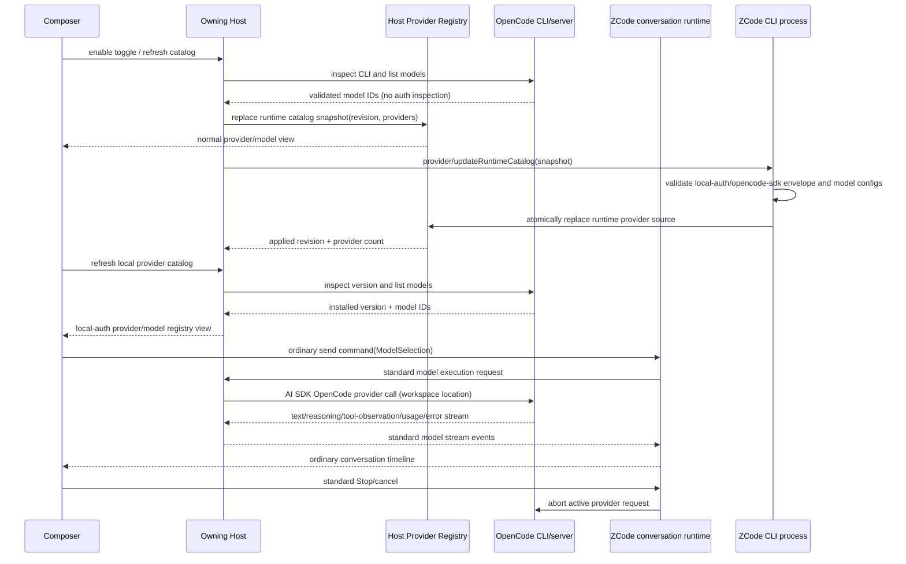

# OpenCode CLI model provider

## Product contract

OpenCode CLI is a first-class local-auth model provider, following the interaction used by Cline:

1. The user enables **OpenCode CLI** in Model Providers. This saves the user's preference even when the executable is absent; the same provider row reports the missing CLI and offers Install. The provider is not selectable in Composer until Host discovery verifies the installed executable and model catalog.
2. The user chooses **OpenCode CLI** in the ordinary conversation model picker and chooses a model reported by the local OpenCode installation.
3. An ordinary conversation send runs the selected model directly through the OpenCode AI SDK provider. It does not make a hidden swarm-planner request. If the user explicitly turns on the Composer's **Swarm** control for the current draft, the normal ZCode-owned swarm planner and runtime run before the final model response. There is no ACP-only Composer route, separate workspace picker, session-start form, or separate transcript panel.

OpenCode CLI is distinct from OpenCode Go and other API providers. The CLI uses credentials managed by OpenCode on the Host that owns the workspace. ZCode must not request, read, copy, or persist those credentials. API-backed provider entries and their existing credentials remain unchanged.

## Runtime and ownership

| Concern                                                                                 | Owner                                                             |
| --------------------------------------------------------------------------------------- | ----------------------------------------------------------------- |
| Enable/disable and install UI                                                           | Model Providers settings                                          |
| Persisted OpenCode CLI enablement preference                                            | Existing settings owner; independent of executable availability   |
| CLI discovery and model catalog                                                         | Process-owning local Host; existing bounded CLI resolver/catalog  |
| User's selected provider/model                                                          | Ordinary Composer `ModelSelection` and standard draft persistence |
| Model execution                                                                         | ZCode's ordinary AI SDK model adapter in the owning CLI/runtime   |
| OpenCode authentication, upstream provider access, OpenCode-side tools and usage limits | OpenCode installation and its own server                          |
| ZCode conversation admission, message order, cancellation, and displayed transcript     | Existing conversation runtime and protocol                        |

The model integration uses `ai-sdk-provider-opencode-sdk` v3, which targets AI SDK 6 and OpenCode 1.x. Do not upgrade the whole AI SDK to copy Cline's current dependency line. Resolve and pin the compatible v3 release. Provider construction/import must be lazy and process-scoped; remove only signal handlers newly registered by the library, never existing host handlers. Dispose provider-owned resources with the owning runtime.

The local provider is created as an ordinary provider-registry entry with the stable provider ID `opencode`, display name `OpenCode CLI`, and a typed local-auth access mode. It must not use a fabricated URL, fake API key, or a public API provider ID. The model list uses the normal provider/model selection UI and validation. OpenCode's `opencode models --verbose` output is the source for model names, context/output limits, and input/output capabilities; only those validated fields cross the Host boundary. Model IDs preserve the CLI's exact `providerID/modelID` namespace so the SDK receives the same ID it reported; the protocol accepts a bounded safe namespace/model grammar and must not require the namespace to equal `opencode`. If a model lacks required metadata, omit that model instead of failing the entire catalog or inventing capabilities. Do not expose reasoning variants until the ordinary model-selection contract can pass them to the OpenCode SDK.

Before an OpenCode SDK request, the adapter must verify that the active invocation has a workspace directory which currently exists and is a directory. If the directory is missing, inaccessible, or no longer a directory, fail before calling the SDK with a concise actionable error asking the user to reopen or restore the workspace. Do not fall back to the process working directory, the user's home, another workspace, or a guessed path. Keep the absolute path out of user-facing errors and logs. For a valid workspace, pass the original active workspace directory to the SDK as before.

Core must provide this invocation context for every local-auth request, including regular turns, swarm planning, connectivity checks, compaction, title generation, MCP sampling, and tool-internal model calls. The runtime model factory binds its owning runtime's `workingDirectory` on every model handle so auxiliary call sites inherit the same directory even when their local invocation context only adds operation metadata. A call that knows the owning runtime workspace must not invoke a local CLI model without `workingDirectory`.

If the SDK reports that OpenCode returned no response data, ZCode must not infer that the model ID is invalid. Preserve a neutral OpenCode request failure unless a bounded upstream status/code/message is available; when that diagnostic says the local OpenCode server failed, direct the user to the OpenCode logs. Do not retry an opaque empty response automatically because the request may already have reached a provider.

The error projection must not re-expose the SDK's raw `EmptyResponseData` message as an underlying error detail: that message may append an unsupported model-ID guess even when OpenCode returned only a generic server error. Keep the classified neutral message and any separately captured bounded status/code/message; suppress only the contradictory raw SDK wrapper text.

Catalog discovery is read-only and must not depend on write access to OpenCode's persistent data directory. Run only the `models --verbose` catalog command with a fresh temporary `XDG_DATA_HOME`, preserve the user's normal OpenCode config and cache environment, and remove the temporary directory after the child process has exited. The temporary directory isolates OpenCode's log/DB side effects; it must never contain, receive, or replace user credentials, and catalog discovery must not run `auth`, start a session, or send a model request. This keeps the local catalog available when the IDE Host cannot write OpenCode's default log path while leaving the user's OpenCode profile untouched.

OpenCode CLI is a host-local provider, not an account or API connection. Selecting its provider group in the Composer must use the same direct model-selection callback as selecting one of its model rows; it must not enter the account-connection synchronization flow or require an account connection key. The Composer's active workspace/runtime remains the owner that resolves and executes the selected model.

The OpenCode SDK executes its own server-side agent/tools and ignores custom tool definitions sent by the AI SDK caller. The provider capability therefore advertises tool-call support so the standard adapter accepts the request; this does not make ZCode tool implementations available to OpenCode. OpenCode owns its tool permissions and must show tool activity in the ZCode timeline through the normal model result stream. Never execute an OpenCode tool event a second time through ZCode's local tool runner. Features that require ZCode-owned tools or controls must be disabled for this provider with a visible reason; they must not silently fall through to another provider.

Every Composer send continues to use the standard `ModelSelection`, CommandInbox admission, ZCode run lifecycle, cancellation, and transcript. Ordinary sends call the selected model directly. Only an explicit per-draft `swarm` intent may add a planner call. OpenCode model calls must receive the active workspace directory through the provider's supported location option. No persistent OpenCode session ID or transcript is copied into ZCode session storage unless the provider contract explicitly requires it and a migration/spec is added first.

The owning CLI runtime must create the OpenCode SDK provider and inject it into the ordinary model adapter before that adapter can receive a selection. Catalog visibility alone is not readiness: a visible `opencode/*` model without an initialized provider is a broken state. The app owns disposal of the adapter and provider when its runtime closes or startup fails.

### OpenCode prompt and agent compatibility

OpenCode's SDK executes tools in its own server process and ignores ZCode's client-side tool schemas. At the provider adapter boundary, ZCode projects the request prompt for OpenCode without changing canonical conversation history:

- Replace ZCode `Agent`/`Task` directions and dynamic profile-list attachments with the invocation-scoped `zcode_task` bridge. It dispatches through the current Core `ToolExecutor`, preserving exact active profile IDs, ancestor tool policy, lifecycle, lineage, root budgets, and cancellation. OpenCode's native `task` tool is disabled for this invocation so it cannot appear as a substitute for a ZCode-owned child.
- Project the Skills catalog instruction to use `zcode_skill` with the exact skill name. Its input accepts only the skill name and optional arguments, never a path. The bridge invokes the registered Core `Skill` handler and current runtime `SkillPort`, including a filtered port for descendants; it does not resolve or read a skill path itself. No `zcode_skill` is advertised when `Skill` is outside the current invocation allowlist.
- Keep available ZCode profile descriptions as role guidance, but do not imply the descriptions alone execute a child. Do not copy or rewrite skill files. Workspace and bundled rules remain the content accepted by ZCode's own context-source snapshot; OpenCode's incidental filesystem discovery does not replace that owner.
- When Core rejects a `zcode_task` call only because the supplied profile ID is not in the active roster, return a bounded, sanitized validation result containing the current allowed role IDs so OpenCode can retry with a valid role. Keep credentials, paths, arbitrary tool errors, and provider errors behind the existing generic bridge error. Do not map unknown names to a generic profile or spawn a child after rejection.
- Keep the projection scoped to OpenCode SDK calls. Other providers and persisted user/assistant messages remain byte-for-byte unchanged.

This compatibility layer must not treat model-visible claims about child work, tests, or receipts as verified ZCode runtime evidence. Errors from OpenCode's own quota, agent lookup, and child task execution remain provider errors and must be shown as such.

### OpenCode network proxy

The OpenCode server is a child process of the ZCode CLI runtime and must use the explicit proxy configured in ZCode's Network settings. The Host supplies this as `ZCODE_HTTP_PROXY` and the matching standard proxy variables; shell proxy variables are not a source of truth. When a proxy is configured, OpenCode must use a dedicated local server port so it cannot silently attach to an unrelated OpenCode server that was started outside ZCode and may have a different network route.

HTTP and HTTPS proxy URLs are inherited unchanged. OpenCode's Bun fetch rejects SOCKS URLs in `HTTP_PROXY`, so for `socks5://` and `socks5h://` settings the owning runtime starts a loopback-only HTTP forward proxy that authenticates to the configured SOCKS5 endpoint and supports HTTPS `CONNECT` plus plain HTTP forwarding. It passes only the loopback URL to the OpenCode child process through standard proxy variables. The original SOCKS URL remains owned by ZCode's configured network policy and is never logged or added to diagnostics. The loopback proxy is disposed with the OpenCode provider; startup/forwarding errors are sanitized.

The configured `NO_PROXY` rules remain in force for OpenCode. No proxy configuration means no proxy bridge. The user may maintain multiple proxy URLs in Network settings and manually select one active URL; the runtime receives only that active URL. Requests are never retried through another proxy, model, or provider to evade an upstream limit. Provider authentication, quotas, and rate limits remain OpenCode/provider-owned.

Never evade provider rate limits or automatically switch models/providers after a limit. Surface the typed provider error and let the user decide.

## Change boundary

- Change layers: `option-source`, `validation`, `commit-effect`, `persistence`, and `recovery`.
- Primary path: provider settings -> local Host discovery/install -> ordinary provider registry view -> Composer `ModelSelection` -> standard AI SDK runtime -> conversation projection.
- Retire the `opencode-acp` Composer execution route and its draft/prewarm/admission exceptions when the standard provider path is proven. Remove its ACP-specific transcript, permission, and SQLite run state if no other product surface owns it. Keep only shared CLI install/discovery code that remains used.
- Do not modify OpenCode Go/API provider credentials or other model surfaces (automation, Subagents, workflows) unless they explicitly select the same provider through existing registry semantics.
- Desktop and local Host are the supported CLI scope. Remote Hosts may use OpenCode only when their own local installation and registry explicitly advertise it; do not proxy local credentials to another Host or mobile client.

## Event sequence



Desktop Main merges the user's login-shell `PATH` into its own `PATH` before the first Host spawn: shell entries first, then any directories already present. Finder and Dock only provide launchd's `PATH`, so a terminal-installed `opencode` would otherwise be invisible. Windows skips the merge. `ZCODE_SKIP_LOGIN_SHELL_PATH=1` leaves `PATH` unchanged. An absolute `ZCODE_E2E_OPENCODE_CLI_PATH` is prepended and the login-shell merge is skipped, so the E2E fixture stays ahead of a developer install. The Host then passes that `PATH` to the Host process and the owning CLI.

The Host owns the authoritative OpenCode catalog because it owns the local CLI and its filesystem. On
worker attachment, the Host sends the current full snapshot before the worker can execute a model;
toggle changes and catalog refreshes send a new full snapshot through a per-client serialized queue.
The protocol carries only the provider identity/display metadata, the detected absolute CLI executable
path, a strict `local-auth` + `opencode-sdk` config, model IDs and validated model configs, and a
revision. It must reject API keys, URLs, headers, and unknown config fields. The worker prepends the
validated executable directory to its own `PATH` while the provider is enabled and restores its prior
`PATH` when disabled or disposed; this is required because the OpenCode SDK spawns the bare command
name. The worker validates the entire envelope before replacing
its runtime provider source. Registry refresh publishes that source and the existing config/account
sources in one generation; an invalid or stale delivery leaves the last complete snapshot intact.
An empty provider list is the authoritative disabled/unavailable state. The ACK is sent only after
the worker Registry has applied the revision, not merely received the bytes.

## Accepted cases and evidence

| Case   | Setup and action                                                                                                     | Required result                                                                                                                                                                                                                                                                                                                                                                                                                                                                                                                                                                                            | Evidence                                                                                                                                                                                                                                                                                     |
| ------ | -------------------------------------------------------------------------------------------------------------------- | ---------------------------------------------------------------------------------------------------------------------------------------------------------------------------------------------------------------------------------------------------------------------------------------------------------------------------------------------------------------------------------------------------------------------------------------------------------------------------------------------------------------------------------------------------------------------------------------------------------- | -------------------------------------------------------------------------------------------------------------------------------------------------------------------------------------------------------------------------------------------------------------------------------------------- |
| OCP-01 | OpenCode missing; enable provider                                                                                    | The switch can be enabled and the preference persists; the same row offers Install; after explicit installation, Host verifies the CLI and catalog before publishing the provider/model in Composer                                                                                                                                                                                                                                                                                                                                                                                                        | provider settings component + resolver/install tests + macOS Desktop E2E `conversation-session-opencode-cli-install`; Windows/Linux live install remains unverified                                                                                                                          |
| OCP-02 | Toggle OpenCode CLI off/on in Model Providers; return to Composer and choose another model                           | The setting persists and the catalog is selectable through normal provider/model selection                                                                                                                                                                                                                                                                                                                                                                                                                                                                                                                 | provider registry + Composer tests + mock CLI Desktop E2E                                                                                                                                                                                                                                    |
| OCP-03 | Select an OpenCode model and send in an existing ZCode conversation                                                  | Standard model selection/admission runs; mock response appears in the same ZCode conversation without external request. Required local fixture trace proves the marker reached the server and the request body contains the selected providerID/modelID; a canned reply alone is insufficient                                                                                                                                                                                                                                                                                                              | AI SDK adapter integration + mock CLI Desktop E2E; real CLI/auth E2E pending                                                                                                                                                                                                                 |
| OCP-04 | Cancel an in-flight OpenCode response with Stop                                                                      | The same ZCode run is cancelled. A provider chunk that arrives after Stop is not written to the transcript                                                                                                                                                                                                                                                                                                                                                                                                                                                                                                 | `opencode-cancel` runtime test; adapter abort test                                                                                                                                                                                                                                           |
| OCP-05 | OpenCode CLI lacks its own provider sign-in                                                                          | Typed sign-in error is shown; ZCode never reads/copies credentials and does not fall back                                                                                                                                                                                                                                                                                                                                                                                                                                                                                                                  | `failure-classifier` + `turn-execution-fallback` OpenCode sign-in tests                                                                                                                                                                                                                      |
| OCP-06 | OpenCode provider reports a terminal rate limit before emitting stream output                                        | The same OpenCode request becomes a visible `TurnError`; Core does not retry it, reopen the stream, or switch provider/model                                                                                                                                                                                                                                                                                                                                                                                                                                                                               | `opencode-rate-limit` Core runtime test + selection fallback unit                                                                                                                                                                                                                            |
| OCP-07 | OpenCode streams a tool observation                                                                                  | It is rendered once as completed provider-side activity and never dispatched to ZCode's tool runner                                                                                                                                                                                                                                                                                                                                                                                                                                                                                                        | `opencode-provider-tool` runtime test + projection test                                                                                                                                                                                                                                      |
| OCP-08 | OpenCode disabled or catalog refresh fails                                                                           | Provider is absent or shows a retryable catalog state; existing API providers still work                                                                                                                                                                                                                                                                                                                                                                                                                                                                                                                   | `providerRuntime` empty snapshot + `registry-service` API provider remains                                                                                                                                                                                                                   |
| OCP-09 | CLI reports a model under another provider namespace                                                                 | Exact `providerID/modelID` is accepted by both Host and Worker and remains selectable                                                                                                                                                                                                                                                                                                                                                                                                                                                                                                                      | Host catalog + Worker `validateSelection` + SDK receives `anthropic/claude-sonnet-4-5`                                                                                                                                                                                                       |
| OCP-10 | OpenCode rejects `session.create` or the local server is unreachable                                                 | Safe HTTP status/upstream code is visible when present; transport failures remain distinguishable; no URL, body, workspace path, or credential is exposed                                                                                                                                                                                                                                                                                                                                                                                                                                                  | provider SDK adapter test + ZCode failure projection test                                                                                                                                                                                                                                    |
| OCP-12 | OpenCode rejects `session.prompt` or `session.promptAsync` with an HTTP error                                        | Preserve its safe status/code/message through the SDK's empty-response wrapper; suppress the SDK's unsupported invalid-model guess and do not infer a cause from a generic 5xx                                                                                                                                                                                                                                                                                                                                                                                                                             | `session.prompt` model-adapter integration + generated-client `promptAsync` error projection + failure-classifier projection                                                                                                                                                                 |
| OCP-13 | OpenCode explicitly reports that its free-model usage limit is exhausted                                             | Classify both generate and streaming chat requests as terminal rate-limited, preserve the bounded provider message and structured attribution in the persisted `TurnError`, and do not retry before any output or infer this cause from a generic 5xx                                                                                                                                                                                                                                                                                                                                                      | OpenCode diagnostic fetch + real SDK `doGenerate`/`doStream` tests + failure-classifier tests + Core no-output terminal-quota runtime test                                                                                                                                                   |
| OCP-11 | Active workspace is missing, inaccessible, or is not a directory                                                     | Fail before the OpenCode SDK request with a concise reopen/restore action; do not substitute another directory or reveal the path                                                                                                                                                                                                                                                                                                                                                                                                                                                                          | adapter preflight tests for absent/non-directory paths and valid directory passthrough                                                                                                                                                                                                       |
| OCP-14 | Configure an HTTP proxy or authenticated SOCKS5 proxy in ZCode Network settings, then send an OpenCode model request | The ZCode-owned OpenCode server uses that configured route; SOCKS traffic goes through a loopback-only bridge, `NO_PROXY` remains honored, credentials never appear in output, and a pre-existing external OpenCode server is not reused. A failed proxy is surfaced without direct-connect fallback or proxy rotation                                                                                                                                                                                                                                                                                     | adapter unit test with a local SOCKS5 fixture plus Desktop replay/live OpenCode request evidence; the real provider response remains required for end-to-end proof                                                                                                                           |
| OCP-15 | Send a Composer request with OpenCode selected while ZCode agent and Skills context is present                       | Only the OpenCode-bound prompt is projected. `zcode_task.subagent_type` is constrained by an enum generated from Core's immutable snapshot of exact model-selectable ZCode profile IDs for this invocation; the snapshot includes configured ZCode profiles, excludes compatibility-only `general`/`general-purpose` and hidden built-in `Explore`, and is checked again by Core before admission. No role is renamed to an OpenCode-native generic type. When Core exposes the ZCode `Skill` tool for this invocation, OpenCode loads the named skill through an invocation-scoped `zcode_skill` MCP tool backed by Core `ToolExecutor` and the current runtime's `SkillPort`; it never reads a host path directly. Child-profile skill allowlists remain enforced by the filtered port. Canonical history and requests for other providers are unchanged | MCP `tools/list` schema enum equals the Core snapshot; generic IDs cannot reach the dispatcher; model-boundary integration observes `SkillPort.loadSkill`, returns a unique skill-body marker to OpenCode, and proves a disallowed child cannot load it; OpenCode Composer desktop replay remains required for the visible chat path |
| OCP-16 | OpenCode calls `zcode_task` with an unknown or stale profile ID                                                          | Core rejects before admission/spawn and does not substitute a generic profile. Only an invocation-schema-valid but subsequently stale ID can reach Core; it receives a bounded validation result with current allowed role IDs. All other Core errors remain redacted by the bridge                                                                                                                                                                                                                                                                                             | MCP schema rejection test proves no executor call for generic/unknown IDs; Core dispatcher test proves stale-profile rejection before admission; bridge test proves safe feedback and generic-error redaction |
| OCP-17 | An OpenCode-backed ZCode child delegates again                                                                       | Every child model invocation gets a fresh immutable Core profile snapshot and exposes `zcode_task` only when that child's effective inherited tool allowlist contains `Task`/`Agent`; its schema enum is the child's exact active profile set. A nested `orchestrator` can spawn a named descendant, return the actual child result, and allow the root model to synthesize a final chat answer. A role without inherited delegation capability cannot spawn a descendant. | Real OpenCode CLI fixture with a local deterministic model and current Core bridge: root → nested orchestrator → leaf → root final marker, plus a negative no-Task profile case; packaged Desktop live-output replay remains required |

## OpenCode Skill invocation boundary

```text
Core model request
  -> only if allowedToolNames contains Skill: capture invocation-scoped dispatcher
  -> OpenCode calls zcode_skill(name, args) over the loopback MCP bridge
  -> dispatcher invokes ToolExecutor.execute({ name: "Skill", input: { skill: name, args } })
  -> current runtime SkillPort loads content (filtered port for a child)
  -> result returns to that OpenCode request only
  -> bridge closes when the model invocation settles or is cancelled
```

The OpenCode adapter does not own skill discovery, file-path resolution, profile policy, or skill content. The current Core runtime's `ToolExecutor` and `SkillPort` remain authoritative; no skill dispatcher is installed when the `Skill` tool is absent from the invocation allowlist. The skill handler retains its existing result format, including optional guidance about the skill's base directory.

## Exit criteria

The provider is complete only when the local catalog appears as a normal registry selection, ordinary Composer sends invoke the AI SDK adapter, the response reaches the same ZCode conversation, Stop cancels the same run, no API key is requested, and a local Desktop E2E proves the flow with a real OpenCode CLI. A passing mocked provider test alone does not prove CLI authentication or a real response.

When a command fails before its ACK, the V4 gateway log must retain the command ID, command type, session ID when present, and whether failure occurred during durable-input admission or handler execution. The UI may keep the concise user-facing error, but diagnostics must not collapse the only available backend evidence to a generic `fault.command.executionFailed` reason.

OpenCode SDK failures from `session.create`, `session.prompt`, and `session.promptAsync` must preserve the HTTP response status and a bounded, sanitized upstream error code/message when the local server exposes them. The model adapter in the pinned provider SDK uses `session.prompt` (`/message`) and wraps an empty result itself; cover that full path with the provider model. The generated client also exposes `promptAsync` (`/prompt_async`), so cover that endpoint's transport and diagnostic projection with the real generated client and the provider SDK's exported empty-response wrapper. Do not imply that the current model adapter sends `promptAsync` requests. The diagnostic must omit request URLs, request bodies, workspace paths, credentials, and arbitrary response payloads; it must not claim an inferred cause or tell the user that an ID is invalid without evidence. The user-facing error may remain concise, while the same safe status/code/message are available in the owning Host error detail and logs. Transport failures without an HTTP response retain their typed network cause rather than being rendered as an empty `{}`.
