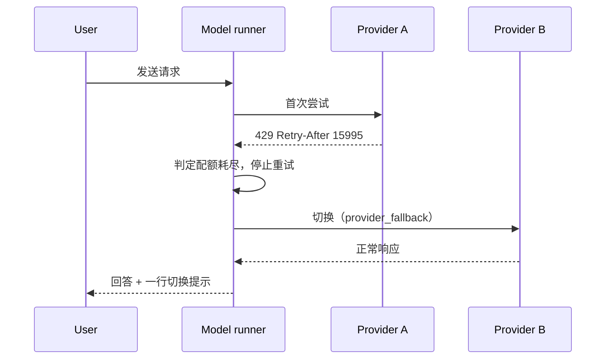

# Provider 配额耗尽自动切换

状态：实现中  
适用分支：`feat/provider-quota-fallback`

## 1. 问题

Provider 返回配额耗尽（402/429/`FreeUsageLimitError`）时，adapter 仍按普通网络错误重试；遇到大 `Retry-After` 时用户会在「Working」上等待约 20 分钟，而不是立即换用已配置的其它 Provider。

## 2. 触发条件

- HTTP 402，业务码 `insufficient_balance`；
- HTTP 429 且 `Retry-After` 大于 300 秒（本地可兑现窗口，见下节）；
- 错误信息命中 `FreeUsageLimitError`。

命中后 adapter 不再重试该 Provider，直接抛出带 `providerQuotaExhausted` 归因的错误。

## 2.1 Retry-After 与本地等待窗口

- 单一事实来源：`MAX_HONORED_RETRY_AFTER_MS = 300_000`（`retry-policy.ts`）。
- `Retry-After <= 300s`：按 provider 要求等待（优先于指数退避），等待可被 `abortSignal` 立刻打断；
- `Retry-After > 300s`：不等待、不重试，分类为 `retryable: false` + `providerQuotaExhausted: true`，
  `retryAfterMs` / `retryAfterSeconds` / `statusCode` 原样保留在 normalized context 中；
- `x-should-retry: false`：`Retry-After` 不参与退避计算（`parseRetryAfterMs` 忽略它），既有行为不变；
- 有界预算仍为 `maxAttempts = 11`（含首次）；重试只重发模型请求，`emittedRetryBoundaryEvent`
  之后（含已输出文本或已完成工具调用）不重放。

测试证据（`apps/zcode-cli/packages/adapters/tests/runner-retry-after-policy.test.ts`）：

- `honors Retry-After up to five minutes and rejects longer waits`
- `keeps a 429 with an in-capacity Retry-After retryable`
- `classifies a 429 beyond the local wait as terminal quota exhaustion`
- `retries a 429 with Retry-After 1s, then emits only the successful attempt`
- `aborts during Retry-After backoff with the caller reason and sends no next request`
- `sleep rejects promptly with the abort reason`
- `stops after one attempt when Retry-After exceeds the local wait`
- `still gives up at maxAttempts for an in-capacity Retry-After`
- `retries before tool dispatch and emits the tool call exactly once`
- `does not retry after a tool call chunk has been emitted`

## 3. 下一次选择

- 候选来自 Registry 中其它已配置、未隐藏且可执行的 Provider；
- 模型必须同属一类：优先相同 `modelId`，否则能力不弱于当前模型（工具调用、JSON Schema、输入模态、上下文窗口），并支持当前 `reasoningLevel`；
- 按 Registry 顺序选择，排除已失败 Provider；总尝试数不超过 Provider 数且最多 3 次；
- 切换时记录 `provider_fallback { from, to, reason }`；成功切换不展示错误横幅，只显示一条简短提示，明确这是额度耗尽、免费额度耗尽、余额不足或长时间限流，不得把 Provider 称为“不可用”；提示按当前 UI 语言本地化；
- 全部失败时只抛一条 `PROVIDER_QUOTA_FALLBACK_EXHAUSTED`，列出尝试过的 Provider，不再重试。

## 4. 边界

- `selection.options.providerFallback === "disabled"`（用户明确「只用这个 Provider」）时不切换；
- 已向客户端输出流式内容后不切换，避免重复文本；
- 不修改 stream idle 600 秒与首 token 90 秒看门狗，也不改变非配额错误的普通重试次数。

