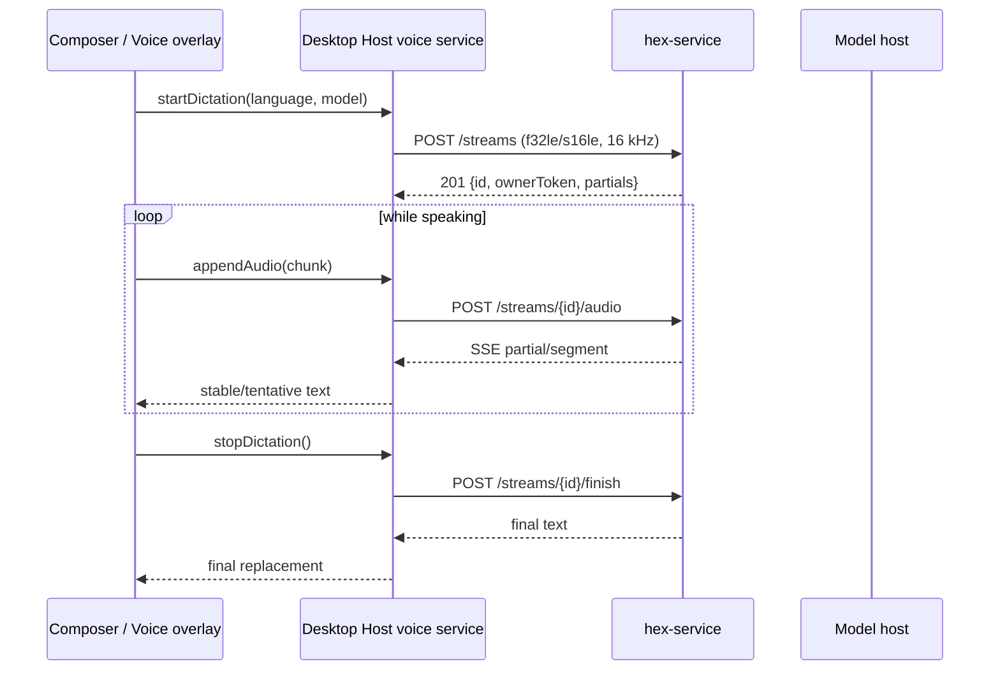

# Voice dictation (Hex engine)

Status: macOS arm64 implementation verified against the bundled engine; the Linux x64
engine is built from the same pinned commit and shipped in the packaged app. Windows
build artifacts are produced by the same script but were not run in this checkout.
Owner: Desktop Host. Applies to the local Desktop app; Web and remote workspaces expose no
dictation surface.

## Goal

ZCode ships local, on-device voice dictation powered by a bundled `hex-service` (Hex, MIT). The user
presses a microphone control (or a shortcut), speaks, and sees text appear in the Composer while they
speak. No audio leaves the machine, no Hex desktop app or system-wide paste is required, and speech
models are downloaded and managed from ZCode itself.

Non-goals: system-wide dictation outside ZCode, replacing the Agent model, meeting recording, screen
annotation, and cloud speech providers.

## Product surface

- A microphone button sits in the empty-state start composer and in the ordinary conversation Composer
  toolbar. It is always visible on Desktop — macOS, Windows and Linux behave identically — and it starts
  and stops one dictation for the focused Composer only.
- The button is inactive until the pre-setup is done: it is rendered muted, marked `aria-disabled`, and a
  press opens the pre-setup dialog instead of starting a capture. The in-app shortcut behaves the same.
- While dictating, an in-window overlay appears above the Composer: level meter, elapsed time, selected
  model/language, and Stop/Cancel. It never creates an OS-level floating window.
- While the Settings tab is active, the overlay hides the moving activity indicator (pulse dot and
  level bars) so the settings page stays still; the elapsed time, model, gear, and Stop/Cancel remain
  available, so an in-progress dictation can still be cancelled or stopped from Settings.
- The shortcut defaults to in-app hold-to-talk and double-tap-to-toggle. A Settings switch may register
  the toggle globally while ZCode is running; global hold-to-talk is not promised until the platform
  input bridge exists. The shortcut acts only on the active ZCode Composer.
- Settings › Voice owns: enabled state, shortcut mode, language, installed model, catalog download with
  progress, and disk usage. The catalog shows the provider's own name, languages, size, and whether the
  model can stream partial text.
- Live text is appended at the Composer caret. `stable` text is never revised; `tentative` text is
  replaced by the next partial for the same segment. On stop, the final transcript replaces the
  tentative tail. Cancel removes all text inserted by that dictation and keeps the prior draft.
- Dictation never sends a message, never starts a turn, and never changes the selected Agent model.

## Mandatory pre-setup

- Dictation needs an explicit pre-setup on every platform: the user picks a language, picks a speech model,
  and that model is installed. Until then the composer control stays inactive.
- The pre-setup is never implicit. Auto-selecting a default model does not count as a setup, and the app
  never starts a hidden download: the first press opens the pre-setup dialog.
- The setup is remembered per renderer (selected model and language). It stops being valid when the chosen
  model is removed or stops supporting the current language; the control returns to the inactive state and the
  next press reopens the pre-setup.
- The pre-setup dialog is the same surface as Settings › Voice; the composer control never opens a second
  settings surface.

## Ownership and process model

- One `hex-service` child per Desktop window Host, started lazily on the first dictation or model action
  and reused across dictations. It is a direct child of the Host (not the renderer), owns model memory,
  and exits with the Host. The Host reads only the service's `{"type":"ready"}` line and its bearer token;
  the token never reaches the renderer.
- The renderer owns microphone capture and Composer projection. Audio is 16 kHz mono `s16le`, produced by
  an AudioWorklet, sent in 100–500 ms chunks to the Host over the existing RPC boundary, and never written
  to disk.
- The Host owns the Hex API client, model lifecycle, download progress, cancellation, and the stream
  lease. It exposes bounded methods to the renderer; no renderer code calls localhost or reads the
  discovery file.
- The existing Composer draft remains the single owner of what the user has typed. Dictation is an input
  source that edits the draft through the same Lexical path as typing; it does not create a second draft
  or a pending send.

## Hex integration

- The repository pins a Hex commit and applies two local patches in
  `scripts/hex-service/patches/`: an embedded service that creates and shares a
  `TranscriptionEngine` so `/streams` works headlessly, and a stub for the Apple Intelligence Swift
  bridge so the service builds with Command Line Tools-only macOS installations. Dictation does not
  depend on Apple Intelligence.
- `scripts/prepare-hex-service.mjs` builds `hex-service` for the target platform into
  `packages/desktop/bundled-voice/<platform>/hex-service` (or verifies a prebuilt artifact supplied by
  CI), writes a manifest with version/commit/sha256, and never downloads models at build time. The
  `hex` MIT license and third-party notices are shipped next to the binary and added to
  `THIRD-PARTY-NOTICES.md`.
- macOS builds must be signed with the app's Developer ID; the upstream Hex signature is not reused.
  Windows/Linux artifacts are produced by the platform CI job. The app reports a clear unavailable state
  when the binary is missing or cannot run, and never silently downloads an executable at runtime.
- Every packaged Desktop build must ship `hex-service` for its own target. A build that declares voice
  dictation (`ZCODE_ENABLE_VOICE_DICTATION=1`) prepares the engine for the target and fails when the engine
  cannot be produced, so a release can no longer ship an app whose dictation control can never work.
- Model downloads are performed by the bundled service through its `/models/{id}/prepare` endpoint,
  with the same bytes and progress events Hex itself uses. Download failures leave the previous model
  usable. Models are stored under the app data directory and are removable from Settings.

## Model and language behavior

- The catalog comes from `GET /models`; it includes `id`, `name`, languages, bytes, installed/verified,
  and the model's streaming capability. Language selection filters the catalog; `auto` is offered only
  when the model supports detection.
- A model marked as streaming produces `partial` events (`stable` + `tentative`) while the user speaks.
  Models without streaming produce `segment` events at pauses and a final transcript on stop; the UI says
  "Текст появится на паузах" instead of promising word-by-word typing.
- The first dictation in a language that has no installed model opens the model picker with the
  recommended model and its download size; it does not start a hidden download.
- At most one live stream exists. A second start while one is active is refused in the UI; the Host
  cancels the previous stream on window close or renderer unload.

## Model preload and error contract (2026-11-21)

A real run exposed `stream-start-503 {"code":"model-not-loaded"}` when an installed
model was started directly. Hex's shared engine reports `prepare` `ok` before the
asynchronous model swap is finished, and the old Host never prepared an installed
model at all. The Host now:

- prepares the selected installed model before the first stream (and before a rolling
  model's first window);
- retries the bounded `503/model-not-loaded` window instead of surfacing an Electron
  IPC string, and prepares again if an already-loaded model was unloaded;
- keeps `loadedModelId` per Host and clears it when the child exits;
- preserves the user's installed model on catalog refresh when it supports the current
  language, and never keeps an English-only stored model for a Russian dictation.

The overlay gear navigates to **Settings › Voice** (`setPendingSettingsSectionIntent`
plus `openSettingsTab`) instead of opening a second settings surface. The in-composer
model picker remains only for the "no installed model" flow.

## Failure, privacy, and capacity

- Audio stays in memory and is sent only to the loopback Hex service. Logs never contain audio,
  transcript text, tokens, or absolute model paths; diagnostics use stable error codes and sizes.
- Microphone permission is requested through the existing platform permission path. Denial leaves the
  Composer editable and shows an actionable notice.
- `stream-busy`, `lease-expired`, `model-not-loaded`, `engine-unavailable`, download failures, and
  process crashes each have a distinct user-visible state. A crash kills the child and the next start
  relaunches it once; it must not loop.
- Stop waits for the final transcript with a bounded deadline; if it expires, the Host cancels the stream
  and keeps the stable text, reporting a truncated dictation instead of hanging.
- One service per window bounds model memory; models are unloaded/replaced only through the service.
  Idle shutdown is explicit and must not drop a model during an active dictation.

## Acceptance scenarios

- First use: open Settings › Voice, choose Russian, pick GigaAM v3, see download progress complete, then
  dictate in the start composer; text appears while speaking or at pauses and lands at the caret.
- Existing draft: place the caret mid-text and dictate; inserted text appears at the caret, the rest of
  the draft is unchanged, and no send occurs.
- Streaming model: with a Parakeet streaming model, tentative words update smoothly and never duplicate
  stable text; on stop the final transcript replaces the tentative tail exactly once.
- Non-streaming model: the overlay shows the "text at pauses" state; segments append without waiting for
  release and the final replaces the loose tail.
- Cancel (Escape or Cancel): all text inserted by the current dictation is removed and the pre-dictation
  draft/selection is restored.
- Shortcut: in-app hold starts on keydown and stops on keyup; double-tap toggles; shortcuts do nothing
  when another app is focused unless the global toggle is explicitly enabled.
- Permission denied, missing model, service crash, stream busy, and lease expiry each show a distinct,
  localized message; the Composer remains usable and no partial message is sent.
- Pre-setup: on a fresh install the microphone control is visible but inactive; the first press opens the
  pre-setup, the model downloads with progress, and only after that does a press start a capture.
- Linux package: the packaged Linux app contains `resources/voice/hex-service` and reports voice dictation as
  available instead of `binary-missing`.
- Code-index descriptor regression: a 20k-file workspace can open while Hex is running; the Host keeps
  enough descriptors to spawn the Agent CLI and the dictation child.
- Cross-platform: macOS arm64/x64, Windows x64/ARM64, and Linux x64/ARM64 builds either ship a verified
  `hex-service` and pass the same start/stop scenario, or report the capability unavailable with the
  missing-artifact reason.

## Verification

- 2026-11-20, macOS arm64: patched Hex 3.4.0 embedded service; `GET /models` reported GigaAM v3 as
  installed/verified; `/transcriptions` returned Russian text; Parakeet Unified English `/streams`
  emitted `partial` events before `final`.
- The same build fed the Composer through the platform port: Russian text appeared in the Lexical
  editor during recording and the final replaced it once; cancel restored the prior draft in the
  editor unit tests.
- The Desktop main process exposed status, catalog, prepare, start, appendAudio, stop, and cancel over
  the `zcode:voice-dictation` channel; no token or model path crossed to the renderer.
- 2026-11-21, macOS arm64: reproduced `stream-start-503 {"code":"model-not-loaded"}`
  against the bundled Hex 3.4.0 service. `POST /models/parakeet_unified_en/prepare`
  loaded the model; `/streams` succeeded after the ~1 s asynchronous swap once the
  Host retried. The Host now preloads an installed model and retries that bounded
  window; the overlay renders a localized model-load message instead of the raw
  Electron IPC wrapper.
- 2026-11-24, Linux x64: the patched Hex 3.4.0 service was built from the pinned commit with the
  repository script; `packages/desktop/bundled-voice/linux-x64/hex-service` starts on this machine and
  prints the `{"type":"ready",…}` line with a loopback URL and a bearer token.
- 2026-11-24: `0001-embedded-shared-engine.patch` creates the shared engine per platform — macOS keeps
  its warm transcriber, other platforms start the engine parked and load the model the host prepares.
  The previous macOS-only `WarmTranscriber` reference did not compile outside macOS.
- 2026-11-24: a Linux x64 package built with `pnpm bundle:desktop -- --os linux --arch x64` ships
  `resources/voice/hex-service` (84 MB, plus the Hex license and the manifest) in the unpacked app,
  the `.deb`, `.rpm`, `.pacman` and the AppImage; the packaged engine starts and prints the ready line.
- 2026-11-24: the composer control is visible on every Desktop platform, inactive until the user chose
  an installed model, and a press opens the voice settings; the renderer tests cover the inactive
  state, the setup gate, and the missing-engine case.
- Not verified here: the Windows engine build, real-microphone TCC approval on a clean machine, and a
  global hold shortcut. The current shortcut is in-app (hold ⌘⇧Space, tap twice to keep recording);
  a global toggle is a deliberate follow-up rather than a hidden partial path.
