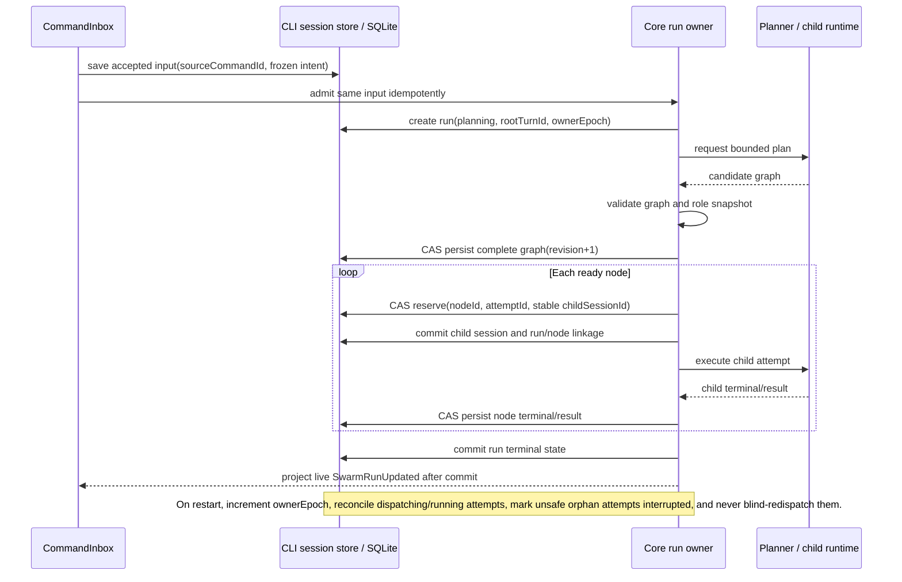
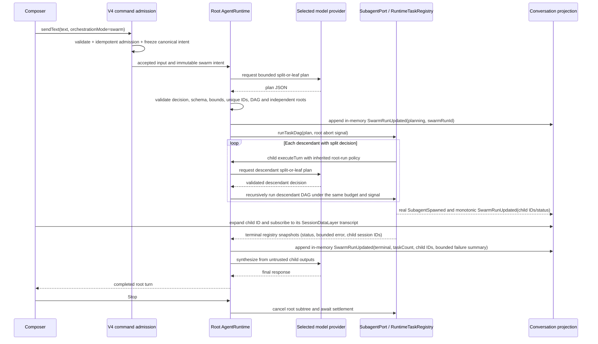
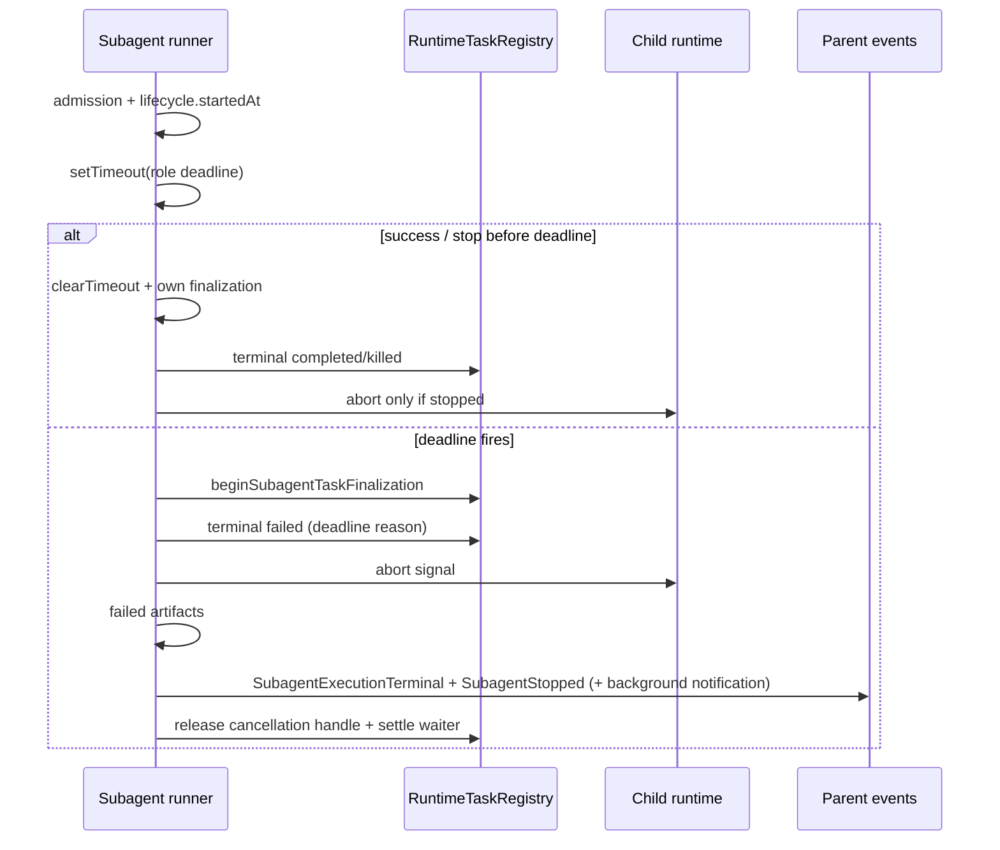

# Явный режим роя ZCode

## Назначение

Сделать ZCode-owned orchestration доступной при обычной работе в Composer независимо от того, умеет ли выбранный provider передавать ZCode tool schemas. Обычная отправка у любого провайдера идёт напрямую в выбранную модель. Если пользователь явно включает переключатель **Рой** для текущего черновика, runtime решает, оставить сообщение обычным ответом или запустить независимых ZCode subagents. Никакой провайдер не запускает planner скрыто.

OpenCode CLI особенно важен: его SDK исполняет собственные инструменты, игнорирует клиентские tool definitions и помечает нативные вызовы как уже выполненные провайдером. Поэтому системная подсказка «вызови Agent» не является запуском ZCode-агентов. В OpenCode-модель передаётся roster из 16 встроенных ZCode-профилей с активными profile ID и краткими описаниями; invocation-scoped MCP server `zcode` регистрирует внутренний инструмент `task`, чтобы OpenCode показывал модели точное имя `zcode_task` (OpenCode добавляет имя сервера как префикс). Аналогично внутренний `skill` публикуется как `zcode_skill`. Нативные OpenCode `Task`, `general` и `explore` не используются как замена ZCode-профилям, и встроенный generic `general-purpose` профиль отсутствует. Каждый активный model invocation получает изолированные OpenCode server/client и bridge lease, привязанные к одному runtime-вызову; lease нужен только для аутентификации loopback MCP-транспорта и никогда не попадает в prompt, tool arguments или логи. Параллельные вызовы не разделяют lease или изменяемое состояние маршрутизации. Bridge вызывает Core Agent executor и возвращает фактический результат в OpenCode tool result. Без подтверждённого реального MCP-вызова, запуска дочерней сессии и видимого transcript OpenCode не считается доказанным путём вложенного делегирования.

## Владелец состояния и контракт

### Профили, навыки и ёмкость

- В каталоге есть отдельные профили `coder`, `debugger`, `researcher` и `test-engineer`; маршрутизатор выбирает профиль по типу результата: реализация, воспроизведение и локализация дефекта, сбор фактов или проверки. `orchestrator` только планирует и делегирует; root `start` сразу передаёт задачу `orchestrator` и возвращает пользователю короткий итог вместо технического дампа.
- `orchestrator` получает перечень установленных навыков с краткими описаниями и назначает подходящий навык конкретной ветке по его имени и назначению. Дочерний профиль может загрузить только навык, который доступен в текущем workspace/user-каталоге, не заблокирован политикой и разрешён профилем/его предками. Для встроенных worker-профилей wildcard разрешает выбор из доступных установленных навыков; он не обходит фильтр каталога и запрет официальных CUA-навыков. Навык, найденный в marketplace, становится доступен после установки и повторного обнаружения каталога.
- Общее количество задач и суммарных запусков агента не ограничивается прикладным счётчиком. `spawnBudget`, `remaining_spawns` и `spawnGrant` — legacy-поля: старые значения в настройках и сохранённых снимках принимаются при чтении, но игнорируются как лимит, а новые запуски не записывают конечные grants. Изменённая семантика не удаляет и не переписывает пользовательские настройки автоматически.
- Одновременная работа ограничивается фактическими свободными слотами runtime, активными worker-процессами, ресурсами ОС и ограничениями провайдера. Нет константы максимального числа одновременно запущенных задач. Параллелизм ограничивается только безопасной динамической доступностью ресурсов и явным ограничением текущего провайдера; отмена, дедлайны и recursion guard остаются обязательными.
- Root-run budget остаётся временным состоянием процесса, владельцем которого является `RuntimeTaskRegistry`; он хранит дедлайн, отмену и активную конкурентность, но не кумулятивный лимит созданных задач. Снимок `RuntimeTaskSnapshot.spawnGrant` может встречаться в старых записях: resume должен сохранить совместимость формата, но не переносить его как действующее ограничение.

- Composer предоставляет один явный переключатель **Рой** для всех провайдеров. Режим хранится только в черновике текущего чата и отправляется как одноразовый intent.
- Renderer передаёт строго типизированный `orchestrationMode: "auto" | "swarm"` в `sendText`; отсутствие поля означает обычный режим. `auto` сохраняет автоматическую маршрутизацию без root planner; bounded planner запускается только явным `swarm`. Команда вместе с mode проходит тот же admission, idempotency и очередь, что и текст. Renderer не запускает дочерние сессии и не дублирует статус runtime.
- CLI сохраняет режим в canonical input intent. Принятый режим не может измениться после admission; queued/replayed input сохраняет исходный режим.
- Core runtime является единственным владельцем планирования и запуска. Только root turn с явным `orchestrationMode: "swarm"`, собственным root-run budget и без унаследованного `internalSwarmRootRunId` получает bounded plan у выбранной модели, валидирует его по runtime-схеме, затем запускает узлы через существующий `SubagentPort.runTaskDag`. Режим `auto` planner не запускает: сложная работа идёт Root → Start → Orchestrator через явные `Task`/`Agent`. Вспомогательный запрос планировщика ограничен 60 секундами и одновременно отменяется сигналом root turn. При явном `swarm` решение `leaf`, невалидный план, исчерпание ёмкости или постоянная ошибка planner передают исходную задачу именованному профилю `orchestrator` как одноузловой DAG. Если для run включён durable journal, fallback-граф сохраняется до перехода в `running`, а попытка orchestrator резервируется до dispatch; отказ commit блокирует запуск. Если orchestrator нельзя запустить или он завершился ошибкой, turn завершается как ошибка `SWARM_RUN_FAILED` и не переходит к root tool loop. После успешного DAG/fallback root получает только результаты детей и делает синтез с пустым toolset. Единственное исключение — явно распознанный list-only запрос, который не просит выполнять работу и остаётся обычным прямым ответом. Нормальный provider tool-call не требуется. Каждый descendant получает внутреннюю root-run policy: общий deadline, token admission, cancellation и worker quota. Эта policy не открывает новый planner, даже если orchestration intent по ошибке/совместимости присутствует у дочернего turn. Назначенный узел выполняет свой prompt; дальнейшее делегирование возможно только явным Task/Agent, если профиль это разрешает. Автоматическое повторное планирование на каждом потомке заставляет короткую ветку снова открывать рой и исчерпывает общий бюджет.
- Встроенные именованные роли, которым разрешено делегирование, получают настоящий `Task` tool с обязательным `subagent_type`; пропущенный тип никогда не выбирает `general-purpose` молча. Выбранный тип должен совпадать с активным profile ID. Он запускает дочернюю сессию через тот же runtime и сохраняет root/parent lineage, принятые инструкции workspace, снимок профилей, skills и политики инструментов. Явный toolset профиля каждого уровня пересекается с унаследованным `toolAllowlist`, затем применяются все `toolDisallowlist`; профиль потомка не может вернуть инструмент, запрещённый любому предку. Обычная runtime-вложенность Agent/Task не имеет фиксированного лимита глубины; общие root-run budget и max-parallel ограничивают объём одновременной работы независимо от уровня вложенности.
- Каталог доступных ролей и delta-уведомление вычисляются только когда в effective toolset разрешён `Agent` или `Task`. При выключенной делегации runtime не читает профили агентов: отсутствие каталога не должно мешать обычному сообщению.
- Специальная проверка рекурсивной способности отделена от обычного planner только в корневой сессии и только для явно запрошенной одиночной последовательной цепочки D1→DN (N — положительное безопасное целое больше 1, также допускается «Nesting chain depth N»). Создаётся одна начальная задача именованного профиля `orchestrator`; каждый уровень до N−1 вызывает ровно один `Task` для следующего уровня, уровень N не вызывает инструментов. Для этого диагностического shortcut N ограничено диапазоном 2–100; обычная runtime-вложенность Agent/Task не имеет фиксированного лимита глубины. Для обоих путей действуют общий root-run deadline, token admission, cancellation и worker quota. Descendant не повторяет shortcut даже при унаследованном swarm intent. Запросы с fan-out, sibling-ветками, небезопасной глубиной или дополнительными deliverables идут через обычный planner; ошибка выполнения явного Swarm не включает root tool loop.
- Для OpenCode вызов `zcode_task` адаптирует вход в канонический Core `Agent` executor, не создаёт параллельный путь запуска. Core остаётся единственным владельцем проверки активного profile ID, admission, root-run budget/max-parallel, permission и hook policy, tool lifecycle/events, дочерних сессий, root/parent lineage и каскадной отмены. MCP handler не вызывает `SubagentPort` напрямую и не принимает решений о разрешениях. Ответ executor возвращается как результат того же MCP tool call, после чего OpenCode продолжает root generation.
- Если `start` ошибочно прислал `task_graph` вместе с общими `acceptance_criteria`, Core принимает типизированный вход и запускает ровно один `orchestrator` с исходным prompt и общими критериями, не исполняя присланный граф. Для остальных ролей сочетания `task_graph` с общими критериями или `run_in_background:true` по-прежнему отклоняются до запуска. Это предотвращает повторные ошибки схемы без расширения прав `start`; ошибки формы остальных вызовов остаются диагностируемыми.
- OpenCode bridge lease создаётся для одного model invocation до передачи prompt в SDK и закрывается ровно один раз после завершения, ошибки или отмены invocation. Секрет lease передаётся только в аутентифицированном заголовке loopback MCP transport; он не сериализуется в model prompt/tool input, persisted session events, пользовательские настройки или логи. Просроченный, неизвестный или отменённый lease отклоняет вызов до Core admission. Параллельные model invocations используют изолированные server/client/lease и никогда не маршрутизируются через глобальный mutable current-runtime указатель. Отмена root model request отменяет bridge execution тем же AbortSignal и ждёт обычного settlement Core child tree до закрытия транспорта; поздние вызовы закрытого lease не создают child.
- Последовательность OpenCode-вызова: (1) Core фиксирует invocation ID, активный профильный snapshot, trace и AbortSignal, затем создаёт lease и отдельный loopback MCP server; (2) adapter передаёт в OpenCode prompt с ZCode roster и `zcode_task`; (3) OpenCode вызывает MCP-инструмент, transport проверяет lease и направляет запрос только callback этого invocation; (4) handler вызывает Core `Agent` executor, который проверяет profile ID и применяет admission, tool/permission policy и общий root budget до spawn; (5) обычные Core tool/session events обновляют child transcript и lineage, а завершённый результат того же executor становится MCP tool result; (6) OpenCode продолжает ответ и синтезирует результат в root чате; (7) завершение/ошибка/отмена закрывает lease и MCP server, а отмена сначала проходит через Core до settlement child tree.
- Раскрытая карточка дочерней сессии показывает read-only ход работы из её `toolCall`-строк, пока ещё нет текста ассистента. Она не показывает параметры, сырой вывод и интерактивные действия дочерних инструментов; полный transcript остаётся доступен в боковой панели сессии.
- Профиль, наследующий инструменты через `tools: ["*"]`, получает `Task` как совместимый алиас `Agent`, если `Agent` доступен родителю и не запрещён ни одному предку. Disallowlist `Agent` или `Task` закрывает оба имени. Явный профиль без `Task` может отключить рекурсию только для себя; вложенное расширение прав запрещено.
- Root и descendant planner используют общий `generateWorkspaceText`; каждый синтетический model request обязан передавать текущий `workingDirectory` runtime в `ModelInvocationContext`. Это необходимо локальным провайдерам OpenCode CLI; fallback к cwd процесса запрещён.
- `orchestrationMode: "swarm"` допустим только для маршрута ZCode. Команда `executionRoute.kind === "opencode-acp"` передаёт весь turn отдельному ACP runtime и не вызывает ZCode `SubagentPort`, поэтому сочетание ACP + swarm отклоняется при разборе команды и canonical intent; оно не должно молча терять флаг или запускаться как обычное ACP-сообщение.
- Решение planning-запроса имеет вид `split` с минимум двумя независимыми узлами или `leaf` с причиной. Явный режим `Рой` передаёт `leaf` профилю `orchestrator`; `split` запускает DAG через core runtime. Режим `auto` planner не вызывает и сразу выполняет обычный model turn; planner ошибки относятся только к явному `swarm`. Ошибка запроса planner, отказ свободным текстом, невалидный план или исчерпание ёмкости до первого дочернего запуска запускает однократную передачу исходной задачи `orchestrator`. Ошибка валидации плана отдельно классифицируется как `planner_invalid_plan`, а не как ошибка запроса модели. Если orchestrator отсутствует или завершился неуспешно, явный рой получает терминальный `failed`, а turn возвращает `SWARM_RUN_FAILED` без обычного root tool loop. После успешного DAG/fallback event помечается `completed`, а root делает синтез без инструментов. Валидный `leaf` не получает `completed` с нулём задач.
- Каждый Task-capable встроенный swarm-профиль получает allowlisted навык `zcode-swarm`, чтобы реально выполнять процедуру делегирования и сбора результатов. Skill не расширяет права; наличие текста навыка не доказывает, что агент был запущен.
- Planner, runner и потомки Swarm используют один неизменяемый canonical Swarm profile snapshot; он содержит 15 системных ролей и только те пользовательские/проектные роли, которые явно opted-in через `includeInSwarm`, имеют уникальное непустое имя и concrete tool allowlist без `*`. Полный active profile snapshot остаётся источником для обычных Agent/Task вызовов. Оба снимка наследуются каждым соответствующим потомком по всему дереву без повторного чтения конфигурации. В prompt и runtime-схеме передаются точные active profile IDs; планировщик не выдумывает имя по примеру. Неизвестный или устаревший ID отклоняется до запуска любых узлов с перечнем доступных ID.
- Средство исполнения модели и рабочая роль — разные понятия. Swarm принимает только 15 канонических встроенных ролей ZCode: `start`, `orchestrator`, `researcher`, `implementer`, `coder`, `frontend-coder`, `backend-coder`, `infra-coder`, `reviewer`, `security-reviewer`, `test-engineer`, `evaluator`, `self-improver`, `knowledge-curator` и `subagent-factory`. Эти роли определены и поставляются ZCode независимо от `.cursor` и соседних репозиториев. В пользовательском/проектном каталоге зарезервированы `general` и `general-purpose`; они не могут добавить или подменить runtime-роли. Встроенная роль владеет своим именем: custom-профиль с тем же именем не заменяет её prompt, tools или skills, а добавляется в каталог только под уникальным именем. `Explore` сохраняется только для совместимости старых сессий и не предлагается модели как роль ZCode. `Agent` и `Task` требуют точный активный профиль; каждый узел Swarm должен указать точную встроенную роль, а отсутствующая или неизвестная роль отклоняется до spawn.
- `start` не делает длинный read-only триаж: он коротко определяет владельца и сразу маршрутизирует изменяющую работу специализированному исполнителю (`coder`, `frontend-coder`, `backend-coder`, `infra-coder`, `test-engineer`), а сложную многокомпонентную работу с независимыми ветками отдаёт `orchestrator`. `orchestrator` запускает столько независимых специализированных веток одним сообщением, сколько допускает фактическая ёмкость spawn envelope, задаёт каждой ветке конечный проверяемый объём и использует профильный deadline (по умолчанию 30 минут для worker и 45 для orchestrator). Если устойчивого направления нет в каталоге, `start`/`orchestrator` вызывают `subagent-factory` вместо generic-роли.
- Если пользователь явно просит выполнить задачу через именованный профиль (например, «через start») или начинает сообщение с `Start`/`start` как с метки задачи, root первым действием вызывает профиль `start` через `Agent`/`Task`, до собственного чтения исходников, поиска или команд по той же задаче. `start` решает, выполнять ли задачу самому или передать независимые направления `orchestrator`-у. Root не дублирует делегированную разведку или работу; он интегрирует фактические child-результаты и выполняет только нужную итоговую проверку. Если вызов роли отклонён или недоступен, root сообщает точный blocker и не заявляет, что делегирование состоялось. Случайное упоминание «start» внутри обычного текста само по себе не является routing intent.
- Root и worker-профили, которым выдан `CodeIndex`, начинают задачу по коду с `status`, затем выполняют адресный `search` и выбирают `context`/`impact`/`trace` по вопросу. При полезных результатах индекса они проверяют только найденные исходники и тесты вокруг нужных строк и не повторяют широкий Explore/Grep обход. Обычный поиск используется при недоступном, пустом, неактуальном или недостаточном индексе; partial-индекс не доказывает отсутствие кода. Итоговый отчёт различает подтверждённые индексом указатели и проверенные исходным кодом факты.
- Фактический fan-out определяется числом независимых узлов плана и запрошенным параллелизмом, ограниченными свободными слотами runtime. В foreground-вызове ожидающий parent передаёт свой worker-slot ребёнку; background-задачи занимают отдельный активный слот. Нет суммарного лимита созданных задач и фиксированного потолка активных задач; одновременная ёмкость равна доступной конкурентности процесса/runtime и при необходимости ограничивается явной пользовательской настройкой или провайдером. Недоступность слота приводит к ожиданию или штатному отказу по отмене/дедлайну, но не к искусственному лимиту дерева. Ветки не дублируются и не пересекаются по файлам.
- `subagent-factory` — реальный механизм создания профилей, а не только оценщик каталога. При устойчивом направлении, которого нет в каталоге, он пишет `.zcode/agents/<kebab-name>.md` с YAML frontmatter (`name`, `description`, `tools`, `skills`; опционально `disallowedTools` и `mcpServers`) и телом — системными правилами роли. Имя не совпадает с built-in/reserved, `tools` берутся только из полного worker-набора, `skills` — из доступных, секреты и generic-роль запрещены, разовые задачи не создают профиль. После Write возвращаются путь, имя, tools, skills, правила и пометка, что профиль станет доступен в следующем turn; существующая роль или навык важнее нового профиля.
- Каждая роль подчиняется пользовательским и workspace-инструкциям. Ролевой system prompt не может запрещать обязательное обновление spec, тесты, документацию или другие действия, требуемые более приоритетными инструкциями. Все дочерние и вложенные агенты получают тот же принятый snapshot `AGENTS.md`; при config-only инициализации дочерней сессии snapshot сохраняется для следующего уровня, профиль не может убрать или заменить его. Навыки обнаруживаются и загружаются через существующий `SkillPort`/`Skill` tool, а не копируются внутрь prompt или читаются в обход порта. Доступный дочерней роли allowlist навыков передаётся следующему уровню только через тот же фильтрующий `SkillPort`; дочерний профиль не может расширить права предка. Для встроенных ролей каталог содержит allowlist навыков из адаптированного пакета ZCode.
- Каждая строка дочерней задачи показывает её фактическую активную роль, переданную runtime вместе с child session ID; роль не угадывается по описанию или порядку.
- Реальные дочерние ответы видны в строке роя по мере поступления без обязательного нажатия «Output». UI подписывается на фактические child sessions через `SessionDataLayer`, показывает текстовые assistant-сообщения, пустое ожидание и ошибку, и не вставляет их в root transcript как будто это ответ координатора. Root-синтез остаётся отдельным ответом исходного чата.
- Планировщик и дочерние задачи используют принятую модель Selection вместе с выбранными `ModelOptions`, если профиль агента явно не задаёт поддерживаемый override. Это обязательно для провайдеров, которые требуют reasoning level: planner не должен терять опции, когда формирует Selection из активного runtime model. OpenCode CLI не читает секреты и не получает обход rate limits; его штатные ошибки показываются как ошибки provider.
- Запрошенный planner output budget ограничен сверху `model.optionSpecs.maxOutputTokens.max`. При ограничении сохраняются остальные выбранные `ModelOptions`; runtime не должен отклонять план до обращения к модели из-за превышения capability конкретной модели.
- Дочерние результаты являются недоверенным содержимым. Core добавляет их в контекст синтеза, но не трактует их текст, утверждения о проверках или receipts как доказательство.
- Состояние исполнения и результат PRISM — разные оси. `SwarmRunUpdated.status === "completed"` означает только, что узлы плана завершили исполнение; оно не означает, что цель достигнута. Терминальный payload отдельно передаёт `outcomeAcceptance: "verified" | "rejected" | "unknown"`. Поле необязательно для совместимости со старыми событиями; отсутствующее значение в завершённой старой записи читается как `unknown`, никогда не выводится из `status`.
- Core агрегирует только Host-side решения по узлам: `rejected`, если хотя бы один узел получил сохранённое отклонение критерия; `verified`, если каждый узел плана имеет сохранённое решение `verified`; иначе `unknown`. Ошибка/отмена исполнения без сохранённого отклонённого критерия даёт `unknown`. Отсутствие критериев остаётся `unknown`; текст отчёта, успешное исполнение задачи, Bash exit code и само наличие receipt не доказывают семантическую корректность пользовательской цели.
- Планировщик может включить `acceptance_criteria` только для конкретных, безопасных и воспроизводимых проверок результата. Он не должен выдумывать shell-команды или считать успешные тесты доказательством семантического результата, если такая связь не следует из задачи. Интерфейс явно показывает завершение исполнения отдельно от состояния объявленных критериев; `verified` поясняется как «все объявленные проверки прошли», а не «цель пользователя доказанно достигнута».
- `acceptance_criteria` в плане роя — только массив объектов `{id, description, check:{kind:"bash_exit_code", command, expectedExitCode:0}}`. Planner prompt обязан показывать этот точный JSON-контракт и требовать опустить поле, если безопасную проверку нельзя выразить такой командой. Runtime не преобразует свободный текст в проверку: строки внутри `acceptance_criteria` отбрасываются как непроверяемая проза, после чего оставшиеся графовые поля проходят прежнюю строгую схему. Невалидные поля другого типа по-прежнему отклоняют весь граф до запуска узлов.
- Искусственного лимита глубины и суммарного числа задач нет. Каждый planner call и descendant разделяют `rootRunId`, deadline, активную конкурентность и abort signal. `subagentMaxParallel` остаётся добровольным пользовательским cap: положительное значение учитывается как предпочтительный предел; `0` или отсутствие настройки означает доступную ёмкость runtime, вычисляемую по ресурсам хоста. Legacy `spawnBudget`, `remaining_spawns` и `spawnGrant` принимаются при чтении старых записей, но не влияют на admission и не выдаются для новых задач или при resume. Foreground descendants ждут освобождаемый слот вместо ошибки `active_limit`, а background children занимают отдельные слоты. Ожидающий foreground parent передаёт worker slot своему foreground child, поэтому глубина сама по себе не расходует concurrency quota. Root-run wall-clock deadline по умолчанию — 4 часа; это аварийная защита сверх per-role deadlines (worker configurable максимум 180 минут), с запасом на synthesis. Token budget удалён: token admission больше не ограничивается, расход токенов пишется только в usage. Резервация каждого активного model request равна его разрешённому `maxOutputTokens`; объявленное моделью `contextWindow` — максимальный размер контекста, а не фактический расход, поэтому оно не резервируется. Резервации временно ограничивают admission новых запросов, но сами по себе не считаются потраченными токенами и не отменяют уже работающие ветки.
- Рекурсивный вызов — фактическая возможность runtime, а не строка в промпте: дочерняя сессия с разрешённым профилем `Task` должна получить видимый provider tool и вызвать его через тот же task registry/root budget/cancellation lineage. В основном чате совместимый `Task` alias виден рядом с `Agent` (`includeTaskAlias` в runtime-tools): это alias делегирования, а не отдельная возможность. Внутренние и child-профили получают alias только когда им доступен `Agent`.
- Самореферентный запрос проверить fan-out без независимых результатов не запускает экспоненциальное дерево в обход planner. Если planner отказывает до spawn, исходная задача передаётся `orchestrator`; неуспешная передача заканчивается `SWARM_RUN_FAILED` без root tool loop. Ограниченную проверку параллельного планирования следует делать отдельным fixture с конечным числом независимых веток, а не имитацией произвольного роя.
- Core не выдумывает `ModelToolCall`: этот факт означает, что именно provider запросил инструмент, и его нельзя использовать для прямого runtime dispatch. Для режима `swarm` Core добавляет `SwarmRunUpdated(planning)` в текущий `SessionEventStore` до запроса планировщика, чтобы Composer показывал ход работы. Сейчас event store процесса хранит live/replay события только в памяти; `SwarmRunUpdated` не является durable записью SQLite и не переживает завершение процесса. При `leaf` или recoverable pre-spawn planner error timeline показывает запуск передачи `orchestrator`; успешный child приводит к `completed`, неуспех — к `failed` и ошибке turn. Root не получает tools после дочернего выполнения. Planner timeout не должен оставлять UI только с общим spinner. Режим `auto` не вызывает planner и не создаёт строку планирования. Реальные `SubagentSpawned`/`SubagentStopped` остаются отдельными фактами, связанными с transcript и child session.
- Timeline показывает отдельную строку роя со статусом и фактическими child session IDs, а дочерние сессии остаются раскрываемыми строками. Связь строится по `swarmRunId`, не по синтетическому `parentToolCallId`.
- Во время `running` единственный владелец DAG публикует монотонные обновления фактически созданных child session IDs в `SwarmRunUpdated` только после того, как child runtime сообщил готовность сессии и родитель записал `SubagentSpawned`; до этого UI не подписывается на ещё не читаемую сессию. Статусы берутся из child lifecycle events, а UI связывает только переданные runtime идентификаторы, не угадывает их по времени или тексту. Строка роя позволяет раскрыть каждый child и читает его transcript через существующий `SessionDataLayer`, показывая состояния загрузки, работающего пустого чата, сообщения, ошибки и завершения. Child transcript остаётся отдельным чатом и не подмешивается в root timeline как будто это ответ root.
- При ошибке дочерних задач root берёт terminal snapshots и причины из единственного `RuntimeTaskRegistry`, записывает прямые child session IDs в terminal `SwarmRunUpdated` и показывает ограниченную сводку ошибок в строке роя и ошибке turn. Сводка не включает успешные отчёты, prompts или полный tool output. Registry и дочерние lifecycle events остаются источниками истины для полного разбора.
- Root turn остаётся владельцем приёма, отмены и синтеза. `Stop` отменяет весь root subtree через существующий registry; результат не публикуется до terminal-состояний принятых ветвей.

## Единый презентационный конверт

- Финальный ответ профиля `start` может содержать ровно один блок `<zcode-presentation>JSON</zcode-presentation>`. Схема строгая: `{ userText: string, facts: string[], unknowns: string[], evidenceRefs: string[] }`. Невалидный JSON, отсутствующее поле, лишнее поле или неверный тип делают блок недействительным целиком; частично применять его нельзя.
- Presentation формирует только `start`. Worker-роли и узлы `task_graph`/DAG её не формируют: их отчёт остаётся обычным текстом и `WorkResult`. Runtime не парсит presentation у worker-ролей и DAG-узлов даже если такой блок случайно оказался в тексте.
- Core парсит последний блок из финального ответа Start и прикладывает `presentation` к `AgentCompletedOutput`. Отсутствие или невалидность блока — штатная обратная совместимость: `presentation` отсутствует, formatter использует прежний вывод (сырой ответ, `work_result`, usage, acceptance). Ошибка парсинга не блокирует и не переписывает ответ агента.
- `userText` — краткий готовый ответ на исходный запрос: для обычного вопроса, уточнения или проверки состояния обычно 1–3 предложения без служебных заголовков и повторов. Он содержит только важный результат и существенную оговорку; пути, номера строк, команды и перечни evidence добавляются в пользовательский ответ, только если человек просит подробный аудит или ссылки.
- `facts`, `unknowns` и `evidenceRefs` — компактные материалы для проверки root, а не обязательные секции пользовательского ответа. Start не дублирует в них один и тот же факт и не размножает технические детали. Подробные списки уместны только для явно запрошенного аудита.
- `formatAgentOutputForModel` при наличии `presentation` выводит `<zcode-start-report>` с `userText`, материалами проверки, фактическим `WorkResult.status` (или `completed`, если WorkResult нет) и `WorkResult.unresolved`. Инструкция блока просит root дать естественный краткий ответ по существу, использовать факты и unresolved для проверки и сохранить существенные caveat/status; она запрещает новые неподтверждённые claims, но не требует дословно копировать evidence. Для обычного ответа root не раскрывает `facts`, `unknowns` и `evidenceRefs` целиком; по прямой просьбе пользователя может выдать их подробно. Formatter не добавляет сырой child text, `agentId` и usage.
- `WorkResult.status` (`completed|partial|failed|blocked`) и `unresolved` видны в model-тексте в обоих режимах: с presentation и без неё. `spawn_budget_exhausted`, repair/blocked-причины и прочие unresolved-строки не скрываются; успешный lifecycle (`AgentOutput.status: "completed"`) не подменяет partial/blocked на completed.
- Root отвечает по существу на пользовательский вопрос, опираясь на `presentation.userText` и проверяя оговорки по supporting fields и WorkResult. Пересказ разрешён, если он не добавляет новых claims и сохраняет существенные caveat/status; raw evidence и служебные списки по умолчанию не выводятся. Детальный формат включается по явной просьбе об аудите, источниках или проверках. Правило закреплено в model-тексте formatter'а (`<zcode-start-report>`), отдельный prompt-level владелец root system prompt не вводится.

## Граница persistence и контракт восстановления после перезапуска

Текущая реализация обеспечивает in-turn orchestration и live preview, а CLI session store/SQLite дополнительно хранит root run, проверенный граф и CAS-журнал попыток DAG. Admission в одной транзакции подтверждает принятое сообщение в той же root session по `sourceCommandId`; оно сохраняет план до dispatch, а повторная доставка того же принятого input завершается fail-closed без второго dispatch. Core записывает резервирование, переход в running и terminal факт попытки до соответствующего live события. Run transitions монотонны: `planning → running|failed|cancelled|interrupted`; `planning → completed` без графа допускается только после успешного named-orchestrator fallback. Ошибка fallback переводит run в `failed` и завершает turn с `SWARM_RUN_FAILED`. Run с уже записанным графом не переходит из `planning` в `completed`. Дальше `running → completed|failed|cancelled|interrupted`; terminal состояние нельзя переоткрыть. Attempt transitions: `dispatching → running|failed|cancelled|interrupted` и `running → completed|failed|cancelled|interrupted`; terminal попытку нельзя переоткрыть. Перед admission очередного root Swarm input Core лениво reconciles nonterminal journal rows текущей root session: повышает `ownerEpoch`, переводит все прежние активные attempts и run в durable `interrupted`, затем восстанавливает UI rows из durable journal. Core обрабатывает не более 500 активных run за проход; если выборка достигает лимита, admission прекращается fail-closed, чтобы не пропустить более старую запись. Неопределённые и ещё не начатые попытки автоматически не перезапускаются; пользователь может явно создать новую задачу. UI event v1 пока не имеет статуса `interrupted`, поэтому interrupted run отображается существующим terminal `failed` статусом с явным сообщением о прерывании после перезапуска; SQLite хранит точный `interrupted` статус. Это lazy fail-closed recovery, не продолжение графа. `SessionEventStorePort` и `RuntimeTaskRegistry` остаются process-local. При одном лишь открытии чата (cold `resumeFromStore`, без нового Swarm input) Core выполняет takeover и проецирует `SwarmRunUpdated`, но не вызывает модель и не резервирует новые попытки. Попытка `dispatching`/`running` становится `completed` только если сохранённая child session имеет `lastOutcome=completed`; иначе она становится `interrupted` и не перезапускается. В пустой `resultText` при этом записывается текст последней assistant-реплики child, не длиннее 4000 символов; tool, reasoning и user prompt не копируются. Узел без попытки, чьи зависимости уже `completed`, остаётся pending: run не переводится в terminal, пока такой узел есть. Продолжение pending узлов выполняет повторная доставка того же `sourceCommandId`, а не новый запрос.

Полное restart-resume по-прежнему может хранить долговечное состояние только во владельце CLI session store/SQLite (`db.sqlite`) через типизированный публичный контракт session store и его адаптер. Host task index остаётся зеркалом CLI-фактов и организационным хранилищем; `SessionEventStore` остаётся live/replay слоем; `.cursor`, sibling repositories и внешний `waves.json` не являются runtime или persistence зависимостями. Уже реализованный journal хранит run identity/root session/root turn/accepted input identity, полный проверенный граф, попытки, child-session identity, terminal result и bounded diagnostic; Core теперь также владеет fail-closed takeover/reconciliation до следующего root Swarm admission и восстановлением terminal row из journal. Сверка попытки с child session ограничена `lastOutcome=completed`. Если у попытки ещё нет `resultText`, Core один раз читает child session через `SessionStorePort.messages` и записывает в результат узла только текст последней assistant-реплики с непустыми text-частями, не длиннее 4000 символов. Части tool, reasoning, user prompt и сырой вывод инструментов не копируются и не вставляются в root transcript. Если такого текста нет или чтение не удалось, остаётся прежняя пометка, что содержимое не восстановлено. Безопасное продолжение есть только у узлов без попытки с доказанно завершёнными зависимостями и только при повторной доставке того же принятого `sourceCommandId`. Новый `sourceCommandId` по-прежнему fail-closed прерывает старый nonterminal run. Projection при открытии чата остаётся без dispatch. Crash-injection Desktop E2E `conversation-session-swarm-crash` покрывает commit графа, резервирование обоих узлов, выполнение child и синтез root.

Core остаётся единственным владельцем переходов, admission, scheduling, retry и восстановления. SQLite adapter выполняет только заданные Core транзакции и CAS, не выводит бизнес-статус из transcript и не запускает узлы. Идемпотентность привязана к принятому `sourceCommandId`/input identity и стабильному `swarmRunId`; повторная доставка того же input возвращает существующий run. Узловая попытка имеет уникальный `(swarmRunId, nodeId, attemptId)`; повтор того же CAS/event не создаёт новую попытку, а retry получает новый `attemptId`.

Каждый переход проверяет ожидаемый revision и текущий `ownerEpoch`. При takeover после рестарта Core атомарно повышает generation; записи старого владельца отклоняются даже при запоздавшем завершении модели или child. До запуска side effect Core durable-записью резервирует attempt и стабильный child-session identity; создание/связь child session выполняется идемпотентно и фиксируется до фактического запуска, чтобы crash между dispatch и сохранением связи не породил дублирующую сессию. Live `SubagentSpawned` и `SwarmRunUpdated` публикуются после соответствующего durable commit.

При полном resume Core должен сверять run journal, `session_input` и сохранённые child sessions. Terminal узлы не запускаются повторно; pending узлы допускаются к обычному admission с тем же проверенным графом. Попытки, оставшиеся `dispatching` или `running` у прежнего `ownerEpoch`, сначала сверяются с child-session фактами и завершаются как `interrupted`, если прежнее выполнение нельзя безопасно продолжить. Их побочные эффекты не повторяются автоматически; новый запуск допустим только как новый `attemptId` после reconciliation. Fail-closed recovery не создаёт новый `attemptId` для попытки, которая уже была `dispatching` или `running`: без `lastOutcome=completed` она становится `interrupted`, а её побочный эффект не повторяется. Весь run становится `interrupted`, только если после этой сверки не осталось узла без попытки с завершёнными зависимостями, либо пришёл другой `sourceCommandId`.

Будущий порядок восстановления должен сохранять commit-before-side-effect: admission фиксирует accepted input; Core создаёт run и сохраняет целиком проверенный graph; затем Core резервирует node attempt и child identity; child session/linkage фиксируются до запуска модели; terminal facts сохраняются до live projection. При рестарте новый Core owner получает следующий `ownerEpoch`, загружает snapshot/journal и reconciliation завершает до admission новых узлов. Внешние UI subscribers восстанавливают список только из durable run/node записей и затем подписываются на реальные child sessions.

Desktop E2E `conversation-session-swarm-crash` инжектирует SIGKILL после commit плана, после резервирования обоих child, во время выполнения child и во время синтеза root, который начинается уже после `completed` run. Повторный `sourceCommandId` не создаёт второй run/child; запоздалые записи старого `ownerEpoch` отклоняются; committed terminal не повторяется; неразрешённый side effect становится `interrupted` и требует отдельного нового `attemptId`; pending DAG продолжает только после reconciliation. Отдельных границ «после commit child session» и «во время частичного transcript» нет: резервирование фиксирует child identity до запуска, а выполнение child удерживается до ответа модели.

## Порядок событий

## Жёсткие per-role deadline дочерних задач

- Владелец deadline — `SubagentPort` конкретного runtime. `createDefaultSubagentPort` передаёт runner'у чистый резолвер `resolveSubagentTaskTimeoutMs(agentType)`; ошибка резолвера не пробрасывается в child и не отменяет задачу без terminal-факта.
- Отсчёт начинается от фактического старта задачи (`lifecycle.startedAt`), поэтому в бюджет входит не только model turn, но и stalled setup/resume до первого события child. Один admitted task получает ровно один таймер.
- Базовые бюджеты: `start` — 90 минут; `orchestrator` — 60 минут; `reviewer`, `security-reviewer`, `researcher` и worker-роли из `SWARM_AGENT_TYPES` — 45 минут; неизвестные/custom/compatibility-профили (включая `Explore`) получают 45 минут. Настройка `subagentTaskTimeoutMinutes` — минимальный per-role deadline: `0` или пустое поле сохраняет профильные значения; `1..180` поднимает срок каждой роли до выбранного минимума. `start` остаётся дольше своих workers, а `orchestrator` сохраняет 15 минут на синтез даже при явном минимуме. Root-run deadline в 2 часа остаётся общим пределом дерева.
- Terminal-переход делает deadline finalizer. Он первым захватывает финализацию через `beginSubagentTaskFinalization`, пишет failed artifacts, переводит registry-запись в `failed` с причиной `Subagent task deadline exceeded`, abort-ит child signal, публикует `SubagentExecutionTerminal`, `SubagentStopped` и background notification/`BackgroundTaskCompleted` для background-задачи, затем освобождает cancellation handle и settle-ит waiter. Если финализацией уже владеет success/stop/другой finalizer, deadline только abort-ит child и не пишет второй terminal.
- Timer очищается на успешном completion, startup-ошибке, non-abort ошибке выполнения, stop/abort, передаче в auto-background (только после фактического settlement) и в explicit `start()`. Success path очищает timer до захвата финализации, поэтому поздний deadline не может перезаписать `completed` в `failed`. Повторный terminal event после успешного completion не публикуется.
- Явный background `start()` использует тот же per-role deadline, что и foreground `run()`; передача в background не снимает и не продлевает бюджет. Владение финализацией, остановка и registry-инварианты остаются прежними: при гонке пользовательского Stop и deadline terminal пишет только первый владелец, второй не дублирует artifacts/events/notification.
- Вложенность не ослабляет бюджеты: каждый child runtime создаёт собственный `SubagentPort`, поэтому таймер роли ставится на каждом уровне независимо. Истечение deadline потомка не завершает родителя; родитель продолжает до собственного бюджета. Внешний root-run deadline (2 часа) остаётся границей всего дерева и по-прежнему может отменить его целиком.

## Предварительная проверка пустого рабочего каталога

Для явных запросов проверить, проанализировать, исправить или протестировать уже существующий репозиторий Core перед планированием проверяет верхний уровень текущего `workingDirectory` через `FileSystemPort`. Русская формулировка «Анализ репы на ошибки и недоделки» также считается запросом анализа существующего кода. Если список доступен и в нём нет файлов, каталогов и ссылок (кроме системного `.DS_Store`), Core не вызывает planner и не создаёт дочерние задачи: публикует терминальный Swarm row с причиной «текущая папка пуста; выберите проект», затем обычный root turn может попросить пользователя открыть нужный проект. Ошибка чтения каталога не считается пустым результатом и не блокирует задачу. Создание нового проекта с нуля и общие вопросы не блокируются. Эта проверка не меняет cwd и не ищет соседние каталоги.

Ошибки сетевых сокетов в OpenCode SOCKS HTTP bridge замыкают пару sockets и завершают текущий запрос; они не должны становиться `uncaughtException` и завершать общий Agent process. Ошибка конкретного запроса остаётся привязанной к своему turn/child, а остальные ветви могут корректно завершиться и передать root свои результаты.

## Приёмочные сценарии

| ID       | Сценарий                                                                                                                           | Ожидаемый результат                                                                                                                                                                                                                                                                                                                                                                                                                                                                                                                                                                                                                                                                                                                                                                                                                                                                                                                                                                                                                                                                                                                                                                                                                                                                                                                                                                                                                                                                                                                                                                                                                                                                                                                                                                                                                                                                                                                                                                                                                                                                                                                                                                                                                                                                                                                                                                                                                                                                                                                                                                                                                                                                 |
| -------- | ---------------------------------------------------------------------------------------------------------------------------------- | ----------------------------------------------------------------------------------------------------------------------------------------------------------------------------------------------------------------------------------------------------------------------------------------------------------------------------------------------------------------------------------------------------------------------------------------------------------------------------------------------------------------------------------------------------------------------------------------------------------------------------------------------------------------------------------------------------------------------------------------------------------------------------------------------------------------------------------------------------------------------------------------------------------------------------------------------------------------------------------------------------------------------------------------------------------------------------------------------------------------------------------------------------------------------------------------------------------------------------------------------------------------------------------------------------------------------------------------------------------------------------------------------------------------------------------------------------------------------------------------------------------------------------------------------------------------------------------------------------------------------------------------------------------------------------------------------------------------------------------------------------------------------------------------------------------------------------------------------------------------------------------------------------------------------------------------------------------------------------------------------------------------------------------------------------------------------------------------------------------------------------------------------------------------------------------------------------------------------------------------------------------------------------------------------------------------------------------------------------------------------------------------------------------------------------------------------------------------------------------------------------------------------------------------------------------------------------------------------------------------------------------------------------------------------------------- |
| SWARM-01 | Обычная отправка без режима                                                                                                        | Остаётся обычным turn; swarm planner и `runTaskDag` не вызываются.                                                                                                                                                                                                                                                                                                                                                                                                                                                                                                                                                                                                                                                                                                                                                                                                                                                                                                                                                                                                                                                                                                                                                                                                                                                                                                                                                                                                                                                                                                                                                                                                                                                                                                                                                                                                                                                                                                                                                                                                                                                                                                                                                                                                                                                                                                                                                                                                                                                                                                                                                                                                                  |
| SWARM-02 | Пользователь включает **Рой** и отправляет задачу, которая делится на независимые ветки                                            | Intent проходит `sendText` admission; runtime делает bounded plan call и до окончания любого child запускает минимум два независимых child через `SubagentPort`.                                                                                                                                                                                                                                                                                                                                                                                                                                                                                                                                                                                                                                                                                                                                                                                                                                                                                                                                                                                                                                                                                                                                                                                                                                                                                                                                                                                                                                                                                                                                                                                                                                                                                                                                                                                                                                                                                                                                                                                                                                                                                                                                                                                                                                                                                                                                                                                                                                                                                                                    |
| SWARM-03 | Выбрана модель OpenCode CLI, переключатель **Рой** выключен                                                                        | Composer отправляет обычный turn напрямую; planner и `runTaskDag` не вызываются.                                                                                                                                                                                                                                                                                                                                                                                                                                                                                                                                                                                                                                                                                                                                                                                                                                                                                                                                                                                                                                                                                                                                                                                                                                                                                                                                                                                                                                                                                                                                                                                                                                                                                                                                                                                                                                                                                                                                                                                                                                                                                                                                                                                                                                                                                                                                                                                                                                                                                                                                                                                                    |
| SWARM-04 | Выбрана модель OpenCode CLI, пользователь явно включил **Рой**                                                                     | Composer передаёт `swarm`; runtime-owned planner создаёт реальные ZCode child sessions несмотря на то, что OpenCode SDK игнорирует custom tool schemas.                                                                                                                                                                                                                                                                                                                                                                                                                                                                                                                                                                                                                                                                                                                                                                                                                                                                                                                                                                                                                                                                                                                                                                                                                                                                                                                                                                                                                                                                                                                                                                                                                                                                                                                                                                                                                                                                                                                                                                                                                                                                                                                                                                                                                                                                                                                                                                                                                                                                                                                             |
| SWARM-05 | Root plan имеет ошибочную схему, цикл, дубликаты, одну ветку или превышает пределы                                                 | До запуска DAG invalid plan отправляет исходную задачу named `orchestrator`; успешное child выполнение передаёт root только синтез без tools. Если fallback невозможен или падает, run становится `failed`, turn завершается `SWARM_RUN_FAILED`, root tool loop не запускается. `leaf` также передаёт работу `orchestrator`.                                                                                                                                                                                                                                                                                                                                                                                                                                                                                                                                                                                                                                                                                                                                                                                                                                                                                                                                                                                                                                                                                                                                                                                                                                                                                                                                                                                                                                                                                                                                                                                                                                                                                                                                                                                                                                                                                                                                                                                                                                                                                                                                                                                                                                                                                                                                                        |
| SWARM-06 | Child выдаёт `split`, grandchild выдаёт `leaf`                                                                                     | Создаются реальные child и grandchild sessions с тем же `rootRunId`, точной parent lineage и без выдуманного provider tool-call.                                                                                                                                                                                                                                                                                                                                                                                                                                                                                                                                                                                                                                                                                                                                                                                                                                                                                                                                                                                                                                                                                                                                                                                                                                                                                                                                                                                                                                                                                                                                                                                                                                                                                                                                                                                                                                                                                                                                                                                                                                                                                                                                                                                                                                                                                                                                                                                                                                                                                                                                                    |
| SWARM-07 | План содержит корректный DAG зависимостей                                                                                          | В DAG соблюдаются dependency ordering, общий active-work ceiling, root budget и cascade cancellation.                                                                                                                                                                                                                                                                                                                                                                                                                                                                                                                                                                                                                                                                                                                                                                                                                                                                                                                                                                                                                                                                                                                                                                                                                                                                                                                                                                                                                                                                                                                                                                                                                                                                                                                                                                                                                                                                                                                                                                                                                                                                                                                                                                                                                                                                                                                                                                                                                                                                                                                                                                               |
| SWARM-08 | Один узел читает fixture-файл с уникальным ожидаемым содержимым                                                                    | Реальные ToolUse/ToolResult и child output содержат точный fixture marker; текст родителя без этой цепочки не засчитывается.                                                                                                                                                                                                                                                                                                                                                                                                                                                                                                                                                                                                                                                                                                                                                                                                                                                                                                                                                                                                                                                                                                                                                                                                                                                                                                                                                                                                                                                                                                                                                                                                                                                                                                                                                                                                                                                                                                                                                                                                                                                                                                                                                                                                                                                                                                                                                                                                                                                                                                                                                        |
| SWARM-09 | Stop во время работы nested child                                                                                                  | Abort достигает всех descendants; root завершает отмену только после terminal settlement дерева; поздние chunks не попадают в ленту.                                                                                                                                                                                                                                                                                                                                                                                                                                                                                                                                                                                                                                                                                                                                                                                                                                                                                                                                                                                                                                                                                                                                                                                                                                                                                                                                                                                                                                                                                                                                                                                                                                                                                                                                                                                                                                                                                                                                                                                                                                                                                                                                                                                                                                                                                                                                                                                                                                                                                                                                                |
| SWARM-10 | Режим включён, отправка в очередь, затем cold resume                                                                               | Frozen intent сохраняет режим; повторная доставка с тем же `sourceCommandId` не создаёт второй root run. Этот сценарий проверяет idempotent admission accepted input и сам по себе не доказывает восстановление DAG после завершения процесса.                                                                                                                                                                                                                                                                                                                                                                                                                                                                                                                                                                                                                                                                                                                                                                                                                                                                                                                                                                                                                                                                                                                                                                                                                                                                                                                                                                                                                                                                                                                                                                                                                                                                                                                                                                                                                                                                                                                                                                                                                                                                                                                                                                                                                                                                                                                                                                                                                                      |
| SWARM-11 | На любой глубине исчерпан общий token/deadline/active-task budget                                                                  | Новые descendants не принимаются; отмена достигает всего дерева; root сохраняет видимое failed/cancelled terminal состояние.                                                                                                                                                                                                                                                                                                                                                                                                                                                                                                                                                                                                                                                                                                                                                                                                                                                                                                                                                                                                                                                                                                                                                                                                                                                                                                                                                                                                                                                                                                                                                                                                                                                                                                                                                                                                                                                                                                                                                                                                                                                                                                                                                                                                                                                                                                                                                                                                                                                                                                                                                        |
| SWARM-12 | Planner завершился ошибкой до child spawn или Child provider/profile недоступен после admission                                    | Ошибка planner до spawn запускает named-orchestrator fallback; неуспешный fallback возвращает `SWARM_RUN_FAILED` без root tool loop. Ошибка child после admission остаётся typed failure с этапом и причиной. Нет скрытого переключения модели/provider или ложного `completed`.                                                                                                                                                                                                                                                                                                                                                                                                                                                                                                                                                                                                                                                                                                                                                                                                                                                                                                                                                                                                                                                                                                                                                                                                                                                                                                                                                                                                                                                                                                                                                                                                                                                                                                                                                                                                                                                                                                                                                                                                                                                                                                                                                                                                                                                                                                                                                                                                    |
| SWARM-13 | Дочерняя задача завершается ошибкой                                                                                                | Root сохраняет `failed`, прямые child session IDs и bounded reason из `RuntimeTaskRegistry`; в ошибку и строку роя не попадают отчёты успешных задач и полный tool output.                                                                                                                                                                                                                                                                                                                                                                                                                                                                                                                                                                                                                                                                                                                                                                                                                                                                                                                                                                                                                                                                                                                                                                                                                                                                                                                                                                                                                                                                                                                                                                                                                                                                                                                                                                                                                                                                                                                                                                                                                                                                                                                                                                                                                                                                                                                                                                                                                                                                                                          |
| SWARM-14 | Все узлы завершены, но один или несколько не имеют критериев или Host receipt                                                      | Lifecycle показывает `completed` для исполнения и `outcomeAcceptance: "unknown"`; UI не выводит подтверждение цели из одного execution status.                                                                                                                                                                                                                                                                                                                                                                                                                                                                                                                                                                                                                                                                                                                                                                                                                                                                                                                                                                                                                                                                                                                                                                                                                                                                                                                                                                                                                                                                                                                                                                                                                                                                                                                                                                                                                                                                                                                                                                                                                                                                                                                                                                                                                                                                                                                                                                                                                                                                                                                                      |
| SWARM-15 | Каждый узел имеет сохранённый Host receipt `verified` для всех объявленных критериев                                               | Lifecycle показывает `completed` и отдельно `outcomeAcceptance: "verified"`; UI называет это прохождением объявленных проверок, а не доказательством цели.                                                                                                                                                                                                                                                                                                                                                                                                                                                                                                                                                                                                                                                                                                                                                                                                                                                                                                                                                                                                                                                                                                                                                                                                                                                                                                                                                                                                                                                                                                                                                                                                                                                                                                                                                                                                                                                                                                                                                                                                                                                                                                                                                                                                                                                                                                                                                                                                                                                                                                                          |
| SWARM-16 | Host receipt отклоняет объявленный критерий                                                                                        | Исполнение и PRISM-приёмка остаются раздельными; lifecycle содержит `outcomeAcceptance: "rejected"`, а UI показывает провал объявленной проверки.                                                                                                                                                                                                                                                                                                                                                                                                                                                                                                                                                                                                                                                                                                                                                                                                                                                                                                                                                                                                                                                                                                                                                                                                                                                                                                                                                                                                                                                                                                                                                                                                                                                                                                                                                                                                                                                                                                                                                                                                                                                                                                                                                                                                                                                                                                                                                                                                                                                                                                                                   |
| SWARM-17 | Активный профиль отличается от встроенного примера planner                                                                         | Planner получает канонический список активных profile IDs; валидный выбранный профиль запускается, несуществующий план отклоняется до spawn и продолжается обычным model turn.                                                                                                                                                                                                                                                                                                                                                                                                                                                                                                                                                                                                                                                                                                                                                                                                                                                                                                                                                                                                                                                                                                                                                                                                                                                                                                                                                                                                                                                                                                                                                                                                                                                                                                                                                                                                                                                                                                                                                                                                                                                                                                                                                                                                                                                                                                                                                                                                                                                                                                      |
| SWARM-18 | DAG ещё работает, один child создан и отправляет ответ                                                                             | Строка роя сразу показывает фактический child ID/status; раскрытие показывает его live transcript и состояния loading/empty/error без копирования текста в root timeline.                                                                                                                                                                                                                                                                                                                                                                                                                                                                                                                                                                                                                                                                                                                                                                                                                                                                                                                                                                                                                                                                                                                                                                                                                                                                                                                                                                                                                                                                                                                                                                                                                                                                                                                                                                                                                                                                                                                                                                                                                                                                                                                                                                                                                                                                                                                                                                                                                                                                                                           |
| SWARM-19 | Planner строит split из активных профилей                                                                                          | Каждый узел имеет именованную специализированную роль; planner prompt не предлагает `general-purpose` как пример или fallback; узел без роли отклоняется до spawn.                                                                                                                                                                                                                                                                                                                                                                                                                                                                                                                                                                                                                                                                                                                                                                                                                                                                                                                                                                                                                                                                                                                                                                                                                                                                                                                                                                                                                                                                                                                                                                                                                                                                                                                                                                                                                                                                                                                                                                                                                                                                                                                                                                                                                                                                                                                                                                                                                                                                                                                  |
| SWARM-20 | Дочерний агент с `Task` создаёт вложенную сессию в workspace с `AGENTS.md` и доступным skill                                       | `Task` реально присутствует в toolset; потомок сохраняет parent/root lineage, workspace-инструкции, именованный профиль, allowlisted skill и ограниченный toolset; глубина не ограничена фиксированной константой, root budget остаётся общим.                                                                                                                                                                                                                                                                                                                                                                                                                                                                                                                                                                                                                                                                                                                                                                                                                                                                                                                                                                                                                                                                                                                                                                                                                                                                                                                                                                                                                                                                                                                                                                                                                                                                                                                                                                                                                                                                                                                                                                                                                                                                                                                                                                                                                                                                                                                                                                                                                                      |
| SWARM-21 | Child пишет assistant-ответ до завершения DAG                                                                                      | После готовности child-сессии частичный текст появляется автоматически, пока запрос модели child ещё удерживается; полный marker отсутствует, а swarm row и root остаются running. После release child ответы завершаются и swarm row становится completed, пока root ещё running отдельный синтез; после root release появляется root-ответ. Не требуется ручное раскрытие.                                                                                                                                                                                                                                                                                                                                                                                                                                                                                                                                                                                                                                                                                                                                                                                                                                                                                                                                                                                                                                                                                                                                                                                                                                                                                                                                                                                                                                                                                                                                                                                                                                                                                                                                                                                                                                                                                                                                                                                                                                                                                                                                                                                                                                                                                                        |
| SWARM-22 | Запущены дочерние задачи с разными именованными профилями                                                                          | Каждая строка показывает роль, переданную runtime для соответствующей child session; UI не выводит generic-роль по умолчанию.                                                                                                                                                                                                                                                                                                                                                                                                                                                                                                                                                                                                                                                                                                                                                                                                                                                                                                                                                                                                                                                                                                                                                                                                                                                                                                                                                                                                                                                                                                                                                                                                                                                                                                                                                                                                                                                                                                                                                                                                                                                                                                                                                                                                                                                                                                                                                                                                                                                                                                                                                       |
| SWARM-23 | Планировщик в явном режиме «Рой» завершился ошибкой, вернул отказ свободным текстом или невалидный план до spawn                   | Режим `auto` planner не вызывает и продолжает прямой model turn без строки роя. В явном режиме «Рой» ошибка planner запускает named-orchestrator fallback; если он недоступен или завершается ошибкой, видна строка `failed` и turn возвращает `SWARM_RUN_FAILED`, не вызывая root tool loop. Успешный fallback показывает фактические child sessions и передаёт root только синтез без tools. Ошибки после старта дочерних задач не скрываются.                                                                                                                                                                                                                                                                                                                                                                                                                                                                                                                                                                                                                                                                                                                                                                                                                                                                                                                                                                                                                                                                                                                                                                                                                                                                                                                                                                                                                                                                                                                                                                                                                                                                                                                                                                                                                                                                                                                                                                                                                                                                                                                                                                                                                                    |
| SWARM-24 | Явный режим «Рой»; planner возвращает `leaf`                                                                                       | Исходная задача передаётся named `orchestrator`; успешное выполнение возвращает результаты child на root-синтез без tools, неуспешный fallback завершает turn с `SWARM_RUN_FAILED`.                                                                                                                                                                                                                                                                                                                                                                                                                                                                                                                                                                                                                                                                                                                                                                                                                                                                                                                                                                                                                                                                                                                                                                                                                                                                                                                                                                                                                                                                                                                                                                                                                                                                                                                                                                                                                                                                                                                                                                                                                                                                                                                                                                                                                                                                                                                                                                                                                                                                                                 |
| SWARM-25 | Именованная роль наследует родительский toolset `*`                                                                                | У неё есть реальный `Task` alias, только если профиль и каждый предок разрешили `Agent`; запрет любого алиаса закрывает оба имени на всех уровнях.                                                                                                                                                                                                                                                                                                                                                                                                                                                                                                                                                                                                                                                                                                                                                                                                                                                                                                                                                                                                                                                                                                                                                                                                                                                                                                                                                                                                                                                                                                                                                                                                                                                                                                                                                                                                                                                                                                                                                                                                                                                                                                                                                                                                                                                                                                                                                                                                                                                                                                                                  |
| SWARM-26 | Planner не завершает вспомогательный запрос в течение 60 секунд, root turn ещё активен                                             | Planner получает timeout, дочерние задачи не запускаются, а сообщение продолжается обычным model turn; явный Stop root turn по-прежнему каскадно отменяет planner и потомков.                                                                                                                                                                                                                                                                                                                                                                                                                                                                                                                                                                                                                                                                                                                                                                                                                                                                                                                                                                                                                                                                                                                                                                                                                                                                                                                                                                                                                                                                                                                                                                                                                                                                                                                                                                                                                                                                                                                                                                                                                                                                                                                                                                                                                                                                                                                                                                                                                                                                                                       |
| SWARM-27 | `Agent` или вложенный `Task` не указывает активную именованную роль                                                                | Вызов не выбирает `general-purpose`/`general` и не создаёт дочернюю сессию; результат ошибки перечисляет допустимые активные ID так, чтобы модель могла повторить вызов корректно.                                                                                                                                                                                                                                                                                                                                                                                                                                                                                                                                                                                                                                                                                                                                                                                                                                                                                                                                                                                                                                                                                                                                                                                                                                                                                                                                                                                                                                                                                                                                                                                                                                                                                                                                                                                                                                                                                                                                                                                                                                                                                                                                                                                                                                                                                                                                                                                                                                                                                                  |
| SWARM-28 | OpenCode-модель получает roster и должна вызвать вложенный ZCode `Task`                                                            | Для одного model invocation появляется аутентифицированный `zcode_task` MCP capability; OpenCode вызывает его с profile ID и задачей. Вызов проходит только через Core Agent executor и создаёт настоящую дочернюю сессию с принятым profile/tool policy, общим root budget, permission/admission, событиями и lineage. MCP result возвращается OpenCode, дочерний transcript виден в ZCode чате, а root выдаёт синтез; нативные OpenCode `Task`/`general`/`explore` не запускаются.                                                                                                                                                                                                                                                                                                                                                                                                                                                                                                                                                                                                                                                                                                                                                                                                                                                                                                                                                                                                                                                                                                                                                                                                                                                                                                                                                                                                                                                                                                                                                                                                                                                                                                                                                                                                                                                                                                                                                                                                                                                                                                                                                                                                |
| SWARM-29 | Child уже выдал частичный assistant-текст, модель child и root synthesis удерживаются тестовыми gates                              | Частичный текст каждого child появляется в его панели, пока обе дочерние модели ещё не завершили ответ; затем виден полный текст child, и только после отдельного release root — синтезированный ответ.                                                                                                                                                                                                                                                                                                                                                                                                                                                                                                                                                                                                                                                                                                                                                                                                                                                                                                                                                                                                                                                                                                                                                                                                                                                                                                                                                                                                                                                                                                                                                                                                                                                                                                                                                                                                                                                                                                                                                                                                                                                                                                                                                                                                                                                                                                                                                                                                                                                                             |
| SWARM-30 | Модель получает каталог доступных ролей для `Agent`/`Task`                                                                         | Каталог содержит только активные именованные пользовательские/проектные роли и продуктовые роли ZCode; внутренние compatibility-профили `general-purpose` и встроенный `Explore` не показываются как варианты выбора.                                                                                                                                                                                                                                                                                                                                                                                                                                                                                                                                                                                                                                                                                                                                                                                                                                                                                                                                                                                                                                                                                                                                                                                                                                                                                                                                                                                                                                                                                                                                                                                                                                                                                                                                                                                                                                                                                                                                                                                                                                                                                                                                                                                                                                                                                                                                                                                                                                                               |
| SWARM-31 | Модель вызывает `Agent`/`Task` с зарезервированным ID `general`/`general-purpose` или legacy ID `Explore`                          | Runtime отклоняет вызов до создания дочерней сессии и возвращает точный список доступных ZCode-ролей; пользовательский/проектный профиль не может использовать зарезервированные имена, а legacy `Explore` не предлагается как роль модели.                                                                                                                                                                                                                                                                                                                                                                                                                                                                                                                                                                                                                                                                                                                                                                                                                                                                                                                                                                                                                                                                                                                                                                                                                                                                                                                                                                                                                                                                                                                                                                                                                                                                                                                                                                                                                                                                                                                                                                                                                                                                                                                                                                                                                                                                                                                                                                                                                                         |
| SWARM-32 | Профиль агента не объявляет навыки или задаёт `skills: []`                                                                         | `Skill` не появляется в toolset потомка; даже прямой/поддельный вызов не может прочитать навык из родительского `SkillPort`.                                                                                                                                                                                                                                                                                                                                                                                                                                                                                                                                                                                                                                                                                                                                                                                                                                                                                                                                                                                                                                                                                                                                                                                                                                                                                                                                                                                                                                                                                                                                                                                                                                                                                                                                                                                                                                                                                                                                                                                                                                                                                                                                                                                                                                                                                                                                                                                                                                                                                                                                                        |
| SWARM-33 | Профиль явно разрешает конкретный MCP-инструмент, которого нет в startup snapshot родителя                                         | Runtime возвращает typed configuration error до создания дочерней сессии; инструмент не исчезает молча из профиля. Родительский allowlist/denylist сохраняет приоритет.                                                                                                                                                                                                                                                                                                                                                                                                                                                                                                                                                                                                                                                                                                                                                                                                                                                                                                                                                                                                                                                                                                                                                                                                                                                                                                                                                                                                                                                                                                                                                                                                                                                                                                                                                                                                                                                                                                                                                                                                                                                                                                                                                                                                                                                                                                                                                                                                                                                                                                             |
| SWARM-34 | Обычное сообщение отправлено без намерения `swarm`/`auto`                                                                          | Runtime сразу вызывает выбранную модель, не делает предварительный planner-запрос и не публикует swarm-строку.                                                                                                                                                                                                                                                                                                                                                                                                                                                                                                                                                                                                                                                                                                                                                                                                                                                                                                                                                                                                                                                                                                                                                                                                                                                                                                                                                                                                                                                                                                                                                                                                                                                                                                                                                                                                                                                                                                                                                                                                                                                                                                                                                                                                                                                                                                                                                                                                                                                                                                                                                                      |
| SWARM-35 | Child session уже создана и выполняет инструменты, но ещё не выдала assistant text                                                 | Раскрытая карточка показывает ограниченную read-only активность инструментов и состояние выполнения; она не выглядит пустой и не приписывает отсутствующий профиль `general-purpose`. Параметры, сырой вывод и интерактивные элементы не отображаются.                                                                                                                                                                                                                                                                                                                                                                                                                                                                                                                                                                                                                                                                                                                                                                                                                                                                                                                                                                                                                                                                                                                                                                                                                                                                                                                                                                                                                                                                                                                                                                                                                                                                                                                                                                                                                                                                                                                                                                                                                                                                                                                                                                                                                                                                                                                                                                                                                              |
| SWARM-36 | В режиме «Рой» пользователь просит только вывести список доступных ролей/skills или файлов в `agents/`                             | Core выполняет прямой model turn без planner, Swarm row и child; если к списку добавлена реализация/изменение, этот обход не применяется.                                                                                                                                                                                                                                                                                                                                                                                                                                                                                                                                                                                                                                                                                                                                                                                                                                                                                                                                                                                                                                                                                                                                                                                                                                                                                                                                                                                                                                                                                                                                                                                                                                                                                                                                                                                                                                                                                                                                                                                                                                                                                                                                                                                                                                                                                                                                                                                                                                                                                                                                           |
| SWARM-37 | Два OpenCode model invocation работают параллельно в разных runtime/session                                                        | Каждый MCP вызов с lease A создаёт child только в runtime A, lease B — только в runtime B; совпадающие profile ID не меняют маршрутизацию. Вызов с чужим lease отклоняется до Core admission.                                                                                                                                                                                                                                                                                                                                                                                                                                                                                                                                                                                                                                                                                                                                                                                                                                                                                                                                                                                                                                                                                                                                                                                                                                                                                                                                                                                                                                                                                                                                                                                                                                                                                                                                                                                                                                                                                                                                                                                                                                                                                                                                                                                                                                                                                                                                                                                                                                                                                       |
| SWARM-38 | OpenCode invocation завершается, ошибается или отменяется во время `zcode_task`                                                    | Lease и server закрываются один раз; root AbortSignal доходит до Core Agent executor и всех descendants, terminal settlement сохраняет обычные Core events, а поздний MCP вызов отклоняется без нового child.                                                                                                                                                                                                                                                                                                                                                                                                                                                                                                                                                                                                                                                                                                                                                                                                                                                                                                                                                                                                                                                                                                                                                                                                                                                                                                                                                                                                                                                                                                                                                                                                                                                                                                                                                                                                                                                                                                                                                                                                                                                                                                                                                                                                                                                                                                                                                                                                                                                                       |
| SWARM-39 | MCP запрос без секрета, с неверным/просроченным lease или с секретом в аргументах                                                  | Запрос fail-closed до admission; секрет не появляется в prompt, tool result/input, persisted transcript и логах.                                                                                                                                                                                                                                                                                                                                                                                                                                                                                                                                                                                                                                                                                                                                                                                                                                                                                                                                                                                                                                                                                                                                                                                                                                                                                                                                                                                                                                                                                                                                                                                                                                                                                                                                                                                                                                                                                                                                                                                                                                                                                                                                                                                                                                                                                                                                                                                                                                                                                                                                                                    |
| SWARM-40 | Явная проверка одной цепочки `Task` D1→DN                                                                                          | Core обходит planner только для D1→DN или `Nesting chain depth N`: один стартовый `orchestrator`, ровно один дочерний Task на уровень, лист возвращает маркер. Обычная runtime recursion не имеет фиксированного depth cap; диагностический shortcut ограничен D100. Оба пути остаются под root deadline, token budget, admission и cancellation. Fan-out и дополнительные deliverables идут в planner.                                                                                                                                                                                                                                                                                                                                                                                                                                                                                                                                                                                                                                                                                                                                                                                                                                                                                                                                                                                                                                                                                                                                                                                                                                                                                                                                                                                                                                                                                                                                                                                                                                                                                                                                                                                                                                                                                                                                                                                                                                                                                                                                                                                                                                                                             |
| SWARM-41 | OpenCode ждёт вложенный `zcode_task`, пока потомок выполняет следующий уровень делегации                                           | OpenCode MCP execution timeout для invocation-scoped сервера ZCode превышает Core inactivity timeout дочернего агента; корректная вложенная цепочка возвращает фактический результат, а Stop/abort по-прежнему прекращает ожидание и каскадно отменяет потомков. Таймаут запуска OpenCode server остаётся отдельным и коротким.                                                                                                                                                                                                                                                                                                                                                                                                                                                                                                                                                                                                                                                                                                                                                                                                                                                                                                                                                                                                                                                                                                                                                                                                                                                                                                                                                                                                                                                                                                                                                                                                                                                                                                                                                                                                                                                                                                                                                                                                                                                                                                                                                                                                                                                                                                                                                     |
| SWARM-43 | OpenCode SDK turn выполняет вложенное ZCode делегирование                                                                          | Изолированный локальный OpenCode server fixture получает invocation-scoped MCP `zcode_task`, вызывает его только с точным активным именованным profile ID; Core создаёт настоящие дочерние сессии, дочерний toolset содержит `Task` только при разрешении каждого предка, внутренний `general-purpose` отсутствует в roster, нативный OpenCode `task` отключён. Результат самого глубокого child возвращается через MCP и появляется в синтезированном root ответе. Проверка только callback-мока или только MCP schema недостаточна.                                                                                                                                                                                                                                                                                                                                                                                                                                                                                                                                                                                                                                                                                                                                                                                                                                                                                                                                                                                                                                                                                                                                                                                                                                                                                                                                                                                                                                                                                                                                                                                                                                                                                                                                                                                                                                                                                                                                                                                                                                                                                                                                               |
| SWARM-44 | Новая durable Swarm admission уже сохраняет состояние `planning`                                                                   | Начальная проекция статуса `planning` публикуется в timeline без повторного перехода SQLite `planning → planning`; первая сохраняемая смена состояния — `running`, `failed` или `cancelled`. Владелец — Core, SQLite остаётся владельцем lifecycle, projection не двигает revision сама по себе. Регрессия должна пройти полный успешный durable run и проверить порядок admission → projection → graph commit → running transition → dispatch → completion.                                                                                                                                                                                                                                                                                                                                                                                                                                                                                                                                                                                                                                                                                                                                                                                                                                                                                                                                                                                                                                                                                                                                                                                                                                                                                                                                                                                                                                                                                                                                                                                                                                                                                                                                                                                                                                                                                                                                                                                                                                                                                                                                                                                                                        |
| SWARM-45 | OpenCode MCP вызов `zcode_task` завершился таймаутом или отменой                                                                   | Adapter пишет безопасное событие готовой конфигурации invocation MCP с bridge ID и заданным timeout; bridge пишет start/completion/failure с correlation ID, который передаётся в Core как ToolCall ID, плюс длительность и факт root abort. В логах нет prompt, описания, профиля, токена, URL или исходного текста ошибки. Частые события идут на `debug`, failure — на `warn` через переданный adapter logger; корреляция позволяет сопоставить callback с Core tool/subagent событиями без утечки пользовательского ввода.                                                                                                                                                                                                                                                                                                                                                                                                                                                                                                                                                                                                                                                                                                                                                                                                                                                                                                                                                                                                                                                                                                                                                                                                                                                                                                                                                                                                                                                                                                                                                                                                                                                                                                                                                                                                                                                                                                                                                                                                                                                                                                                                                      |
| SWARM-42 | Частично реализовано: process restart между plan commit, child reservation, child-session commit, child execution и root synthesis | CLI SQLite journal сохраняет accepted input, validated graph, node attempts, `ownerEpoch` и child-session identity. Admission run транзакционно требует в той же root session запись `session_input` со статусом `admitted`/`promoted` и совпадающим `sourceCommandId` из `conversationInputIntent.sourceCommandId` (legacy fallback: `intent.sourceCommandId`); `session_input.id` не является ключом команды. Тот же `sourceCommandId` не создаёт второй run/dispatch; revision CAS и owner generation отвергают stale writes. Проверено unit: persist-before-dispatch и duplicate fail-closed; SQLite adapter покрывает accepted-input identity, граф, попытки, CAS и takeover fencing; Core при следующем root Swarm input повышает epoch, переводит неопределённые активные попытки/run в `interrupted`, затем гидратирует live row и только после этого продолжает admission. **Реализовано дополнительно:** при cold open/`resumeFromStore` без нового Swarm input Core гидратирует `SwarmRunUpdated` из journal (активные run → durable `interrupted` → UI `failed`). **Реализовано дополнительно:** `dispatching`/`running` с child `lastOutcome=completed` дописывается как `completed` без нового child; узлы без попытки и с завершёнными зависимостями продолжаются только повторной доставкой того же `sourceCommandId`. **Приёмка перезапуска:** Desktop E2E `conversation-session-swarm-crash` задаёт `ZCODE_E2E_SWARM_CRASH_BOUNDARY=1` до запуска агента. Только тогда Core ждёт 1,5 с после commit графа и после резервирования child; без этой переменной обе паузы отсутствуют. Тест после каждой границы посылает агенту SIGKILL, затем заново открывает тот же чат. Границы: commit графа (`planning`, `graph_json` записан, попыток нет); резервирование обоих узлов (`dispatching`, ни один ещё не `running`); выполнение child (оба `running`, ответы моделей удерживаются локальными gates); root synthesis (run уже `completed`, обе попытки `completed`, gate синтеза удерживается: журнал роя закрывается до model-вызова синтеза). После открытия для commit, резервирования и выполнения run в журнале — `interrupted`, строка роя — `failed`, незавершённые попытки — `interrupted`. Для синтеза run, попытки и строка остаются `completed`. Новый model request не появляется. Узлы без попытки не стартуют из-за самого открытия чата, если run ещё не был `running`. **Реализовано дополнительно:** при сверке `lastOutcome=completed` пустой `resultText` заполняется текстом последней assistant-реплики child (не более 4000 символов); tool, reasoning и user prompt не копируются. Нет текста или ошибка чтения оставляют прежнюю пометку. |

| SWARM-46 | `orchestrationMode: "auto"` без явного «Роя» | Root planner не вызывается; выполняется один обычный model turn, `runTaskDag` не стартует, строка `SwarmRunUpdated(planning)` не создаётся. Сложная работа может уйти только явным `Task`/`Agent` (Root → Start → Orchestrator). |
| SWARM-47 | Start вернул финальный ответ с валидным `<zcode-presentation>` | Runtime парсит последний блок и прикладывает `presentation` к `AgentCompletedOutput`; formatter выводит `<zcode-start-report>` с userText, supporting fields, status и unresolved, просит краткий естественный ответ без полного дампа evidence по умолчанию и не добавляет сырой child text. |
| SWARM-48 | Presentation невалиден/отсутствует или его вернула worker-роль/DAG-узел | Presentation не прикладывается; worker/DAG не парсятся; formatter использует прежний вывод: сырой ответ, `work_result`, usage, acceptance. |
| SWARM-49 | `WorkResult.status` = `partial`/`failed`/`blocked`, а `unresolved` содержит `spawn_budget_exhausted` или repair-причину | Model-текст показывает фактический status и unresolved; успешный lifecycle не скрывает partial/blocked и не подменяет status на `completed`. |
| SWARM-50 | Роль не завершается до своего профильного или пользовательского минимального срока | Deadline finalizer переводит задачу в terminal `failed` с `Subagent task deadline exceeded`, abort-ит child signal, пишет failed artifact, публикует один terminal/stopped event и освобождает cancellation handle; waiter получает `failed`, задача не остаётся running. |
| SWARM-51 | Worker/custom-роль, `orchestrator` или `start` завершается успешно до своего бюджета | Таймер снят до финализации: registry остаётся `completed`, поздний deadline не публикует второй terminal и не перезаписывает результат. По умолчанию действуют role deadlines 45–90 минут; минимальный срок можно увеличить через настройку. |
| SWARM-52 | Явный background `start()` превысил per-role deadline | Задача terminal `failed` по тому же finalizer-контракту, с background notification; при гонке с пользовательским Stop terminal пишет только первый владелец, второй не дублирует события, registry и cancellation handle освобождены. |
| SWARM-53 | Вложенный child достигает deadline своей роли, пока родитель ещё работает | Потомок на своём уровне получает terminal `failed`; родитель продолжает выполнение до собственного per-role бюджета. Deadline каждого уровня ставится портом соответствующего runtime. |

## Независимые доказательства

- Core integration: явный Swarm для существующей repo-задачи в подтверждённо пустом workspace публикует терминальный `failed` без planner и дочерних сессий, передаёт модели только `swarm_unavailable` с просьбой выбрать проект и не запускает root tool loop; ошибка проверки каталога считается неизвестностью и не блокирует запуск.
- Core integration: scripted provider выдаёт точный plan; проверяются admission, реальный planner request, два одновременно активных child, nested lineage, fixture `ToolUse`/`ToolResult`, синтез и terminal registry snapshots.
- Core/desktop acceptance: агрегируются verified/rejected/unknown по сохранённым Host receipts; старое lifecycle событие без `outcomeAcceptance` проецируется как unknown. UI показывает статус исполнения и статус критериев отдельно.
- Desktop E2E: OpenCode model selection без swarm toggle -> прямой model turn без planner; с явным Composer toggle -> planner `split` -> ZCode timeline со строкой роя и фактическими child sessions. Обычный чат любого провайдера не запускает скрытую декомпозицию. Отдельный Stop case доказывает каскад отмены.
- OpenCode bridge acceptance: отдельный local fixture исполняет сам OpenCode MCP round-trip к Core `Task` executor, включая вложенный вызов, child tool schemas, lineage, D5 result и root synthesis; fixture не использует пользовательские credentials или внешнюю модель.
- Core integration: `auto` не вызывает planner; явный Swarm planner transport/parse failure вызывает named-orchestrator fallback, а отказ или ошибка fallback заканчиваются `SWARM_RUN_FAILED` без root tool calls.
- Core integration: planner prompt содержит точную структуру `acceptance_criteria`; строки критериев в ответе модели удаляются без превращения в shell-проверки, валидный split-граф запускает обе независимые root-ветки и зависимый summary после них, а невалидные остальные поля отклоняются с lifecycle-диагностикой `planner_invalid_plan`.
- Core integration: обычное сообщение без orchestration intent вызывает ровно один model request и не запускает planner независимо от выбранного провайдера.
- Core integration: list-only запрос ролей или файлов под `agents/` при выбранном «Рое» вызывает один прямой model request без planner, lifecycle row и child; такой же запрос с реализацией проходит обычный planner.
- Core integration: зависший planner ограничивается собственным 60-секундным deadline даже при переданном root abort signal; timeout запускает named-orchestrator fallback, а отмена root завершает общий запрос раньше deadline.
- Core integration: явные запросы D1→D5 и `Nesting chain depth 100` обходят planner и создают по одной начальной задаче `orchestrator`; реальные вложенные вызовы `Task` сохраняют lineage и возвращают листовой marker до root. Запрос с дополнительным deliverable и fan-out не попадают в shortcut.
- Core integration: фактический profile snapshot один раз передаётся planner и runner; успешный custom profile исполняется, stale profile отклоняется без spawn.
- Desktop E2E: пока child gate удерживает DAG, строка роя получает child ID до release; раскрытие показывает живой transcript, а после завершения — итог дочерней сессии и обычный синтезированный ответ root.
- Core integration: planner returns `leaf` -> named `orchestrator` child is launched -> root synthesis request has no tools; planner invalid/timeout plus orchestrator failure produces `SWARM_RUN_FAILED` and zero root tool-loop requests.
- UI unit/E2E: each running child row visibly shows its exact `subagentType` beside the task title.
- Desktop E2E: SIGKILL агента после commit графа, после резервирования обоих child и во время их выполнения; повторное открытие показывает `failed`, журнал помечает run и незавершённые попытки `interrupted`. SIGKILL во время root synthesis происходит после `completed` run и не меняет завершённые попытки; новый model request не появляется.
- Core integration: повтор того же `sourceCommandId` после `lastOutcome=completed` записывает в `resultText` текст последней assistant-реплики child и передаёт его следующей задаче; вывод tool, reasoning и user prompt в результат и prompt не попадают. Отсутствие текста оставляет прежнюю пометку.
- Core integration: planner получает только swarm-допустимые именованные роли, каждое выбранное имя приводит к фактическому profile system prompt/tool allowlist в model request; пустая или устаревшая роль не создаёт child.
- Core integration: root, child, grandchild и агент четвёртого уровня получают один принятый user-instruction snapshot; вложенный агент фактически вызывает `Task`, выбранный bundled skill доступен и читается только через `SkillPort`; конфликтующий legacy text про запрет документации отсутствует.
- Core integration: явный tool allowlist вложенного профиля пересекается с эффективными разрешениями каждого предка, включая MCP tools; запрошенный `Bash` не появляется у потомка, если он отсутствует в allowlist родителя.
- Core unit: agent-listing delta совпадает с каталогом из полного системного prompt и не раскрывает встроенные compatibility-профили; пользовательский профиль сохраняет обычное поведение даже при совпадающем имени.
- Core unit: обычный `Agent`/`Task` вызов с внутренним compatibility ID отклоняется до admission; профиль с таким ID, явно заданный пользователем или проектом, проходит по тому же активному catalog snapshot.
- Desktop E2E: частичный assistant marker дочерней модели виден по умолчанию, пока child response удержан gate и полного marker ещё нет; root остаётся running. После release виден полный ответ child, а после отдельного root gate — синтез в исходной сессии.
- OpenCode dogfood: упакованный локальный OpenCode CLI с пользовательской авторизацией; результат принимается только при совпадении `swarmRunId`, `SubagentSpawned`, child Session IDs, terminal events и fixture output. Ответ модели сам по себе недостаточен.
- OpenCode bridge contract: управляемый test server реально вызывает локальный MCP `zcode_task`; trace связывает invocation ID → MCP lease → Core Agent executor → ToolCall lifecycle → SubagentSpawned/child Session ID → child transcript/terminal → MCP result → root synthesis. Проверяются активный roster/profile, Core admission/permission/budget, отсутствие native OpenCode Task-вызова и отсутствие фиктивного успеха из одного текста модели.
- OpenCode bridge timeout regression (проверено частично): invocation config задаёт большой timeout и для MCP-сервера `zcode`, и для глобального `experimental.mcp_timeout`, потому что OpenCode 1.x использует глобальное значение как fallback для выполнения MCP tools; тест проверяет оба поля. Отдельный медленный вложенный fixture и запуск цепочки в упакованном CLI остаются обязательными для подтверждения, что установленный OpenCode CLI применяет эти пределы к выполнению tool до Core deadline и сохраняет каскадную отмену.
- OpenCode bridge isolation/lifecycle: два одновременно удержанных model invocation вызывают собственные MCP servers; тест сверяет child Session ID и root lineage с владельцем каждой lease. Отдельные cases проверяют неверный/закрытый lease, root abort во время handler, идемпотентную очистку при success/error/abort и отсутствие новых child от поздних запросов.
- OpenCode bridge secret handling: тесты проверяют, что credential присутствует только в MCP transport header и отсутствует в model prompt/tool input, Core events, persisted transcript, diagnostics и logs; отсутствие/невалидность credential отклоняет запрос до admission.
- Core unit: `shouldRunRootSwarmPlanner` возвращает `false` для `auto`, отсутствующего intent, потомка с `internalSwarmRootRunId` и turn без root-run budget; `true` только для явного `swarm` на root turn с собственным budget.
- Core unit: `parsePresentationBlock` принимает только строгую схему и последний валидный блок; formatter с presentation сохраняет userText/status/facts/unknowns/evidenceRefs/unresolved как supporting context, инструктирует root отвечать кратко и естественно, не печатать внутренние списки без запроса и не добавлять claims; сырой child text отсутствует. Без presentation сохраняется прежний Branch B вывод.
- Core unit: presentation парсится только у `agentType === "start"`; worker-роль и DAG-узел (`internalSwarmNodeID`) её игнорируют. Start prompt содержит presentation-инструкцию, worker-промпты — нет.
- Core unit: partial/blocked status и unresolved-строки (`spawn_budget_exhausted`, repair) остаются видимыми в model-тексте при наличии и отсутствии presentation.
- Core unit: `resolveSubagentTaskTimeoutMs` возвращает 45 минут для reviewer/researcher/worker/custom ролей, 60 минут для `orchestrator`, 90 минут для `start`; имена нормализуются, резолвер не бросает.
- Core unit: foreground `reviewer` с истёкшим deadline terminal-`failed` в registry, child signal aborted, waiter resolved, cancellation handle released; успешный task снимает таймер и не публикует поздний terminal.
- Core unit: explicit background `start()` с истёкшим deadline terminal-`failed`, notification и registry-факт согласованы; гонка deadline со `stopTask` даёт ровно один terminal без дублирующих событий.
- Core unit: вложенный reviewer получает deadline на своём уровне, пока родительский orchestrator остаётся running, затем завершается по собственному бюджету.
- Acceptance case проверяется текущим case lifecycle; ручной/pending E2E не объявляется завершённым, пока не replayed/promoted согласно `e2e-case-lifecycle`.

## Ограничения

Presentation-политика root закреплена в model-тексте formatter'а: блок `<zcode-start-report>` передаёт пользовательский ответ и supporting context, требует кратко ответить на исходный запрос, не раскрывать внутренние evidence-списки без прямой просьбы, сохранять существенные статусы и не добавлять неподтверждённые утверждения. Отдельного prompt-level владельца root system prompt нет; runtime обеспечивает formatter-контракт и видимость status/unresolved.

Режим роя координирует выполнение ZCode и не означает, что каждый provider предоставляет одинаковые инструменты или гарантирует качество естественно-языкового плана. Runtime гарантирует попытку bounded orchestration и честный отказ; семантическое достижение цели подтверждается отдельно. PRISM receipts, task text, provider output и успешный exit code одного теста не удостоверяют качество самостоятельного улучшения.
