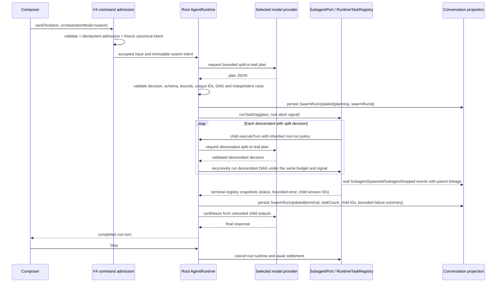

# Явный режим роя ZCode

## Назначение

Сделать рой доступным по явному выбору пользователя в обычном Composer. Режим должен запускать ZCode-owned subagent runtime независимо от того, умеет ли выбранный provider передавать ZCode tool schemas. Обычная отправка остаётся обычной отправкой; один раз включённый режим относится только к одной принятой отправке.

OpenCode CLI особенно важен: его SDK исполняет собственные инструменты и игнорирует клиентские tool definitions. Поэтому системная подсказка «вызови Agent» не является запуском ZCode-агентов. В режиме роя ZCode runtime сам принимает план и вызывает свой `SubagentPort`; OpenCode остаётся выбранной моделью планирования, выполнения дочерних задач и синтеза.

## Владелец состояния и контракт

- Composer показывает одноразовый режим **Рой** рядом с обычной отправкой. Состояние включения принадлежит только текущему черновику и сбрасывается после принятия отправки или очистки черновика.
- Renderer передаёт строго типизированный `orchestrationMode: "swarm"` в `sendText`; отсутствие поля означает обычный режим. Команда вместе с mode проходит тот же admission, idempotency и очередь, что и текст. Renderer не запускает дочерние сессии и не дублирует статус runtime.
- CLI сохраняет режим в canonical input intent. Принятый режим не может измениться после admission; queued/replayed input сохраняет исходный режим.
- Core runtime является единственным владельцем планирования и запуска. Для swarm intent runtime получает bounded plan у выбранной модели, валидирует его по runtime-схеме, затем запускает узлы через существующий `SubagentPort.runTaskDag`. Нормальный provider tool-call не требуется. Каждый descendant получает внутреннюю root-run policy, поэтому дочерний runtime может запросить такое же разбиение, включая при OpenCode CLI.
- Root и descendant planner используют общий `generateWorkspaceText`; каждый синтетический model request обязан передавать текущий `workingDirectory` runtime в `ModelInvocationContext`. Это необходимо локальным провайдерам OpenCode CLI; fallback к cwd процесса запрещён.
- `orchestrationMode: "swarm"` допустим только для маршрута ZCode. Команда `executionRoute.kind === "opencode-acp"` передаёт весь turn отдельному ACP runtime и не вызывает ZCode `SubagentPort`, поэтому сочетание ACP + swarm отклоняется при разборе команды и canonical intent; оно не должно молча терять флаг или запускаться как обычное ACP-сообщение.
- Решение планировщика имеет вид `split` с минимум двумя независимыми узлами или `leaf` с причиной. Root в явном режиме `Рой` обязан вернуть `split`; root `leaf` завершается понятным отказом до обычного выполнения. Дочерний `leaf` выполняет обычную задачу, а дочерний `split` рекурсивно вызывает core planner и создаёт собственные дочерние сессии.
- Планировщик и дочерние задачи используют принятую модель Selection вместе с выбранными `ModelOptions`, если профиль агента явно не задаёт поддерживаемый override. Это обязательно для провайдеров, которые требуют reasoning level: planner не должен терять опции, когда формирует Selection из активного runtime model. OpenCode CLI не читает секреты и не получает обход rate limits; его штатные ошибки показываются как ошибки provider.
- Дочерние результаты являются недоверенным содержимым. Core добавляет их в контекст синтеза, но не трактует их текст, утверждения о проверках или receipts как доказательство.
- Искусственного лимита глубины нет. Каждый planner call и descendant разделяют `rootRunId`, deadline, token budget, active-task quota и abort signal. Действующие пределы registry остаются общими для всего дерева: максимум 24 активных subagent work items на root session; root-run budget по умолчанию — 2 часа и 500 000 токенов. При исчерпании budget новые задачи не принимаются, всё дерево отменяется, root получает видимый terminal failure; обычного fallback не происходит. Ожидающий foreground parent передаёт worker slot своему foreground child, поэтому глубина сама по себе не расходует concurrency quota.
- Core не выдумывает `ModelToolCall`: этот факт означает, что именно provider запросил инструмент, и его нельзя использовать для прямого runtime dispatch. Для явного режима core публикует собственные durable `SwarmRunUpdated` события с `swarmRunId` и фазой `planning`/`running`/`completed`/`failed`/`cancelled`; реальные `SubagentSpawned`/`SubagentStopped` остаются отдельными фактами и дочерними строками.
- Timeline показывает отдельную строку роя со статусом и фактическими child session IDs, а дочерние сессии остаются раскрываемыми строками. Связь строится по `swarmRunId`, не по синтетическому `parentToolCallId`.
- При ошибке дочерних задач root берёт terminal snapshots и причины из единственного `RuntimeTaskRegistry`, записывает прямые child session IDs в terminal `SwarmRunUpdated` и показывает ограниченную сводку ошибок в строке роя и ошибке turn. Сводка не включает успешные отчёты, prompts или полный tool output. Registry и дочерние lifecycle events остаются источниками истины для полного разбора.
- Root turn остаётся владельцем приёма, отмены и синтеза. `Stop` отменяет весь root subtree через существующий registry; результат не публикуется до terminal-состояний принятых ветвей.

## Порядок событий

## Приёмочные сценарии

| ID       | Сценарий                                                                                | Ожидаемый результат                                                                                                                                                        |
| -------- | --------------------------------------------------------------------------------------- | -------------------------------------------------------------------------------------------------------------------------------------------------------------------------- |
| SWARM-01 | Обычная отправка без режима                                                             | Остаётся обычным turn; swarm planner и `runTaskDag` не вызываются.                                                                                                         |
| SWARM-02 | Пользователь включает **Рой** и отправляет задачу, которая делится на независимые ветки | Intent проходит `sendText` admission; runtime делает bounded plan call и до окончания любого child запускает минимум два независимых child через `SubagentPort`.           |
| SWARM-03 | Выбран OpenCode CLI; OpenCode SDK игнорирует custom tool schemas                        | Runtime-owned планирование всё равно создаёт ZCode child sessions; доказательство — реальные Agent events и terminal children, не ответ модели.                            |
| SWARM-04 | Root plan имеет ошибочную схему, цикл, дубликаты, одну ветку или превышает пределы      | До запуска узлов возвращается typed видимая ошибка; нет молчаливого fallback к обычному ответу.                                                                            |
| SWARM-05 | Child выдаёт `split`, grandchild выдаёт `leaf`                                          | Создаются реальные child и grandchild sessions с тем же `rootRunId`, точной parent lineage и без выдуманного provider tool-call.                                           |
| SWARM-06 | План содержит корректный DAG зависимостей                                               | В DAG соблюдаются dependency ordering, общий active-work ceiling, root budget и cascade cancellation.                                                                      |
| SWARM-07 | Один узел читает fixture-файл с уникальным ожидаемым содержимым                         | Реальные ToolUse/ToolResult и child output содержат точный fixture marker; текст родителя без этой цепочки не засчитывается.                                               |
| SWARM-08 | Stop во время работы nested child                                                       | Abort достигает всех descendants; root завершает отмену только после terminal settlement дерева; поздние chunks не попадают в ленту.                                       |
| SWARM-09 | Режим включён, отправка в очередь, затем cold resume                                    | Frozen intent сохраняет режим; повторная доставка не запускает тот же root plan дважды.                                                                                    |
| SWARM-10 | На любой глубине исчерпан общий token/deadline/active-task budget                       | Новые descendants не принимаются; отмена достигает всего дерева; root сохраняет видимое failed/cancelled terminal состояние.                                               |
| SWARM-11 | Профиль/Provider не доступен для plan или child                                         | Typed failure содержит этап и причину; нет скрытого переключения модели/provider или ложного `completed`.                                                                  |
| SWARM-12 | Дочерняя задача завершается ошибкой                                                     | Root сохраняет `failed`, прямые child session IDs и bounded reason из `RuntimeTaskRegistry`; в ошибку и строку роя не попадают отчёты успешных задач и полный tool output. |

## Независимые доказательства

- Core integration: scripted provider выдаёт точный plan; проверяются admission, реальный planner request, два одновременно активных child, nested lineage, fixture `ToolUse`/`ToolResult`, синтез и terminal registry snapshots.
- Desktop E2E: пользовательский Composer toggle -> принятый command intent -> UI timeline со строкой роя и фактическими child sessions -> новое сообщение в том же чате. Отдельный Stop case доказывает каскад отмены.
- OpenCode dogfood: упакованный локальный OpenCode CLI с пользовательской авторизацией; результат принимается только при совпадении `swarmRunId`, `SubagentSpawned`, child Session IDs, terminal events и fixture output. Ответ модели сам по себе недостаточен.
- Acceptance case проверяется текущим case lifecycle; ручной/pending E2E не объявляется завершённым, пока не replayed/promoted согласно `e2e-case-lifecycle`.

## Ограничения

Режим роя координирует выполнение ZCode и не означает, что каждый provider предоставляет одинаковые инструменты или гарантирует качество естественно-языкового плана. Runtime гарантирует попытку bounded orchestration и честный отказ; семантическое достижение цели подтверждается отдельно. PRISM receipts, task text, provider output и успешный exit code одного теста не удостоверяют качество самостоятельного улучшения.
